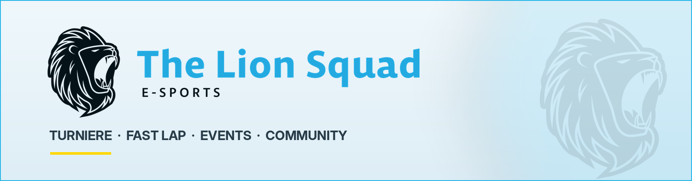
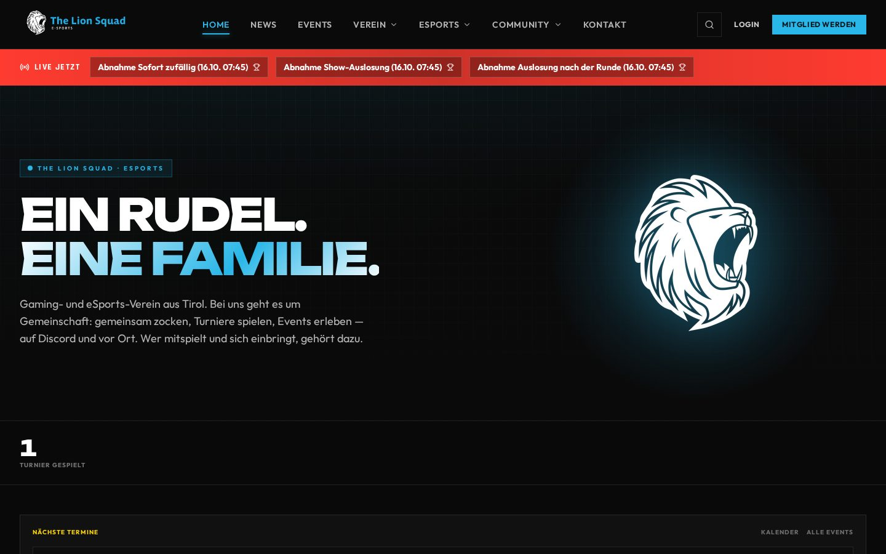
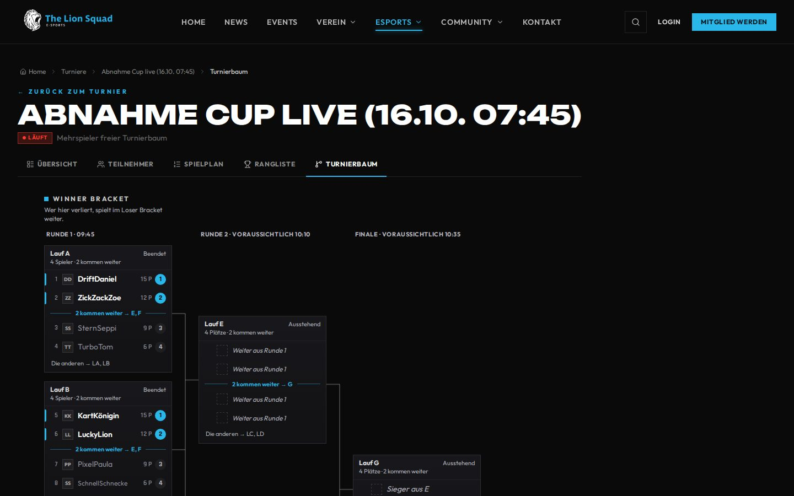
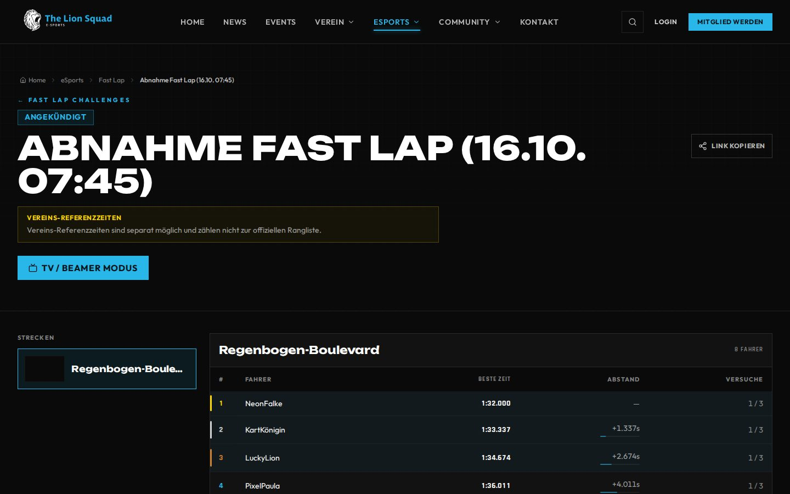
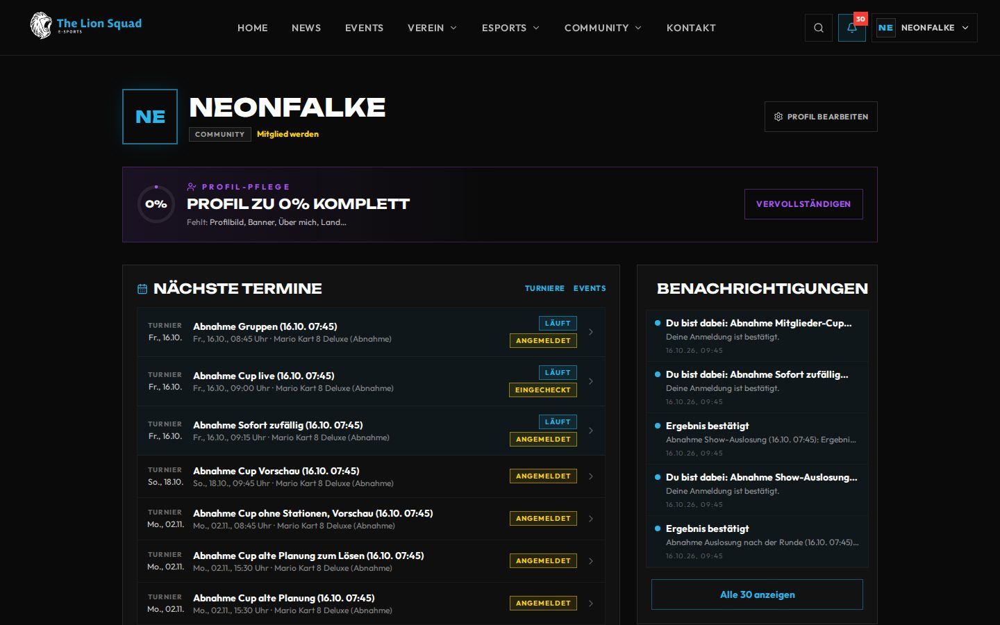
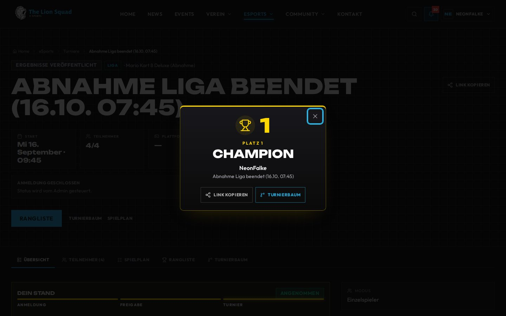
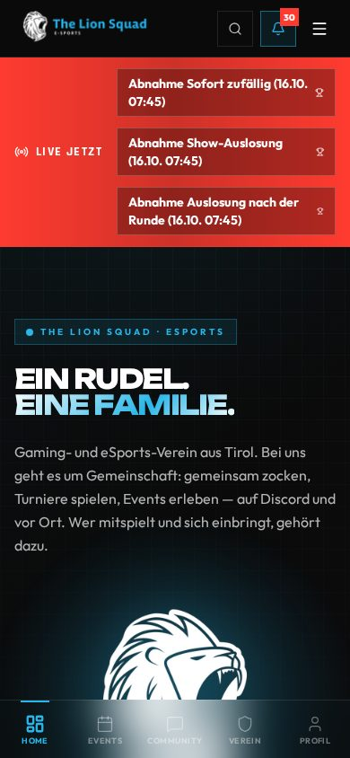
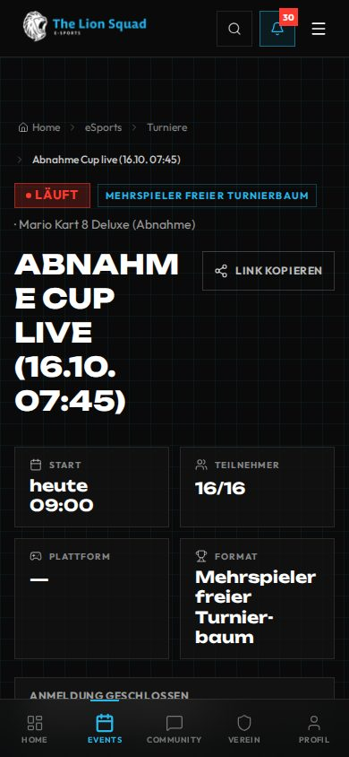

<div align="center">

<a href="https://lionsquad.at">
  <picture>
    <source media="(prefers-color-scheme: dark)" srcset="docs/assets/readme/banner-dark.png">
    
  </picture>
</a>

[](https://github.com/Tabsi1998/THE-LION_SQUAD-eSPORT-Webseite/actions/workflows/ci.yml?query=branch%3Amain)
[](https://github.com/Tabsi1998/THE-LION_SQUAD-eSPORT-Webseite/actions/workflows/codeql.yml)
[](https://lionsquad.at)
[](https://github.com/Tabsi1998/THE-LION_SQUAD-eSPORT-Webseite/releases)

[](https://github.com/Tabsi1998/THE-LION_SQUAD-eSPORT-Webseite/commits/main)
[](https://github.com/Tabsi1998/THE-LION_SQUAD-eSPORT-Webseite/issues)
[](LICENSE)


**Die selbst gehostete Vereins- und eSports-Plattform von THE LION SQUAD.**<br>
Öffentliche Website, Mitgliederbereich, Turniere, Fast Lap, Jahreswertung, Events und Verwaltung – plus die Android-App.

[**lionsquad.at**](https://lionsquad.at) · [Handbuch](docs/handbuch/README.md) · [Dokumentation](DOCS.md) · [Installation](INSTALL.md) · [Updates und Fehlerhilfe](UPDATE.md) · [Changelog](https://github.com/Tabsi1998/THE-LION_SQUAD-eSPORT-Webseite/releases)

</div>

## Was die Plattform kann

<table>
  <tr>
    <td colspan="2"></td>
  </tr>
</table>

### 🏆 Turniere und Fast Lap

Turniere online und vor Ort: K.-o., Doppel-K.-o. mit Winner und Loser Bracket, Free-for-all, Liga und Gruppen.
Vor Ort mit Check-in, Stationen, Live-Aufruf am Handy und TV-Ansicht für die Halle. Am Ende stehen Podest und
Sieger-Moment, über das Jahr die Jahreswertung. Dazu Fast Lap: Bestzeiten auf Strecken mit eigener Rangliste.

<table>
  <tr>
    <td width="50%"></td>
    <td width="50%"></td>
  </tr>
  <tr>
    <td align="center"><sub>Turnierbaum, live</sub></td>
    <td align="center"><sub>Fast Lap</sub></td>
  </tr>
</table>

### 🦁 Mitgliederbereich

Eigenes Profil mit Löwen-Rang und Erfolgen, „Mein Bereich“ mit dem nächsten Spiel und offenen Aufgaben,
Nachrichten und Chat, Galerie, Dokumente, Versammlungen und Helferdienste. Anmeldung mit Passwort, Google oder
Passkey, Zwei-Faktor für die Verwaltung.

<table>
  <tr>
    <td width="50%"></td>
    <td width="50%"></td>
  </tr>
  <tr>
    <td align="center"><sub>Mein Bereich</sub></td>
    <td align="center"><sub>Sieger-Moment nach der Liga</sub></td>
  </tr>
</table>

### 📱 LionsAPP und unterwegs

Die Website ist fürs Handy gebaut. Dazu kommt die native Android-App mit Benachrichtigungen, Turnieren und dem
Mitgliederbereich ([App-Anleitung](mobile/README.md), [Releases](https://github.com/Tabsi1998/THE-LION_SQUAD-eSPORT-Webseite/releases)).

<table>
  <tr>
    <td align="center" width="50%"></td>
    <td align="center" width="50%"></td>
  </tr>
</table>

<sub>Alle Bilder stammen aus dem Abnahme-Stand mit Testdaten, nicht von echten Mitgliedern. Sie entstehen
automatisch ([README-Bilder](.github/workflows/readme-screenshots.yml)).</sub>

---

## Stand und nächste Schritte

Offene Arbeit steht in den GitHub-Meilensteinen und -Issues. Passkeys ergänzen
Passwort und Google; [Einrichtung und Voraussetzungen](CONFIGURATION.md). Zur Website
gehört die LionsAPP für Android ([App-Anleitung](mobile/README.md)).

Grüne Prüfungen sind keine Abnahme des Produktivservers. Dazu gehören ein Praxistest,
der [Backup-/Restore-Nachweis](BACKUP_RESTORE.md) und ein sauberes [Update](UPDATE.md).

## Betrieb

Erstinstallation mit eigener `.env` nach [INSTALL.md](INSTALL.md).
Eine bestehende Installation aktualisieren:

```bash
cd /root/THE-LION_SQUAD-eSPORT-Webseite
./update.sh u
```

Bei `createUser requires authentication`, ausbleibenden Bestätigungen oder
veralteten Browseransichten zuerst die [Update-Fehlerhilfe](UPDATE.md) verwenden.
MongoDB- und Upload-Volumes enthalten die Bestandsdaten.

Eigene Google-, SMTP-/Resend-, Discord- und Twitch-Zugänge werden über die
[Betreiberkonfiguration](CONFIGURATION.md) eingerichtet. Geheimnisse gehören in
die geschützte `.env` bzw. verschlüsselte Einstellungen im Adminbereich.

## Aufbau

| Verzeichnis | Inhalt |
| --- | --- |
| `backend/` | FastAPI, MongoDB, Auth, Fachlogik und Backend-Tests |
| `frontend/` | React 19, Vite, Tailwind, Nginx und Browser-Tests |
| `mobile/` | Native Expo-App (LionsAPP) |
| `scripts/` | Update-Prüfungen, Backups, Restore und Staging |
| `.github/workflows/` | CI, CodeQL, Releases, PR-Prüfungen und weitere Automatik ([Übersicht](docs/entwicklung/github.md)) |

Die Website läuft hinter dem eigenen HTTPS-Reverse-Proxy. API-Pfad: `/api`.
Anmeldung: HttpOnly-Cookies mit CSRF-Schutz, E-Mail-Bestätigung, optionale Passkeys,
eigener Google-Login und MFA für Adminfunktionen.

## Entwicklung und Prüfungen

Backend: Python 3.11; Frontend: Node 24 und Yarn gemäß Lockfile.
Anleitungen: [Frontend](frontend/README.md),
[Leistungsbudgets](frontend/PERFORMANCE_BUDGETS.md).

```bash
python -m pytest -m "not live"
python scripts/check-doc-links.py
cd frontend
corepack yarn install --frozen-lockfile
corepack yarn test
corepack yarn build
```

Benötigte Python-Pakete stehen in `backend/requirements.txt` und
`backend/requirements-dev.txt`. Schreibende Live-Tests laufen ausschließlich auf
einem dafür vorbereiteten Teststack.

**Lokal zuerst, GitHub bestätigt.** Die [CI-Workflows](.github/workflows/ci.yml)
enthalten die verbindlichen automatischen Prüfungen. Sie laufen vor dem Push auf dem
Entwicklungsrechner. Auf GitHub startet die CI für Pull Requests, die kein Entwurf
sind, und nach jedem Merge noch einmal auf `main` – jeweils nur mit den Jobs, deren
Bereich die Änderung berührt ([Regeln](scripts/ci-changed-areas.py)). Der Geheimnis-Scan
läuft bei jeder Änderung. CodeQL läuft bei Pull Requests und Merges, die Code berühren,
und einmal die Woche. Das Repository ist öffentlich: in Issues, PRs und Doku stehen
deshalb keine Daten von Mitgliedern und keine Zugänge.

**Releases.** PR-Titel beginnen mit `feat:`, `fix:` oder einem anderen Typ nach
Conventional Commits. Daraus pflegt release-please einen Release-PR; wer ihn mergt,
bekommt Version, [GitHub-Release](https://github.com/Tabsi1998/THE-LION_SQUAD-eSPORT-Webseite/releases)
und [Changelog](CHANGELOG.md). Die App hat ihren eigenen Ablauf
([App-Releases](mobile/RELEASES.md)). Alles zu Workflows, Vorlagen und Einstellungen:
[GitHub-Automatik](docs/entwicklung/github.md).

## Lizenz

Alle Rechte vorbehalten – © 2026 IT-Tabelander (Fabian Tabelander). Ohne schriftliche Zustimmung darf der Inhalt
weder genutzt noch kopiert, verändert, weitergegeben oder selbst betrieben werden; der Verein THE LION SQUAD eSPORT
betreibt ihn mit Zustimmung. Bestandteile Dritter behalten ihre eigene Lizenz. Alles Weitere steht in
[LICENSE](LICENSE).
