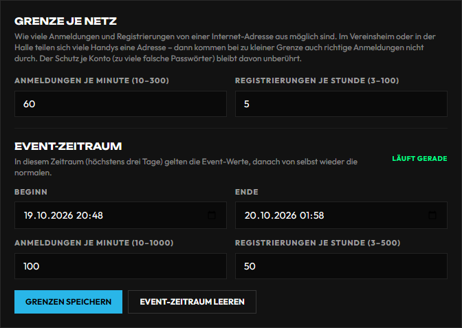

# Betrieb, Logs und Alarme

Was die Website über sich selbst festhält, wo es steht und wann sie sich meldet.

## Wo was steht

| Seite | Was | Woher |
|---|---|---|
| System → Betrieb & Logs → **Fehler** | Gruppen unbehandelter Serverfehler und Antworten mit Status 5xx (ohne Namen, Adressen, Tokens) | `ops_errors`, 30 Tage |
| System → Betrieb & Logs → **Tempo** | Anfragen über der Schwelle (Route, Dauer) | `ops_slow_requests` |
| System → Betrieb & Logs → **Vitals** | Ladezeiten aus dem Browser je Route (LCP, INP, CLS, TTFB), anonym | `ops_vitals` |
| System → Betrieb & Logs → **Checks** | Auto-Checks alle fünf Minuten: Datenbank, Speicher, Mail-Queue, Twitch, Dolibarr, Fehlergruppen, Besucher-Adresse, eindeutige Indizes, Datei-Nacharbeit; darunter die Dateien, deren Löschung scheiterte, mit „Erneut versuchen“ | `ops_check_runs`, `pending_file_cleanups` |
| System → Betrieb & Logs → **Alarme** | Wer bei welchem Ereignis eine Meldung bekommt, Sperrfrist, Testalarm, Aufbewahrung, letzte Alarme | `settings/ops_alerts`, `ops_alert_log` |
| System → Betrieb & Logs → **Überblick** | Je Quelle Zähler und Auffälligkeiten, die neuesten Probleme der letzten sieben Tage | Sammelsicht |
| System → Betrieb & Logs → **Ereignisse** | Alle Quellen in einer Liste: Serverfehler, Auto-Checks, Alarme, App-Logs, E-Mail-Versand, Mail-Queue, Adminaktionen, Uploads, Dolibarr-Abgleich, Discord-Bot – Filter nach Quelle, Schwere, Zeitraum, Text; „Als CSV“ | `GET /api/admin/ops/events` |
| System → Betrieb & Logs → **App-Logs** | Fehler und Meldungen der LionsAPP und der Website (Gerät, Version, Stufe) mit Status und Notiz; die Suche findet auch die Kennung, die Admins auf der Fehlerseite der Website sehen (#1230) | `mobile_client_logs`, 90 Tage |
| E-Mail → Mail-Queue | Wartende und fehlgeschlagene Sendungen, neu einreihen | `mail_jobs` |

Die früheren Seiten Logs, Audit Logs, App-Logs und Versandlogs leiten auf die passenden Reiter um
(`/admin/logs` → Ereignisse, `/admin/audit` → Ereignisse mit Quelle Adminaktionen, `/admin/mobile-logs`
→ App-Logs, `/admin/settings/mail-logs` → Ereignisse mit Quelle E-Mail).

## Besucher-Adresse: sieht der Server die Besucher oder nur den Proxy? (#941)

Die Prüfung „Besucher-Adresse“ unter Checks liest die Sitzungen der letzten 24 Stunden. Kommen alle von
einer einzigen Adresse oder nur aus privaten Netzen bzw. denen von Cloudflare, steht sie auf Gelb: der
Server sieht dann den Proxy statt der Besucher, und jede Bremse je Adresse (Registrierung fünfmal je
Stunde, Passwort vergessen, Zwei-Faktor) gilt für alle gemeinsam. In der Sitzungsliste im Profil steht
in dem Fall bei jedem Gerät dieselbe Adresse.

So wird es richtig, wenn der Nginx Proxy Manager auf einem anderen Rechner läuft:

1. Server-`.env`: `TRUSTED_PROXY_CIDRS` um die Adresse des Proxy-Rechners ergänzen
   (`…,172.16.0.0/12,<Adresse des Proxys>/32`), danach `docker compose up -d backend`.
2. Nur mit Cloudflare davor (orange Wolke): Proxy Manager → Host → Advanced →
   `real_ip_header CF-Connecting-IP;` und je Netz von Cloudflare eine Zeile `set_real_ip_from …;`
   (Liste: cloudflare.com/ips). Mit grauer Wolke braucht es den Block nicht.

Gelb ist kein Fehler, wenn an dem Tag wirklich alle im selben Netz waren, etwa am Vereinsabend.
Cloudflare lässt je Anfrage höchstens 100 MB durch – größere Uploads enden mit 413, egal was im Proxy
Manager eingestellt ist (Ausweg: der Upload-Host ohne Cloudflare, siehe unten).

## Anmelde-Grenze je Netz für Events (#1802)

Von einer Internet-Adresse aus sind höchstens **30 Anmeldungen je Minute** und **5 Registrierungen je
Stunde** möglich (Web und App zusammen). Im Hallen- oder Vereins-WLAN teilen sich alle Handys eine
öffentliche Adresse; beim Einlass kommen dann auch richtige Anmeldungen nicht durch. Betroffene lesen
„Zu viele Anmeldungen aus diesem Netz. Bitte versuche es in … erneut.“ – nach spätestens einer Minute
(Registrierung: einer Stunde) geht es wieder.

Einstellen unter **Admin → System → Zugang → Grenze je Netz** (nur Superadmin):



| Feld | Vorgabe | Erlaubt | Wofür |
| --- | --- | --- | --- |
| Anmeldungen je Minute | 30 | 10–300 | Alltag |
| Registrierungen je Stunde | 5 | 3–100 | Alltag |
| Event-Zeitraum Beginn/Ende | leer | höchstens drei Tage | Nur in diesem Zeitraum gelten die Event-Werte, danach von selbst wieder die normalen |
| Event: Anmeldungen je Minute | 150 | 10–1000 | Einlass, Turnierstart |
| Event: Registrierungen je Stunde | 50 | 3–500 | Anmeldung vor Ort |

**Vor einem Event:** Beginn eine Stunde vor Einlass, Ende nach dem letzten Programmpunkt eintragen,
**Grenzen speichern**. Solange der Zeitraum läuft, steht oben rechts „Läuft gerade“. Richtwert für
Anmeldungen je Minute: etwa so viele, wie in den ersten zehn Minuten gleichzeitig ankommen; höher
als nötig bringt nichts. Wer in der Minute schon einmal angemeldet ist, braucht keine weitere Anmeldung.

**Wann erhöhen:** Melden am Einlass mehrere Leute die Meldung „aus diesem Netz“, oder ist die Anmeldung
vor Ort über QR-Code geplant. Für einen Vereinsabend reicht meist die Vorgabe.

**Was gleich bleibt:** Der Schutz je Konto – nach sieben falschen Passwörtern für dieselbe E-Mail sind
15 Minuten Pause – hängt nicht an diesen Werten und lässt sich nicht lockern. Die Grenzen stehen nur
in der Verwaltung, nicht auf der öffentlichen Seite.

Zählt der Server alle Besucher als eine Adresse (Prüfung „Besucher-Adresse“ oben auf Gelb), gilt die
Grenze für alle gemeinsam – dann zuerst den Proxy richtig einstellen, nicht die Grenze hochdrehen.

## Eindeutige Indizes und Altdubletten (#930, #1043)

Einige Sammlungen dürfen je Schlüssel nur eine Zeile haben (etwa XP je Konto, Discord-Aktivität je Person und
Tag). Liegen beim Start schon alte Dubletten vor, scheitert der eindeutige Index; der Server startet trotzdem mit
einem gewöhnlichen, und die Prüfung „Eindeutige Indizes“ unter Checks steht auf Gelb und nennt den Index. Gelöscht
wird dabei nie etwas – bereinigt wird bewusst, im Backend-Container:

1. Sicherung ziehen (`BACKUP_RESTORE.md`).
2. Trockenlauf, ändert nichts:
   `docker compose exec backend python scripts/unique_index_duplicates.py`
   Er nennt je Index die Zahl der Gruppen und der überzähligen Zeilen und die Regel. Schlüssel nennt er nicht.
3. Bereinigen mit Protokoll:
   `docker compose exec -T backend python scripts/unique_index_duplicates.py --anwenden --wer "Name" > dubletten-protokoll.json`
   Je Gruppe bleibt die älteste Zeile (die liest und beschreibt die Anwendung); bei Plattform-Verknüpfungen je
   Person die zuletzt verknüpfte, wie beim Start. Danach legt das Werkzeug den eindeutigen Index gleich an. Die
   Datei enthält jede entfernte Zeile und taugt zum Zurückspielen; sie enthält Kennungen von Personen – nach der
   Prüfung löschen. Bei laufendem Betrieb möglich, besser in ruhiger Zeit: Gelöscht wird je Zeile und nur, wenn
   sie noch genau so aussieht wie beim Suchen; eine inzwischen geänderte Zeile bleibt und steht unter `skipped`
   (dann später noch einmal). Ins Adminprotokoll kommen nur die Zahlen (`ops.unique_duplicates.apply`). Mit
   `--nur sammlung.index` (mehrfach möglich) nur einzelne Indizes.
4. Unter Checks „Jetzt prüfen“: die Prüfung ist grün.

Zwei Indizes bereinigt das Werkzeug nie, es meldet sie mit „HAND“: dasselbe fremde Konto bei mehreren Personen
(`platform_links.platform_external`) und mehrere Rechnungsaufträge für dieselbe Buchung
(`billing_orders.booking_key`). Dort entscheidet ein Mensch, was gilt.

## Datei-Nacharbeit (#1046)

Scheitert beim Löschen eines Kontos oder in der Mediathek das Löschen einer Datei (Rechte, Sperre), läuft die
Löschung trotzdem durch; die Datei steht als Eintrag in `pending_file_cleanups`. Der stündliche Job
`erasure_file_cleanup` versucht es erneut – nach einer, zwei, vier … Stunden, höchstens einem Tag Abstand. Nach
acht Versuchen gibt er auf; jeder Fehler zählt als Versuch, auch einer außerhalb der Datei selbst. Die Prüfung
„Datei-Nacharbeit“ steht bei offenen Einträgen auf Gelb, bei aufgegebenen auf Rot (mit Alarm). Unter Checks stehen
die Einträge mit Datei, Versuchen und Fehlerart (Klasse und Code, etwa `PermissionError EACCES`); Log und Eintrag
nennen weder Pfad noch Konto, ältere Einträge werden beim Anzeigen entsprechend gekürzt. Nach dem Beheben am Server (meist die Rechte am Upload-Volume) „Erneut versuchen“: Das gibt
aufgegebenen Einträgen eine neue Runde und versucht alles Offene sofort. Was schon weg ist, gilt als gelöscht; was
inzwischen wieder verwendet wird, bleibt.

## Alarme (#517)

Unter **System → Betrieb & Logs → Alarme** legt der Admin je Ereignisart fest, ob eine Meldung per **Discord**
(der Bot schickt in den Betriebskanal – ein privater Kanal nur für den Vorstand, gewählt unter Verbindungen → Discord; Bot aus = kein Alarm)
und/oder per **E-Mail** an die eingetragenen Empfänger geht.

| Ereignis | Wann |
|---|---|
| Auto-Check rot | eine der Prüfungen steht auf rot |
| Serverfehler (5xx) | eine neue Fehlergruppe |
| Mail nicht zustellbar | eine Mail ist nach allen Versuchen endgültig fehlgeschlagen – nur per Discord, eine Mail darüber käme ja nicht an |
| Hintergrundjob abgebrochen | ein Job des Schedulers (Abgleich, Erinnerungen, Versand …) bricht mit einem Fehler ab |
| Dolibarr-Abgleich rot | der Abgleich mit der Mitgliederverwaltung schlägt fehl (nicht erreichbar, Schlüssel, Antwort) |
| Discord-Bot offline | der Bot ist eingeschaltet, kommt aber nicht mehr auf den Server |
| App: kritischer Fehler | die LionsAPP meldet einen kritischen Fehler (Absturz, Login, Push) |

Vorgabe: Discord an, E-Mail aus. **Sperrfrist:** je Schlüssel (eine Prüfung, eine Fehlergruppe, ein Job,
ein App-Fingerabdruck) meldet die Website höchstens einmal je Frist (Vorgabe 60 Minuten) – ein
Dauerfehler flutet keinen Kanal. Der **Testalarm** geht alle Wege, die irgendeine Regel nutzt, ohne
Sperrfrist. Jede Meldung steht unter „Letzte Alarme“, auch wenn kein Weg eingerichtet war.

Alarme tragen nie Nutzdaten: keine Namen, keine vollständigen E-Mail-Adressen, keine Tokens – nur
Ereignis, Route, Fehlerart und Zähler.

## Aufbewahrung

- Versandlogs: 90 Tage (einstellbar unter Alarme, 7 Tage bis 10 Jahre)
- Adminaktionen: 2 Jahre (einstellbar)
- App-Logs 90 Tage, Fehlergruppen 30 Tage, Tempo-Messungen und Upload-Ereignisse: feste Frist, räumt die Datenbank selbst
- Alarm-Verlauf: 1 Jahr

Der Job `ops_retention` läuft einmal am Tag.

## Live-Updates (SSE)

Web- und TV-Ansichten bekommen Aktualisierungen über `/api/changes/stream` (Server-Sent Events):

- Am Reverse Proxy für genau diese Route Puffer und Cache aus, lange Lese-/Sendezeiten,
  `Last-Event-ID` unverändert weiterreichen.
- Das Backend läuft bewusst mit **einem** Uvicorn-Worker (`backend/docker-entrypoint.py` erzwingt
  `--workers 1`): Puffer und Abonnenten liegen im Prozess. Mehrere Worker bräuchten zuerst einen
  gemeinsamen Event-Bus.
- Gäste bekommen nur geschwärzte Signale, rohe Admin-Pfade nur angemeldetes Personal. Nach einem
  Neustart fordert ein `reset`-Event einen vollständigen Neuabruf an.
- Eine Änderung an einem öffentlichen Turnier (in einem öffentlichen Event oder ohne Event) nennt
  `tournament_id` und `parent_event_id` (#1801): Seiten eines Turniers laden dann nur bei seinen
  Änderungen nach, Seiten mit Stationen auch bei denen der anderen Turniere desselben Events.
  Eine Station nennt ihr Turnier oder - hängt sie nur am Event - ihr Event. Meldungen ohne Kennung
  (Turniere nur für Mitglieder, neue oder geänderte Stationen) laden überall nach - wie vorher.
  Turnier und Event werden je Turnier, Spiel und Station 45 Sekunden zwischengespeichert; jede
  Änderung an Event-Zuordnung (auch im Programm des Events), Sichtbarkeit oder Status leert den
  Speicher sofort.

## Uploads und der Upload-Host ohne Cloudflare

Uploads brauchen ein dauerhaftes Docker-Volume, ein beschreibbares Upload-Verzeichnis und ein großes
Upload-Limit am Reverse Proxy. Richtwerte:

```env
UPLOAD_DIR=/app/backend/uploads
MAX_IMAGE_UPLOAD_MB=50
MAX_VIDEO_UPLOAD_MB=1536
MAX_ORIGINAL_UPLOAD_MB=1536
MAX_DOCUMENT_UPLOAD_MB=50
PROXY_UPLOAD_LIMIT_MB=1700
PUBLIC_UPLOAD_BACKEND_URL=https://upload.lionsquad.at
```

Cloudflare lässt je Anfrage höchstens 100 MB durch. Große Uploads laufen deshalb über eine Subdomain
**ohne** Cloudflare-Proxy (graue Wolke), z. B. `upload.lionsquad.at`, die im Nginx Proxy Manager auf
denselben Upstream zeigt, mit:

```nginx
client_max_body_size 2048m;
client_body_timeout 3600s;
proxy_connect_timeout 300s;
proxy_send_timeout 3600s;
proxy_read_timeout 3600s;
send_timeout 3600s;
proxy_request_buffering off;
proxy_buffering off;
proxy_max_temp_file_size 0;
```

Keine aggressive Cache-Regel auf `/api/uploads/*`.

## Suchmaschinen und Search Console

Welche Pfade indexiert, privat, umgeleitet oder entfernt sind, steht in
[`PUBLIC_ROUTE_INVENTORY.md`](../PUBLIC_ROUTE_INVENTORY.md); `301`/`410` entscheidet das Frontend-Nginx.
Nach Änderungen an SEO oder Routen:

```bash
curl -fsS https://lionsquad.at/sitemap.xml | head
curl -fsS https://lionsquad.at/robots.txt
curl -I -A "Googlebot" "https://lionsquad.at/u/beispiel"
```

Danach in der Google Search Console die betroffenen Adressen prüfen („Fehlerbehebung validieren“).
Sichtbare Suchergebnisse ziehen oft erst nach Tagen nach.

Öffentlichen Inhalt im echten Browser prüfen (Sitemap-Crawl, meldet Platzhalter, kaputte Bilder,
Browser- und HTTP-Fehler) – manuell nach Deployments, nie als CI-Schritt gegen die Live-Seite:

```bash
cd frontend
yarn audit:public
```

Das interne Nginx setzt je HTML-Antwort eine CSP-Nonce; JSON-LD, SEO-Vorschauen und Cloudflares
JavaScript-Erkennung nutzen dieselbe Nonce, `script-src` braucht kein `unsafe-inline`.

## Docker-Build-Kontext (#1050)

`backend/.dockerignore` und `frontend/.dockerignore` begrenzen, was `docker compose build` an Docker
schickt. Raus bleiben Tests, `node_modules`, `venv`, `uploads`, `.env*`, Schlüssel- und Zugangsdateien,
Build- und Testausgaben. Im Backend-Image bleiben `scripts/`, `static/` und `docker-entrypoint.py`.

Wer zur Laufzeit (Backend) oder im Build (Frontend) eine neue Datei im Image braucht, muss sie aus der
jeweiligen `.dockerignore` herausnehmen, sonst fehlt sie im Image. Prüfen:

```bash
docker compose build
docker compose exec backend ls scripts static
```

## Betriebsskripte im Backend-Container (#1583)

Skripte, die im laufenden Container gebraucht werden, liegen in `backend/scripts/` (nur das kommt ins
Backend-Image, die Skripte im Repo-Ordner `scripts/` nicht). Aufruf immer aus dem Container:

```bash
docker compose exec backend python3 scripts/media-report.py
docker compose exec backend python3 scripts/uploads-inventory.py > /tmp/upload-inventar.md
docker compose exec backend python scripts/unique_index_duplicates.py
```

Alle drei lesen nur (Dubletten-Skript: ohne `--anwenden`).

## Betriebsskripte im Backend-Container (#1583)

Skripte, die im laufenden Container gebraucht werden, liegen in `backend/scripts/` (nur das kommt ins
Backend-Image, die Skripte im Repo-Ordner `scripts/` nicht). Aufruf immer aus dem Container:

```bash
docker compose exec backend python3 scripts/media-report.py
docker compose exec backend python3 scripts/uploads-inventory.py > /tmp/upload-inventar.md
docker compose exec backend python scripts/unique_index_duplicates.py
```

Alle drei lesen nur (das Dubletten-Skript ohne `--anwenden`).

## Externe Überwachung

Ein Uptime-Dienst prüft mindestens jede Minute `https://lionsquad.at/api/health/live`,
`/api/health/ready` und `/health` und meldet sich nach zwei bis drei Fehlern in Folge. Dazu
Speicherplatz (Warnung 80 %, kritisch 90 %), Docker-Neustarts und die Backup-Timer im Blick behalten:

```bash
docker compose ps
docker compose logs --since 7d backend | tail -n 200
systemctl list-timers 'tls-*'
journalctl -u tls-backup.service --since '7 days ago'
```

## Wenn etwas passiert ist

1. Auswirkungen begrenzen: betroffene Integration oder Konto sperren.
2. Zeitpunkte, Logs und betroffene Daten sichern – Logs nie öffentlich teilen.
3. Zugangsdaten rotieren, Sitzungen widerrufen.
4. Aus dem Backup nur nach bestandenem Restore-Check wiederherstellen ([`BACKUP_RESTORE.md`](../BACKUP_RESTORE.md)).
5. Datenschutz einbeziehen, gesetzliche Meldefristen prüfen.
6. Ursache, Maßnahmen und Nachkontrolle intern festhalten.

Niemals ohne Absicht `docker compose down -v` – das löscht die Volumes.
