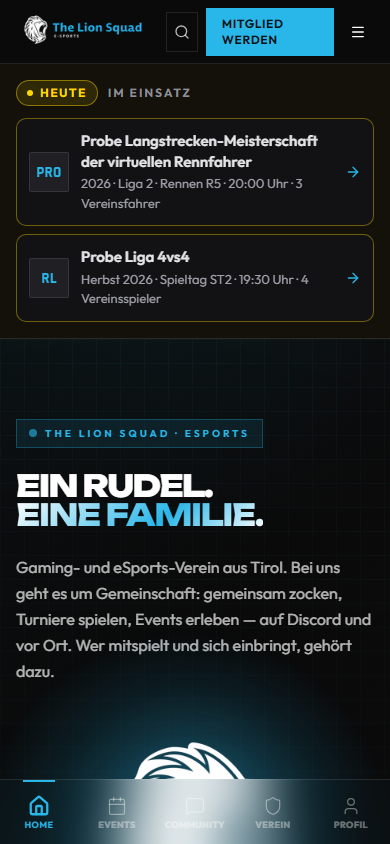

# Auftritt und Einstellungen – Handbuch

Wie die Website nach außen aussieht und was ihr dafür einstellt: Logo und Bilder, Akzentfarbe, die rechtlichen Seiten,
der Cookie-Hinweis, die Jahreszeiten-Deko, der Adventkalender, die Ostereiersuche und was auf der Startseite steht.

**Wo im Admin:**

- **Admin → Auftritt → Branding** (`/admin/settings/branding`) – Name, Farbe, Logos, Favicon, Maskottchen,
  Teilen-Banner, App-Links, Hinweisleisten
- **Admin → Verein → Vereinsdaten** (`/admin/club`) – Impressum, Datenschutz, Nutzungsbedingungen
- **Admin → Auftritt → Jahreszeiten** (`/admin/settings/jahreszeiten`) – Deko nach Datum, Wetter, Kalender
- **Admin → Content → Adventkalender** (`/admin/advent`)
- **Admin → Content → Ostereiersuche** (`/admin/ostern`)
- Weitere Seiten, die zum Auftritt gehören: **Admin → Auftritt → Socials** (eure Kanäle und Links), **Admin → Auftritt
  → SEO & Analytics** (Suchmaschinen), **Admin → Verein → Über uns**, **News**, **Sponsoren**, **Vorstand**

Die Einstellungen unter **Auftritt** und **Vereinsdaten** darf der Bereich **System** ändern, Adventkalender und
Ostereiersuche der Bereich **Content** oder **Verein**.

---

## Inhalt

1. [Überblick: was alles geht](#1-überblick-was-alles-geht)
2. [Einrichten Schritt für Schritt](#2-einrichten-schritt-für-schritt)
3. [Die Funktionen einzeln](#3-die-funktionen-einzeln)
4. [Wenn etwas nicht klappt](#4-wenn-etwas-nicht-klappt)
5. [Häufige Fragen](#5-häufige-fragen)

---

## 1. Überblick: was alles geht

| Funktion | Was passiert | Einstellen unter |
| --- | --- | --- |
| **Branding** | Vereinsname, Tagline, Browsertitel, Beschreibung, Logos, Favicon, Maskottchen, Teilen-Banner, QR-Logo, App-Links | Admin → Auftritt → Branding |
| **Akzentfarbe** | Eine Farbe als HEX-Wert (Standard `#29B6E8`) | Admin → Auftritt → Branding |
| **Hinweisleisten** | Schmale Banner mit Text, Zeitraum und Zielgruppe, auf der Website und in der App | Admin → Auftritt → Branding, Abschnitt „Banner-Manager“ |
| **Rechtliches** | Impressum, Datenschutz, Nutzungsbedingungen aus euren Vereinsdaten | Admin → Verein → Vereinsdaten |
| **Cookie-Hinweis** | Besucher wählen, was erlaubt ist; die Wahl gilt sechs Monate | fest eingebaut, keine Einstellung im Admin |
| **Jahreszeiten** | Deko nach Datum: Halloween, Advent, Schnee, Weihnachten, Silvester, Fasching, Vereinsgeburtstag, Ostern, dazu das Wetter | Admin → Auftritt → Jahreszeiten |
| **Adventkalender** | 24 Türchen mit Text, Bild, Video, Quiz, Verlosung und mehr | Admin → Content → Adventkalender |
| **Ostereiersuche** | Versteckte Eier auf Website und in der App, mit Preisen | Admin → Content → Ostereiersuche |
| **Startseite** | Setzt sich aus euren News, Terminen, Sponsoren, Vorstand und Zahlen zusammen | die Seiten dahinter, siehe 3.8 |

---

## 2. Einrichten Schritt für Schritt

Für eine neue Website in dieser Reihenfolge:

1. **Branding:** Admin → Auftritt → Branding. Vereinsname, Tagline, Akzentfarbe, Logos (3.1), **Speichern**.
2. **Vereinsdaten:** Admin → Verein → Vereinsdaten. Name, ZVR-Zahl, Anschrift, Vertretung, Datenschutz-E-Mail,
   **Rechtliches speichern** (3.3). Ohne diese Daten sind Impressum und Datenschutz leer.
3. **Jahreszeiten:** Admin → Auftritt → Jahreszeiten. Vereinsort für das Wetter, dann je Saison an oder aus (3.5).
4. **Inhalte für die Startseite:** News, Sponsoren, Vorstand und Über-uns-Zahlen pflegen (3.8).
5. Im Herbst den **Adventkalender** vorbereiten (3.6), im Frühling die **Ostereiersuche** (3.7).

---

## 3. Die Funktionen einzeln

### 3.1 Branding: Logo und Bilder

**Admin → Auftritt → Branding.** Oben die Textfelder, darunter die Bilder, ganz unten **Speichern**.

| Feld | Wofür |
| --- | --- |
| **Vereinsname**, **Tagline** | Überall, wo der Name steht |
| **Website-/Browsertitel** | Der Titel im Browser-Tab (Standard „THE LION SQUAD - eSPORTS“) |
| **SEO Beschreibung** | Der Text unter dem Treffer in Suchmaschinen |
| **Akzentfarbe (HEX)** | siehe 3.2 |
| **Domain**, **Zeitzone**, **Kontakt E-Mail** | Grunddaten der Website |
| **Countdown ab … Tagen vorher** | Ab wann die Website bei Terminen zählt („in 13 Tagen“, am Vortag „morgen 14:00“, am Tag selbst „heute 14:00“ bzw. „in 45 Minuten“). Davor steht bis 60 Tage das Datum („Sa 14. November“), noch weiter weg nur der Monat („im März“). Der große Countdown auf der Startseite erscheint nur innerhalb dieser Tage. Leer = 14 Tage, erlaubt 1 bis 60 |
| **Standard-Logo** | Das Logo, wenn nichts Spezielleres hinterlegt ist |
| **Logo auf dunklem Hintergrund** / **auf hellem Hintergrund** | Zwei Fassungen für dunkle und helle Flächen |
| **Standard SEO-/Teilen-Banner** | Das Bild, das beim Teilen eines Links erscheint, wenn die Seite kein eigenes Bild hat |
| **Maskottchen** | Der Löwe als Zweitbild und Rückfall für das Logo |
| **QR-Logo** | Das Bild in der Mitte der QR-Codes (sonst das Maskottchen) |
| **Standard-Favicon**, **Favicon für hellen Modus**, **Favicon für dunklen Modus** | Das kleine Symbol im Browser-Tab |
| **Play-Store-Link (LionsAPP)**, **App-Store-Link (LionsAPP, iOS)** | Erst eintragen, wenn die App dort öffentlich ist. Dann zeigen Fußzeile und Startseite die Abzeichen. Ohne Link steht im Fuß „bald im App Store“ |

**Bilder immer als PNG** (oder JPG/WebP) hochladen – **keine SVG**. Der Upload erlaubt nur PNG, JPG und WebP; die
maximale Größe steht unter dem Feld. Für Logos nehmt ihr am besten PNG mit transparentem Hintergrund, groß genug
(mindestens 512 × 512 Pixel), damit es auf dem Handy scharf bleibt. Ein Bild könnt ihr neu hochladen oder aus den schon
hochgeladenen Medien wählen (Verwaltung unter **Admin → Content → Medien**).

**Favicon aus dem Logo erzeugen:** Der Knopf **Aus Logo und Akzentfarbe erzeugen** macht ein Standard-Favicon: das weiße
Logo auf einem Kreis in der Akzentfarbe. Das lohnt sich, wenn ihr nur ein Favicon für dunklen Modus habt, das auf
hellen Tableisten unsichtbar wäre (dann warnt die Seite gelb).

**Hinweisleisten** (Abschnitt „Banner-Manager“): **Neuer Banner**, dann **Interner Titel**, **Text**, **Stil** (Info,
Live, Warnung, Erfolg), **Design** (Neon, Signal, Minimal), **Animation** (Lauftext oder Statisch), **Position**
(Unter Navigation, Unten fixiert, Über Footer), **Zielgruppe** (Alle Besucher, Eingeloggt, Vereinsmitglieder, Admins),
**Läuft auf** (Website und/oder App), **Anzeigen ab/bis** und optional ein **Link**. Eine Vorschau zeigt den
Banner. **Banner erstellen** speichert, mit **Edit** ändert ihr einen.

### 3.2 Farben und Schriften

- **Akzentfarbe:** Ein HEX-Wert wie `#29B6E8`. Sie bestimmt die Farbe der Browser-Leiste am Handy, die Mitte der
  QR-Codes und das erzeugte Favicon. Die Farben der Website selbst (dunkler Grund, Blau, Gold) sind fest im Design und
  nicht über das Admin änderbar.
- **Schriften:** Die Website nutzt drei feste Schriften – **Unbounded** (Überschriften), **Outfit** (Text) und
  **Rajdhani** (Zahlen). Sie liegen auf eurem eigenen Server, es gibt also keine Anfrage bei Google (gut für den
  Datenschutz). Es gibt keinen Schalter, um die Schriften zu tauschen.

### 3.3 Rechtliches

**Admin → Verein → Vereinsdaten.** Das ist die **eine Stelle** für Impressum, Datenschutz und Nutzungsbedingungen. Die
Seiten **/imprint**, **/privacy** und **/terms** (in der Fußzeile: Impressum, Datenschutz, Nutzungsbedingungen) und die
Kontaktseite lesen von hier.

Ausfüllen:

- **Rechtlicher Vereinsname**, **ZVR-Zahl**, **Rechtsform**, **Vereinssitz**
- **Strasse und Hausnummer**, **Adresszusatz**, **PLZ**, **Ort**, **Bundesland**, **Land**
- **Vereinsbehoerde**, **Telefon**, **Vertretungsbefugte Person** mit **Funktion**
- **Inhaltlich verantwortlich**, **Datenschutz E-Mail**
- **Hosting / Betreiber**, **Hosting-Region**, **UID-Nummer** (falls vorhanden), **Turnierbedingungen URL**
- Der Haken **Preisturniere oder Turniere mit Startgeld können stattfinden**
- Zusatztexte: **Zusätzliche rechtliche Hinweise**, **Zusätzliche Datenschutzhinweise**, **Ergänzende
  Nutzungsbedingungen** (alle optional)

Mit **Rechtliches speichern** wird gespeichert. Es werden nur die Felder gesendet, die ihr geändert habt. „Keine
Änderungen zum Speichern“ heißt: nichts ist anders als vorher.

**Aus Dolibarr übernehmen:** Ist Dolibarr angebunden, kann die Seite Name, ZVR, Behörde, Anschrift, Telefon und die
vertretungsbefugte Person aus dem Vereinsmodul holen (stündlich nachgelesen). Den Schalter findet ihr unter **Admin →
Mitglieder → Dolibarr → Funktionen**; die Seite verlinkt ihn mit „Schalter: Dolibarr → Funktionen →“. Die übernommenen
Felder sind dann gesperrt mit dem Vermerk „aus Dolibarr“. **Datenschutz-E-Mail, inhaltlich Verantwortlicher, Hosting,
UID und Zusatztexte** bleiben immer bei euch. Mit **Jetzt nachlesen** holt ihr den Stand sofort. Mehr dazu im
[Dolibarr-Kapitel](../DOLIBARR.md).

**Wichtig:** Tragt hier nur eure echten Vereinsdaten ein. Die Texte sind rechtlich relevant. Lasst sie im Zweifel
von eurem Vorstand oder einer Rechtsberatung prüfen. Das Handbuch ersetzt keine Rechtsberatung.

### 3.4 Cookies

Der Cookie-Hinweis ist fest eingebaut, ihr stellt im Admin nichts ein. So verhält er sich:

- Besucher sehen am unteren Rand „Cookies und eingebettete Inhalte“. **Essentiell** ist immer an. Dazu gibt es vier
  Auswahlen: **Externe Medien** (Google Maps, Twitch, YouTube), **Statistik**, **Meta** und **TikTok**.
- Ohne Zustimmung werden externe Inhalte nicht geladen, stattdessen steht ein Hinweis mit dem Link zu den
  **Cookie-Einstellungen**.
- Die Wahl gilt **sechs Monate**. Ändern geht jederzeit über den Link **Cookies** in der Fußzeile.
- Auf den TV-Seiten (`/display/…`) gibt es keinen Hinweis; dort läuft nur das Nötige.

Welche Dienste ihr tatsächlich einsetzt (zum Beispiel Statistik), tragt ihr unter **Admin → Auftritt → SEO &
Analytics** ein, und die **Datenschutzerklärung** soll dazu passen.

### 3.5 Jahreszeiten

**Admin → Auftritt → Jahreszeiten.** Ganz oben der Hauptschalter **Saisonale Deko**. Ist er aus, ist nirgends Deko
zu sehen, eure Einstellungen bleiben aber erhalten.

**Wetter am Vereinsort:** Tragt Ort, Breitengrad und Längengrad eures Vereinsorts ein (Breite −90 bis 90, Länge −180 bis 180) und klickt auf
**Ort speichern**. Dann zeigen Website und App passendes Wetter (Regen, Schnee, Wetterleuchten). Mit **Wetter zeigen** schaltet ihr es
ein oder aus, **Jetzt abrufen** holt den Stand sofort. Gibt es keinen frischen Stand, gilt die Vorgabe „leichter Wind, kein Niederschlag“.

**Jede Saison hat eine eigene Karte** mit diesen Einstellungen:

| Einstellung | Auswahl | Wirkung |
| --- | --- | --- |
| Schalter oben rechts der Karte | an / aus | Ob die Saison überhaupt erscheinen darf |
| **Modus** | automatisch nach Datum / jetzt an / aus | „Automatisch“ schaltet nach dem Kalender, „jetzt an“ erzwingt die Saison bis zum Zeitpunkt unter „Bis“ |
| **Bis** | Datum und Uhrzeit | Bis wann „jetzt an“ oder „aus“ gilt. Leer: bis ihr umstellt |
| **Stärke** | dezent / normal / voll | Wie viel Deko erscheint |
| **Wo** | Website / App | Wo die Saison läuft. Beides aus: sie läuft nirgends |
| Texte (nur bei Saisons mit Text, etwa Weihnachten) | Gruß, Abschied am 6. Jänner | Eigene Worte; leer heißt Vorgabe |
| **Vorschau 60 Sekunden** | Knopf | Zeigt die Saison eine Minute lang, auch außerhalb der Zeit |
| **Auf der Website ansehen** | Link (nur während der Vorschau) | Öffnet die Startseite im selben Tab – die Vorschau läuft dort weiter, mit Logo, Kopf- und Fußzeile |
| Gelber Hinweis | – | Sagt, warum du weniger siehst – einmal über den Karten, was fürs Gerät oder Konto gilt („Bewegung reduzieren“, deine Deko „dezent“/„aus“); an der Karte, was nur die Saison betrifft (Stärke „dezent“, Website nicht angehakt) |

Die Saisons und ihre Zeiten:

| Saison | Wann |
| --- | --- |
| Halloween | in der Woche um den 31. Oktober |
| Adventkranz | vier Kerzen je Adventsonntag, bis 26. Dezember |
| Schneefall | vom 1. Advent bis Dreikönig |
| Nikolaus | 6. Dezember |
| Adventkalender | 1. bis 24. Dezember, nachholen bis Dreikönig (gepflegt unter Adventkalender, siehe 3.6) |
| Weihnachten | 24. bis 26. Dezember, Abschied am 6. Jänner |
| Silvester | ab 29. Dezember abends bis 1. Jänner |
| Fasching | Faschingsdienstag |
| Vereinsgeburtstag | am Gründungstag, braucht das **Gründungsdatum** unter **Admin → Verein → Über uns** |
| Ostern | Palmsonntag bis Ostermontag |
| Ostereiersuche | Karfreitag bis Ostermontag (gepflegt unter Ostereiersuche, siehe 3.7) |

Unten steht der **Kalender** des Jahres mit den genauen Terminen; mit den Knöpfen für das Vorjahr und das Folgejahr
blättert ihr. Ostern und die Adventsonntage werden berechnet. **Jede Person kann die Deko für sich selbst auf dezent oder
aus stellen**, und mit „Bewegung reduzieren“ am Gerät bleibt alles ruhig. Mehr zur Technik dahinter:
[Jahreszeiten](../SEASONS.md).

### 3.6 Adventkalender

**Admin → Content → Adventkalender.** Das Jahr wählt ihr oben rechts bei **Jahr**. Rechts daneben ist der Schalter
**Adventkalender**: an oder aus und wo (Website, App).

- 24 Türchen je Jahr. Jedes geht an seinem Tag um 6 Uhr auf (die Seite nennt die Uhrzeit) und lässt sich bis 6. Jänner
  nachholen.
- Ein Tag **ohne Eintrag** zeigt den Gruß des Löwen. Ohne ein einziges Türchen gibt es in dem Jahr keinen Kalender.
- Oben vier Kacheln: **Angelegt** („x von 24“), **Hinweise**, **Personen dabei**, **Stand** (leer / bereit / läuft).
- **Vorschau** zeigt den Kalender (erst ab dem ersten Türchen). **Aus <Vorjahr> übernehmen** kopiert die Türchen vom
  Vorjahr. **Kalender öffnen** erscheint, sobald er läuft.
- Pro Tag **Anlegen** oder **Bearbeiten**; mit dem Papierkorb-Symbol leert ihr ein Türchen. Warnt die Seite gelb,
  lest den Hinweis dort; er sagt, was fehlt.

Ein Türchen kann sein:

| Art | Inhalt |
| --- | --- |
| **Text** | Ein Gruß, ein Gedicht, ein Rezept |
| **Bild** | Ein Foto aus dem Vereinsleben (aus dem eigenen Upload) |
| **Video** | Ein YouTube-Video (Adresse eintragen) |
| **Twitch-Clip** | Ein Clip |
| **News-Beitrag** / **Event** | Zeigt einen Beitrag oder ein Event als Karte |
| **Mitglied der Woche** | Stellt ein Mitglied vor – **nur mit bestätigter Einwilligung** (Haken im Formular, gilt nur für dieses Jahr) |
| **Sticker** | Ein Sticker zum Tag |
| **Quiz** | Frage, drei Antworten, richtige markieren, optional Erklärung. Die Antworten der Besucher werden nicht gespeichert |
| **Gewinn** | Verlosung: **Was gibt es zu gewinnen?**, **Wie viele gewinnen?**, **Wer darf mitmachen?**, **Teilnahmeschluss** |

Zusätzlich hat jedes Türchen **Titel** und **Text**, optional ein **Bild** und einen **Knopf unter dem Inhalt**
(Link auf eine eigene oder fremde Seite).

**Verlosung ziehen:** Bei einem Gewinn-Türchen gibt es **Ziehen** (oder „Teilnahme beenden und ziehen“). Gezogen wird
erst, wenn das Türchen offen war. Die Gewinner werden privat benachrichtigt, das Protokoll steht dabei. Ist ein Gewinn
verfallen, zieht **Nachziehen** Ersatz. Die Übergabe verwaltet ihr unter **Admin → eSports → Gewinne**. Vorstand und
Verwaltung machen standardmäßig nicht mit (Haken lässt sich setzen).

### 3.7 Ostereiersuche

**Admin → Content → Ostereiersuche.** Oben das Jahr und der Schalter **Ostereiersuche** (an/aus, wo).

Ablauf:

1. Tragt ein, wie viele Eier auf der **Website** und wie viele in der **App** (je 0 bis 30) versteckt sein sollen,
   und klickt auf **Vorschlag für <Jahr>**. Die Seite wählt Seiten, Kanten und Muster; jedes Jahr
   neu.
2. **Prüfen und anpassen:** Jedes Ei hat **Muster**, **Wo** (Website/App), **Seite**, **Kante** (Karte, Bild, Löwe,
   Kopfzeile, Fußzeile), **Ecke** und einen **Hinweis**. Mit **Ansehen** seht ihr das Ei auf der Seite (Vorschau,
   zählt nicht).
3. **Verstecke speichern.**
4. **Preise und Freigabe:** Preise für die **Verlosung unter allen mit vollem Korb** und für **Schnellste:r**,
   **Zweitschnellste:r**, **Drittschnellste:r** eintragen (leer = kein Preis). Dann **Freigeben**. Die Suche startet
   am Karfreitag.
5. **Auswerten:** Nach Ostermontag zieht **Auswerten** die Verlosung und vergibt die Preise an die drei Schnellsten.
   Alle Gewinner werden privat benachrichtigt. **Das lässt sich nicht rückgängig machen.** Vorstand und Verwaltung
   gewinnen nicht.

Die Kacheln oben: **Stand** (nicht angelegt, Entwurf, freigegeben, läuft, vorbei – auswerten, ausgewertet), **Eier**,
**Angefangen**, **Voller Korb**. Sobald jemand ein Ei gefunden hat, bleiben die **Verstecke** wie sie sind.

### 3.8 Die Startseite

Die Startseite hat keinen eigenen Editor. Sie setzt sich aus Inhalten zusammen, die ihr an anderer Stelle pflegt:

| Was auf der Startseite steht | Wo ihr es pflegt |
| --- | --- |
| Live-Banner, wenn gerade ein Turnier, Event oder Stream läuft | entsteht von selbst |
| **Heute im Einsatz** über dem Kopf, nur an Tagen mit einem Termin einer laufenden Serie (Runde, Uhrzeit, gemeldete Vereinsfahrer/-spieler, Link zur Serienseite) | Admin → Verein → Serien: Saison auf **Läuft**, Termine und Teilnehmer der Saison |
| Der große Kopf mit „Ein Rudel. Eine Familie.“ | fester Text, nicht im Admin änderbar |
| **Angeheftete oder neueste News** und die **nächsten Termine** mit Countdown (der große Countdown nur, wenn ein Termin in den nächsten 14 Tagen liegt) | Admin → Content → News (Haken **Anpinnen**), Admin → Content → Events; ab wann gezählt wird: Admin → Auftritt → Branding, **Countdown ab … Tagen vorher** |
| **Jahreswertung** | Admin → eSports → Jahreswertung (die aktive Saison) |
| **Aktuelle News** | Admin → Content → News |
| **Zahlen** (Mitglieder, Spiele …) | Admin → Verein → Über uns: Häkchen bei den Kacheln |
| **Ansprechpartner** | Admin → Verein → Vorstand |
| **Sponsoren-Laufband** | Admin → Verein → Sponsoren, Haken **Auf Home** |
| **Live-Streams** und **Twitch-Clips** | Admin → Verbindungen → Twitch |
| Play-Store- und App-Store-Abzeichen | Admin → Auftritt → Branding, die beiden Links |
| Deko, Wetter | Admin → Auftritt → Jahreszeiten |

Gibt es weder Live-Inhalte noch Termine noch News, zeigt die Startseite „Aktuell ruht das Rudel“ mit Knöpfen zu den
News und zur Mitgliedschaft.

**Heute im Einsatz:** Steht heute (Wiener Tag) ein Termin einer laufenden, sichtbaren Serie an, zeigt die Startseite
über dem Kopf einen schmalen Streifen – je Saison eine Karte mit Serie, Saison, Runde, Uhrzeit und wie viele
Vereinsmitglieder in der Saison gemeldet sind (nur die Zahl, keine Namen). Ein Klick führt zur Serienseite mit der
Tabelle. Mehrere Termine stehen nacheinander, am Handy untereinander. Der Punkt bei „Heute“ pulsiert leise, mit
„Bewegung reduzieren“ nicht. Ohne Termin heute fehlt der Streifen ganz.

### 3.9 Neu auf der Website

Die Seite **/neu** zeigt die letzten Neuerungen der Website, je eine in einem Satz mit Datum, die neuesten oben
(höchstens 30). In der Fußzeile steht unten der Link **Neu**; ein kleiner blauer Punkt daneben zeigt, dass seit dem
letzten Besuch etwas dazugekommen ist. Beim Öffnen von /neu verschwindet er. Gemerkt wird das nur im Browser.

Gepflegt wird die Liste nicht im Admin, sondern in der Datei `frontend/src/whatsnew.json` (Datum, Satz, optional ein
Link auf eine Seite der Website) – im Doku-Stand-PR nach einem Merge, wie die Texte der App. Was Website und App
betrifft, steht in beiden. Ein Satz je Neuerung, ohne Ticketnummern und Planungskürzel; ein Test prüft das.

---

## 4. Wenn etwas nicht klappt

| Fehlerbild | Ursache | Lösung |
| --- | --- | --- |
| „Nur PNG, JPG oder WebP erlaubt.“ beim Hochladen | Die Datei hat ein anderes Format | Das Logo als PNG exportieren (zum Beispiel 512 × 512 oder größer) |
| „SVG-Dateien gehen hier nicht.“ beim Hochladen | SVG bleibt aus Sicherheitsgründen gesperrt | Als PNG mit durchsichtigem Hintergrund (zum Beispiel 2000 px breit) oder als WebP exportieren; die Website macht daraus alle Größen |
| Das Logo ist unscharf oder abgeschnitten | Zu kleine Datei oder falsches Seitenverhältnis | Quadratisches PNG in höherer Auflösung hochladen |
| Das Favicon ist im Browser nicht zu sehen | Browser-Cache, oder nur die Fassung für dunklen Modus hinterlegt | Seite hart neu laden. Besser **Aus Logo und Akzentfarbe erzeugen** nutzen |
| Änderungen am Branding sieht man nicht | Browser-Cache | Mit `Strg + F5` neu laden |
| Impressum oder Datenschutz sind leer | Die Vereinsdaten sind nicht ausgefüllt | Admin → Verein → Vereinsdaten ausfüllen, **Rechtliches speichern** |
| „Keine Änderungen zum Speichern.“ | Es wurde nichts geändert | Kein Fehler |
| Felder in den Vereinsdaten sind grau, „aus Dolibarr“ | Die Vereinsdaten kommen aus dem Vereinsmodul | Dort ändern, oder den Schalter unter Dolibarr → Funktionen ausschalten |
| „Dolibarr-Stand nicht abrufbar“ | Die Anbindung fehlt oder hat keinen Zugriff | Verbindung unter **Admin → Mitglieder → Dolibarr** prüfen |
| Keine Deko zu sehen | Hauptschalter **Saisonale Deko** aus, die Saison aus, nicht im Zeitraum oder das Gerät hat „Bewegung reduzieren“ | Hauptschalter, Karte der Saison und den Kalender prüfen; zum Testen **Vorschau 60 Sekunden** |
| Silvester-Vorschau: Countdown ja, aber kein Feuerwerk | Am Gerät ist „Bewegung reduzieren“ an, die eigene Deko steht auf „dezent“ oder die Stärke auf „dezent“ – dann bleibt alles ruhig (gewollt). Der gelbe Hinweis über den Karten bzw. an der Karte nennt den Grund | „Bewegung reduzieren“ am Gerät ausschalten (Windows: Animationseffekte) oder Profil → Darstellung → Saison-Deko „An“ |
| „… läuft nirgends – schalte Website oder App ein.“ | Bei **Wo** ist beides abgewählt | Website und/oder App ankreuzen |
| „Kein frischer Stand – es gilt die Vorgabe“ beim Wetter | Der Abruf ist fehlgeschlagen | **Jetzt abrufen** erneut klicken, Breiten- und Längengrad prüfen |
| Der Vereinsgeburtstag erscheint nie | Es gibt kein Gründungsdatum | Unter **Admin → Verein → Über uns** das Gründungsdatum eintragen |
| Adventkalender: „Vorschau“ ist grau | Es ist noch kein Türchen angelegt | Mindestens ein Türchen anlegen |
| Mitglied der Woche lässt sich nicht speichern | Die Einwilligung ist nicht bestätigt | Haken „Das Mitglied ist einverstanden …“ setzen |
| Ostereiersuche: Verstecke sind gesperrt | Es wurden schon Eier gefunden | Die Verstecke bleiben dann, wie sie sind |
| Ostereiersuche läuft nicht an | Noch nicht **Freigegeben**, oder kein Ei angelegt | Verstecke speichern, dann **Freigeben** |
| Der Cookie-Hinweis erscheint nicht wieder | Die Wahl gilt sechs Monate | Zum Testen im Browser die Websitedaten löschen oder über den Fuß-Link **Cookies** ändern |
| Play-Store-Abzeichen fehlt | Der Link ist nicht eingetragen | Admin → Auftritt → Branding, **Play-Store-Link** ausfüllen |

---

## 5. Häufige Fragen

**Kann ich die Farben der Website ändern?**
Die Akzentfarbe in den Branding-Einstellungen färbt die Browser-Leiste am Handy, die QR-Codes und das erzeugte Favicon.
Das Farbschema der Website selbst ist fest.

**Kann ich die Schriften tauschen?**
Nein. Die drei Schriften sind fest eingebaut und liegen auf eurem Server.

**Warum kein SVG?**
Der Upload nimmt nur PNG, JPG und WebP an. Exportiert das Logo als PNG.

**Wie lange gilt die Cookie-Wahl?**
Sechs Monate. Danach fragt die Seite neu.

**Kann ich die Deko für einzelne Seiten abschalten?**
Nicht seitenweise. Ihr schaltet pro Saison an oder aus und wählt die Stärke. Jede Person kann sie außerdem für sich auf
dezent oder aus stellen.

**Ich will den Adventkalender im nächsten Jahr wiederverwenden.**
Im neuen Jahr beim Adventkalender **Aus <Vorjahr> übernehmen** wählen und danach die Türchen anpassen.

**Wo ändere ich den Text auf der Startseite?**
Der große Kopftext ist fest. Alles darunter kommt aus News, Events, Sponsoren, Vorstand und „Über uns“ (siehe 3.8).
