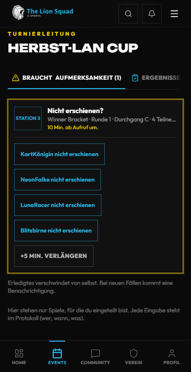
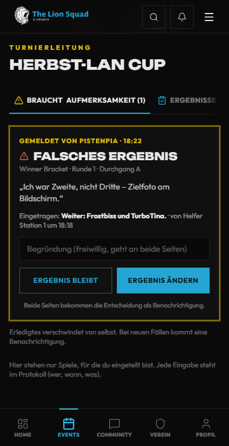
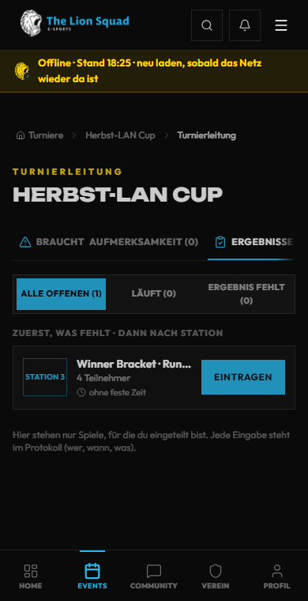
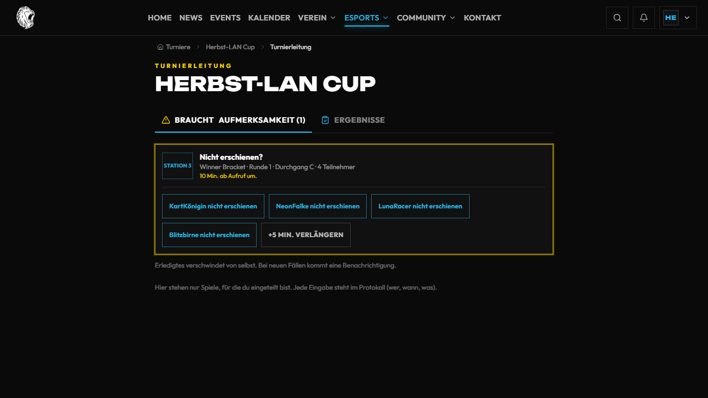
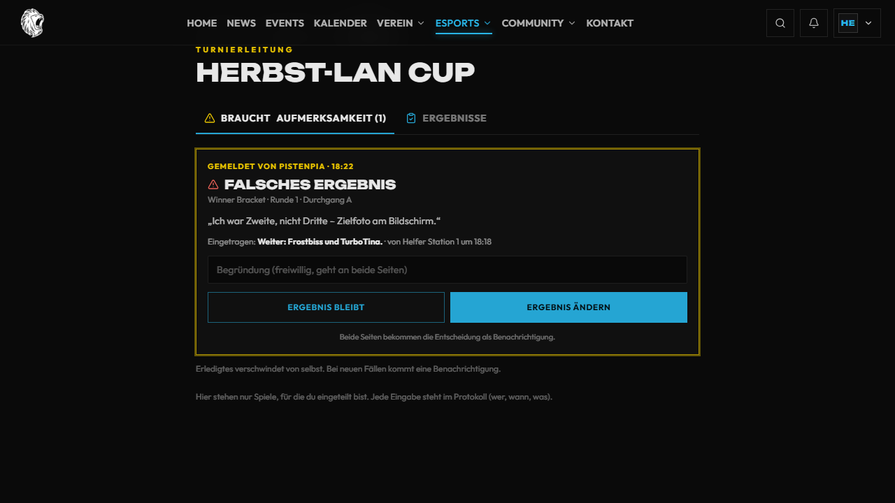
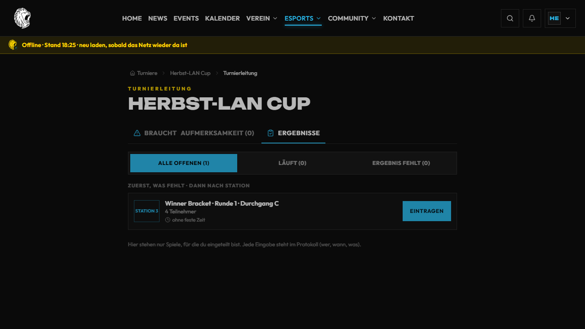

# Helfer am Event-Tag: Spickzettel

Für den Abend vor Ort (zuerst am **31.10.**). Eine Aufgabe, drei bis fünf Schritte, ein Bild, ein Kasten für den
Notfall. Zum Ausdrucken gibt es eine [Kurzfassung auf zwei A4-Seiten](helfer-eventtag-druck.md). Alle Bilder und mehr
Details stehen in der [ausführlichen Helfer-Anleitung](helfer.md).

**Bevor es losgeht:**

1. Am Handy **lionsquad.at** öffnen und anmelden. Zwei-Faktor bereithalten.
2. Die Turnierleitung teilt dich ein. Du siehst nur die Spiele, für die du eingeteilt bist.
3. Schau auf den **Aushang**: Dort steht, wen du bei Problemen anrufst.

Jede Eingabe wird gespeichert, auch wer sie gemacht hat. Du kannst nichts kaputt machen, was sich nicht korrigieren lässt.

---

## 1. Station betreuen: Aufrufen und Starten

**Öffnen:** Turnier → **Turnierleitung** → Reiter **Stationen**.

1. Bei deiner Station steht **Als Nächstes**: Runde, Durchgang und wer antritt.
2. Tippe **Aufrufen**. Die Spieler bekommen „Du bist dran“, der TV zeigt den Aufruf mit Countdown.
3. Sind alle da: **Gestartet** tippen. Die Spielzeit-Uhr läuft.
4. Ist die Station noch belegt, steht dort „Aufrufen nach dem laufenden Spiel“. Dann warten.

> [!TIP]
> **Wenn** niemand kommt, **dann** nicht selbst entscheiden. Nach der Frist (Vorgabe 10 Minuten ab Aufruf) meldet die
> Seite der Turnierleitung „Nicht erschienen?“ – siehe [Probleme](#5-wenn-etwas-schiefgeht).

---

## 2. Ergebnis eintragen

**Öffnen:** Reiter **Ergebnisse** (gleiche Seite).

1. Beim fertigen Spiel **Eintragen** tippen.
2. Spieler in der Zielreihenfolge antippen. Darunter steht in Worten, wer weiterkommt.
3. **Ergebnis speichern.**
4. Vertippt? Sofort **Rückgängig** (10 Sekunden). Danach rückt das nächste Spiel an die Station nach.

> [!TIP]
> **Wenn** die 10 Sekunden vorbei sind, **dann** unten bei „Zuletzt eingetragen“ **Korrigieren** und kurz den Grund
> schreiben (mindestens 5 Zeichen). Der Grund steht im Protokoll.

---

## 3. Fast Lap: Zeiten am Simulator

**Öffnen:** Fast-Lap-Challenge → ganz oben **Schnelleingabe**.

1. **Fahrer** wählen: **Konto** (Namen suchen) oder **Gast** (Namen tippen, **Anlegen**).
2. Zeit tippen, z. B. `1:24,587`. Oben steht, der wievielte Versuch es ist.
3. **Eintragen & nächster Fahrer.** Steht jemand unter „Am Start / Als Nächstes“, ist er gleich gewählt.
4. Runde zählt nicht? **Ungültig** → Grund antippen. Das zählt als Versuch.

> [!TIP]
> **Wenn** die letzte Zeit falsch ist, **dann** **Letzte korrigieren** tippen, richtige Zeit eingeben, speichern.
> **Wenn** „Zeit prüfen“ kommt, **dann** die Zeit noch einmal am Simulator ansehen – erst danach **Trotzdem speichern**.
> **Wenn** ein Fahrer alle Versuche gefahren hat, geht Eintragen nicht mehr. Das ist so gewollt.

---

## 4. Einlass: Vor-Ort-QR und Check-in

1. Wer vor Ort mitspielen will, scannt den **QR-Code am Aushang** (oder am TV).
2. Am Handy **Mitspielen** → anmelden → **Verbindlich anmelden**.
3. **Einchecken** macht die Turnierleitung: Verwaltung des Turniers → Reiter **Teilnehmer** → **Check-in**.

> [!TIP]
> **Wenn** ein Foto des QR-Codes herumgeht, **dann** der Turnierleitung sagen. Sie macht einen **Neuen Code**, der alte
> gilt dann nicht mehr. **Wenn** das Turnier voll ist, kommt die Person auf die Warteliste und rückt nach, sobald ein
> Platz frei wird.

---

## 5. Wenn etwas schiefgeht

Grundregel: **Nichts raten. Turnierleitung holen.** Wen du anrufst, steht am **Aushang**.

| Was passiert | Was du tust |
| --- | --- |
| **Station defekt** (Gerät, Controller) | Nichts mehr an der Station starten. Turnierleitung holen – sie setzt die Station auf „Defekt“ und legt die Spiele mit **Umlegen** auf eine freie Station. Der TV zeigt dort „Bitte nicht benutzen“. |
| **Spieler fehlt** | Aufrufen, warten. Nach der Frist kommt bei der Turnierleitung „Nicht erschienen?“. Sie tippt den Namen an oder **+5 Min. verlängern**. |
| **Ergebnis strittig** | Nichts eintragen. Turnierleitung holen. Spieler können auf der Spielseite auch selbst **Problem melden**. |
| **Falsch eingetragen** | Sofort **Rückgängig**, sonst **Korrigieren** mit Grund. |
| **Internet weg** | Oben steht „Offline · Stand …“. Auf Papier notieren: Station, Spiel, Plätze bzw. Zeit, Uhrzeit. Ist das Netz zurück: neu laden und nachtragen. |
| **Seite hängt** | Neu laden. Hilft das nicht: anderes Gerät nehmen. |

So sieht es die Turnierleitung im Reiter **Braucht Aufmerksamkeit**:

<table><tr><th>Station defekt</th><th>Nicht erschienen?</th><th>Streitfall</th></tr><tr>
<td></td>
<td></td>
<td></td>
</tr></table>

Und so, wenn das Internet weg ist – der zuletzt geladene Stand bleibt stehen, Eintragen geht erst wieder mit Netz:

Dieselben Bilder am PC

### Wen anrufen

Echte Namen und Nummern stehen **nur am Aushang** vor Ort, nicht hier.

| Rolle | Wofür |
| --- | --- |
| **Turnierleitung** (Nummer am Aushang) | Spieler fehlt, Streit ums Ergebnis, Station umlegen, alles Unklare |
| **Technik** (Nummer am Aushang) | Gerät, Controller, Strom, WLAN |
| **Einlass** (Nummer am Aushang) | QR-Code, Anmeldung, Warteliste |

---

Mehr für die Turnierleitung: [Turniere](turniere.md) · [Fast Lap](fastlap.md) · [TV und Beamer](tv.md) ·
[ausführliche Helfer-Anleitung](helfer.md)

Die Bilder der Problemfälle stammen aus `frontend/e2e/helfer-eventtag-bilder.spec.js` (nachgestellte Daten,
erfundene Namen); die übrigen aus der Abnahme der [Helfer-Anleitung](helfer.md).
