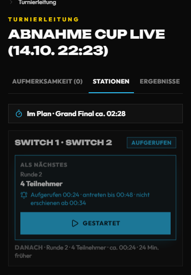
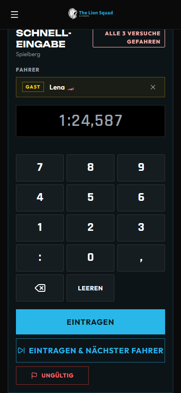

# Helfer am Turniertag – Kurzanleitung

Für alle, die am Event-Tag an Stationen, am Simulator oder am Einlass helfen. Zwei Seiten, zum Ausdrucken. Ausführlich:
[Turniere](turniere.md), [Fast Lap](fastlap.md), [TV und Beamer](tv.md).

**Vorher:** Am Handy bei lionsquad.at angemeldet sein (Zwei-Faktor bereit). Die Turnierleitung trägt dich im Turnier
unter **Team** ein – du siehst dann genau die Spiele und Stationen, für die du eingeteilt bist. Jede Eingabe steht im
Protokoll (wer, wann, was).

## 1. Stationen und Warteschlange

Öffne das Turnier → **Turnierleitung** (Adresse `…/tournaments/<Turnier>/leitung`) → Reiter **Stationen**.

- Je Station steht, was **läuft** (mit Spielzeit-Uhr: gelb ab 80 %, rot wenn die Zeit um ist), was **als Nächstes**
  kommt und was **danach**. Die Reihenfolge rechnet die Seite selbst – wird eine Station frei, rückt das nächste
  bereite Spiel nach.
- **Aufrufen:** reserviert die Station, die Spieler bekommen „Du bist dran“ aufs Handy, der TV zeigt den Aufruf.
- **Gestartet:** tippen, sobald die Spieler wirklich fahren/spielen. Ab da läuft die Uhr.
- Ruft jemand anderes gleichzeitig auf, gilt nur ein Aufruf – die Seite zeigt dir dann den neuen Stand.

## 2. Ergebnis eintragen

Reiter **Ergebnisse** → beim Spiel **Eintragen** → Plätze bzw. Punkte setzen → speichern.

- Danach läuft **10 Sekunden** unten **Rückgängig** – bei einem Vertipper sofort drücken. Erst dann rückt der Baum
  weiter und der TV zeigt das Ergebnis.
- Später ändern: unter **Zuletzt eingetragen** → **Korrigieren** (mit kurzem Grund).

## 3. Fast Lap am Simulator

Fast-Lap-Challenge öffnen → ganz oben **Schnelleingabe** (Handy oder Tablet am Simulator).

1. **Fahrer** wählen: **Konto** (Personensuche) oder **Gast** (nur Name). Steht genau eine Person **Am Start**, ist sie
   schon gewählt.
2. Zeit am Ziffernblock tippen, z. B. `1:24,587` – darunter steht, was die Seite liest.
3. **Eintragen** – oder **Eintragen & nächster Fahrer** (die nächste Person aus „Als Nächstes“ kommt dran).
4. Runde zählt nicht? **Ungültig** und den Grund wählen (Strecke verlassen, Abkürzung, Kollision, Runde nicht beendet).
5. Oben steht **Versuch 2 von 3** – sind alle gefahren, geht Eintragen nicht mehr.

## 4. Einlass und Vor-Ort-Anmeldung (QR)

- Am Eingang hängt der **Aushang mit QR-Code**, der TV zeigt denselben Code. Wer scannt, kann sich – auch ohne
  Mitgliedschaft, z. B. Begleitpersonen – fürs Turnier anmelden und mitspielen.
- Der **Check-in vor Ort** passiert bei der Turnierleitung: Reiter **Teilnehmer**, Haken setzen.
- Geht ein Foto des Aushangs herum: der Turnierleitung Bescheid geben – sie macht mit **Neuer Code** den alten ungültig.

## 5. Wenn etwas nicht passt

| Problem | Was du tust |
| --- | --- |
| **Station defekt** (Gerät, Controller) | Turnierleitung Bescheid geben. Sie setzt die Station auf **defekt**; die wartenden Spiele legt **Umlegen** (Reiter **Braucht Aufmerksamkeit**) auf eine freie Station. |
| **Spieler kommt nicht** | Nach dem Aufruf läuft eine Frist (vor Ort 10 Minuten). Danach erscheint bei der Turnierleitung **„<Name> nicht erschienen“** oder **+5 Min. verlängern** – nicht selbst entscheiden, Bescheid geben. |
| **Ergebnis strittig** | Nichts eintragen, Turnierleitung holen. Sie entscheidet unter **Braucht Aufmerksamkeit** mit einem Tipp. |
| **Falsches Ergebnis gespeichert** | Innerhalb von 10 Sekunden **Rückgängig**, sonst **Korrigieren** mit Grund. |
| **Handy zeigt nichts / Seite hängt** | Seite neu laden. Bleibt es so: anderes Gerät oder Turnierleitung fragen. |
| **Internet weg** | Ergebnisse auf Papier notieren (Spiel, Plätze, Uhrzeit) und nachtragen, sobald es wieder geht – die Reihenfolge rechnet die Seite danach neu. |

**Turnierleitung am Tag:** _______________________ · Telefon: _______________________

**Technik / Stationen:** _______________________ · Telefon: _______________________
