# Helfer am Turniertag

Kurz und zum Ausdrucken. Such dir deine Aufgabe – mehr brauchst du nicht. Zu jedem Schritt ein Bild: links am PC,
rechts am Handy.

| Deine Aufgabe | Abschnitt |
| --- | --- |
| Spiele an einer **Station** betreuen (Turnier) | [A](#a-station-turnier) |
| Zeiten am **Simulator** eintragen (Fast Lap) | [B](#b-simulator-fast-lap) |
| **Einlass** und Anmeldung vor Ort | [C](#c-einlass) |

**Vorher (alle):** Am Handy bei **lionsquad.at** anmelden (Zwei-Faktor bereit). Die Turnierleitung trägt dich ein – du
siehst nur, wofür du eingeteilt bist. Jede Eingabe wird gespeichert, auch wer sie gemacht hat.

---

## A. Station (Turnier)

**Öffnen:** Turnier → **Turnierleitung** → Reiter **Stationen**.

<table><tr><th>PC</th><th>Handy</th></tr><tr>
<td>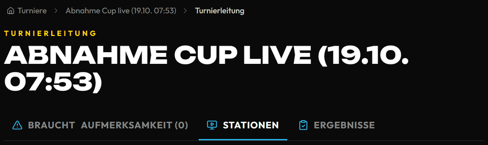</td>
<td>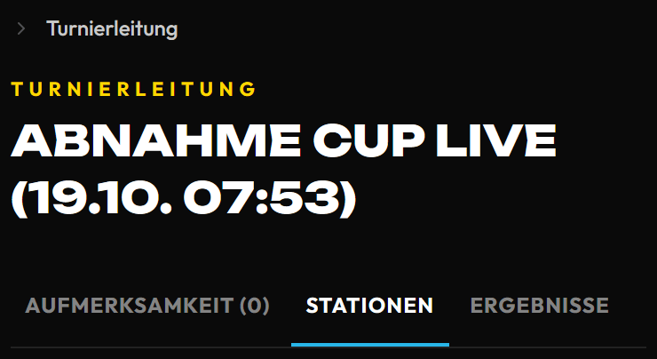</td>
</tr></table>

**1.** Bei deiner Station steht **Als Nächstes**. Tippe **Aufrufen** – die Spieler bekommen „Du bist dran“.

<table><tr><th>PC</th><th>Handy</th></tr><tr>
<td></td>
<td>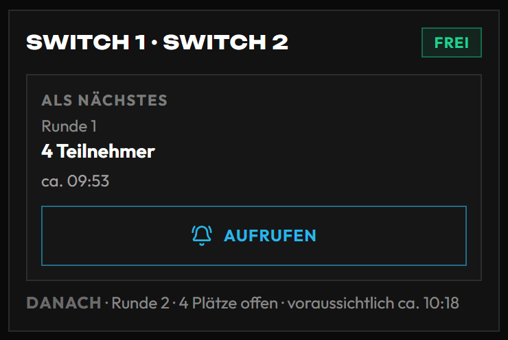</td>
</tr></table>

**2.** Sind alle da und es geht los: **Gestartet** tippen. Die Uhr läuft.

<table><tr><th>PC</th><th>Handy</th></tr><tr>
<td>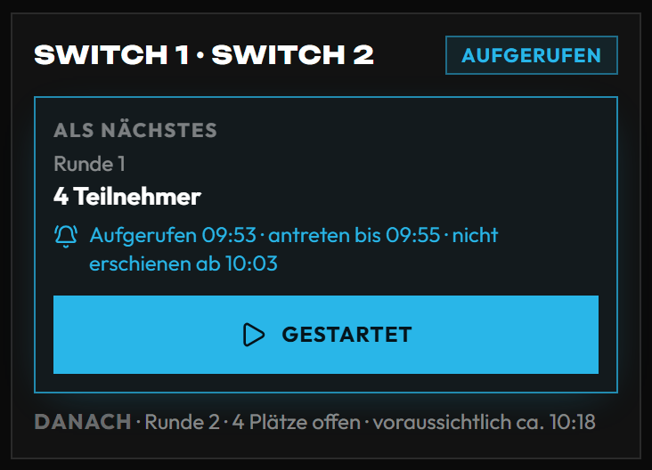</td>
<td>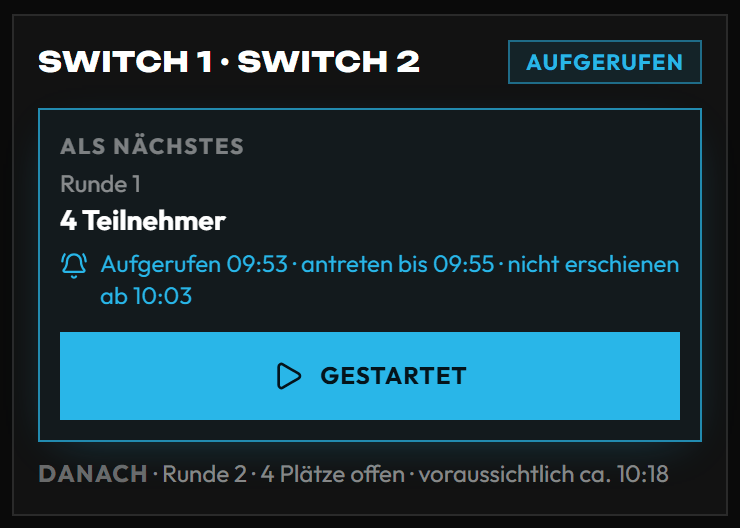</td>
</tr></table>

**3.** Spiel fertig: Reiter **Ergebnisse** → **Eintragen** → Plätze setzen → speichern.

<table><tr><th>PC</th><th>Handy</th></tr><tr>
<td>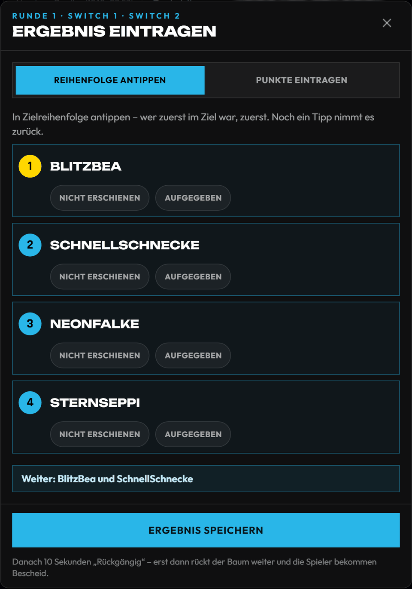</td>
<td>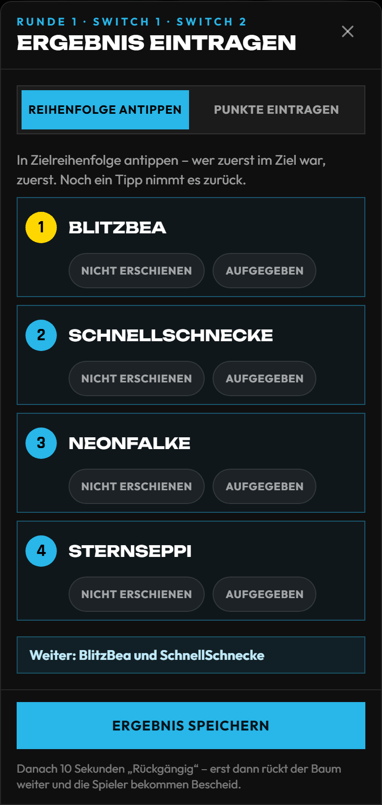</td>
</tr></table>

**4.** Vertippt? Sofort **Rückgängig** (10 Sekunden). Später: **Korrigieren** mit kurzem Grund.

<table><tr><th>PC</th><th>Handy</th></tr><tr>
<td>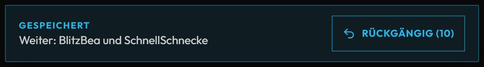</td>
<td>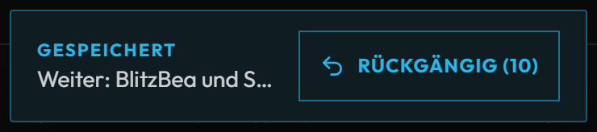</td>
</tr></table>

Danach rückt das nächste Spiel von selbst nach – wieder bei 1.

---

## B. Simulator (Fast Lap)

**Öffnen:** Fast-Lap-Challenge → ganz oben **Schnelleingabe**.

**1.** **Fahrer** wählen: **Konto** (Name suchen) oder **Gast** (nur Name eintippen, **Anlegen**).

<table><tr><th>PC</th><th>Handy</th></tr><tr>
<td>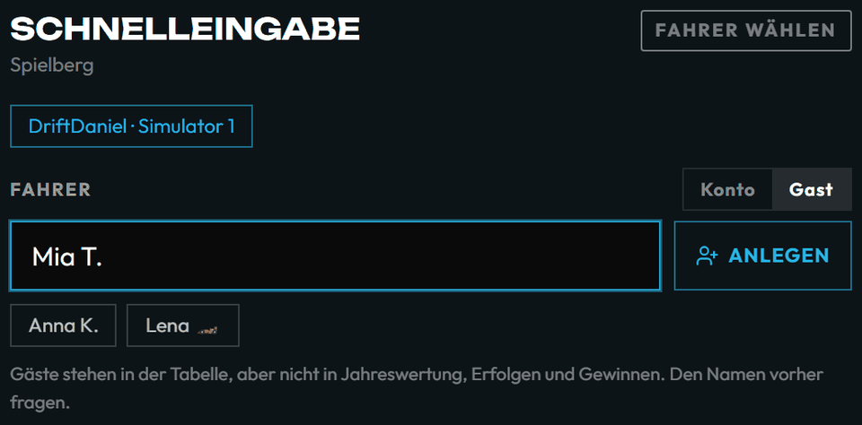</td>
<td>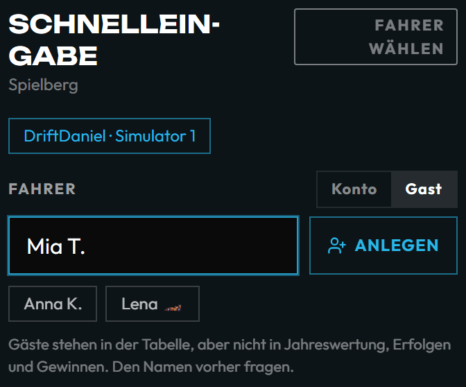</td>
</tr></table>

**2.** Zeit tippen, z. B. `1:24,587`. Oben steht, der wievielte Versuch es ist.

<table><tr><th>PC</th><th>Handy</th></tr><tr>
<td>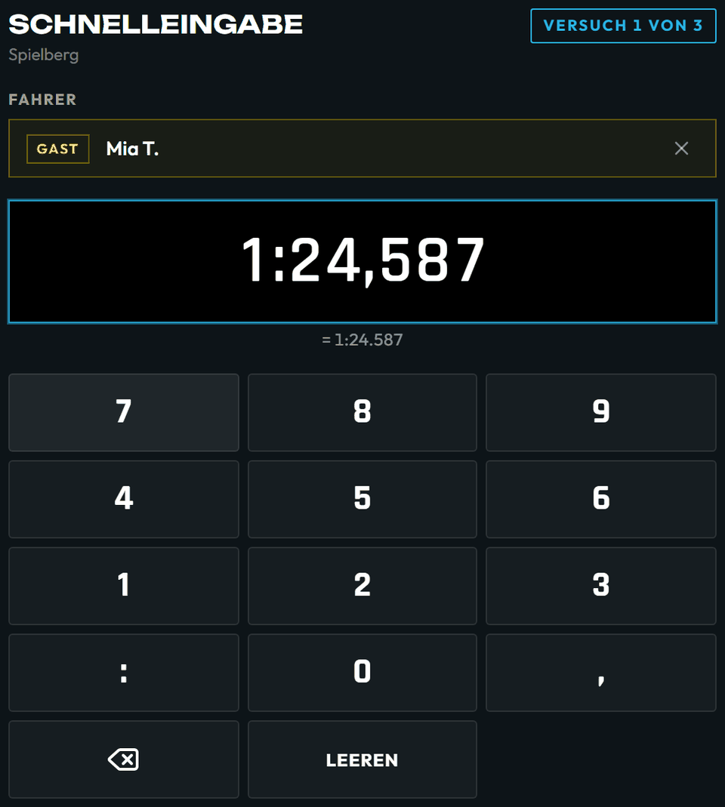</td>
<td>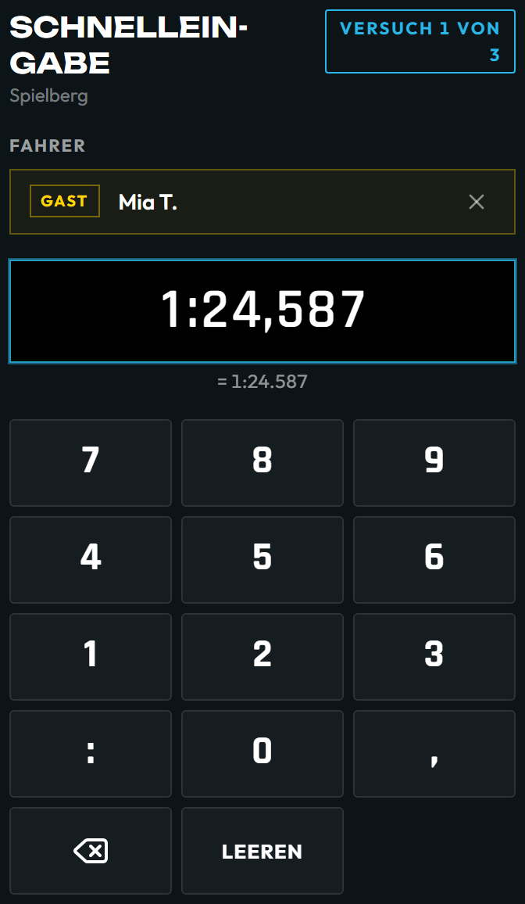</td>
</tr></table>

**3.** **Eintragen & nächster Fahrer** – der Nächste aus der Liste ist dran.

<table><tr><th>PC</th><th>Handy</th></tr><tr>
<td>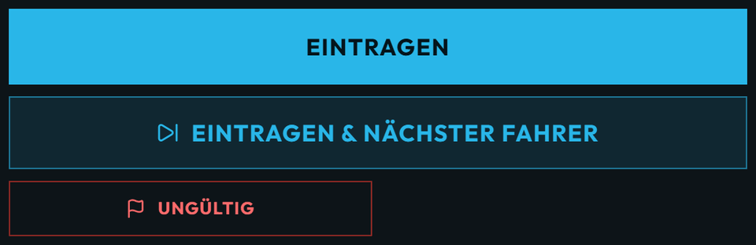</td>
<td>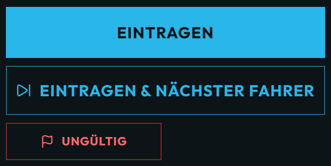</td>
</tr></table>

**4.** Runde zählt nicht? **Ungültig** → Grund wählen.

<table><tr><th>PC</th><th>Handy</th></tr><tr>
<td>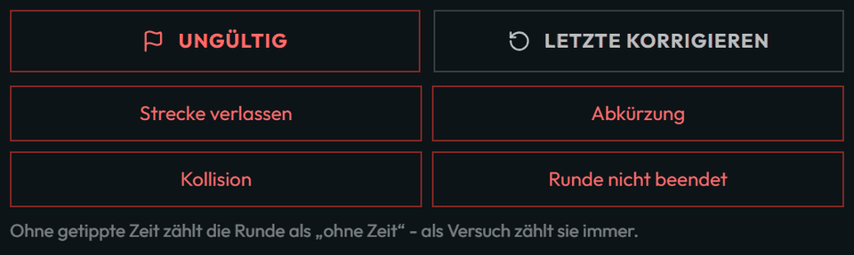</td>
<td>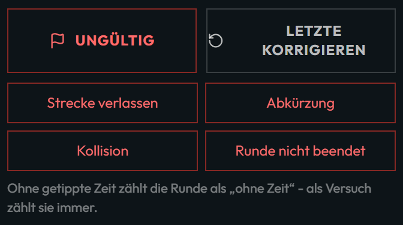</td>
</tr></table>

Hat ein Fahrer alle Versuche gefahren, geht Eintragen für ihn nicht mehr.

---

## C. Einlass

**1.** Wer sich vor Ort anmelden will (auch Begleitpersonen ohne Mitgliedschaft): **QR-Code am Aushang** oder am TV
scannen lassen → **Mitspielen**.

<table><tr><th>Aushang</th><th>Nach dem Scannen (Handy)</th></tr><tr>
<td>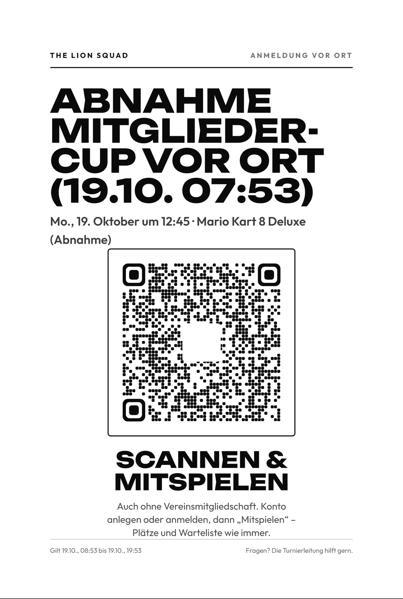</td>
<td>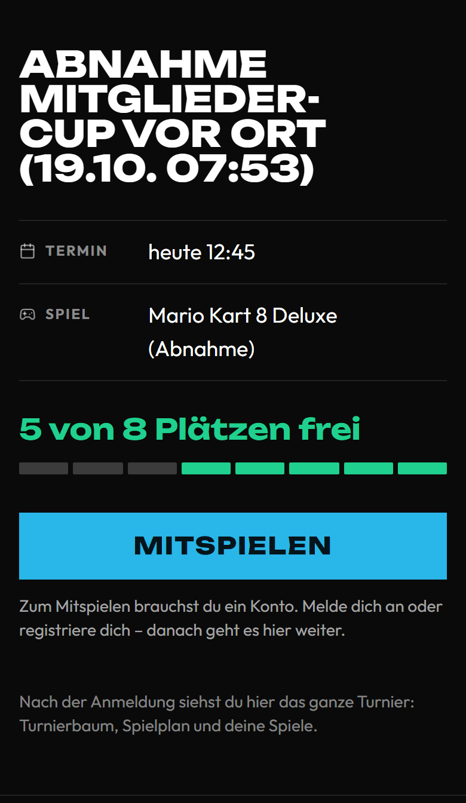</td>
</tr></table>

**2.** **Einchecken** macht die Turnierleitung (Reiter **Teilnehmer**, Knopf **Check-in**).

<table><tr><th>PC</th><th>Handy</th></tr><tr>
<td></td>
<td>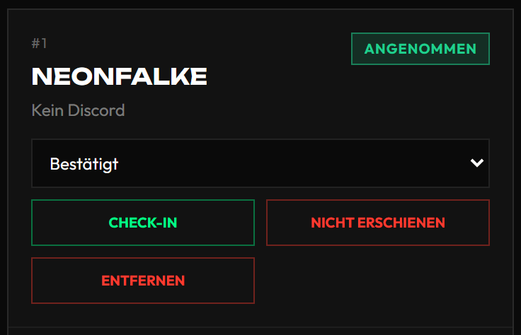</td>
</tr></table>

**3.** Geht ein Foto des QR-Codes herum: der Turnierleitung sagen – sie macht einen neuen Code
(Knopf **Neuer Code**).

<table><tr><th>PC</th><th>Handy</th></tr><tr>
<td>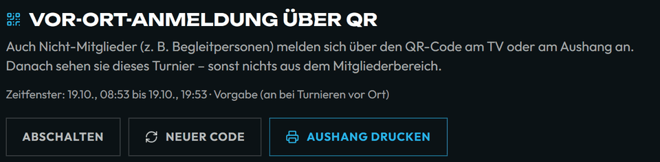</td>
<td>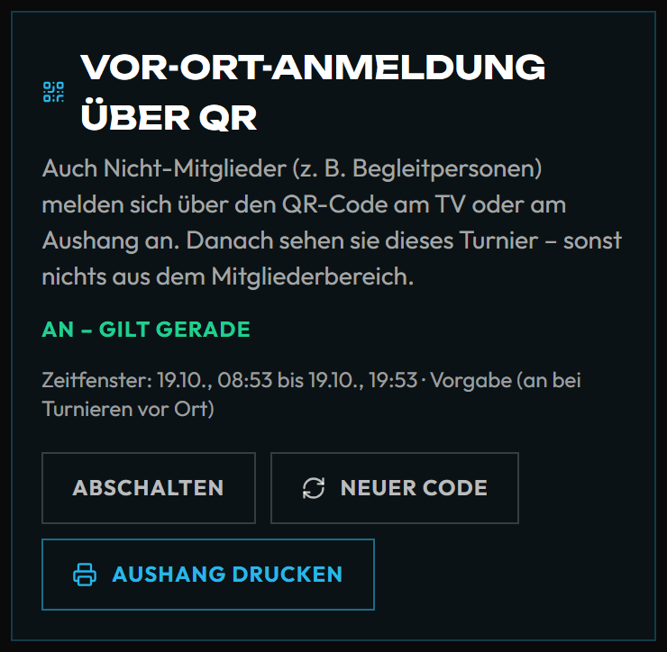</td>
</tr></table>

---

## Wenn etwas nicht passt

| Problem | Was du tust |
| --- | --- |
| Gerät oder Controller kaputt | Turnierleitung holen – sie legt die Spiele auf eine andere Station. |
| Spieler kommt nicht | Nicht selbst entscheiden. Nach 10 Minuten meldet sich die Seite bei der Turnierleitung. |
| Streit ums Ergebnis | Nichts eintragen, Turnierleitung holen. |
| Falsches Ergebnis | Sofort **Rückgängig**, sonst **Korrigieren**. |
| Seite hängt | Neu laden. Hilft nichts: anderes Gerät nehmen. |
| Internet weg | Auf Papier notieren (Spiel, Plätze bzw. Zeit, Uhrzeit) und später nachtragen. |

So sieht es die Turnierleitung (Reiter **Braucht Aufmerksamkeit**), hier eine defekte Station:

<table><tr><th>PC</th><th>Handy</th></tr><tr>
<td>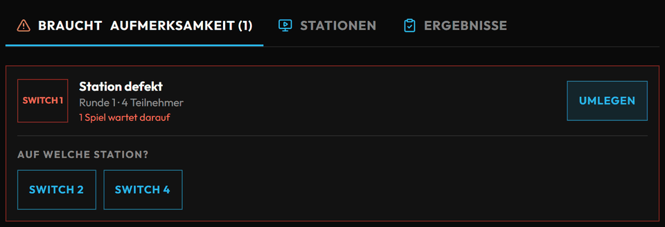</td>
<td>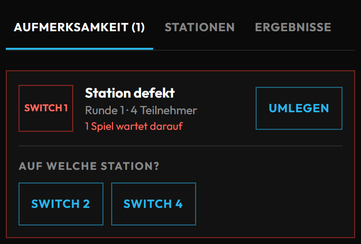</td>
</tr></table>

**Turnierleitung:** ______________________ · Tel. ______________________

**Technik:** ______________________ · Tel. ______________________

Mehr Details für die Turnierleitung: [Turniere](turniere.md) · [Fast Lap](fastlap.md) · [TV und Beamer](tv.md)

Die Bilder stammen aus der Abnahme `frontend/e2e/abnahme/helfer-anleitung-*.spec.js` – sie spielt jeden Schritt
jede Nacht gegen einen echten Server durch.
