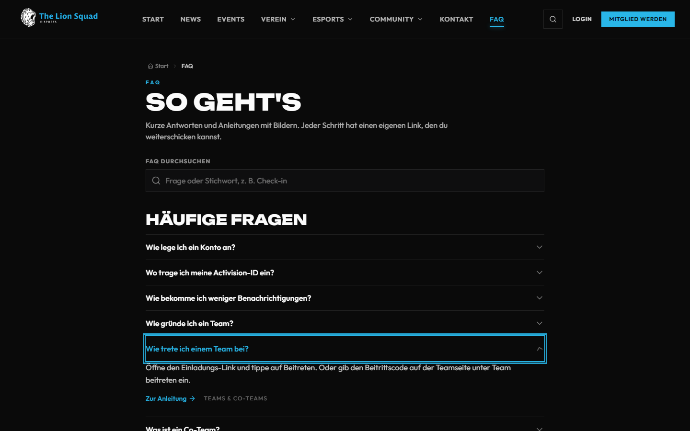
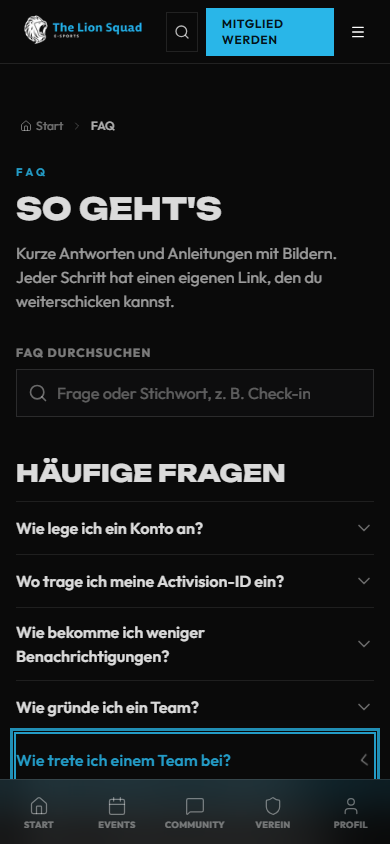

# FAQ: Fragen und Anleitungen

Unter **lionsquad.at/faq** stehen häufige Fragen mit kurzer Antwort und Anleitungen Schritt für Schritt – ohne Konto
lesbar und fürs Handy gemacht. Bis November 2026 hieß der Bereich „Hilfe“ und lag unter `/hilfe`. Alte Links führen
automatisch zur FAQ, auch Links auf einzelne Schritte und Suchen (#2448).

 

## Aufbau der Seite

1. **Suche** über alle Fragen und Schritte. Jeder Treffer zeigt seinen Bereich, etwa „Turniere“ oder „Liga“.
2. **Häufige Fragen:** kurze Antworten zum Aufklappen, jeweils mit Link zur passenden Anleitung.
3. **Alle Bereiche:** eine kompakte Liste. Ein Tipp klappt einen Bereich auf und zeigt seine Anleitungen und Fragen.
   Bereiche, zu denen es noch nichts gibt, stehen als **Kommt bald** da.
4. **Für wen?** Die Chips **Alle, Spieler, Captain, Mitglied** (und **Turnierleitung** für die Leitung) filtern die
   Bereiche. Die Auswahl steht in der Adresse, etwa `/faq?rolle=captain`.

| Anleitung | Für wen | Link |
| --- | --- | --- |
| Konto und Profil (auch Benachrichtigungen) | alle Spieler | `/faq/konto-und-profil` |
| Team und Co-Team | Teamleitung und Spieler | `/faq/team-und-co-team` |
| Liga für Captains | Captain und Vertreter | `/faq/liga-captains` |
| Turniere (Check-in auch unter „Turniertag vor Ort“) | alle Spieler | `/faq/turniere` |
| Verein und Mitgliedschaft (Mitglied werden, Antrag) | alle, die Mitglied werden wollen | `/faq/verein-und-mitgliedschaft` |
| Events und Kalender (Begleitung, Warteliste, Tagesplan, Kalender-Abo) | alle | `/faq/events-und-kalender` |
| Turniertag vor Ort (Aufruf, Station, Spielzeit-Uhr, Ergebnis, Hinweise) | alle Spieler vor Ort | `/faq/turniertag` |
| Gewinne und Trophäen (Preise, Medaillen, Erfolge teilen) | alle Spieler | `/faq/gewinne-und-trophaeen` |
| Datenschutz und Konto (Daten herunterladen, anonymisieren) | alle mit Konto | `/faq/datenschutz-und-konto` |

## Wer was sieht

- **Alle** sehen die öffentlichen Fragen und Anleitungen.
- **Vereinsmitglieder** sehen zusätzlich Fragen zur Mitgliedschaft (Beitrag, Mitgliedsnummer und Karte,
  Mitgliederverzeichnis, Austritt, Versammlungen, Dokumente) und den Bereich **Helferdienste** (Dienst eintragen und
  absagen, Stand der Anfrage, „Mein Dienst“ und die Nachricht beim Eintragen).
- **Turnierleitung** sieht zusätzlich den Bereich **Turnierleitung** mit Fragen zu Check-in, Aufruf, Stationen,
  Cockpit, „Braucht Aufmerksamkeit“ und Ergebnissen. Dazu zählt jeder, der die Leitungsansicht eines Turniers öffnen darf: der Bereich Turnierleitung (Rolle
  oder Freigabe, mit Zwei-Faktor-Anmeldung), Helfer mit einem aktiven Einsatz in einem Turnier und die Liga-Leitung.
- Fragen, deren Weg über die **Verwaltung** führt (Turnierleitung öffnen, Einlass beim Event, Abschluss nachholen), sehen nur Personen mit
  dem Bereich Turnierleitung. Helfer und Liga-Leitung sehen sie nicht.

Das prüft der Server. Wer kein Recht hat, bekommt diese Fragen gar nicht erst geschickt. Geheim sind sie trotzdem
nicht: Der Quelltext der Website ist öffentlich. In die FAQ gehört deshalb nur Bedienung, nichts Vertrauliches.

## Bilder und Animationen

Jeder Schritt zeigt, wo man tippt. Wo eine Bewegung hilft (etwas ankreuzen, eintippen, ein Fenster öffnen), läuft eine
kurze, stumme Animation in Schleife wie ein GIF. Der gelbe Rahmen am Ende zeigt das Ergebnis.

- **Passend zum Gerät:** Am Handy (und am Tablet mit Touch) läuft die Handy-Fassung, am PC die PC-Fassung. Wird das
  Fenster schmaler oder breiter, wechselt sie mit.
- **Sparsam:** Geladen wird eine Animation erst, wenn ihr Schritt ins Bild kommt. Außerhalb des Bildes hält sie an.
- **Anhalten:** Unten rechts an jeder Animation steht ein Knopf zum Anhalten und wieder Abspielen.
- **„Bewegung reduzieren“** am Gerät eingeschaltet: Es steht nur das Standbild da, mit dem Knopf **Abspielen**.
- Klappt das Video nicht (alter Browser, Abbruch beim Laden), bleibt das Standbild.

## Links verschicken

- **Eine Anleitung:** Link aus der Adresszeile, etwa `lionsquad.at/faq/liga-captains`.
- **Genau ein Schritt:** Neben jedem Schritt steht ein Ketten-Symbol (**Link kopieren**). Der Link springt direkt zum
  Schritt, etwa `…/faq/liga-captains#check-in`.
- **Eine Frage:** `…/faq#frage-<kennung>` klappt die Frage auf, etwa `/faq#frage-team-beitreten`.
- **Eine Suche:** Die Suche steht in der Adresse (`/faq?q=check-in`) und lässt sich ebenso schicken.

Discord und WhatsApp zeigen eine Vorschau mit Titel und Kurztext.

## Wo die FAQ auf der Website auftaucht

- **Hauptleiste:** **FAQ** als letzter Eintrag rechts, am Handy im Menü. Ausblenden oder umbenennen geht im Admin unter
  **Content → Navigation**. Unter „Community“ steht sie nicht mehr.
- **Fußzeile:** Spalte „Mitmachen“ → **FAQ**.
- **„?“ an den Stellen, an denen man hängen bleibt:** Anmeldung auf der Ligaseite und jeder Schritt der Liga-Anmeldung,
  auf der Matchseite bei Terminabstimmung, Termin und Verschiebung, Check-in (während des Vetos beim Veto), Ergebnis
  und Problem melden, auf der Teamseite neben Teilen (Einladen bzw. Beitreten), unter **Teams → Deine Teams** beim
  Co-Team und in den Einstellungen bei **Gaming → Spiel-IDs**. Das „?“ öffnet die FAQ in einem neuen Tab, ein halb
  ausgefülltes Formular bleibt also stehen.

## Aktuell halten

Bilder und Animationen entstehen automatisch aus den echten Abläufen mit Testdaten. Ändert sich die Oberfläche, meldet
ein Test das, und Bilder und Animationen werden neu erzeugt – Anleitung für die Entwicklung:
[FAQ: Inhalte, Sichtbarkeit, Bilder und Animationen](../entwicklung/hilfe-bilder.md). Für Captains bleibt der ausführliche
[Spickzettel](liga-captains.md) mit allen Fristen.
