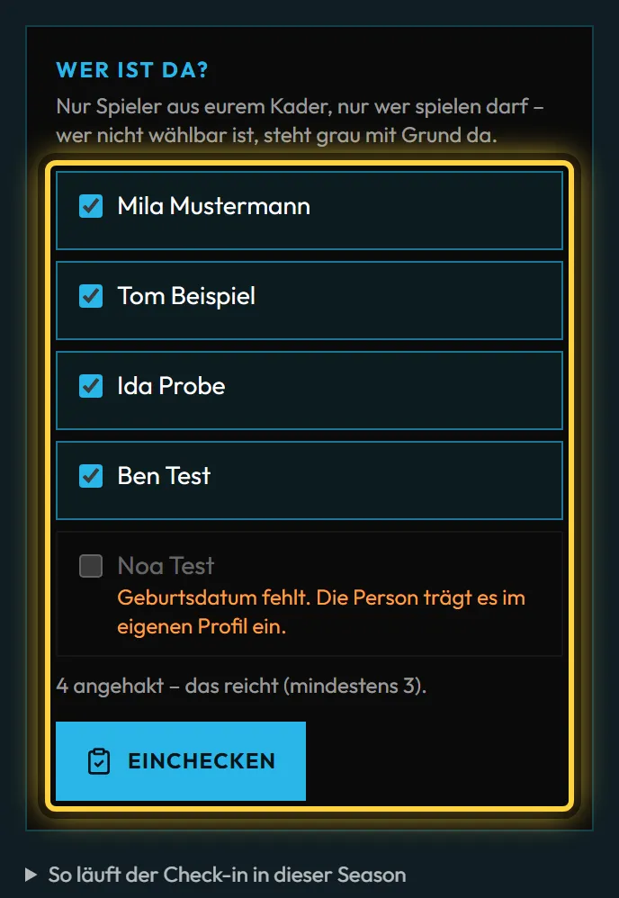

# Hilfe für Spieler und Captains

Unter **lionsquad.at/hilfe** stehen kurze Anleitungen für Spieler und Captains – ohne Konto lesbar und fürs Handy
gemacht. Jeder Schritt hat einen Satz, einen Hinweis, wo nötig, und ein Bild für Handy und PC. Drei Abläufe gibt es
zusätzlich als kurzes Video ohne Ton (Liga-Anmeldung, Ergebnis melden, Team und Co-Team anlegen).

| Thema | Für wen | Link |
| --- | --- | --- |
| Konto und Profil | alle Spieler | `/hilfe/konto-und-profil` |
| Team und Co-Team | Teamleitung und Spieler | `/hilfe/team-und-co-team` |
| Liga für Captains | Captain und Vertreter | `/hilfe/liga-captains` |
| Turniere | alle Spieler | `/hilfe/turniere` |

## Links verschicken

- **Ein Thema:** Link aus der Adresszeile, etwa `lionsquad.at/hilfe/liga-captains`.
- **Genau ein Schritt:** neben jedem Schritt steht ein Ketten-Symbol (**Link kopieren**). Der Link springt direkt zum
  Schritt, etwa `…/hilfe/liga-captains#check-in`.
- **Eine Suche:** Die Suche auf `/hilfe` steht in der Adresse (`/hilfe?q=check-in`) und lässt sich ebenso schicken.

Discord und WhatsApp zeigen eine Vorschau mit Titel und Kurztext des Themas.

## Wo die Hilfe auf der Website auftaucht

- **Fußzeile:** Spalte „Mitmachen“ → **Hilfe**.
- **„?“ an den Stellen, an denen man hängen bleibt:** Anmeldung auf der Ligaseite und jeder Schritt der Liga-Anmeldung,
  auf der Matchseite bei Terminabstimmung, Termin und Verschiebung, Check-in (während des Vetos beim Veto), Ergebnis
  und Problem melden, auf der Teamseite neben Teilen (Einladen bzw. Beitreten), unter **Teams → Deine Teams** beim
  Co-Team und in den Einstellungen bei **Gaming → Spiel-IDs**. Das „?“ öffnet die Hilfe in einem neuen Tab, ein halb
  ausgefülltes Formular bleibt also stehen.

Im Hauptmenü steht die Hilfe noch nicht: Eigene Menüpunkte gibt es im Navigations-Editor bewusst nicht, ein neuer
Standardpunkt wäre eine eigene Entscheidung.

## Aktuell halten

Bilder und Videos entstehen automatisch aus den echten Abläufen mit Testdaten. Ändert sich die Oberfläche, meldet ein
Test das, und die Bilder werden neu erzeugt – Anleitung für die Entwicklung:
[Hilfe-Bereich: Bilder und Videos erzeugen](../entwicklung/hilfe-bilder.md). Für Captains bleibt der ausführliche
[Spickzettel](liga-captains.md) mit allen Fristen.
