# Inhalte: News, Galerie und Seiten – Handbuch

Was auf der Website steht und wer es pflegt: News schreiben und verteilen, Galerie und Alben (mit den Fotos, die
Mitglieder von Events einsenden), die Medien-Bibliothek, „Über uns“ mit Zeitstrahl, Werten und Vereinsfoto, Sponsoren
und Partner, die Seite „Sponsor werden“, die Referenzen und die Serien (externe Wettbewerbe über eine Saison).

**Wo im Admin:**

- **Admin → Content → News** (`/admin/news`) – Beiträge, **Neuer Beitrag** (`/admin/news/new`)
- **Admin → Content → Galerie** (`/admin/gallery`) – Alben und **Eingesandte Fotos**
- **Admin → Content → Medien** (`/admin/media`, Seitenname „Medien-Browser“) – alle hochgeladenen Dateien
- **Admin → Verein → Über uns** (`/admin/about`) – die Texte der Seite „Über den Verein“
- **Admin → Verein → Sponsoren** (`/admin/sponsors`) – Sponsoren und die Seite „Sponsor werden“
- **Admin → Verein → Partner** (`/admin/partners`) – befreundete Vereine, Veranstalter, Communitys
- **Admin → Verein → Referenzen** (`/admin/references`) – Turnierteilnahmen des Vereins
- **Admin → Verein → Serien** (`/admin/reference-series`) – Turnierserien, Rennligen und Team-Ligen über eine Saison

Öffentlich: **/news**, **/gallery**, **/about**, **/sponsors**, **/partners**, **/references**.

Wer das darf: der Bereich **Redaktion**. Zwei Ausnahmen: **Eingesandte Fotos** in der Galerie geben auch die
**Vereinsverwaltung** (der Vorstand) frei, ohne Alben pflegen zu dürfen; **Events** und deren Newsletter gehören zur
Turnierleitung. Die Turnierleitung allein darf keine News, Galerie, Sponsoren oder Partner bearbeiten.

---

## Inhalt

1. [Überblick: was alles geht](#1-überblick-was-alles-geht)
2. [Einrichten Schritt für Schritt](#2-einrichten-schritt-für-schritt)
3. [Die Funktionen einzeln](#3-die-funktionen-einzeln)
4. [Wenn etwas nicht klappt](#4-wenn-etwas-nicht-klappt)
5. [Häufige Fragen](#5-häufige-fragen)

---

## 1. Überblick: was alles geht

| Funktion | Was passiert | Einstellen unter |
| --- | --- | --- |
| **News** | Beitrag mit Bild, Video, Verknüpfungen, geplantem Termin, Newsletter und Discord-Meldung | Content → News |
| **Galerie** | Alben mit Abschnitten, Bildern und Videos, an ein Event gehängt | Content → Galerie |
| **Eingesandte Fotos** | Mitglieder schicken Fotos vom Event, ihr gebt frei oder lehnt ab | Content → Galerie, oben |
| **Medien** | Eine Bibliothek für alles Hochgeladene, mit Drehen, Zuschneiden, Prüfen | Content → Medien |
| **Über uns** | Leitbild, Zeitstrahl, Werte und Ziele, Vereinsfoto, Zahlen | Verein → Über uns |
| **Sponsoren** | Logo, Stufe, Laufzeit, wo der Sponsor erscheint | Verein → Sponsoren |
| **Sponsor werden** | Zahlen, Leistungen je Stufe, Mappe als PDF | Verein → Sponsoren, Kasten unten |
| **Partner** | Eigene Seite je Partner mit Kanälen, Tools und gemeinsamen News | Verein → Partner |
| **Referenzen** | Turnierteilnahmen mit Platzierung, für den Auftritt des Vereins | Verein → Referenzen |
| **Serien** | Externe Wettbewerbe über eine Saison: Spur, Saisons und ihre Regeln | Verein → Serien |

---

## 2. Einrichten Schritt für Schritt

1. **Über uns** füllen: Admin → Verein → Über uns (3.5). Das Vereinsfoto, ein paar Zeitstrahl-Einträge, Werte und Ziele.
2. **Sponsoren und Partner** anlegen (3.6, 3.7), sofern ihr welche habt. Mit Dolibarr-Anbindung kommen Name und Art von dort
   ([Dolibarr](../DOLIBARR.md)).
3. **Referenzen** eintragen (3.8), sobald es Turnierteilnahmen gibt.
4. **Erste News** schreiben (3.1) und veröffentlichen.
5. Für jedes Event ein **Album** anlegen (3.3), wenn die Fotos da sind.

---

## 3. Die Funktionen einzeln

### 3.1 News schreiben

1. **Admin → Content → News → Neuer Beitrag**.
2. **Titel**, **Kurzbeschreibung** (steht in der Liste, in Suchmaschinen und beim Teilen), **Inhalt**. Der Text ist
   Markdown; HTML wird nicht roh gezeigt. Mit `[[fastlap:name]]`, `[[tournament:name]]` und `[[event:name]]` setzt ihr Karten
   hinein.
3. **Banner** (das Bild oben und beim Teilen). Optional **Video (YouTube-Link)**: erscheint oben als Player, statt des
   Banners, und erst nach Zustimmung zu externen Medien.
4. **Kategorie**: Verein, Turniere, Events, Community, Sponsoren, Mitglieder, Teams, Ankündigung, Rückblick, Wartung.
5. **Sichtbarkeit**: **Öffentlich**, **Nur registrierte Community**, **Nur Vereinsmitglieder**, **Nur intern (Admins)**.
6. **Veröffentlicht** anhaken. Ohne **Veröffentlichungsdatum** erscheint der Beitrag sofort beim Speichern; mit einem Datum in der
   Zukunft ist er **geplant** und geht dann online. **Anpinnen** hält ihn oben in der News-Liste und auf der Startseite.
7. **Personen und Verknüpfungen**: Benutzer markieren (nur aktive öffentliche Profile; ein Klick setzt den Profil-Link in den
   Text) und **Verknüpfte Events**, **Turniere** und **Fast-Lap Challenges** – ein Klick setzt die Karte in den Text.
8. Die **Checkliste** rechts zeigt, was noch fehlt (Titel, Kurzbeschreibung, Bild, Text, Sichtbarkeit, SEO). Ohne Banner nimmt
   die Seite ein allgemeines Bild.
9. Speichern.

Die Liste unter Content → News hat Suche, Filter nach Kategorie und Sichtbarkeit; Löschen ist endgültig.

**Verteilen** (Kasten am Beitrag; am Handy zugeklappt): Zeigt, was hinausgeht – den **Newsletter** mit der Zahl der Empfänger
(nie Namen), die Meldung an Mitglieder oder Vorstand und die Discord-Vorschau.

- Veröffentlicht ihr, geht der Newsletter von selbst an die Abonnenten: „Geht beim Veröffentlichen von selbst an …“. Mit
  **Jetzt senden** schickt ihn die Redaktion von Hand. Danach steht dort „gesendet am … an …“.
- Ein **zweites Mal** senden nur Redaktion und System, immer mit Rückfrage.
- **Entwürfe** und **Nur intern** gehen nicht als Newsletter hinaus.
- Die Meldung „intern“ geht per Benachrichtigung nur an die, die den Inhalt sehen dürfen: bei **Nur Vereinsmitglieder** an aktive
  Mitglieder und Ehrenmitglieder, bei **Nur intern** an die Vereinsverwaltung. Öffentliche Beiträge melden so niemanden
  (dafür sind Newsletter und Discord da). Wer das nicht will, schaltet das Thema „Vereinsintern“ ab, siehe [Mails und
  Benachrichtigungen](mails.md).
- Discord: Öffentliche News gehen über den Bot in den Kanal, den ihr unter Verbindungen → Discord gewählt habt
  ([Discord](discord.md)). Alles Nicht-Öffentliche geht nie in einen öffentlichen Kanal.

**So erscheint ein Beitrag auf der Website** – die Redaktion muss dafür nichts extra tun:

- **Angepinnt** heißt: Der Beitrag steht als breiter **Aufmacher** oben auf **/news** und auf der Startseite – Bild links,
  Kategorie, Titel, Kurzbeschreibung und „Weiterlesen“ rechts (am Handy untereinander). Sind mehrere angepinnt, ist der
  neueste der Aufmacher, die anderen stehen vorne im Raster. Ohne angepinnten Beitrag zeigt die Startseite den neuesten.
- **Ohne Banner** bekommt der Beitrag eine **Text-Karte**: eine Fläche in der Farbe der Kategorie (Turniere Cyan, Events
  Violett, Verein und Mitglieder Gold, sonst Grau) mit dem ersten Satz der Kurzbeschreibung und dem Vereinslöwen. Ist ein
  Turnier mit veröffentlichten Ergebnissen verknüpft, zeigt die Karte stattdessen Pokal und den Sieger. Dasselbe Bild steht
  nie zweimal nebeneinander – die Wiederholung bekommt ebenfalls die Text-Karte.
- **Filter** über der Liste: nur Kategorien, in denen der Besucher wirklich etwas sieht, mit Anzahl; eine Zeile zum Wischen,
  die Suche als Lupe am Ende.
- **Verknüpfte Turniere und Events** (höchstens drei) stehen als Karte **nach dem ersten Absatz**: Beginn, freie Plätze und
  **Anmelden** – das führt direkt zur Anmeldung auf der Turnier- bzw. Event-Seite. Ist die Anmeldung zu, steht dort der Stand
  (ausgebucht, öffnet am …, läuft, Ergebnisse). Schreibt den wichtigsten Satz also in den ersten Absatz.

<table><tr>
<td>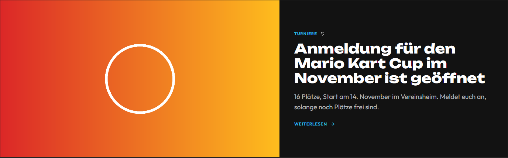</td>
<td>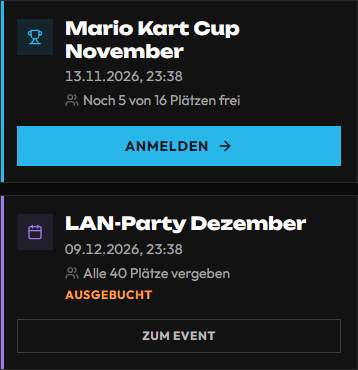</td>
</tr></table>

### 3.2 Die Medien-Bibliothek

**Admin → Content → Medien** (Seite „Medien-Browser“). Hier liegt alles Hochgeladene: News-Bilder, Galerie, Sponsoren, Banner.

- **Medien hochladen** (Bilder und Videos, Größenlimit steht an der Auswahl) und Suche nach Dateinamen.
- Ein Klick auf eine Datei öffnet ein Blatt mit Vorschau, Angaben und **Verwendet in** (wo sie eingebaut ist), dazu **Drehen**,
  **Zuschneiden**, **URL kopieren** und **Löschen**. „Datei endgültig löschen?“ fragt vorher nach.
- Der **Qualitätscheck** zeigt unter anderem Kaputte Referenzen (Bildfelder zeigen auf Dateien, die es nicht mehr gibt), defekte
  Metadaten, doppelte Dateien und Dateien ohne Verwendung. **Scopes reparieren** sortiert alte Uploads ohne saubere Kategorie ein.
  Das braucht ihr nur bei Bedarf.
- Überall, wo ein Bild gewählt wird (Banner, Album, Sponsorenlogo …), könnt ihr neu hochladen **oder aus den schon hochgeladenen
  Medien wählen**.

### 3.3 Galerie und Alben

**Admin → Content → Galerie.** Oben **Neues Album**.

- Ein Album hat **Titel**, **Slug** (der Name in der Adresse), **Beschreibung**, **Cover-Bild**, **Aufgenommen am**, **Verknüpftes
  Event**, **Sichtbarkeit** (Öffentlich, Community, Nur Mitglieder), **Sortierung** und den Haken **Veröffentlicht**.
- Im Album: Bilder aus der **Medienbibliothek** wählen (**Auswahl hinzufügen**) oder hochladen; **Videos** als Link (YouTube,
  Twitch, Kick, Vimeo oder direkte MP4/WebM-Adresse) mit **Vorschaubild**; **Titel / Caption** je Medium.
- **Abschnitte** gliedern ein Album (zum Beispiel „Aufbau, Tag 1, Tag 2“). Löscht ihr einen Abschnitt, bleiben die Medien im
  Album unter „Ohne Abschnitt“.
- Ein Album, das an ein Event hängt, zeigt dort seine Kachel; das Album verweist mit „Vom Event: …“ zurück.
- Löschen eines Albums entfernt es und die zugeordneten Medien.

**Hinweis „Die Fotos sind da“:** Veröffentlicht ihr ein Event-Album, meldet ein Job das **einmal je Person** an die Angemeldeten
des Events (Event-Anmeldung, Turniere des Events, Teams mit allen Mitgliedern). Er wartet, bis zehn Minuten lang keine Fotos
mehr dazukommen; alte Alben melden nichts. Bei Alben mit „Nur Mitglieder“ erfahren es nur Mitglieder. Mehr: [Mails und
Benachrichtigungen](mails.md).

### 3.4 Fotos vom Event einsenden und freigeben

**Einsenden:** Mitglieder (wer Mitglieder-Inhalte sieht) sehen im Album eines Events **Fotos einsenden** („Warst du dabei?“),
vom ersten Event-Tag bis **sieben Tage nach dem letzten**. Bis zu **20 Bilder** je Person und Album, aus der Galerie oder vom PC, am
Handy auch mit der Kamera. Pflicht ist der Haken **Die Personen auf den Fotos sind einverstanden, dass die Bilder in der
Galerie erscheinen**. Mit **Mit meinem Namen zeigen („Foto: …“)** wählt die Person, ob ihr Name dabeisteht. Gäste sehen den Knopf
nicht. Jedes Bild wird neu gespeichert (ohne Ort und Kamera-Daten), liegt bis zur Freigabe privat und geht durch die Bildprüfung.

**Freigeben:** **Admin → Content → Galerie**, Kasten **Eingesandte Fotos** (nach Album sortiert). Der einzige Ort dafür.
Freigeben dürfen **Redaktion und Vereinsverwaltung**; wer nur die Vereinsverwaltung hat, sieht dort nur die Einsendungen, nicht
die Alben.

- **Freigeben** (einzeln oder alle) geht erst, wenn die Bildprüfung fertig ist. Steht ein Foto bei **Bildprüfung läuft**, wartet ihr; steht
  es bei **Bei der Moderation** oder **Von der Bildprüfung entfernt**, ist es ein Fall für die [Moderation](../MODERATION.md).
- **Ablehnen** löscht das Foto sofort, auf Wunsch mit einem **Grund (freiwillig)**.
- Die einsendende Person bekommt in beiden Fällen Bescheid. Jede Entscheidung steht im Protokoll.

### 3.5 Über uns

**Admin → Verein → Über uns.** Die Seite „Über den Verein“ besteht aus euren Texten und aus Daten, die sie selbst zieht
(Zahlen, Spiele, Vorstand, Events, Vereinsdaten). Rechts im Formular steht „Was die Seite sonst zeigt“, damit niemand danach sucht.

- **Texte:** Kopf, Spiele-Text, Aktivitäten (eine je Zeile) und der Aufruf.
- **Vereinsfoto:** Ein Foto für den ganzen Verein, steht im Kopf von „Über uns“. Nur eines, mit dem alle Abgebildeten einverstanden
  sind. Mit **Fokuspunkt setzen** (ins Bild klicken) legt ihr fest, welcher Punkt beim Zuschneiden immer sichtbar bleibt.
- **Zeitstrahl „So sind wir gewachsen“:** je Eintrag Jahr, ein Satz und auf Wunsch ein Bild (Gründung, erste LAN, erster
  Podestplatz …).
- **Werte & Ziele:** je Wert ein Satz mit Beispiel („Nach jedem Match ein GG“), dazu **Unsere Ziele** (eines je Zeile). Die alte
  Seite `/values` leitet auf diesen Abschnitt weiter.
- **Der Verein in Zahlen:** Haken je Zähler mit dem echten Stand, die Pfeile bestimmen die Reihenfolge. Gezählt, nicht getippt;
  Zähler mit null bleiben weg.
- **Gründung, Zweck, gemeinnützig:** kommen mit Dolibarr aus der Mitgliederverwaltung (Schalter **Vereinsdaten aus Dolibarr
  übernehmen**). Die Felder hier sind nur der Rückfall. Mit dem **Gründungstag** feiern Web und App jedes Jahr den Vereinsgeburtstag.

### 3.6 Sponsoren und „Sponsor werden“

**Admin → Verein → Sponsoren.** Je Sponsor ein Blatt (**Sponsor bearbeiten**):

- **Name**, **Logo**, **Link (URL)**, **Tier** (main, platinum, gold, silver, bronze), **Beschreibung**, **Reihenfolge**, **Aktiv**.
- **Vertrag:** **Vertragsstatus**, **Start**, **Ende**. Status und Laufzeit entscheiden, ob der Sponsor öffentlich erscheint; die
  Vorschau „Ausspielung“ sagt „Wird ausgespielt“ oder „Nicht öffentlich“.
- **Wo er erscheint:** **Auf Home**, **Im Footer**, **Events**, **TV / Anzeige**, **PDFs**, **E-Mails**. Das Tier ist nur eine Vorlage; die
  Haken entscheiden. Mit dem Haken **Events** wählst du **Bei allen Events** oder **Bei ausgewählten Events** (dann
  mindestens eines). Nur hier wird das festgelegt – das Event zeigt die Sponsoren nur an (#1371).
- **Ansprechpartner**, **Kontakt E-Mail**, **Telefon**, **Interne Notizen** (nie öffentlich).
- Sponsoren am TV: Haken **TV / Anzeige**, siehe [TV und Beamer](tv.md).
- Mit Dolibarr-Anbindung kommen Name, Stufe, Laufzeit und Kontakt von dort (diese Felder sind gesperrt); Link, Platzierungen,
  Reihenfolge und Texte bleiben hier. Logo und Banner kommen ab Vereinsmodul 1.9 aus Dolibarr. Technik: [Dolibarr](../DOLIBARR.md).
- Pflegeknöpfe für Bilder (**Bilder migrieren**, **URLs reparieren**, **Fehlende leeren**) braucht ihr nur bei Bedarf, jeweils mit Rückfrage.
- Auf der Kommandozentrale erinnert „Sponsoring läuft aus“ 30 Tage vorher.

**Sponsor werden** (Kasten **Sponsor werden** unten auf derselben Seite): Einleitung, **Zahlen – nur echte** (selbst eingetragen
oder von der Website gezählt, zum Beispiel „Besuche im Monat“), **Stufen in der Tabelle**, **Was jede Stufe bekommt** (Leistungen
je Stufe) und eine **Mappe als PDF** zum Hochladen. Interessierte sehen auf der Sponsoren-Seite die Tabelle, **Unterlagen anfordern** (führt ins Kontaktformular, Betreff vorbelegt; die Nachricht landet in der Kontakt-Inbox, siehe
[Verein und Mitglieder](verein.md)). Bleibt der Kasten leer, steht dort nur die kleine Karte „Sponsor werden“ zum Kontaktformular.

### 3.7 Partner

**Admin → Verein → Partner.** Jeder Partner hat eine eigene Seite unter `/partners/<Name>` (die alte Adresse leitet weiter).

- **Name**, Art (Verein, Messe, Community), **Kurzbeschreibung** (Partnerliste und Kopf der Seite), **Über den Partner**
  (längerer Text), Logo/Bild.
- **Kanäle:** **Discord-Einladung** und **Discord-Server-ID** (für „x gerade online“ muss der Partner im Discord das Widget
  einschalten: Servereinstellungen → Widget), **Twitch-Kanal** (Live-Anzeige läuft über die Twitch-App unter Verbindungen → Twitch),
  und eine Liste **Socials**: mit „+ Social“ eine Zeile, Plattform aus der Liste, Adresse; bei „Eigener Link“ eine Beschriftung.
- **Tools & Projekte:** Seiten des Partners; **Auf der Partnerseite einbetten** zeigt sie direkt, wenn die Seite des Partners
  das zulässt – sonst bleibt der Link.
- Partner können Referenzen und News mit ihrem Namen verknüpfen; sie erscheinen auf der Partnerseite unter „Gemeinsam“.
- Mit Dolibarr kommen Name und Art von dort.

### 3.8 Referenzen

**Admin → Verein → Referenzen.** Eine Referenz ist eine **Turnierteilnahme des Vereins**: **Titel** (nur der Turniername),
**Plattform**, **Format**, **Liga**, **Saison** als eigene Felder, Spiele (Mehrfachauswahl), Turnier-Webseite, Bracket/Tabelle,
Highlights/Notizen. Dazu **Einträge**: ein **Team** mit gemeinsamer Platzierung oder mehrere **Einzelstarter** mit je eigener
Platzierung, beides in derselben Teilnahme möglich. Spieler wählt ihr aus den Vereinsprofilen; externe Spieler tragt ihr als Namen ein.

**Prüfung beim Speichern:** Das Formular prüft Datum und Platzierung und zeigt einen orangen Hinweis direkt am Feld –
wenn das Ende vor dem Start liegt, mehr als ein Jahr nach dem Start (Tippfehler beim Jahr?), eine abgeschlossene
Teilnahme erst in der Zukunft endet oder der Platz größer ist als die Zahl der Teilnehmer bzw. Teams. Das sind nur
Hinweise: gespeichert wird trotzdem, die Meldung danach nennt die Zahl der Hinweise. Unter **Auffälligkeiten** stehen
alle Referenzen mit Hinweis, auch alte, jede mit Stift zum Bearbeiten. Dort stellt ihr auch ein, ab wie vielen Tagen
zwischen Start und Ende ein Hinweis kommt (Vorgabe 365) und ob ein Ende in der Zukunft auffallen soll.

<table>
<tr>
<td>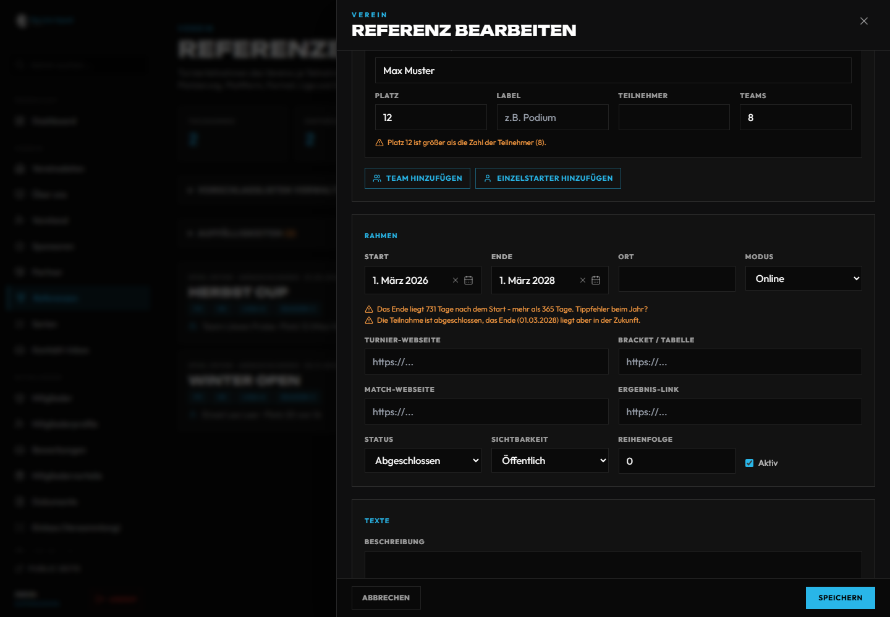</td>
<td>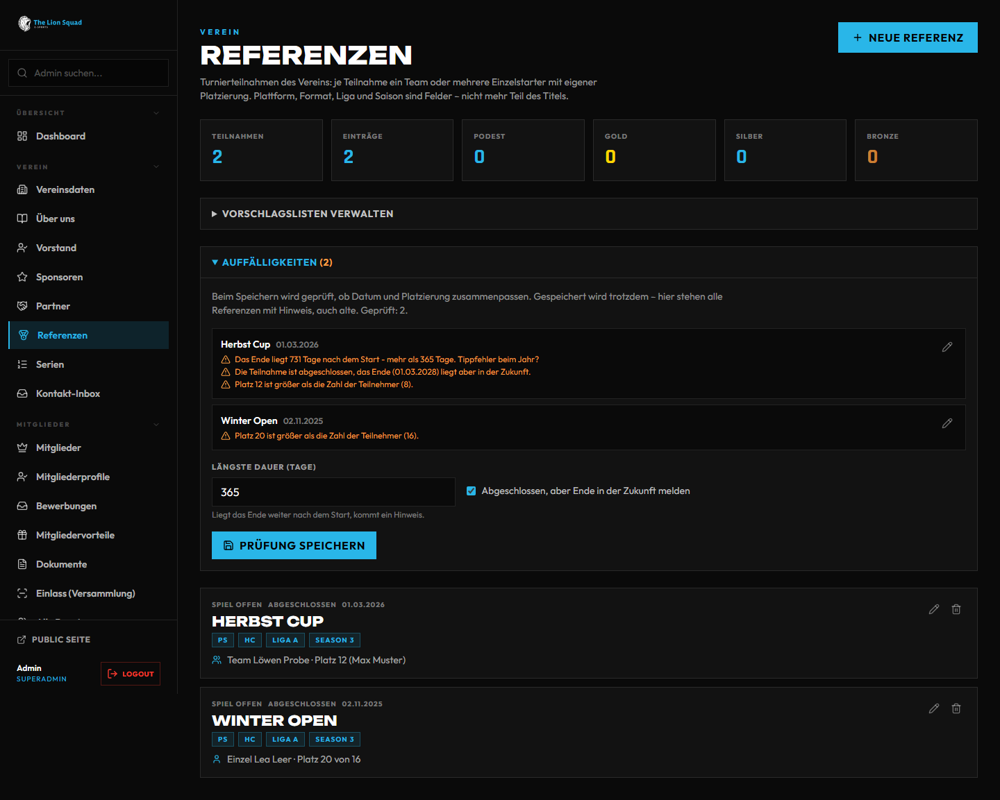</td>
</tr>
</table>

Mit **Vorschläge speichern** pflegt ihr die Auswahllisten für Formate und Platzierungen. Einen Partner als Veranstalter oder per Haken
zu nennen, zeigt die Referenz auch auf seiner Seite.

**Die Übersicht /references** („Erfolge & Referenzen“) zeigt von oben nach unten:

- **Ehrentafel:** Siege, Zweite und Dritte (je Eintrag gezählt), darunter Teilnahmen, Spiele, laufende Saisons, Aufstiege
  und „seit“ dem ersten Jahr. Die Sprungmarken daneben führen zu den Abschnitten.
- **Läuft gerade:** die laufenden Saisons der Serien (3.9).
- **Vitrine:** der größte Erfolg als **Hauptkarte**, daneben die übrigen Podestplätze, die neuesten zuerst. Gold, Silber
  und Bronze stehen nur als Ring und Schrift.
- **Serien & Ligen:** je Spur der Liga-Weg (3.9).
- **Chronik:** alle Teilnahmen als Liste je Jahr, mit Platz, Veranstalter, Spiel, Format, unseren Startern (jeder Name nur
  einmal) und Datum. Darüber filtern **Spiel-Chips** und **Nur Podest**; rechts steht „x von y Teilnahmen“. Kommt man über
  „Alle Referenzen“ aus einem Mitgliederprofil, steht vorne der Chip „Nur …“ – ein Klick hebt ihn auf.
- **Mitmachen:** „Mitglied werden“ und – wenn unter Einstellungen eine Discord-Einladung steht – „Discord beitreten“.

Die Chronik ordnet jede Teilnahme nach dem Jahr ihres **Startdatums** ein (Wiener Zeit; ohne Start zählt das Enddatum).
Teilnahmen ganz ohne Datum stehen am Ende unter **Ohne Datum** – tragt also ein Datum ein.

**Kurzer Titel:** Ist das Feld **Liga** gefüllt, steht in der Chronik und im Mitgliederprofil statt des langen
Veranstalter-Titels kurz „Veranstalter · Liga · Saison“ (bei einer Saison aus 3.9 deren Stufe und Saison). Der lange Titel
steht im Tooltip und auf der Detailseite. Ohne Liga bleibt der Titel, wie er ist.

**Im Mitgliederprofil** (`/members/…`) stehen die **Vereinsplatzierungen** als Ausschnitt dieser Übersicht – nur mit
Werten über null:

- **Kopf:** die eigenen Medaillen, die es gibt. Ohne Podest steht dort **Bestes Ergebnis** mit Platz, Liga, Monat und
  „von N Teams“. Daneben Teilnahmen, Spiele und „seit“.
- **Liga-Weg:** nur, wenn die Person in mindestens zwei Saisons derselben Spur stand (3.9) – wie in der App; eine einzelne
  Saison steht schon in der Chronik. Je Spur die Saisons der Person mit ihrem Platz und dem Vermerk der Saison (Aufstieg,
  läuft …), dazu **Zur Serie**. Am Handy lässt sich die Reihe wischen.
- **Chronik je Jahr:** eine Zeile je Teilnahme mit dem eigenen Platz, kurzem Titel, Spiel, Team mit „von N Teams“ und
  Datum. Ein Klick klappt die Details auf: langer Titel, Format und Plattform, die Aufstellung (die Person selbst
  hervorgehoben), **Saison ansehen** (nur mit Saison), **Details** (die Seite der Referenz mit Bericht, Partnern und Ort)
  und **Beim Veranstalter** (Turnierseite, sonst Ergebnis oder Bracket). Offen steht immer nur eine Zeile.

**Alle Referenzen** öffnet die Chronik oben mit „Nur …“.

<table>
<tr>
<td>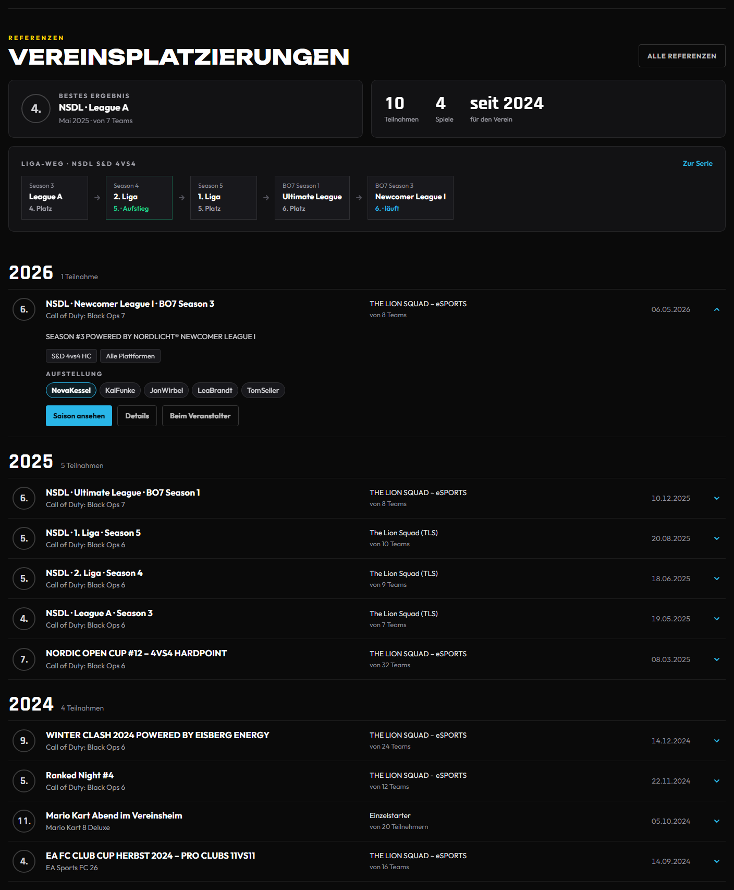</td>
<td>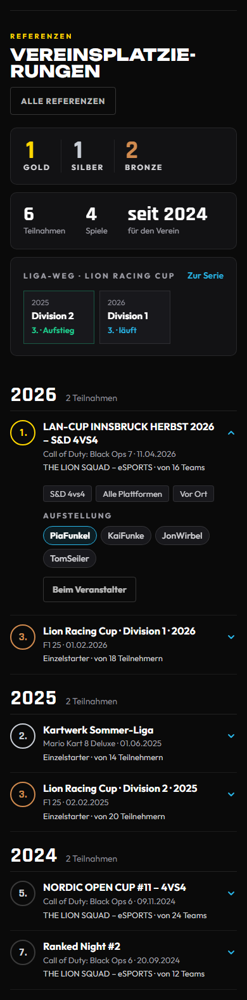</td>
</tr>
</table>

**Welche Teilnahme die Hauptkarte bekommt,** stellt ihr oben auf der Seite unter **Vitrine: Hauptkarte** ein:
**Automatisch** (Vorgabe) nimmt den höchsten Platz in der höchsten Stufe, bei Gleichstand den neuesten. Die Stufe kommt aus
der Saison, zu der die Referenz gehört, sonst aus dem Feld **Liga**; es zählt die Zahl nach Liga, Division, Div, Stufe,
Tier oder League („Liga 1“ vor „Liga 2“, ohne solche Zahl ganz unten). Oder ihr wählt eine der Podest-Referenzen fest – dann steht auf der Karte „Ausgewählt vom Verein“.
Gehört die Hauptkarte zu einer Saison, führt sie zur Seite der Saison, sonst zur Referenz.

<table>
<tr>
<td>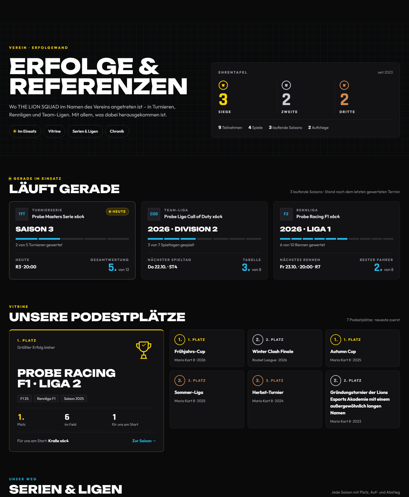</td>
<td>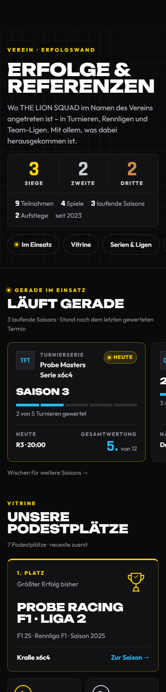</td>
</tr>
</table>

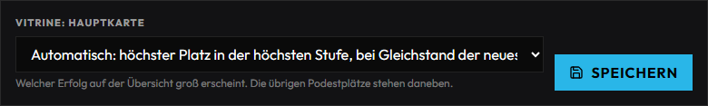

### 3.9 Serien

**Admin → Verein → Serien** (`/admin/reference-series`). Für externe Wettbewerbe, die über eine ganze Saison laufen:
monatliche **Turnierserien**, **Rennligen** mit Fahrer- und Teamwertung und **Team-Ligen**. Der Aufbau hat zwei Stufen:

- Eine **Spur** ist die Klammer, etwa „Lion Racing F1“: Titel, Art, Bezeichnung (F1, 4vs4 …), Veranstalter, Spiel und
  Sichtbarkeit, bei Rennligen dazu die **Vorlage für Ergebnis-Bilder** (siehe „Bild auslesen“ unten). **Neue Spur**
  öffnet das Blatt.
- Darunter je **Saison und Stufe** eine Serie: an der Spur **Saison**. Saison und Stufe (etwa „2026“ und „Division 1“)
  ergeben die Adresse. Dazu Status, Standard-Wochentag und -Uhrzeit (Wiener Zeit), die eigenen Teams, Links und wie
  Einträge eines Captains erscheinen – Standard: als Entwurf, den der Vorstand freigibt.
- **Eigene Teams:** Fährt der Verein mit mehreren Teams (etwa Hauptteam, Academy und ein drittes Team), stehen alle in
  der Liste – je Team der Name wie beim Veranstalter und weitere **Schreibweisen**, mit Komma getrennt. Groß/klein,
  Leer- und Bindestriche erkennt die Seite selbst: „TLS-DarkFriday“ und „TLS DarkFriday“ sind dasselbe Team. **+ Team**
  fügt eines an, das **×** nimmt es weg. Garage, Teamwertung, „Unser Platz“ und Liga-Weg zählen alle Teams der Liste;
  eine ältere Saison hat ihr bisheriges „Eigenes Team“ als erstes Team.

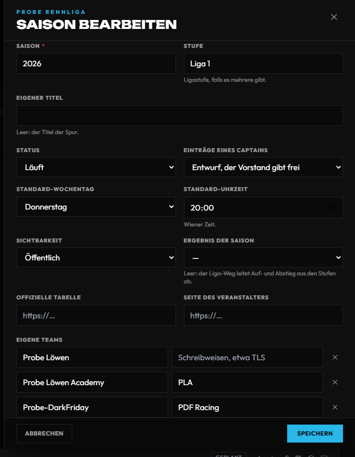

<table>
<tr>
<td>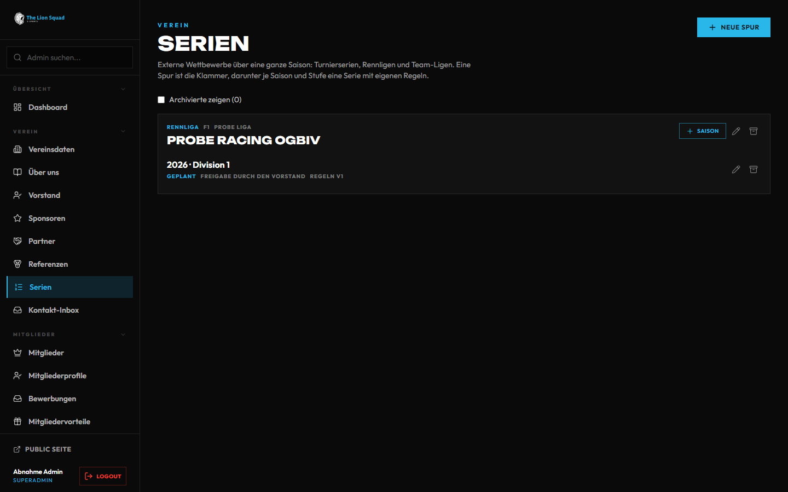</td>
<td>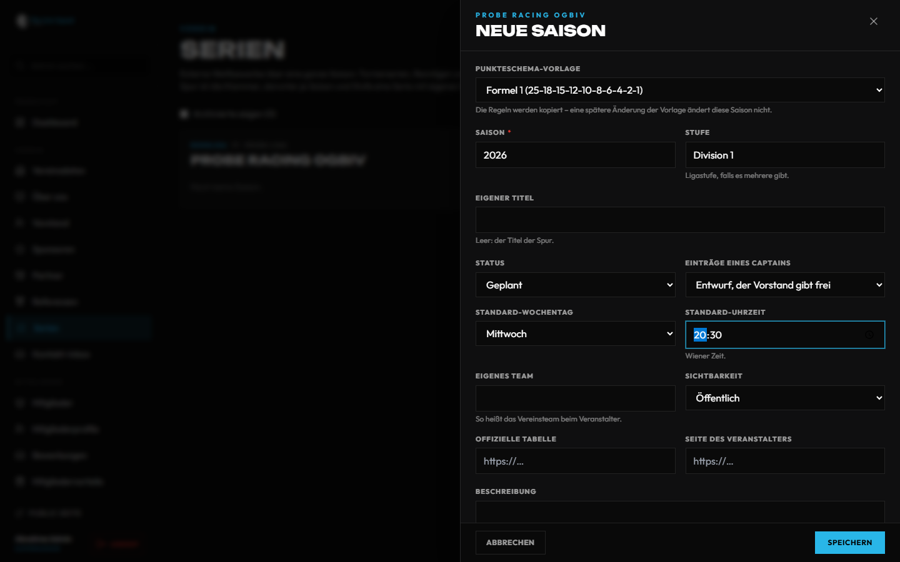</td>
</tr>
</table>

**Regeln:** Die **Punkteschema-Vorlage** füllt alle Regeln vor. Sie werden kopiert – eine spätere Änderung der Vorlage
ändert die Saison nicht. Einstellbar ist alles: Punkte je Platz oder **laut Veranstalter**, Boni für schnellste Runde und
Pole (bis Platz X), Punkte bei Ausfall, Nichtstart und Disqualifikation, **alle Runden**, **beste N** oder **N
Streichergebnisse** (es zählen die besten „Runden im Kalender minus N“), Aktivitätspunkte ab Runde X, die Finalgrenze,
der Vorrang bei Gleichstand (der Reihe nach, sonst teilen sich beide den Platz) und die Teamwertung (wie viele Fahrer je
Rennen zählen, ob Gäste zählen). Eine Team-Liga hat stattdessen Punkte für Sieg, Unentschieden und Niederlage.

Ändert ihr eine Regel mitten in der Saison, steigt die **Version**, der **Hinweis zur Regeländerung** steht bei der Saison
und im Protokoll, und alle Tabellen der Saison werden neu gerechnet.

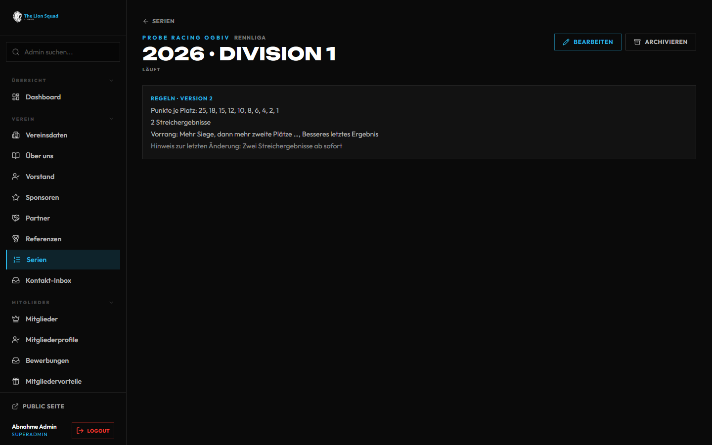

**Auf- und Abstieg:** An jeder Saison gibt es das Feld **Ergebnis der Saison** (Aufstieg, Abstieg, Klassenerhalt,
Meister oder leer). Steht dort etwas, gilt es – auch wenn die Stufen keine Zahl im Namen tragen. Ist es leer, wird
Auf- und Abstieg aus den Stufen abgeleitet. Die **Reihenfolge der Stufen** (höchste zuerst) steht an der Spur: Vorgabe
ist die Zahl im Namen („Liga 1“ vor „Liga 2“); mit den Pfeilen legt ihr eine eigene Reihenfolge fest, etwa für
„Gold“ und „Silber“, **Vorgabe aus den Namen** nimmt sie zurück. Der Vermerk steht klein im Liga-Weg – unter
**Serien & Ligen** auf der Übersicht und auf der Seite der Team-Liga gleich (Aufstieg grün, Meister gold, Abstieg und
Klassenerhalt grau); die Ehrentafel zählt die Aufstiege mit, die Vitrine wählt mit der Reihenfolge der Spur.

<table>
<tr>
<td>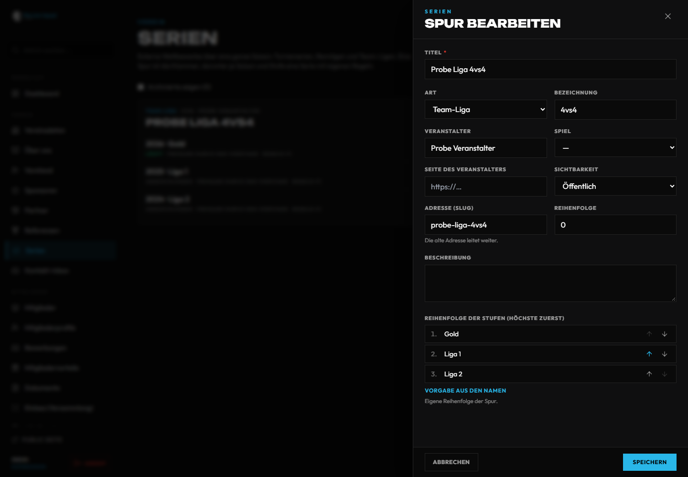</td>
<td>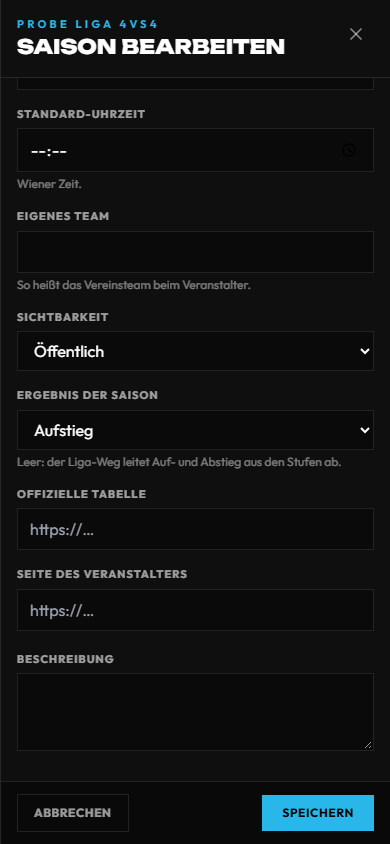</td>
</tr>
</table>

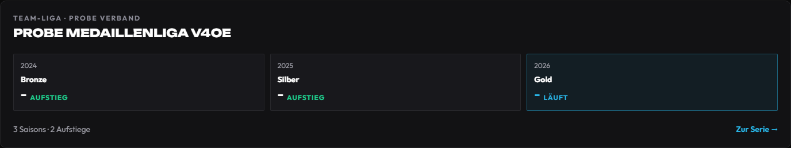

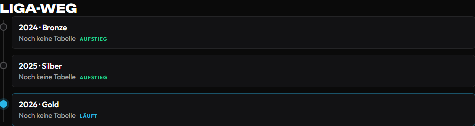

**Archivieren statt Löschen:** Spur und Saison lassen sich nur archivieren; **Archivierte zeigen** blendet sie ein,
**Zurückholen** macht es rückgängig. Ein Klick auf die Saison öffnet ihre Seite mit Regeln, Version und Kalender.
Teilnehmer, Ergebnisse und Captains stehen weiter unten. Die bestehenden
Referenzen bleiben, wie sie sind.

**Kalender der Saison.** Auf der Seite der Saison stehen alle Termine in ihrer Reihenfolge, jeder mit Status:
**Geplant**, **Heute**, **Ergebnis fehlt** (Tag vorbei, nichts eingetragen), **Verschoben**, **Abgesagt** und
**Gewertet**. Gezählt wird immer nach dem Wiener Kalendertag.

- **Liste einfügen:** je Zeile ein Termin, etwa `R1 · 05.11. · Strecke` – Kürzel, Datum (TT.MM. oder TT.MM.JJJJ),
  optional Uhrzeit und Ort; trennen mit Leerzeichen, `·`, `|` oder `;`. Ohne Jahr gilt das erste Jahr der Saison, über
  Neujahr zählt es weiter. Eine Zeile ohne Datum bekommt den nächsten **Standard-Wochentag** nach der Zeile davor,
  ohne Uhrzeit gilt die **Standard-Uhrzeit**. **Vorschau** zeigt, was daraus wird; hat eine Zeile einen Fehler, steht
  er mit Zeilennummer da, und übernommen wird erst eine fehlerfreie Liste. Aus dem Ort kommt die **Flagge**, etwa
  `R1 · 18.06.2026 · Aserbaidschan`.
- **Flagge:** Jeder Termin bekommt sein Land automatisch aus Strecke oder Ort, sonst aus dem Titel – deutsche und
  englische Ländernamen, bekannte Strecken und Städte (Monza, Spa, Suzuka, Interlagos, COTA, Baku, Yas Marina …) und
  Zusätze wie „USA (Miami)“. Ohne Treffer bleibt der Termin ohne Flagge. Im Termin wählt ihr unter **Land (Flagge)**
  ein anderes Land oder **Ohne Flagge** – diese Wahl bleibt, auch wenn sich die Strecke später ändert; **Automatisch aus
  der Strecke** nimmt sie zurück. Die Flagge steht im Kalender, im Rennraster, im Fahrer-Detail, im Ergebnisblatt und
  bei „Läuft gerade“ und „Heute im Einsatz“.
- **Termin:** einzeln anlegen; Tag und Uhrzeit sind mit dem nächsten Standard-Wochentag und der Standard-Uhrzeit
  vorbefüllt. Art **Finale**, **Zählt zur Wertung** (aus: steht im Kalender, geht aber nicht in die Tabelle) und bei
  einer Team-Liga der Gegner. Die Notiz sieht nur die Verwaltung.
- **Verschieben** (Kalender-Symbol): neuer Tag und Uhrzeit. Der ursprüngliche Tag bleibt beim Termin stehen, auch wenn
  ihr noch einmal verschiebt.
- **Absagen** (Verbotszeichen): ein abgesagter Termin fehlt nie und zählt nicht zur Rundenzahl der Wertung;
  **Wieder ansetzen** nimmt es zurück.
- **Reihenfolge:** mit den Pfeilen oder **Nach Datum ordnen**. **Archivieren** nimmt einen Termin aus dem Kalender,
  unter **Archiviert** lässt er sich zurückholen. Gewertete Termine lassen sich weder absagen noch archivieren.

Hat ein Termin kein Ergebnis, obwohl danach schon gewertet ist, steht oben der Hinweis **Lücke im Kalender** – meist
fehlt das Ergebnis, oder der Termin wurde abgesagt.

<table>
<tr>
<td>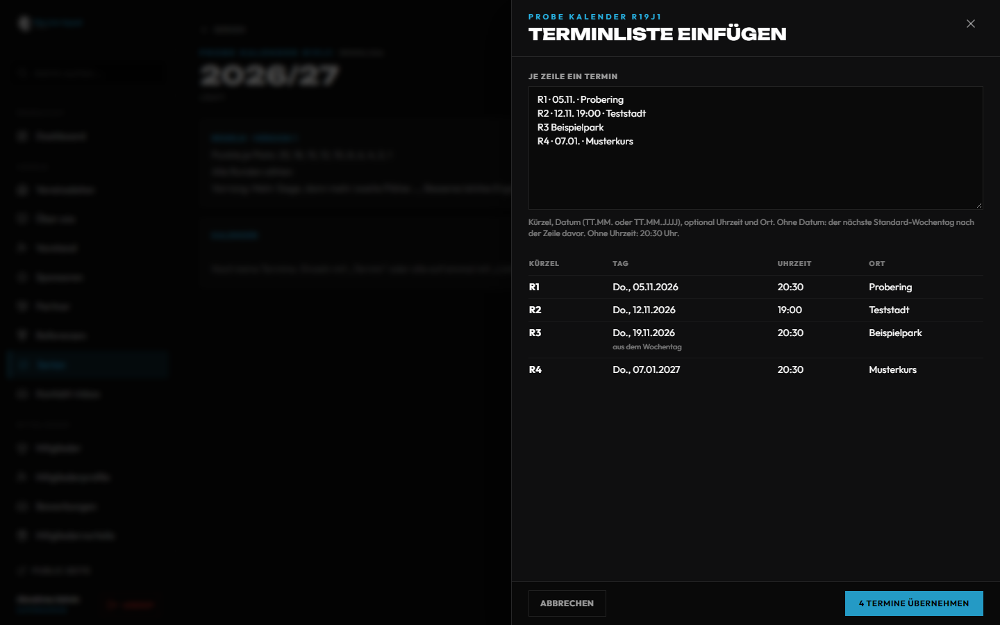</td>
<td>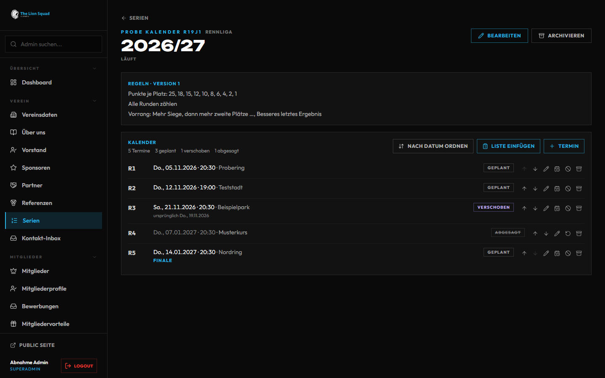</td>
</tr>
<tr>
<td>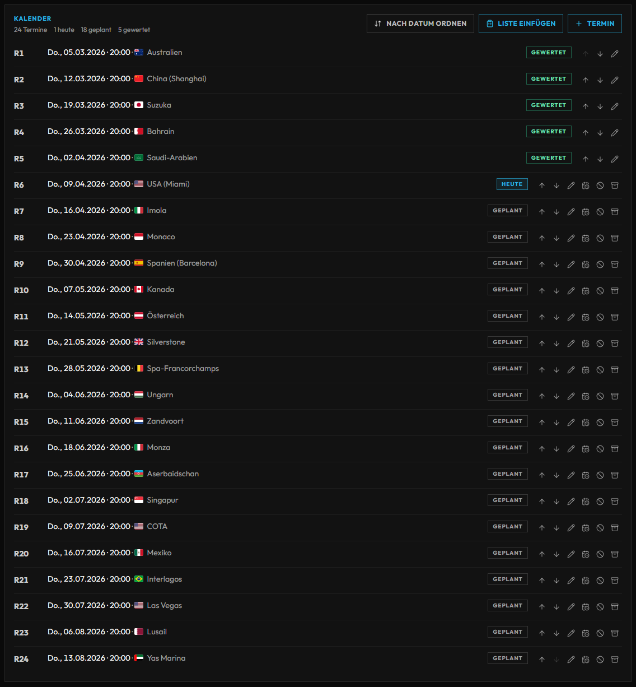</td>
<td>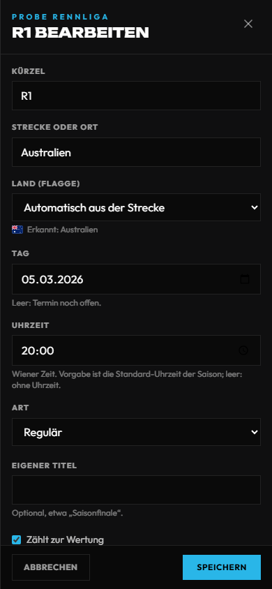</td>
</tr>
</table>

**Öffentlich** steht der Kalender unter `/references/series/<spur>/<saison>` – mit der Sichtbarkeit von Spur und Saison
(eine Saison „Nur Mitglieder“ sehen Gäste nicht), ohne Notizen; statt „Ergebnis fehlt“ steht dort „Ergebnis folgt“.

**Seite Turnierserie:** Dieselbe Adresse zeigt die ganze Saison – oben Spur, Veranstalter und Spiel, dann der
**Fortschritt** (ein Feld je Wertungsrunde, das Finale in Gold, darunter das nächste Turnier mit Datum) und die **Regeln**
(Punkteschlüssel, Streichergebnisse oder „beste N“, Vorrang bei Gleichstand, Finalgrenze). Die **Gesamtwertung** zeigt das
Ergebnis je Runde; gestrichene Ergebnisse sind durchgestrichen und blass, Pfeile zeigen den Weg seit der Runde davor, eine
goldene Linie die **Finalgrenze** (Top N aus den Regeln der Saison). Vereinsmitglieder sind cyan markiert und verlinken auf
ihr Profil; fremde Namen stehen nur als Text in der Tabelle, ein ausgeblendeter Name als „Name ausgeblendet“. **Nur
Vereinsspieler** blendet alle anderen aus. Am Handy stehen Karten statt der breiten Tabelle: die ersten zehn und alle
Vereinsspieler, **Ganze Tabelle zeigen** klappt den Rest auf. **Was braucht es fürs Finale?** rechnet für einen gewählten
Spieler den Abstand zur Finalgrenze und den nötigen Schnitt je offener Runde – ausdrücklich ein Richtwert. Das **Finale**
(Termin mit Art „Finale“) steht als eigene Runde mit eigener Endplatzierung darunter. Die Seite liest nur den
gespeicherten Stand und ist nicht für Suchmaschinen gedacht (`noindex`).

<table>
<tr>
<td>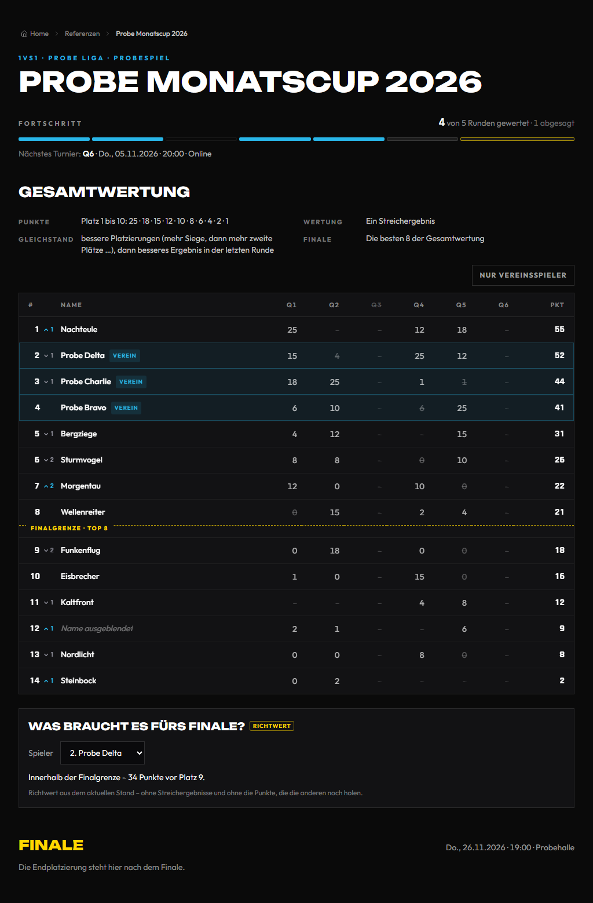</td>
<td>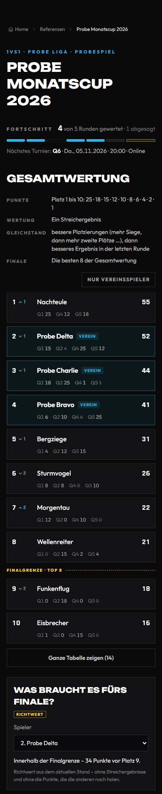</td>
</tr>
</table>

**Seite Team-Liga:** Bei einer Spur vom Typ Team-Liga zeigt dieselbe Adresse statt der Gesamtwertung die Liga aus
Sicht der eigenen Teams (Liste **Eigene Teams** der Saison; spielen mehrere, steht im Spielplan, welches gespielt
hat). Oben die **Spieltage** (ein Feld je Spieltag – Sieg cyan, Niederlage grau) und der nächste Spieltag mit Gegner. Die **Tabelle** ist die Tabelle laut Veranstalter vom letzten
eingetragenen Spieltag, sonst aus den eigenen Spielen gerechnet; Punkte für Sieg, Unentschieden und Niederlage und der
Vorrang bei Gleichstand stehen darüber und kommen aus den Regeln der Saison. Das eigene Team ist als „Verein“ markiert,
mit Form (die letzten fünf eigenen Spiele) und darunter dem **Platzierungsverlauf** nach jedem Spieltag. Der
**Spielplan** zeigt je Spieltag Gegner, Heim oder Auswärts, das Ergebnis und die Maps. Die **Aufstellung** zählt, wer an
welchem Spieltag gespielt hat: Vereinsmitglieder verlinken auf ihr Profil und haben unter **Gesamt** ihre Einsätze über
alle Saisons der Spur; Gäste stehen getrennt und zählen nicht in die Vereinsstatistik. Der **Liga-Weg** listet alle
Saisons der Spur mit Stufe, Platz von N und Punkten – Platz 1 bis 3 in den Farben der Pokale, die aktuelle Saison
markiert, die anderen verlinkt. Eingetragen wird alles im Blatt **Ergebnis eintragen** des Spieltags: Spiel mit Maps und
Aufstellung, dazu bei Bedarf die Tabelle laut Veranstalter.

<table>
<tr>
<td>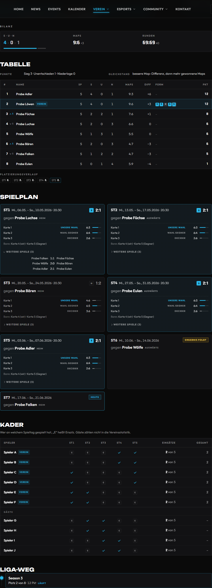</td>
<td>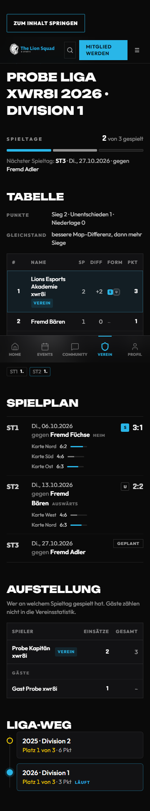</td>
</tr>
</table>

**Seite Rennliga:** Eine Spur der Art **Rennliga** zeigt unter derselben Adresse ihre eigene Seite:

- Oben der **Umschalter** zwischen den Saisons und Ligen der Spur (etwa 2026 · F1, 2026 · F2, die Vorsaison) –
  laufende Saisons tragen „läuft“. Der Fortschritt zählt Rennen.
- **Vereins-Garage:** je Vereinsteam die Fahrer mit Platz und Punkten und das **Teamduell** – wer in gemeinsamen
  Rennen fürs Team öfter vor dem anderen ins Ziel kam, dazu die Punkte, die jeder laut Teamwertung fürs Team geholt hat
  (nur gezählte Rennen, Gäste nur, wenn sie mitzählen). Garage und Duell sind keine Tabelle: Gäste und Fremde stehen dort
  als **Gastfahrer** ohne Namen (Gäste mit **Gast**), ihre Namen nur in den Tabellen. Vereinsteams sind alle **eigenen
  Teams** der Saison (auch eines ohne Rennen) und jedes Team, für das ein Vereinsmitglied zuletzt gefahren ist.
- **Fahrer-Detail:** Ein Klick auf einen Vereinsfahrer (Garage, Tabelle oder Kalender) zeigt Platz, Punkte, Rennen,
  Siege, Podien, schnellste Runden, Ausfälle und je Rennen einen Balken mit Punkten und Platz. Die Adresse merkt sich den
  Fahrer (`?fahrer=…`), so lässt sich das Detail teilen. Ein Detail gibt es nur für Vereinsmitglieder mit aktivem Profil
  und sichtbarem Namen – wie beim Profil-Link; für alle anderen öffnet auch die Adresse keins. Ist der Startplatz
  eingetragen, steht unter jedem Rennen, wie viele **Plätze gutgemacht** (Cyan, Pfeil nach oben) oder verloren
  wurden, und oben die Summe der Saison und wie oft der Fahrer **Fahrer des Tages** war; unter den Rennen die Flaggen.
- **Fahrerwertung** als Rennraster: je Rennen der Platz, das Podium in Gold, Silber und Bronze, eine Stoppuhr für die
  schnellste Runde, ein goldener Stern für den **Fahrer des Tages**, **DNF**, **DNS** und **DSQ**, dazu Punkte und
  **Abstand** zur Spitze; über jeder Spalte die Flagge des Rennens. Fährt man mit der Maus über eine Zelle, stehen dort
  Startplatz, gutgemachte Plätze, Zeit, Abstand und die Zeit der schnellsten Runde. Weicht der **Gesamtstand laut
  Veranstalter** von der eigenen Summe ab (meist Strafen), steht die Abweichung klein in Gold neben den Punkten.
- **Teamwertung** (wenn die Regeln sie einschalten): ein Balken je Team, die Punkte je Rennen, Vereinsteams in Cyan,
  Gäste markiert; darüber, wie viele Fahrer je Rennen zählen und ob Gäste mitzählen.
- **Rennkalender:** alle Termine mit Status; bei gewerteten Rennen der Sieger, wenn er aus dem Verein ist, sonst der
  beste Vereinsfahrer mit Platz.

Das Team je Rennen kommt aus der Spalte **Team** im Ergebnisblatt, sonst gilt das Standard-Team des Teilnehmers. Am Handy
stehen Karten statt der Tabellen.

<table>
<tr>
<td>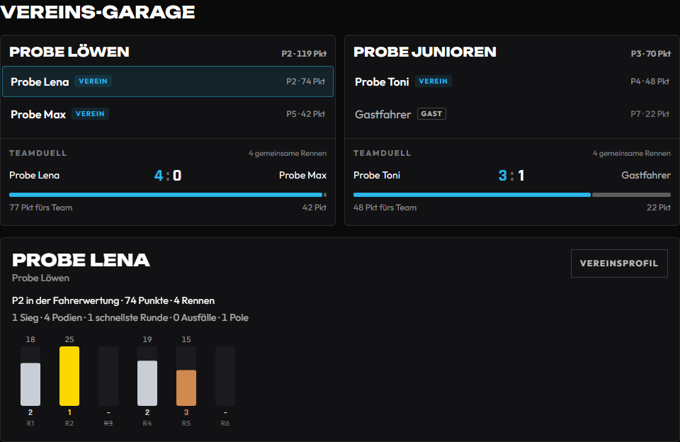</td>
<td rowspan="2">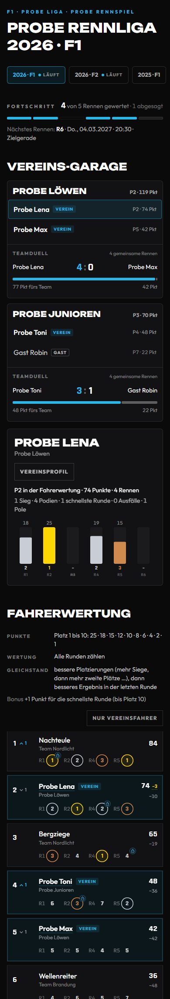</td>
</tr>
<tr>
<td>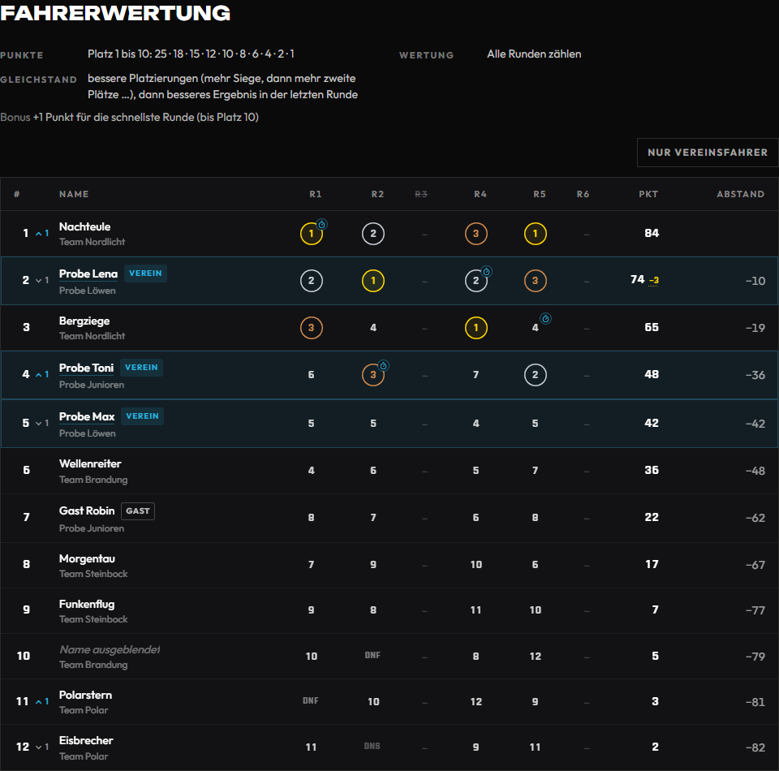</td>
</tr>
</table>

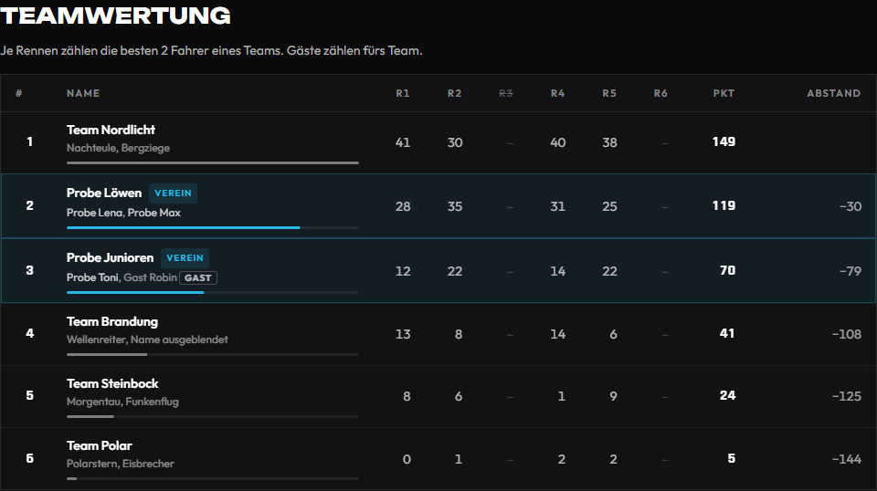

<table>
<tr>
<td>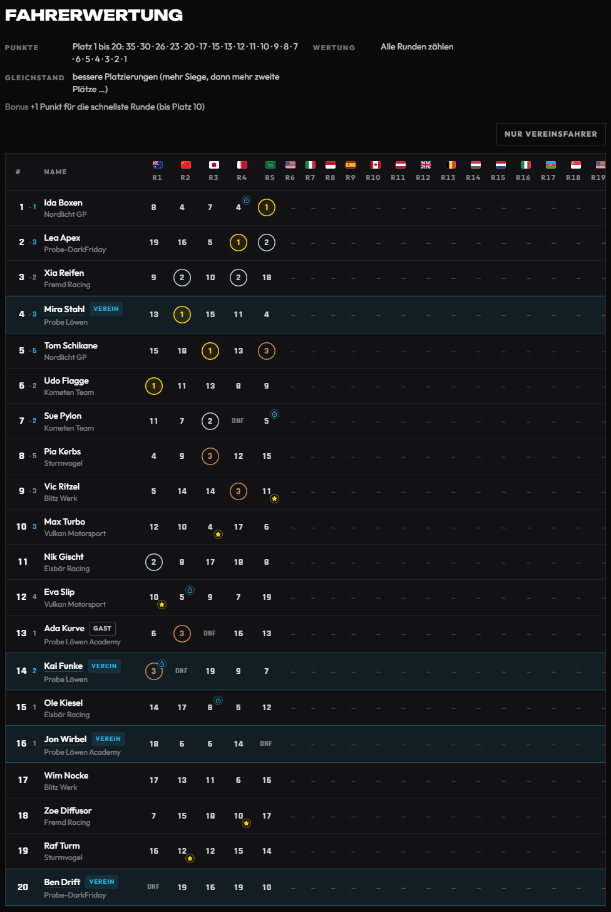</td>
<td>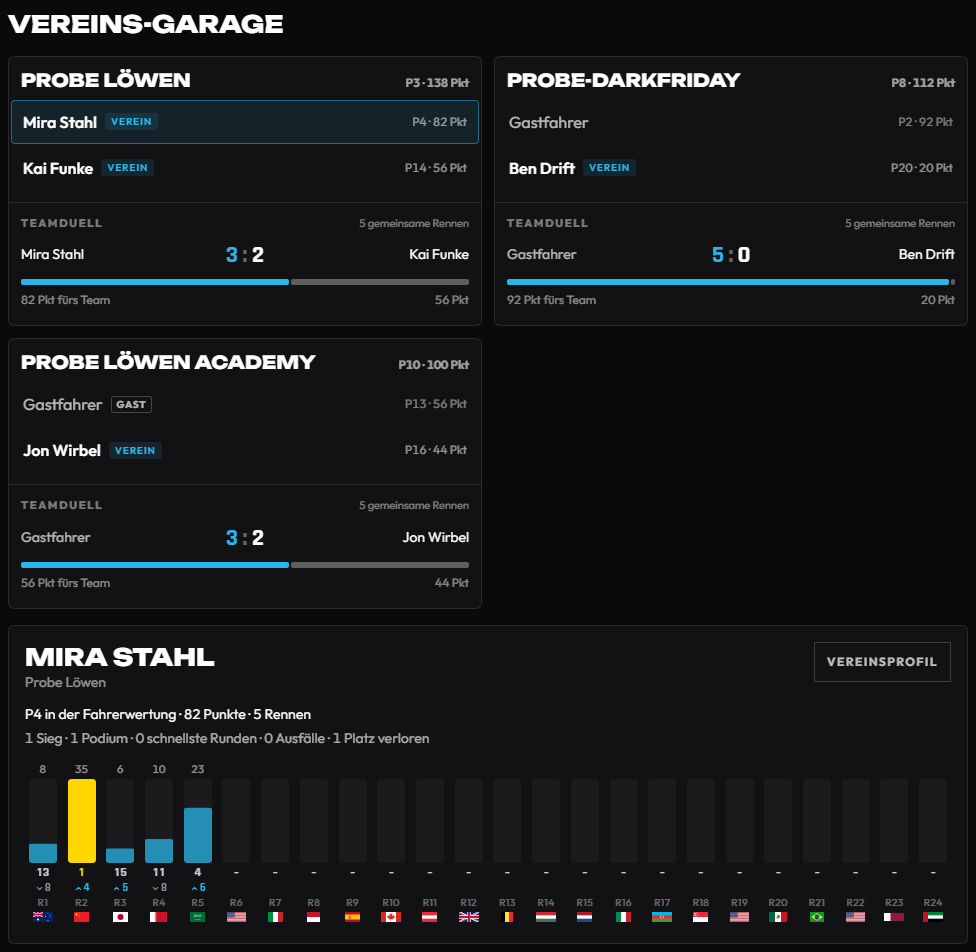</td>
</tr>
</table>

**Läuft gerade:** Sobald eine Saison den Status **Läuft** hat (und sichtbar, nicht archiviert ist), erscheint sie oben
auf der Seite **Erfolge & Referenzen** (`/references`), noch vor der Vitrine. Jede Karte zeigt den Fortschritt in
Segmenten („6 von 10 Rennen gewertet“, „3 von 7 Spieltagen gespielt“, „2 von 5 Turnieren gewertet“), den **nächsten
Termin** mit Flagge und unseren Platz als große Zahl – bei der Team-Liga den besten Platz eines eigenen Teams in der
Tabelle, sonst den
besten Platz eines Vereinsmitglieds („Noch offen“ bis zur ersten Wertung). Ein Klick führt zur Seite der Saison. Steht
**heute** (Wiener Tag) ein Termin an, kommt die Saison zuerst und trägt den goldenen Chip **Heute** mit einem leisen Puls
(bei „Bewegung reduzieren“ ohne Puls). Am Handy wischt man waagrecht von Karte zu Karte. Fremde Namen erscheinen dort
nie. Läuft nichts, fehlt der Bereich ganz. Zum Ändern genügt der Status der Saison.

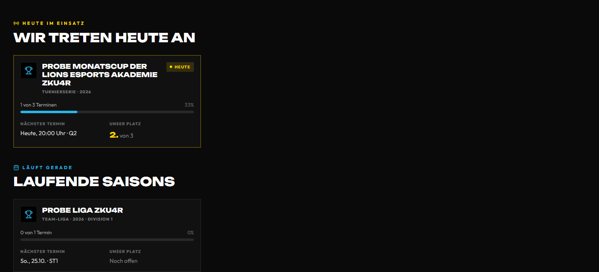

**Serien & Ligen:** Darunter steht je Spur eine Karte mit ihrem **Liga-Weg** – jede sichtbare Saison mit Stufe, unserem
Platz und einem Vermerk: **läuft** für die laufende Saison (hervorgehoben), **Aufstieg** oder **Abstieg**, wenn die
nächste Saison eine höhere oder tiefere Stufe hat. Verglichen wird die Zahl direkt nach **Liga**, **Division**, **Div**,
**Stufe**, **Tier** oder **League** („Division 3“ → „Division 2“ ist ein Aufstieg, auch als „4v4 Division 3“; „1. Liga“
geht ebenso). Spielformate wie 4v4 und Jahreszahlen zählen nicht – ohne solche Zahl bleibt der Vermerk leer. Die Karte
führt zur laufenden, sonst zur neuesten Saison.

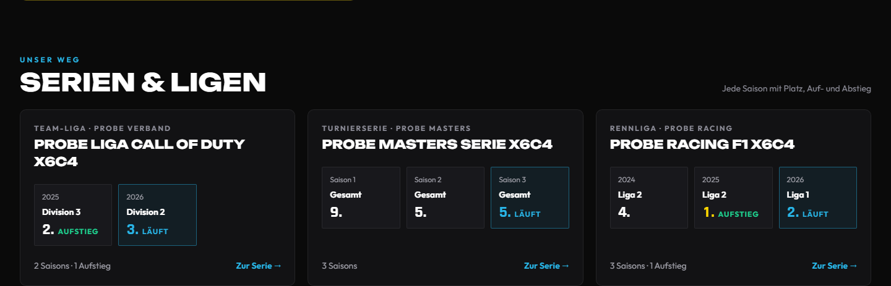

**Captains:** Auf der Seite der Saison steht unten **Captains**. Dort tragt ihr Mitglieder ein, die für genau diese
Saison Ergebnisse hochladen dürfen – nur aktive Vereinsmitglieder, die Suche findet nur sie. Namen tippen, **Gilt bis** wählen (Pflicht, meist das Saisonende) und – wenn der
Captain ohne Freigabe veröffentlichen darf – **Darf veröffentlichen** anhaken; dann **Captain hinzufügen**. In der Liste
lassen sich der Ablauf verlängern (**Ablauf speichern**), das Recht umschalten und der Captain entfernen. Abgelaufene
Captains stehen blass am Ende. Fehlt einem Captain noch die Zwei-Faktor-Anmeldung oder ist er kein aktives Mitglied mehr,
steht es dabei – so lange kommt er nicht in die Saison. Steht die Saison unter **Einträge eines Captains** auf „Captain veröffentlicht direkt“, gilt das für
alle ihre Captains.

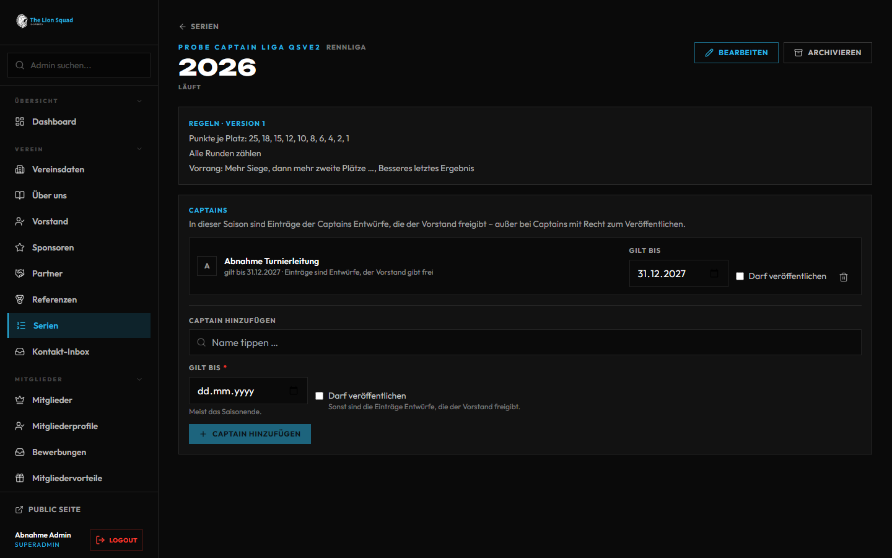

Ein Captain findet seine Saisons unter **Mein Dienst → Meine Serien** (im Benutzermenü, oder `/admin`). **Saison
öffnen** zeigt die Seite der Saison ohne die Knöpfe des Vorstands; oben steht, bis wann sein Recht gilt und ob seine
Einträge Entwürfe sind. Nach dem letzten Tag verschwindet die Saison aus der Liste.

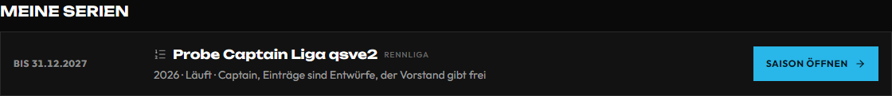

**Teilnehmer und unbekannte Namen:** Auf der Seite der Saison stehen unter **Teilnehmer** alle Namen so, wie der
Veranstalter sie führt – je als **Mitglied** (mit Profil), **Gast**, **Extern** oder **offen**. **Namen** fügt mehrere auf
einmal hinzu (einer je Zeile); schon vorhandene werden übersprungen, bekannte gleich zugeordnet.
**Unbekannte Namen** öffnet die offenen Namen mit Vorschlägen samt Begründung:

- **Spiel-ID passt** – die Kennung im Konto des Mitglieds (Reiter „Gaming“: je Spiel, EA-ID, PSN, Xbox …) ist gleich.
  Der Vorschlag ist vorausgewählt.
- **Alias bestätigt am …** – der Name wurde schon einmal zugeordnet.
- **Name im Profil passt** und **Gleiche Startnummer wie in …** sind nur Hinweise und werden nicht vorausgewählt.

Verglichen wird ohne Groß/Klein, Leerzeichen, Sonderzeichen und Akzente; Clan-Tags wie „[TLS]“ sind optional (der
Vorschlag sagt dann „ohne Clan-Tag“). Bloß ähnliche Namen („Name2“) werden nie vorgeschlagen. Je Zeile entscheidet ihr
einmal: **Bestätigen** (Mitglied), **Gast** oder **Extern**. Mitglied und Gast merkt sich die Website als **Alias** und
erkennt den Namen danach in jeder Serie selbst; für Externe wird nichts gespeichert, und ein falscher Alias wird damit
zurückgenommen. **Gäste** zählen fürs Team, aber nicht in der Vereinsstatistik und nicht im Profil. Aliase und
Verknüpfungen sieht nur die Verwaltung (Bereich Redaktion).

<table>
<tr>
<td>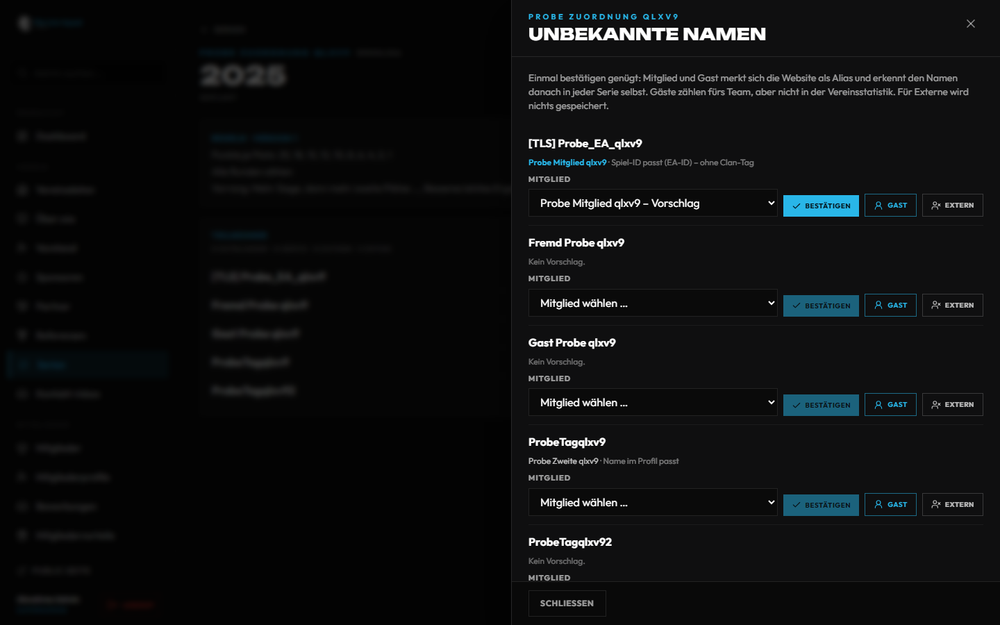</td>
<td>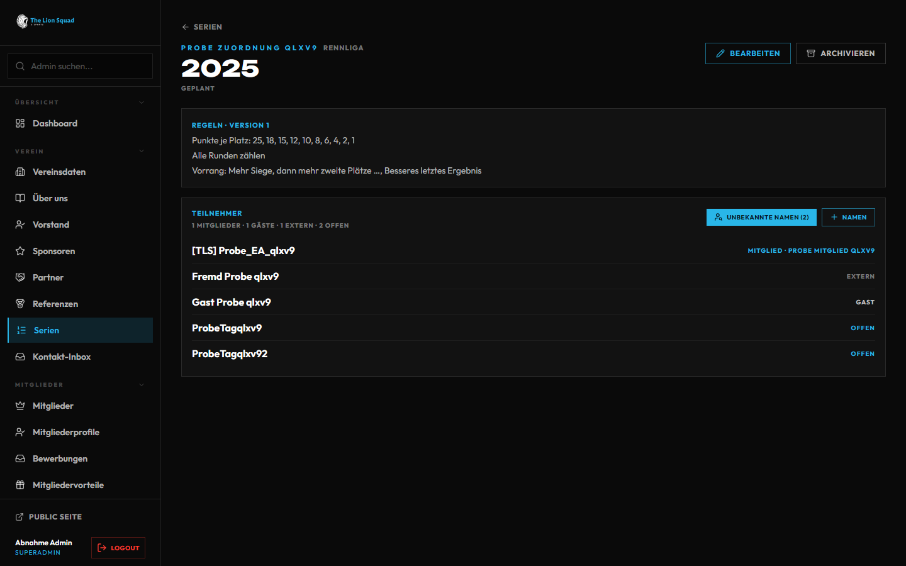</td>
</tr>
</table>

**Teilnehmer nachträglich bearbeiten:** Kurz zur Zuordnung – **Mitglied** zählt für Verein und Profil, **Gast** fährt
für ein Vereinsteam, ist aber kein Mitglied, **Extern** sind alle anderen. Über der Liste filtert ihr nach **Alle**,
**Mitglieder**, **Gäste**, **Extern** oder **Offen** und sucht nach Name, Startnummer, Team oder Profil.

- **Bearbeiten** (Stift am Ende der Zeile): Name wie beim Veranstalter, Startnummer, Standard-Team und die Zuordnung
  (Mitglied mit Profil, Gast oder Extern). Wird ein Mitglied oder Gast extern, fragt die Seite nach – jeder Alias des
  Teilnehmers wird dann in allen Saisons zurückgenommen. Gibt es den neuen Namen in der Saison schon, sagt die Seite
  das: dann zusammenführen.
- **Mehrere auf einmal:** Haken setzen – **Alle auswählen** nimmt nur, was Filter und Suche gerade zeigen – und
  **Als Gast** oder **Als Extern**. Geht dabei eine Zuordnung verloren, fragt die Seite einmal für alle nach. Die
  Saison wird danach einmal neu gerechnet, andere Saisons mit demselben Alias ziehen mit. Beispiel: alle Fremden
  versehentlich als Gast angelegt – Filter **Gäste**, **Alle auswählen**, die echten Gäste wieder abwählen,
  **Als Extern**, bestätigen.
- **Zusammenführen:** Genau zwei auswählen (dieselbe Person unter zwei Schreibweisen) und festlegen, welcher Eintrag
  bleibt. Die Ergebnisse des anderen wandern mit, auch Entwürfe, danach wird neu gerechnet; jedes geänderte Ergebnis
  behält seinen alten Stand als Revision. Die Zuordnung des behaltenen gilt danach auch für die andere Schreibweise, in
  allen Saisons. Stehen beide im selben Ergebnis, geht es nicht – dort erst eine der beiden Zeilen entfernen.
- **Entfernen** steht im Blatt „Teilnehmer bearbeiten“ nur bei Namen ohne Ergebnis; sonst führt der Weg übers
  Zusammenführen.

Jede Änderung steht im Protokoll. Bearbeiten und zuordnen darf nur der Vorstand, ein Captain nicht.

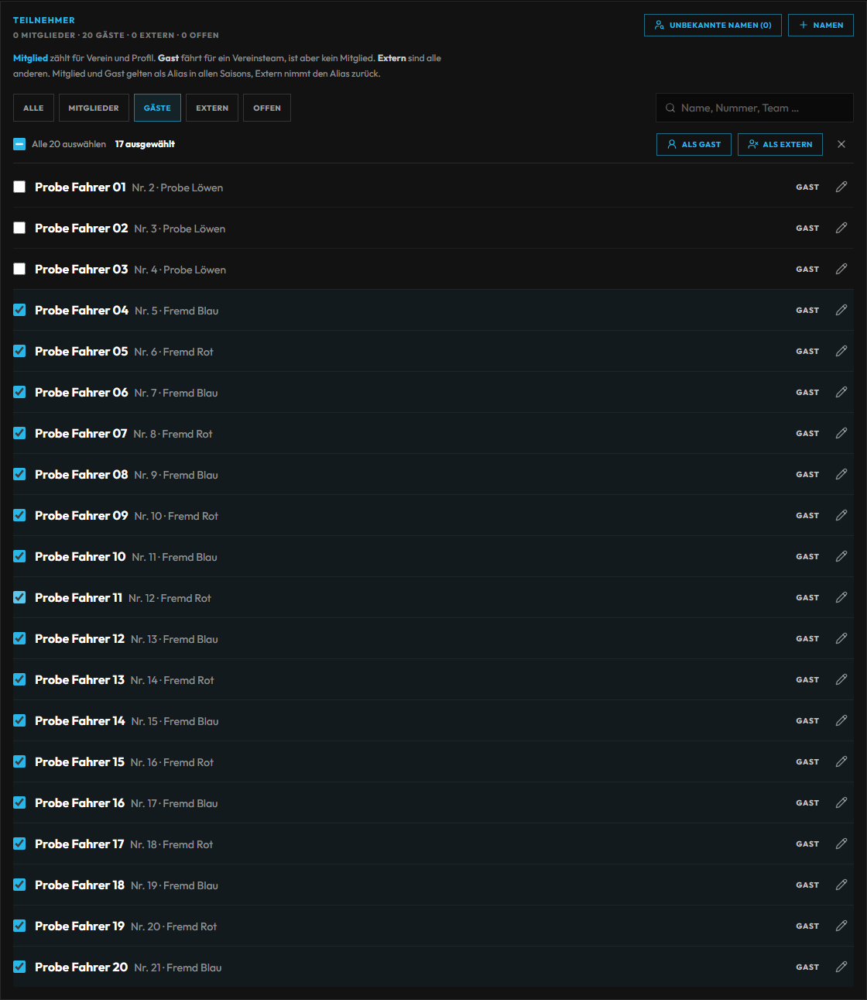

<table>
<tr>
<td>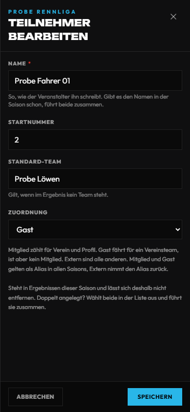</td>
<td>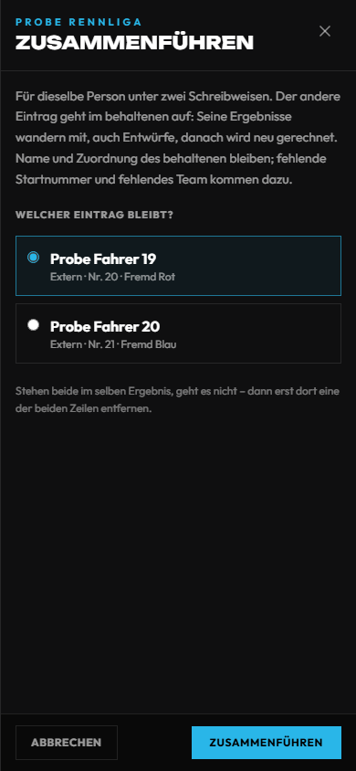</td>
</tr>
</table>

#### Ergebnisse eintragen

Auf der Seite der Saison steht unter **Ergebnisse** jeder Termin (außer abgesagten) mit **Ergebnis eintragen** – bei
einem gewerteten Termin **Ergebnis ändern**. Das öffnet das Blatt des Termins. Vorstand und Captains der Saison sehen es.

- **Ergebnisliste:** je Zeile ein Teilnehmer. **+ Teilnehmer** fügt eine Zeile an, das **×** nimmt sie wieder weg.
  Der **Platz** ergibt sich aus der Reihenfolge (grau vorgeschlagen) und lässt sich überschreiben; ein Nichtstart (DNS)
  bekommt keinen Platz. Der **Name** schlägt die Teilnehmer der Saison vor – ein bekannter Name bringt sein Team mit.
  **Team** gilt für dieses Rennen. **Punkte** leer heißt: nach dem Schlüssel der Saison. Eingetragene Punkte gelten als
  **laut Veranstalter** und werden gegen den Schlüssel geprüft; bei einer Saison „Punkte laut Veranstalter“ zählen sie
  direkt.
- **Mehr** (Regler-Symbol) zeigt die Marken **DNF**, **DNS**, **DSQ**, **Schnellste Runde** und **Pole**, dazu
  **Strafpunkte**, **Startnummer**, **Startplatz**, **Zeit**, **Abstand**, den **Gesamtstand laut Veranstalter** (wird mit
  der eigenen Rechnung verglichen) und **Punkte zählen statt Schlüssel**, wenn ein Wert bewusst vom Schlüssel abweicht.
  Zugeklappt stehen Startnummer, Startplatz, Zeit und Abstand kurz unter der Zeile.
- **Rennliga:** unter der Liste je Rennen die **Schnellste Runde** (Name aus der Liste und Rundenzeit) und der **Fahrer
  des Tages**. Beide müssen in der Liste stehen; die schnellste Runde setzt die Marke an ihrer Zeile, so zählt ein Bonus.
  Alles ist freiwillig – die Punkte kommen weiter aus dem Schlüssel.
- **Liste einfügen:** die Ergebnisliste von der Seite des Veranstalters kopieren und einfügen – etwa `1. Name 25 Pkt`,
  `3 Name DNF`, nur Namen in Reihenfolge, `Name;Platz` oder eine Tabelle aus Excel oder einer Website (Tab, `|` oder
  `;`, gern mit Kopfzeile wie „Pos | Fahrer | Team | Punkte“). **Liste übernehmen** ersetzt die Zeilen und prüft gleich.
  Was sich nicht lesen lässt, steht mit Zeilennummer darunter. Eine Zahl, die nur mit einem Leerzeichen am Namen hängt
  („Max Muster 33“), bleibt beim Namen; die Zeile fragt dann **Letzte Zahl = Punkte** oder **Gehört zum Namen** (bei
  mehreren Zeilen auch **Bei allen: letzte Zahl = Punkte**). Klar sind Punkte mit zwei Leerzeichen davor, mit „Pkt“
  dahinter oder in einer eigenen Spalte. Tabellen mit den Spalten **Nr**, **Start** (oder Startplatz, Grid), **Zeit**,
  **Abstand** (Gap, Rückstand) und **Beste Runde** werden mitgelesen – die schnellste beste Runde wird die schnellste
  Runde des Rennens. Ohne Kopfzeile gilt eine Zelle mit „:“ als Zeit und eine mit „+“ als Abstand. Zeilen wie
  `Schnellste Runde: Name 1:31.456` und `Fahrer des Tages: Name` füllen die Felder des Rennens.
- **Bild auslesen** (Rennligen): den Ergebnis-Screenshot des Veranstalters mit **Strg+V** ins Blatt einfügen oder über
  **Bild auslesen** wählen – am Handy geht auch die Kamera. Der eigene Server liest das Bild (kein fremder Dienst, das
  Bild wird nicht gespeichert) und füllt die Liste: Platz, Startnummer, Name, Team, Punkte (falls im Bild), Startplatz,
  Zeit, Abstand, DNF bzw. OUT und die Pole als Marke; dazu die **Schnellste Runde** und den **Fahrer des Tages** des
  Rennens. Die Vorschau prüft gleich. Darüber steht **Aus dem Bild gelesen** mit dem Bild zum Vergleichen (antippen
  vergrößert), Strecke, Art (Rennen oder Qualifying – nur als Hinweis), schnellster Rennrunde, Pole und Fahrer des
  Tages. Passt die Strecke zu einem anderen Termin der Saison, sagt ein Hinweis, zu welchem. **Gelbe Felder** sind
  unsicher, darunter steht, was im Bild stand; ist Startplatz, Zeit oder Abstand gelb, steht **Mehr** gleich offen.
  Ändern nimmt die Markierung weg, **Passt so** bestätigt die ganze Zeile (beim Rennen: schnellste Runde und Fahrer des
  Tages). Übernehmen geht erst, wenn nichts mehr gelb ist – bis dahin heißt der Knopf **Gelbe Zeilen prüfen** und
  springt zur ersten. Wie das Bild
  aufgebaut ist, sagt die **Vorlage für Ergebnis-Bilder** an der Spur (eine Saison kann abweichen): Standard für
  Rennligen ist „Rennliga-Ergebnis (dunkel)“, **Aus** schaltet das Auslesen ab.
- **Team-Liga:** statt der Liste das **Spiel** – eigenes Team und Gegner (aus dem Termin vorbefüllt), Ergebnis, die
  **Maps** und die **Aufstellung** (wer gespielt hat). Darunter die **Tabelle laut Veranstalter**: einfügen, etwa
  `1. Team 10 7 1 2 22` oder mit Kopfzeile (Pl, Team, Sp, S, U, N, Maps, Pkt).

<table>
<tr>
<td>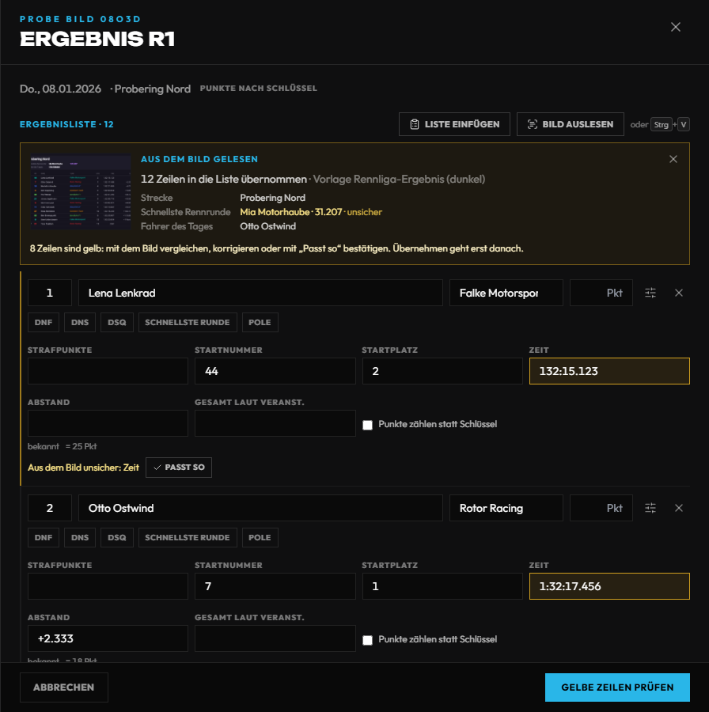</td>
<td>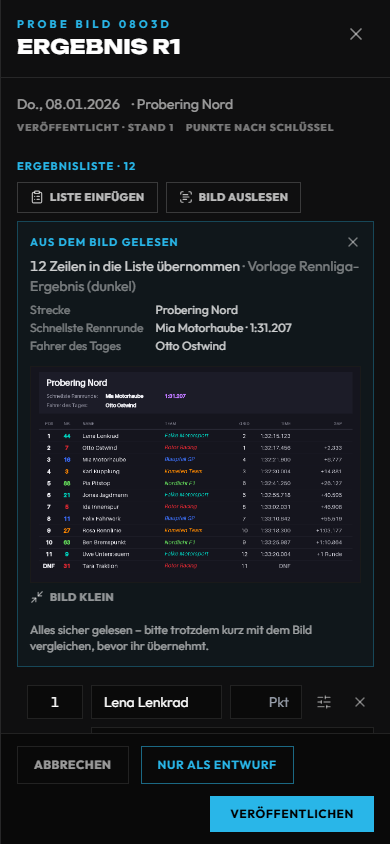</td>
<td>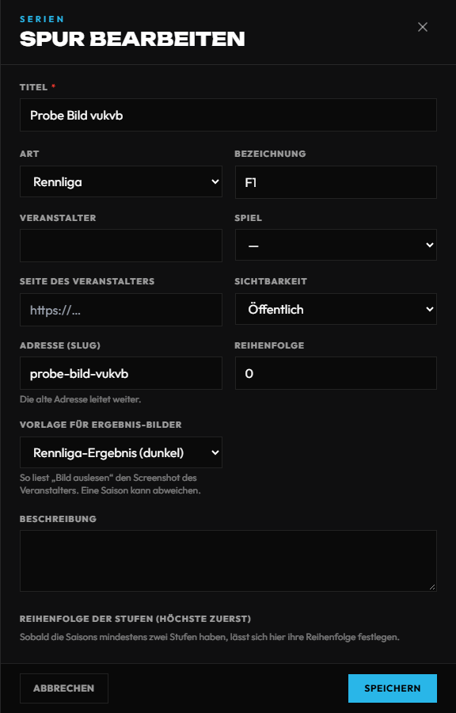</td>
</tr>
</table>

**Vorschau** lässt den Server prüfen und rechnen, gespeichert wird dabei nichts. Fehler (rot) und Hinweise (gelb)
stehen direkt an der Zeile, dazu die Punkte je Zeile, die erkannten **Vereinsleute**, **unbekannte Namen** und der
**Stand nach diesem Termin** mit Bewegung (Pfeile) und der Linie der **Finalgrenze**; wer neu im Finale ist oder
herausfällt, steht darunter. Fehler halten das Übernehmen auf, Hinweise nicht. Sobald ihr etwas ändert, muss die
Vorschau neu prüfen.

<table>
<tr>
<td>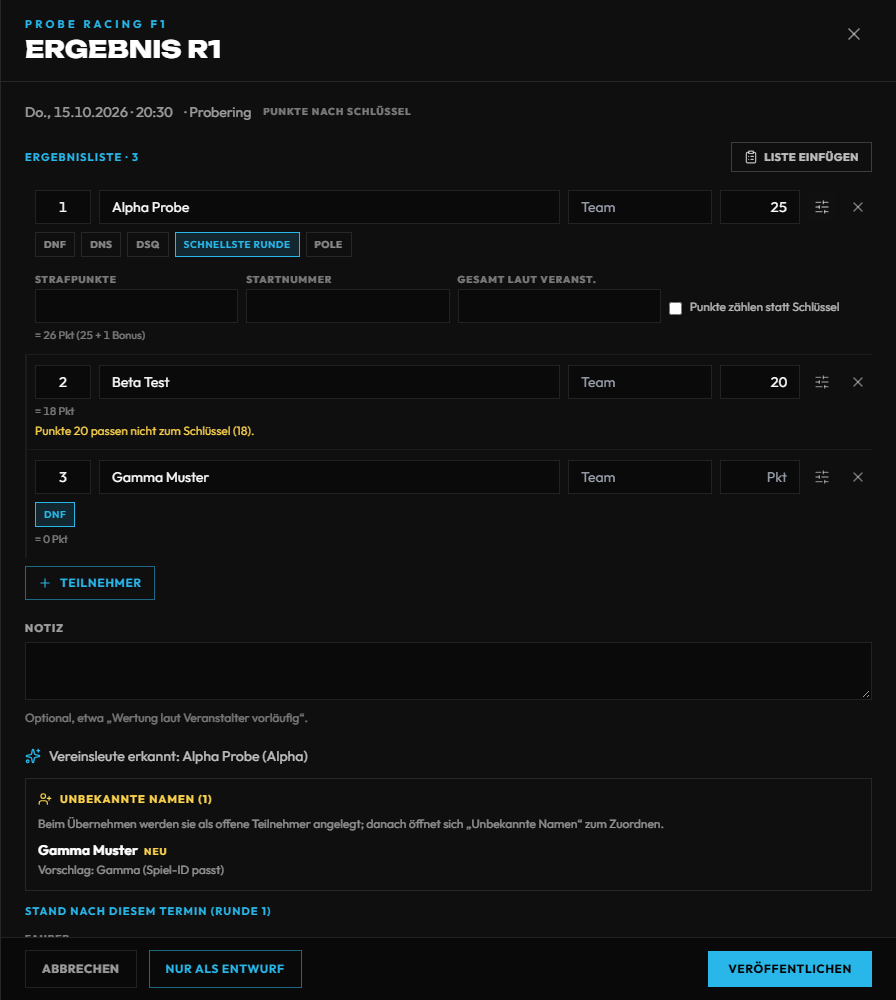</td>
<td>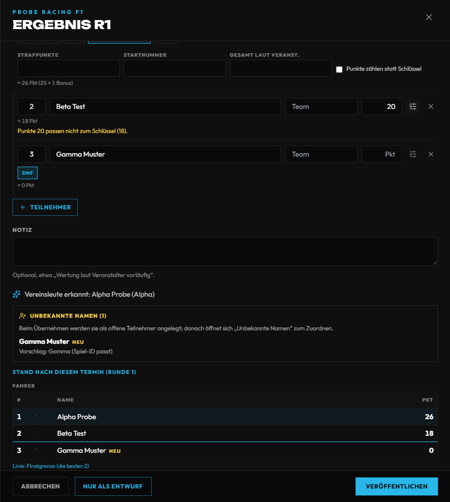</td>
</tr>
<tr>
<td>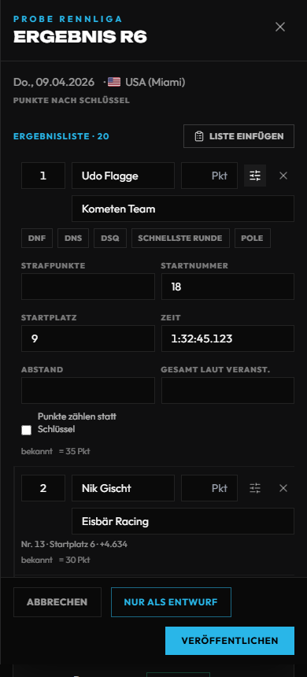</td>
<td>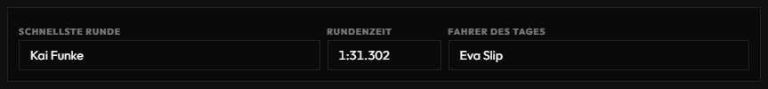</td>
</tr>
</table>

**Übernehmen:** Der Vorstand (und ein Captain mit Recht zum Veröffentlichen) sieht **Veröffentlichen** und **Nur als
Entwurf**; sonst heißt der Knopf **Als Entwurf speichern**. Ist das Ergebnis schon veröffentlicht und darf der Captain
nicht veröffentlichen, wird seine Änderung ein **Entwurf daneben** – das veröffentlichte Ergebnis bleibt sichtbar. Der
Vorstand sieht ihn oben im Blatt und kann ihn **Freigeben** oder **Verwerfen**; einen gespeicherten Entwurf
veröffentlicht er mit **Gespeicherten Entwurf veröffentlichen**. Unbekannte Namen werden beim Übernehmen als offene
Teilnehmer angelegt; beim Vorstand öffnet sich danach gleich **Unbekannte Namen** zum Zuordnen (Vorschläge sieht nur
er, Captains sehen nur „neu“). Hat inzwischen jemand anderes gespeichert, sagt das Blatt es: **Neu laden** holt den
aktuellen Stand, eure Eingaben bleiben stehen, und die Vorschau prüft neu. Jede Änderung steht im Adminprotokoll.

---

## 4. Wenn etwas nicht klappt

| Fehlerbild | Ursache | Lösung |
| --- | --- | --- |
| Beitrag ist gespeichert, aber nicht zu sehen | **Veröffentlicht** nicht gesetzt, Datum liegt in der Zukunft („geplant“) oder Sichtbarkeit zu eng | Haken, Datum und Sichtbarkeit prüfen |
| Newsletter ging nicht hinaus | Entwurf oder **Nur intern**, oder keine Abonnenten | Veröffentlichen, Kasten **Verteilen** ansehen |
| „Newsletter ein zweites Mal senden?“ erscheint nicht für dich | Das dürfen nur Redaktion und System | Dort fragen |
| Kein Banner beim Teilen | Kein Bild gesetzt | **Banner** wählen |
| Video-Player zeigt nichts | Besucher haben externen Medien nicht zugestimmt | Gewollt |
| Admin → Galerie zeigt nur Einsendungen | Du hast nur die Vereinsverwaltung | Gewollt, Alben pflegt die Redaktion |
| **Freigeben** ist grau | Die Bildprüfung läuft noch | Warten |
| Mitglied sieht „Fotos einsenden“ nicht | Außerhalb des Zeitfensters (bis sieben Tage nach dem Event), kein Mitglied, oder Album nicht an ein Event gehängt | Verknüpftes Event und Datum prüfen |
| „Fotos sind da“ kam nicht | Album nicht veröffentlicht, oder noch Fotos in den letzten zehn Minuten dazugekommen | Veröffentlichen und kurz warten |
| Bild ist plötzlich weg („Kaputte Referenzen“) | Die Datei wurde gelöscht | Medien → Qualitätscheck, neues Bild wählen |
| Upload scheitert („zu groß oder Reverse Proxy blockiert“) | Datei über dem Limit | Verkleinern; Limit steht an der Auswahl |
| Sponsor ist angelegt, aber nicht zu sehen | Status nicht aktiv, Laufzeit abgelaufen oder keine Platzierung | Vorschau „Ausspielung“ am Sponsor |
| Sponsor-Felder lassen sich nicht ändern | Dolibarr führt sie | In Dolibarr ändern |
| Partner zeigt „x online“ nicht | Das Widget ist im Discord des Partners aus | Partner bitten, es einzuschalten |
| Seite „Über uns“ zeigt keine Zahl | Zähler mit null bleiben weg | Gewollt |
| `/references/series/…` zeigt „Hier ist kein Rudel“ | Saison oder Spur archiviert, Adresse falsch, oder die Sichtbarkeit ist enger (etwa „Nur Mitglieder“) | Sichtbarkeit und Status prüfen |
| Termin steht auf **Ergebnis fehlt**, fand aber nie statt | Nicht abgesagt | **Absagen** – dann fehlt er nicht mehr |
| Ergebnis-Blatt meldet „inzwischen geändert“ | Jemand anderes hat das Ergebnis gespeichert | **Neu laden**, Vorschau prüfen, dann übernehmen |
| Captain-Änderung ist nicht öffentlich | Das Ergebnis war veröffentlicht – die Änderung ist ein Entwurf daneben | Vorstand: im Blatt **Freigeben** |
| Rennliga ohne Vereins-Garage | Kein Teilnehmer ist als Mitglied zugeordnet, und die Saison hat kein eigenes Team | **Unbekannte Namen** → **Bestätigen**, oder das eigene Team der Saison eintragen |
| Rennliga ohne Teamwertung | Teamwertung in den Regeln der Saison aus | Saison bearbeiten → Teamwertung einschalten |
| Kein Knopf **Bild auslesen** | Für die Art gibt es keine Vorlage (Team-Liga, Turnierserie) oder sie steht auf **Aus** | Spur oder Saison bearbeiten → **Vorlage für Ergebnis-Bilder** |
| „Texterkennung gerade nicht verfügbar“ | Dem Server fehlt Tesseract (altes Image) | Server mit `update.sh` aktualisieren; bis dahin **Liste einfügen** |
| Viele Zeilen gelb | Bild unscharf, klein oder abfotografiert | Screenshot statt Foto, ganzes Ergebnis ohne Zoom; sonst gelbe Felder nach dem Bild korrigieren |
| „Das Bild sieht nicht nach einem Rennergebnis aus“ | Eingefügt wurde die Saisontabelle oder der Kalender (keine Zeiten) | Das Ergebnis dieses Termins einfügen |

---

## 5. Häufige Fragen

**Kann die Turnierleitung News schreiben?**
Nein, das ist die Redaktion.

**Kann ich eine Serie löschen?**
Nein – Spur und Saison werden archiviert und lassen sich zurückholen. So gehen Termine, Ergebnisse und Tabellen nie verloren.

**Wo stelle ich ein, dass eine News nur Mitglieder sehen?**
Im Beitrag unter **Sichtbarkeit**: **Nur Vereinsmitglieder**.

**Wie verschicke ich eine News als Newsletter?**
Beim Veröffentlichen geht er von selbst hinaus; sonst im Kasten **Verteilen** mit **Jetzt senden**.

**Kann ich ein Foto nachträglich entfernen?**
Im Album das Medium löschen. In den Medien gibt es **Löschen** für die Datei selbst.

**Wo steht das Vereinsfoto?**
Admin → Verein → Über uns, Abschnitt Vereinsfoto.

**Wie viele Fotos darf ein Mitglied einsenden?**
20 je Album.

**Was ist die „Mediathek“?**
Die Seite **Admin → Content → Medien**.
