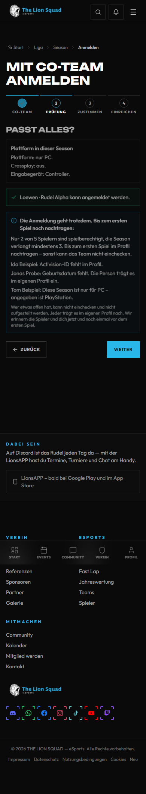
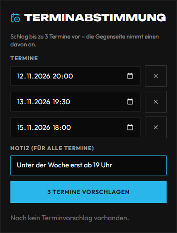
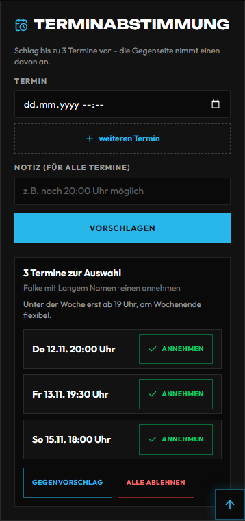

# Liga: Spickzettel für Captains

Eine Seite für **Captain und Vertreter** eines Co-Teams in der CoD-Liga (Season 1 ab Di 10.11.2026). Alles läuft
auf der **Matchseite** eures Spiels: Ligaseite → euer Spiel, oder über die Benachrichtigung. Ohne Captain und
Vertreter macht das die Teamleitung. Melden, Bestätigen und Nachtragen ausführlich:
[Turniere, 3.16 Ergebnis je Map melden](turniere.md#316-liga-ergebnis-je-map-melden-für-captains); für die
Turnierleitung: [Liga leiten](liga.md). Zum Verschicken an Captains gibt es dieselben Schritte kürzer und mit Bildern
auf der Website unter `/hilfe/liga-captains` ([Hilfe für Spieler und Captains](hilfe.md)).

## Anmelden

Das Co-Team meldet sich auf der **Ligaseite** an, sobald das Anmeldefenster offen ist. Das geht nur als **Captain oder Vertreter**. Fehlen beide, trägt die Teamleitung erst einen Captain ein: **Teams → Deine Teams → Co-Team bearbeiten**.

1. Ligaseite → **Mit Co-Team anmelden**. Solange das Fenster offen ist, steht derselbe Knopf auch auf der **Startseite** im Hinweis zur Liga, mit Anmeldeschluss und freien Plätzen.
2. **Co-Team wählen.**
3. **Prüfung lesen („Passt alles?“).** Was die Anmeldung wirklich aufhält, steht unter „So geht die Anmeldung noch nicht“, etwa ein zu kleiner Kader oder ein fehlender Captain. **Fehlende Angaben halten nicht auf:** Fehlen Geburtsdatum, Spiel-ID oder Plattform, ist jemand zu jung oder dürfen zu wenige spielen, steht das als Hinweis da, und **Weiter** bleibt frei. Bis zum ersten Spiel nachtragen: Wer dann noch etwas offen hat, kann nicht einchecken und nicht aufgestellt werden, und mit zu wenigen Spielberechtigten könnt ihr nicht einchecken – das Spiel gilt dann als nicht angetreten, die Liga-Leitung kann es kampflos werten. Ihr und die Betroffenen bekommt beim Einreichen und vor dem ersten Spiel eine Nachricht; den Stand zeigt auch die Ligaseite.
   Ist die Season nur für bestimmte Plattformen, steht das oben in der Prüfung („Plattform: nur PC“). Wer auf einer anderen oder keiner Plattform spielt, steht mit Grund bei den Hinweisen und zählt nicht mit.

   
4. **Regeln lesen und zustimmen**, **Datenschutz-Hinweis lesen und zustimmen**. Beides wird mit Zeitpunkt und deinem Namen gespeichert.
5. **Anmeldung einreichen.** Das ist noch kein Startplatz: Die Liga-Leitung prüft und entscheidet, du bekommst eine Nachricht.

Den Stand siehst du auf der Ligaseite und unter **Teams → Deine Teams**:

| Stand | Heißt |
| --- | --- |
| Anmeldung offen | Ihr könnt einreichen |
| Eingereicht, In Prüfung | Die Liga-Leitung ist dran |
| Angenommen | Ihr habt einen Startplatz. Liga und Staffel teilt die Liga-Leitung zu, dann stehen sie dabei |
| Warteliste | Wird ein Platz frei, entscheidet die Liga-Leitung. Niemand rückt von selbst nach |
| Abgelehnt | Der Grund steht dabei. Im offenen Fenster dürft ihr neu einreichen |
| Zurückgezogen | Du oder dein Vertreter habt zurückgezogen. Im offenen Fenster dürft ihr neu einreichen |

**Zurückziehen** geht, bis das Co-Team einer Staffel zugeteilt ist. Danach klärt ihr den Austritt mit der Liga-Leitung.

## Die Woche

- Eine **Spielwoche** geht von **Dienstag bis Montag**, je Woche ein Spiel.
- **Weihnachtspause 21.12.–3.1.:** keine Spiele und keine Termine. Spieltag 6 endet am So 20.12., Spieltag 7 ist in
  der Woche ab Di 5.1. Der **Mo 4.1.** gehört noch zur gesperrten Woche – Terminvorschläge erst ab **Di 5.1.**
- In der Pause **ruhen Termin-, Bestätigungs- und Nachtragsfristen**, das **Einspruchsfenster nicht**: Einspruch
  also gleich einlegen, auch kurz vor oder in der Pause.

## Was ihr tut

| Schritt | Wo | Frist |
| --- | --- | --- |
| **Termin ausmachen:** Datum und Uhrzeit → **Vorschlagen**. Mit **+ weiteren Termin** schlagt ihr bis zu **3 Termine auf einmal** vor (eine Notiz für alle, Knopf „3 Termine vorschlagen“); passt einer nicht (vorbei, doppelt, Sperrzeit), steht der Grund direkt an diesem Termin und es geht keiner raus. Liegt ein Termin außerhalb der Spielwoche, steht dort nur ein Hinweis: Er gilt, wenn die Gegenseite annimmt, die 72-h-Regel greift für ihn aber nicht. Die Gegenseite bekommt **eine** Nachricht mit allen Terminen, sieht sie als Liste und tippt beim passenden **Annehmen** – die übrigen sind damit erledigt. Sonst **Alle ablehnen** (auf Wunsch mit Grund) oder **Gegenvorschlag** (ebenfalls bis zu 3 Termine) – ihr bekommt die Antwort ebenso. Euer eigener Vorschlag steht als **wartet auf die Gegenseite** da; passt er nicht mehr, **Zurückziehen** (nimmt alle Termine zurück). Vorschläge gehen nur in die Zukunft (frühestens 5 Minuten ab jetzt). Absprachen im **Matchchat**. | Matchseite → **Terminabstimmung**; offene Vorschläge der Gegenseite auch auf der Startseite unter **Offene Aktionen** („Terminvorschlag beantworten“) | ohne Einigung **Sonntag 20:00** der Spielwoche (liegt der Tag in einer Sperrzeit: der nächste freie Tag der Woche). Lehnt die Gegenseite ab, gilt weiter der vereinbarte oder der Standardtermin. Jeder neue Vorschlag hat eine neue Antwortfrist. |
| **Schweigen zählt:** Antwortet ihr als Gastseite nicht auf einen Vorschlag der Heimseite, gilt er nach **72 Stunden** (wenn er in der Spielwoche liegt). Hat die Heimseite mehrere Termine vorgeschlagen, gilt der **früheste**. Die Matchseite sagt, ab wann. | Matchseite → **Termin und Verschiebung** | 72 Stunden ab dem Vorschlag, Sperrzeiten zählen nicht |
| **Verschieben:** Steht der Termin fest (Einigung, 72-h-Regel oder Leitung), gibt es keine neuen Vorschläge mehr. Neuen Termin und **Grund** eintragen → **Beantragen**; die andere Seite tippt **Zustimmen** oder **Ablehnen**, ihr könnt **Zurückziehen**. Bis zur Zustimmung gilt der alte Termin. Die Seite zeigt, wie viele noch gehen und bis wann („Noch 1 Verschiebung möglich, beantragen bis Sa 14.11. 20:00“). Darunter steht der **Verlauf** des Termins. | Matchseite → **Termin und Verschiebung**; offene Anträge der Gegenseite auch unter **Offene Aktionen** („Verschiebung beantworten“, beantworten im Web) | spätestens **24 Stunden** vor dem Termin, höchstens **zweimal** je Spiel, in derselben Spielwoche – alles darüber entscheidet die Liga-Leitung (**@leitung** im Matchchat) |
| **Einchecken:** 15 Minuten vor dem Termin geht auf der Matchseite der Block **Check-in** auf (ihr bekommt eine Nachricht, der Ring zählt herunter). Hakt an, **wer da ist** – mindestens **3**, nur aus eurem Kader, nur wer spielen darf (grau mit Grund = nicht wählbar; wer selbst betroffen ist, sieht oben „Du kannst so nicht einchecken“ und **Im Profil nachtragen**) – und tippt **Einchecken**. Dürfen zu wenige spielen, steht das schon vor dem Fenster da, und Einchecken geht erst nach dem Nachtragen. Bis zum Schluss könnt ihr Anwesende ergänzen. Ihr seht, ob die Gegenseite schon da ist. Hat euer Co-Team einer neuen Regelversion nicht zugestimmt, geht kein Check-in: Die Seite sagt es und führt zur neuen Fassung. | Matchseite → **Check-in**; auf der Startseite unter **Offene Aktionen** („Jetzt einchecken“) | von 15 Minuten vor bis **15 Minuten nach dem Termin**. Fehlt ihr danach, entscheidet die Liga-Leitung (kampflos, nachtragen oder verlängern) – gewertet wird nie von selbst |
| **Map-Veto** (wenn eure Season eins hat): Sind beide Seiten eingecheckt, beginnt es von selbst. Seid ihr am Zug, tippt ihr eine Map an – **Sperren** oder **Wählen**, je nach Schritt; läuft die Zeit ab, wählt das System. Steht eine Map als **Vorgabe der Woche** da, hat die Liga-Leitung sie für diesen Spieltag festgelegt: Sie ist weder sperrbar noch wählbar und steht in der Spielreihenfolge fest. Sie gilt auch, wenn euer Spiel verschoben wurde. Fehlt die Vorgabe noch, steht dort **Veto wartet auf die Vorgabe der Woche** – die Leitung bekommt einen Hinweis, gewertet wird nichts. Sobald sie eingetragen ist, bekommt ihr die Nachricht „Vorgabe da – Veto kann starten“, und auf der Matchseite steht **Vorgabe steht – Veto starten**: Tippt **Veto starten**, wenn beide Teams bereit sind (das kann jede der beiden Seiten). Erst ab da läuft die Zeit je Schritt, vorher gibt es keine Frist. | Matchseite → **Check-in** → **Map-Veto** | je Schritt die Zeit der Season (Vorgabe 60 Sekunden) |
| **Starten:** Sind beide Seiten eingecheckt und ist das Veto fertig, tippt eine Seite **Spiel starten – Map 1 läuft** – auch vor dem Termin. Ab da zählt die Spielzeit, verschieben geht nicht mehr. Ändert sich das Regelwerk dazwischen, stimmt ihr erst zu. | Matchseite → **Check-in** | sobald beide da sind |
| **Ergebnis nicht vergessen:** Ist ein Spiel 24 Stunden nach dem Termin nicht gemeldet, kommt eine Erinnerung an beide Seiten; nach 48 Stunden entscheidet die Liga-Leitung. | Matchseite | 24 bzw. 48 Stunden nach dem Termin |
| **Melden:** erst, wenn **beide Seiten eingecheckt** sind – sonst sagt die Matchseite, wer fehlt (in der App kommt der Satz beim Absenden). Hat niemand auf **Spiel starten** getippt, gilt das Spiel mit eurer Meldung als begonnen. Dann je Map Modus, **Map aus dem Pool** und den **Endstand** der Map – den **Sieger** ergeben die Punkte, antippen müsst ihr ihn nur bei Gleichstand (Endstand Pflicht; an jeder Map steht, wie sie gewertet wird, z. B. „bis 250 Punkte“ oder „6 Runden, höchstens 11“ – ein unpassender Endstand wird gleich angezeigt) – bis die Serie entschieden ist. Beim Bestätigen gelten die Punkte der ersten Meldung. Dieselbe Map im selben Modus gibt es je Serie nur einmal. Am Schluss einmal ankreuzen, **wer bei euch gespielt hat**: mindestens 3, bei Wechseln auch 6 und mehr, nur aus eurem Kader. Wer nicht spielen darf, steht grau mit Grund da. | Matchseite, **nur im Web** (die App lehnt eine erste Meldung ab) | nach dem Spiel |
| **Bestätigen:** im Web ankreuzen, wer bei euch gespielt hat, und **Stimmt**; in der App nur bestätigen. | Web oder App | sonst gilt die Meldung nach **48 Stunden** |
| **Teilnehmerliste nachtragen**, wenn „Teilnehmerliste fehlt noch“ dasteht (nach App-Bestätigung oder 48-Stunden-Regel). Das Ergebnis gilt schon. Wer nicht auf der Liste steht, zählt nicht als Einsatz. Niemand spielt am selben Spieltag für zwei Teams. | Matchseite, Web; Startseite → **Offene Aktionen** | bis **48 Stunden ab der Bestätigung**, danach entscheidet die Liga-Leitung: Die Matchseite sagt das und hat den Knopf **@leitung im Matchchat** |
| **Spielberechtigung im Blick:** Unter eurem Co-Team steht, wer spielen darf und was fehlt (Geburtsdatum, Spiel-ID, Plattform, Wartezeit). Neue Spieler warten nach Spieltag 1 sieben Tage. Wechsel aus einem anderen Co-Team der Season gehen nur per Transfer, den die Teamleitung beantragt; danach wartet die Person immer sieben Tage, auch vor Spieltag 1. | **Teams → Deine Teams** | vor dem Spiel |
| **Einspruch:** **Stimmt nicht** bzw. **Problem melden** → **Falsches Ergebnis** → kurz schreiben, was nicht stimmt (Foto möglich). Nicht einfach mit anderen Maps bestätigen. | Matchseite | vor dem Ergebnis immer, danach **30 Minuten** (nach der 48-Stunden-Regel bis Ende der Spielwoche); später Matchchat mit **@leitung** |

**Mehrere Termine auf einmal** – im ersten Bild schlagt ihr drei Termine vor, im zweiten sieht die Gegenseite sie zur Auswahl:

 

In der **App** stehen die Termine einzeln untereinander. Nimmst du dort einen an, schließen die übrigen mit; ein
Gegenvorschlag gilt ebenfalls für alle. **Lehnst du in der App nur einen Termin ab, bleiben die anderen offen – die
72-h-Regel kann dann noch greifen.** Alle auf einmal ablehnen geht im Web mit **Alle ablehnen**. Mehrere Termine auf
einmal vorschlagen geht nur im Web.

Die Turnierleitung entscheidet einen Einspruch und korrigiert das Ergebnis; beide Seiten bekommen Bescheid. Ändert sie
Termin oder Best of eures Spiels, bekommt ihr ebenfalls eine Nachricht.

**Gegner nicht da?** Checkt selbst ein – fehlt die Gegenseite nach dem Fenster, bekommt die Liga-Leitung von selbst den
Vorschlag „Nicht erschienen?“ und entscheidet; gewertet wird nie automatisch. Dazu gern im Matchchat mit **@leitung**.
Eine kampflose Niederlage steht als Teamstrafe bei Captain, Vertreter und der Leitung des Hauptteams unter **Meine
Strafen**. Notiz und Name eines Terminvorschlags sehen nur die beiden Seiten und die Turnierleitung.

## Tabelle

- **Punkte:** Sieg 3, Niederlage 0, kein Remis. Ein **kampfloser Sieg** zählt die Maps des Best of (BO3 2:0) und steht
  in der Tabelle als „kampflos“. Sind **beide nicht erschienen**, verlieren beide ohne Punkte und Maps; die Leitung kann
  das Spiel neu ansetzen.
- **Punktgleich?** Zuerst der **direkte Vergleich** (bei drei und mehr Teams eine Mini-Tabelle nur aus euren Spielen
  untereinander – nur, wenn die alle gespielt sind), dann Map-Differenz und gewonnene Maps. Stehen Teams danach in allem gleich, teilen sie sich den Platz,
  bis die Liga-Leitung mit Grund entscheidet. Unter eurem Namen steht klein, was entschied.
- **Steigt ein Team aus** (Austritt, Auflösung, Disqualifikation), zählen **alle** seine Spiele für die Gegner, auch schon
  gespielte. Das echte Ergebnis bleibt sichtbar, das Team steht am Tabellenende.

Die genaue Reihenfolge stellt jede Season ein – sie steht unter der Tabelle.

## Regeln

Die Regeln stehen auf der Ligaseite unter **Regeln**, mit Inhaltsverzeichnis, Suche und PDF. Oben steht, was **neu in dieser Version** ist, geänderte
Paragrafen haben einen Strich am Rand und das Wort „Geändert“. Ältere Versionen und ein Vergleich Wort für Wort stehen auf derselben Seite.

Verlangt die Leitung eine **Zustimmung**, siehst du als Captain oder Vertreter auf der Startseite unter **Offene Aktionen** „Regeln zustimmen“ und auf der
Regelseite den Knopf **Zustimmen**. Die Zustimmung gilt für euer Co-Team und genau diese Version. Fehlt sie, geht für euer Team **kein
Check-in, kein Start und keine erste Ergebnismeldung** – Bestätigen und Nachtragen bleiben möglich.

## Activision-ID

- **Jeder im Kader** braucht die **Activision-ID** (inklusive `#`) im Profil: **Einstellungen → Gaming → Spiel-IDs**
  (gilt für alle CoD-Teile). Wer keine hat, steht beim Aufstellen **grau mit Grund** da und kann nicht spielen.
- Beim Zuteilen bzw. beim ersten Aufstellen wird die ID **für die Season festgehalten**. Ändert jemand sie später im
  Profil, gilt in der Liga weiter die gemeldete – das Profil sagt das. Eine neue ID gibt nur die **Liga-Leitung** frei;
  bis dahin spielt er mit der alten.
- Neue Spieler im Co-Team: Gibt es einen **Stichtag** der Season, braucht jeder, der danach dazukommt, die Freigabe
  der Liga-Leitung – auch wer aus einem anderen Co-Team wechselt. Wer nur kurz draußen war und zurückkommt, nicht.
  Fehlt die ID oder wartet jemand auf die Freigabe, bekommen er und ihr eine Nachricht.
- **Lobby:** Auf der Matchseite steht unter **Activision-ID für die Lobby** die ID jedes Spielers beider Seiten – nur
  für euch, den Gegner und die Turnierleitung.

## Euer Co-Team und eure Rolle

- **Wo:** **Teams → Deine Teams** (Website) – Team wählen, dort stehen die Co-Teams mit Captain und Vertreter. Auf
  der Teamseite (`/teams/…`) führt **Co-Teams verwalten** dorthin.
- **Rolle abgeben:** Wer Captain oder Vertreter ist und nicht mehr will oder kann, tippt beim Co-Team auf **Rolle
  abgeben**. Leitung und Co-Leitung des Hauptteams bekommen eine Nachricht und vergeben neu; bis dahin handelt der
  andere (Captain oder Vertreter), ohne beide die Teamleitung. Erst ohne Rolle lässt sich das Team verlassen.
- **Kader zu klein:** Geht jemand und der Kader fällt unter den Mindestkader der Staffel, bekommen ihr und die
  Turnierleitung eine Warnung. Auf der Startseite steht **Kader auffüllen**, bis er wieder reicht. Auffüllen kann nur die
  Teamleitung – sagt ihr Bescheid.
- **Wer nicht aufstellbar ist:** Ein gesperrtes Konto lässt sich nicht aufstellen und zählt nicht als Captain oder
  Vertreter; ohne beide handelt die Teamleitung. Dieselbe Person spielt nie auf beiden Seiten eines Spiels.
- **In der App** gibt es Captain und Vertreter noch nicht – meldet sie beim Kader-Ändern „… bitte erst die Rolle neu
  vergeben“, das auf der Website erledigen.
- **Abmelden** einer Staffel geht nicht selbst („Austritt nur über die Turnierleitung“) – im Matchchat oder direkt bei
  der Turnierleitung melden.
- **Angaben ändern** auf der Staffel geht nur für den Discord-Kontakt: Das dürfen Captain und Vertreter, ohne beide die
  Teamleitung. Name und Spiel-ID stehen je Season im Liga-Kader, ändern kann sie nur die Liga-Leitung.
- **Konto löschen** geht erst, wenn die Rolle abgegeben ist; **Meine Daten** nennt den Weg.
