# Liga leiten – Handbuch

Für die **Liga-Leitung** (und den Obmann der Liga): eine Liga über Wochen aufsetzen, starten und durch die Season
bringen – am Beispiel der CoD-Liga, Season 1 (Start Di 10.11.2026). Ohne Vorwissen lesbar; was technisch dahinter
steckt, steht in [LIGA.md](../LIGA.md). Für die Captains der Co-Teams gibt es einen eigenen
[Spickzettel](liga-captains.md), zum Abhaken vor dem Start die [Checkliste für den Obmann](#6-checkliste-für-den-obmann-bis-911).

**Wo im Admin:**

- **Admin → eSports → Spiele → Zahnrad** (`/admin/games/<Spiel>`) – die Spielseite: Reiter **Modi** (etwa Stellung, Suchen & Zerstören)
  und Reiter **Maps** (`#maps`) – Map-Bibliothek als Tabelle Map × Modus mit Bildern
- **Admin → eSports → Liga** (`/admin/leagues`) – Liga, Season, Liga 1, 2 …, Staffel A, B …
- **Turnierverwaltung der Staffel** (`/admin/tournaments/<Staffel>`, aus der Season über **Turnierverwaltung · Co-Teams
  zuteilen**) – Co-Teams zuteilen, starten, Spiele, Ergebnisse
- **Ligaseite** (`/liga/<liga>/<season>`, etwa `/liga/call-of-duty/season-1`) – was Mitglieder und Gäste sehen

Wer was darf: Liga, Season, Liga N, Staffel, Zuteilen, Start und Korrekturen macht nur die **Liga-Leitung mit
bestätigter Zwei-Faktor-Anmeldung**: wer den Bereich **Ligen** hat oder in dieser Liga **zuständig** ist, siehe
[2.11](#211-bereich-ligen-und-zuständige). Wo dieses Handbuch und die Oberfläche von „Turnierleitung“ schreiben, ist bei einer
Liga genau diese Liga-Leitung gemeint. Der Bereich **Turnierleitung allein gibt in der Liga nichts mehr**. Co-Teams, Captain und
Vertreter pflegt die **Teamleitung** (Leitung oder Co-Leitung des Hauptteams) im Profil. Termine, Melden, Bestätigen und Einspruch
machen **Captain und Vertreter** des Co-Teams – hat ein Co-Team keinen von beiden, die Teamleitung.

---

## Inhalt

1. [Überblick: wie eine Liga aufgebaut ist](#1-überblick-wie-eine-liga-aufgebaut-ist)
2. [Einrichten Schritt für Schritt](#2-einrichten-schritt-für-schritt)
3. [Während der Season](#3-während-der-season)
4. [Wenn etwas nicht klappt](#4-wenn-etwas-nicht-klappt)
5. [Häufige Fragen](#5-häufige-fragen)
6. [Checkliste für den Obmann bis 9.11.](#6-checkliste-für-den-obmann-bis-911)

---

## 1. Überblick: wie eine Liga aufgebaut ist

| Ebene | Beispiel | Was dort festgelegt wird |
| --- | --- | --- |
| **Liga** (je Spiel) | CoD-Liga | Name, Spiel, Adresse `/liga/call-of-duty`, Gestaltung (Emblem, Banner, Farbe – 2.10) |
| **Season** | Season 1 | alle Vorgaben: Kalender, Sperrzeiten, Best of, Teamgröße, Punkte, Fristen, Map-Pool, Regelwerk, Sichtbarkeit |
| **Liga N** | Liga 1 | Stufe der Liga; darf Best of, Teamgröße, Mindestkader, Staffelgröße, Punkte und Antwortfrist abweichend festlegen |
| **Staffel** | Staffel A | ein gewöhnliches Turnier im Format Liga mit den Werten der Season – Spiele, Termine, Ergebnisse, Tabelle |
| **Co-Team** | Nebelwölfe · Rudel | Teilnehmer der Staffel: ein Kader eines Hauptteams mit Captain und Vertreter |

So läuft eine Spielwoche: Die Woche geht von **Dienstag bis Montag**. Die Captains vereinbaren einen Termin – ohne
Einigung gilt der **Standardtermin** (Season 1: Sonntag 20:00). Nach dem Spiel meldet eine Seite das Ergebnis **im
Web** mit Maps und hakt einmal an, wer bei ihr gespielt hat (**Teilnehmerliste**, siehe 3.3), die andere bestätigt. Antwortet sie nicht, gilt die Meldung nach **48 Stunden**
(spätestens am Ende der Spielwoche, mindestens 24 Stunden Zeit). Die Tabelle rechnet in neuen Seasons **3 Punkte für
einen Sieg, 0 für eine Niederlage, ohne Remis**; bei Punktgleichheit entscheiden der **direkte Vergleich**, dann
Map-Differenz und gewonnene Maps, zuletzt die Liga-Leitung (siehe 3.5). Alles stellt die Season ein.

Season 1 im Kalender (10 Wochen, nur Hinrunde, acht Teams = sieben Spieltage):

| Woche | Tage | Spieltag |
| --- | --- | --- |
| 1–6 | 10.11.–21.12.2026 | Spieltag 1 bis 6 |
| 7–8 | 22.12.2026–4.1.2027 | **Weihnachtspause** – keine Spiele |
| 9 | 5.1.–11.1.2027 | Spieltag 7 |
| 10 | 12.1.–18.1.2027 | Reserve für Nachholspiele |

Gesperrt ist eine Woche, wenn mehr als die Hälfte ihrer Tage in einer Sperrzeit liegt. Gesperrt sind damit alle Tage
der Sperrzeit **und** alle Tage einer gesperrten Woche: Am Montag 21.12. (letzter Tag von Woche 6) und am Montag 4.1.
(letzter Tag von Woche 8) lässt sich kein Termin vorschlagen – Vorschläge wieder ab Di 5.1.

In der Pause **ruhen Termin-, Bestätigungs- und Nachtragsfristen**: Die 48 Stunden zum Bestätigen und zum Nachtragen
der Aufstellung und die Antwortfrist auf einen Terminvorschlag laufen erst danach weiter. **Das Einspruchsfenster ruht
nicht** – es bleibt bei 30 Minuten nach dem Ergebnis (nach der 48-Stunden-Regel bis zum Ende der Spielwoche).

Staffeln zählen nicht für Jahreswertung, Turnier-Pokale, Löwen-Rang-XP für Teilnahme und Podest und die Team-Stufe;
gespielte und gewonnene Spiele zählen weiter. Startseite, öffentlicher Kalender und Turnierliste zeigen die Staffeln nicht –
die Startseite zeigt stattdessen die **Season** (2.8a). Dazu gibt es die Ligaseite, den Menüpunkt **Liga** und die Kachel **Liga** auf der eSports-Übersicht (`/esports`, mit
„Start am …“ oder „Läuft“). Menüpunkt und Kachel erscheinen nur, solange eine Season sichtbar ist. Name, Stelle und
Ausblenden des Menüpunkts stellt die Redaktion unter **Admin → Content → Navigation** ein.

---

## 2. Einrichten Schritt für Schritt

### 2.1 Modi und Maps in der Bibliothek

1. **Admin → eSports → Spiele → Zahnrad**, Reiter **Modi**, **Modus hinzufügen**: je Modus eine Zeile,
   etwa **Stellung**, **Suchen & Zerstören**, **Kontrolle**. Minuten braucht ein Modus nur für Maps nicht. Aufgeklappt
   trägt jeder Modus auf Wunsch **Beschreibung**, **Spieler je Seite**, **Format** und eine **Ergebnisregel** (Punkte bis
   zum Ziel, Runden gewinnen oder höherer Endstand; Ziel, Rundenlimit, Zeitlimit, Remis, Verlängerung) – die Werte laut
   Regelwerk tragt ihr selbst ein. Details: [Turniere, 3.12](turniere.md#312-spieldauer-und-spiel-daten).
2. Reiter **Maps** → **Map hinzufügen**: Name, **Bild** im Format 16 : 9 (nur eigene Uploads),
   und die **Modi**, in denen die Map gespielt wird; später setzt ein Häkchen in der Tabelle sie frei. Mit **Aus Spiel übernehmen** kommen Maps einer anderen Spielversion
   samt Bild dazu; gibt es schon Maps ohne Modus, ordnet **Allen … Maps zuordnen** sie gesammelt zu. Details:
   [Turniere, 3.14](turniere.md#314-maps-und-map-pools).

Modi und Maps dürfen sich auch während einer laufenden Season ändern: Gemeldet wird immer aus dem gespeicherten Pool der
Staffel. Ein Modus, der in Pool, Reihenfolge oder Spielen steht, lässt sich nicht entfernen, nur auf **Inaktiv** oder
**Archiviert** stellen: Er kommt dann in keinen neuen Pool und keine neue Reihenfolge, Pool und Ergebnisse bleiben.
Nennt **Modus je Map** den Modus noch, ändert zuerst diese Reihenfolge: Einen Pool ohne ihn nimmt die Season sonst nicht an.
Nach dem ersten Ergebnis geht beim **Übertragen** nur noch der Pool an die Staffel, nicht die Reihenfolge. Fehlt ihrem Pool
dann ein Modus der Reihenfolge, sagt das Übertragen das, und die Teams wählen den Modus je Map frei. Spiele mit
festgehaltenem Pool behalten ihre Reihenfolge.

**Maps deaktivieren:** In der Map-Bibliothek hat jede Karte die Knöpfe **Deaktivieren** (Pause-Symbol) und **Archivieren**.
*Inaktiv* heißt: Die Map kommt in keinen neuen Pool, dort, wo sie schon steht, bleibt sie gültig und meldbar. *Archiviert*
blendet sie zusätzlich aus. Vor beidem fragt die Verwaltung nach und nennt die Seasons, in deren Map-Pool die Map gerade
steht – das ist nur ein Hinweis, gesperrt wird nichts. Soll eine kaputte Map wirklich aus einer laufenden Season raus, geht
das in der Season mit **Map aus dem Pool nehmen** (2.2, Reiter Spielbetrieb).

### 2.1a Ausrüstung und Sperrliste

Grundsatz: **Alles ist erlaubt außer dem, was auf der Sperrliste der Season steht.** Die Website prüft nicht, was im Spiel benutzt
wird – ein Verstoß läuft über Einspruch und Strafe.

1. **Bibliothek:** **Admin → eSports → Spiele → Zahnrad → Reiter Ausrüstung** (`/admin/games/<Spiel>#ausruestung`), auch aus der Season
   über **Sperrliste → Bibliothek pflegen**. Der Reiter speichert je Eintrag sofort – es gibt nichts „Ungespeichertes“. Zuerst **Kategorien**: Ohne Kategorien gibt es einen Vorschlag (Waffen, Aufsätze, Perks, Ausrüstung, Abschussserien), den
   du anpasst und speicherst. Die **Art** entscheidet: An einer *Waffe* lassen sich einzelne Aufsätze sperren, ein *Aufsatz* passt zu Waffen,
   alles andere ist *sonstige Ausrüstung*. Hat eine Kategorie Einträge, bleibt ihre Art und sie lässt sich nicht entfernen.
2. **Einträge:** **Eintrag hinzufügen** – Name, Bild 16 : 9 (nur Upload oder Mediathek; ohne Medienrechte nur eigene Bilder), bei Aufsätzen
   **Passt zu**: Ein Aufsatz passt nur zu den gewählten Waffen, **ohne Wahl zu keiner**. Aufsätze ohne Waffe nennt oben ein gelber Hinweis;
   dort Waffen anhaken und **Allen … Aufsätzen zuordnen** (wie „Maps ohne Modus“). Suche und Kategorie-Knöpfe helfen bei vielen Einträgen.
   Kategorien und Unterkategorien sind anfangs **zugeklappt**: Die Kopfzeile nennt Art und Anzahl, ein Klick (oder Enter) klappt auf,
   **Unterkategorien** und **Hinzufügen** daneben gehen auch zugeklappt. **Alle aufklappen** und **Alle zuklappen** stehen neben der
   Suche; die Suche klappt die Bereiche mit Treffern auf und zählt „1 von 30“. Ist nur eine Kategorie gewählt, ist sie gleich offen.
   **Aus Spiel übernehmen** holt Einträge einer anderen Spielversion, fehlende Kategorien kommen mit, Aufsätze finden ihre Waffen über den
   Namen (Waffen also mit übernehmen, sonst kommen sie ohne Waffe).
3. **Zustand:** *Deaktivieren* (Ein/Aus-Symbol): kommt auf keine neue Sperrliste, wo er steht, bleibt er. *Archivieren*: zusätzlich
   ausgeblendet. Was auf einer gespeicherten Sperrliste steht, lässt sich nicht löschen, nur archivieren.
4. **Unterkategorien (Klassen):** Je Kategorie über **Unterkategorien** neben dem Kategorie-Namen – etwa Waffen → Sturmgewehr,
   Schrotflinte, Pistole oder Aufsätze → Mündung, Optik, Magazin. Ohne Unterkategorien bietet das Blatt einen **Vorschlag** aus
   Gattungsbegriffen an, den du anpasst; gespeichert wird erst mit **Speichern**. Umbenennen und Umsortieren gehen jederzeit, entfernen nur
   ohne Einträge (erst verschieben) und nicht, solange eine gespeicherte Sperrliste die Klasse ganz sperrt. Optional ein **Symbol** (eigener
   Upload, quadratisch). In der Bibliothek stehen die Einträge dann je Unterkategorie in **einklappbaren Gruppen** mit Zähler, Einträge ohne
   zuerst unter **Ohne Unterkategorie**. Zuordnen: im Eintrag **Unterkategorie** wählen, oder **Auswählen** → Einträge anhaken →
   **Nach …** → **Verschieben** (nur innerhalb einer Kategorie). Ein **Aufsatz** passt zusätzlich zu ganzen **Waffenklassen**: Eine neue
   Waffe dieser Klasse passt dann sofort. Ohne Waffe und ohne Klasse passt ein Aufsatz weiter zu keiner. **Aus Spiel übernehmen** legt
   fehlende Unterkategorien an („neu“ in der Vorschau); ist kein Platz mehr, kommt der Eintrag ohne Unterkategorie und die Meldung sagt es.
5. **Sperrliste der Season:** auf der Season-Seite im Reiter **Regelwerk und Sperrliste** (`#sperrliste`). Haken bei **sperren**, darunter **Gilt in**: allen Modi oder
   einzelnen. Bei einer Waffe klappt der Knopf **„N Aufsätze · K gesperrt“** die **passenden** Aufsätze auf, je Slot (Unterkategorie, etwa
   Mündung, Optik). Haken heißt **gesperrt an dieser Waffe** – die Waffe bleibt erlaubt; darunter je Aufsatz **Gilt in** (alle Modi oder
   einzelne). **An allen Waffen sperren** setzt den Aufsatz selbst auf die Liste (gleich wie in seiner eigenen Kategorie), **Für alle
   Sturmgewehr übernehmen** gibt jeder anderen Waffe der Klasse dieselben Sperren mit denselben Modi, soweit die Aufsätze dort passen. Beides
   gilt erst mit **Speichern**. **Nur gesperrte** zeigt, was schon auf der Liste steht.
   **Einklappen:** Kategorien, Unterkategorien und die Slots im Kasten einer Waffe sind anfangs zu. Die Kopfzeile nennt die Anzahl und
   **„K gesperrt“**, ein Klick (oder Enter) klappt auf; **Ganze Klasse sperren** geht auch zugeklappt. Hat die Season noch keine Sperren,
   ist die erste Kategorie offen; hat eine Waffe nur einen Slot, ist er offen. **Alle aufklappen** und **Alle zuklappen** stehen neben
   der Suche (zuklappen schließt auch die Kästen der Waffen). Suche und **Nur gesperrte** klappen die Bereiche mit Treffern auf. Was du
   angehakt hast, bleibt beim Zuklappen stehen, bis du speicherst; die Seite merkt sich nicht, was offen war.
   Je Unterkategorie gibt es den Schalter **Ganze Klasse sperren**, auch nur für einzelne Modi. Er gilt für **alle Einträge der Klasse, auch
   für später angelegte** – eine neue Schrotflinte in einer gesperrten Klasse „Schrotflinte“ ist sofort mitgesperrt (Ligaseite, Matchseite) und
   das Regelwerk meldet **Regelwerk muss freigegeben werden** (2.11). In allen Modi gesperrt, sind die Einträge der Klasse mit „Mit der ganzen
   Klasse gesperrt“ markiert und einzeln nicht mehr wählbar; nur für einzelne Modi lassen sie sich zusätzlich einzeln sperren. Eine leere
   Klasse lässt sich schon sperren, sie gilt ab dem ersten Eintrag. Die Version hält Klasse und Einträge zum Zeitpunkt fest.
6. **Speichern** legt eine neue **Version** an. Bestehende Staffeln bekommen sie mit **Jetzt übertragen** (auch gesperrte und laufende),
   neue Staffeln gleich beim Anlegen. Ein Spiel hält die Version fest, die bei seinem Ergebnis galt. **Versionen vergleichen** zeigt neu
   gesperrt, geändert und wieder erlaubt.
7. **Regelwerk:** Der Baustein heißt **Erlaubte Ausrüstung** (`[[baustein:loadout_bans]]`). Er zeigt nicht die Sperren, sondern **was
   erlaubt ist**: alle **aktiven** Einträge der Bibliothek ohne die Sperrliste, je Kategorie und Unterkategorie mit Bild. Nur in einzelnen
   Modi gesperrt, steht ein Eintrag mit „nicht in …“ da – ist er in **mehr Modi der Season gesperrt als erlaubt**, mit „nur in …“ (etwa „nur
   in Suchen & Zerstören“; bei Gleichstand „nicht in …“). **Waffen stehen als Tabelle**, eine je Kategorie, im Web und im PDF gleich: je
   Unterkategorie eine Kopfzeile, je Waffe eine Zeile mit **kleinem Bild**, **Name** (mit Hinweis) und den **Ausnahmen nach Slot**, je
   Slot eine Zeile wie „Optik: Rotpunkt, Holo“. Ohne Ausnahme steht „alle passenden Aufsätze erlaubt“, sonst „**gesperrt:**“ mit den ganz
   gesperrten und „**eingeschränkt:**“ mit denen, die nur in einzelnen Modi gesperrt sind („Holo (nur in Suchen & Zerstören)“ – der
   Hinweis sagt, wo er erlaubt ist). Sind an einer Waffe **mehr passende Aufsätze gesperrt als erlaubt** (etwa bei Scharfschützengewehren),
   dreht sich die Zeile um: „**nur erlaubt:**“ mit den erlaubten je Slot – so bleibt sie kurz; bei Gleichstand bleibt es bei „gesperrt“.
   Ohne erlaubten Aufsatz steht „keine Aufsätze erlaubt“. Am Handy stapelt die Tabelle: Bild und Name nebeneinander, die Aufsätze darunter.
   Ist ein Aufsatz an **jeder** passenden Waffe gleich gesperrt (etwa über **An allen Waffen sperren**), steht er nur einmal unter den
   Waffen: „**An keiner Waffe erlaubt:** Kompensator“ (mit Hinweis, wenn nur in Modi); an der Waffe zählt er bei „K gesperrt“ weiter mit.
   Eine ganz gesperrte Klasse ist nur eine Zeile „Schrotflinte · nicht erlaubt“ (mit den Namen in Klammern), eine ohne jede Einschränkung
   sagt „alle erlaubt“. Inaktive und archivierte Einträge fehlen. Die übrige Ausrüstung (Perks und Co.) steht im Web als Karten, im
   **PDF** als Tabelle Kategorie · Unterkategorie · Erlaubt · Einschränkungen. Weil der
   Baustein die Bibliothek von heute liest, meldet **jeder neue aktive Eintrag** (auch einer in einer gesperrten Klasse) und jede neue
   Version der Sperrliste **Regelwerk muss freigegeben werden**. Steht der Baustein im Regelwerk, sagt der Abschnitt Sperrliste, ob die
   letzte Fassung noch den alten Stand zeigt; **Neue Version vorbereiten** führt ins Regelwerk, dort sind die Unterschiede markiert, du gibst
   frei und wählst, ob neu zugestimmt werden muss (2.11). Jede Fassung friert ihre Liste ein; ältere Fassungen mit der Sperrliste bleiben,
   wie sie veröffentlicht wurden – auch die mit der eigenen Aufsatz-Liste („nicht an …“) und die mit dem Satz „alle passenden Aufsätze
   erlaubt, außer: …“ je Waffe. Die Tabelle kommt einmal als Vorschlag **Regelwerk muss freigegeben werden**.

Öffentlich steht auf der Ligaseite unter dem Map-Pool **Erlaubte Ausrüstung** – genau die Sicht des Regelwerks, nur wenn die Season
sichtbar ist und das Spiel eine Bibliothek hat. Jede Waffe mit passenden Aufsätzen zeigt „N Aufsätze · K gesperrt“; ein Klick (oder Enter)
klappt darunter einen Kasten auf: **ganz oben „Gesperrt: …“**, darunter die **erlaubten Aufsätze je Slot mit Bild**. Auf der **Matchseite** eines Ligaspiels steht sie
unten aufklappbar, aus der Liste, die für dieses Spiel gilt (nach dem Ergebnis die festgehaltene, ältere Spiele so, wie sie damals
aussah). Rechte: Bibliothek wie Maps (Bereich
Turnierleitung), Sperrliste mit **Season konfigurieren** (lesen: jede Zuständigkeit der Liga).

<table>
<tr>
<td>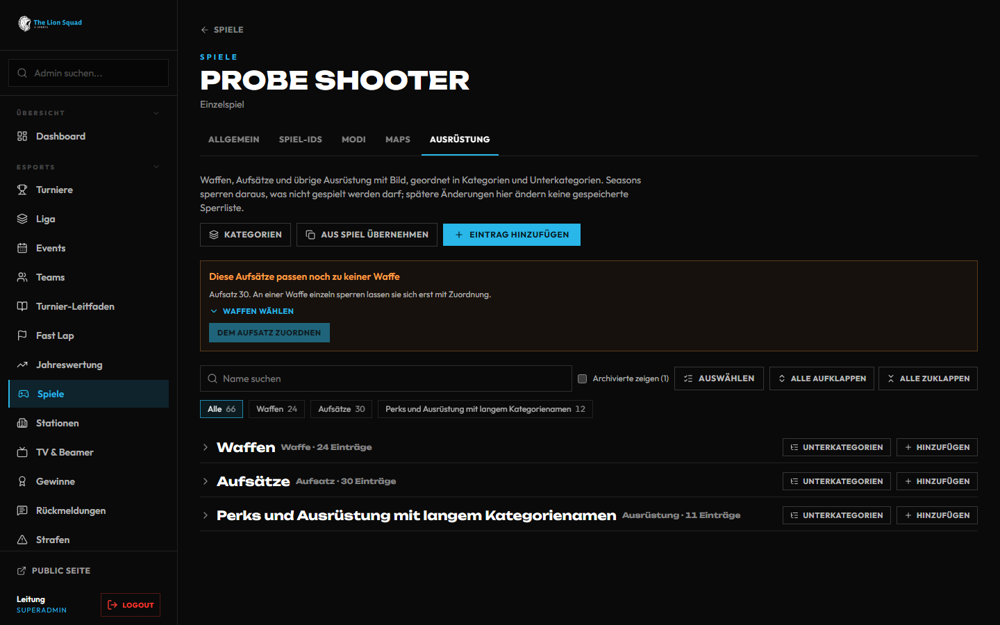</td>
<td>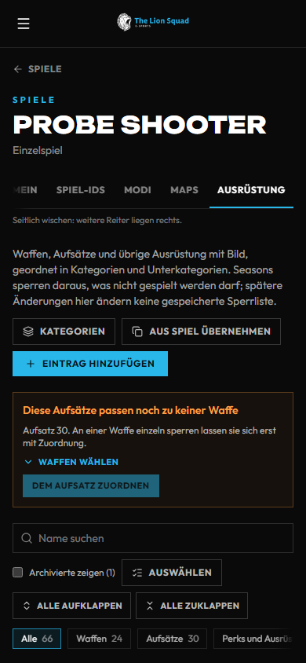</td>
</tr>
<tr>
<td>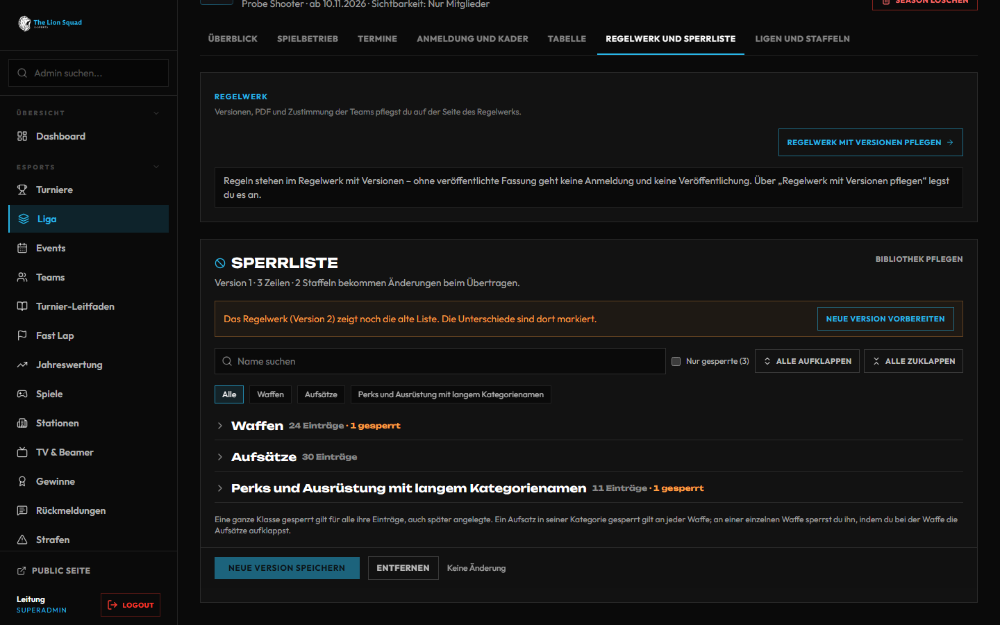</td>
<td>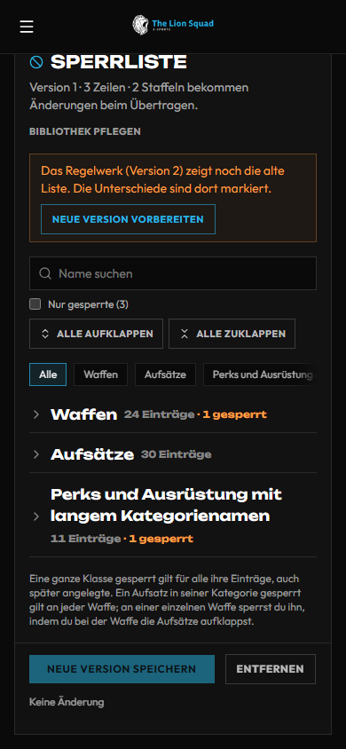</td>
</tr>
<tr>
<td>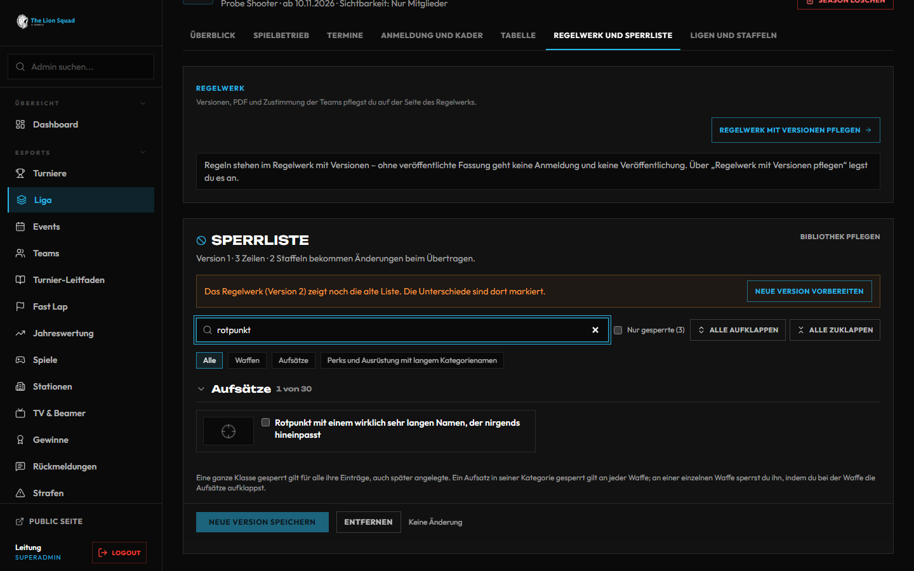</td>
<td>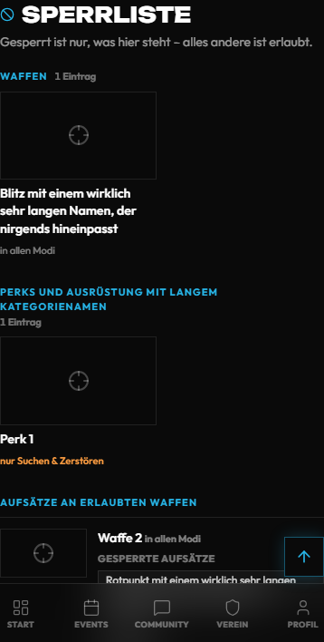</td>
</tr>
<tr>
<td>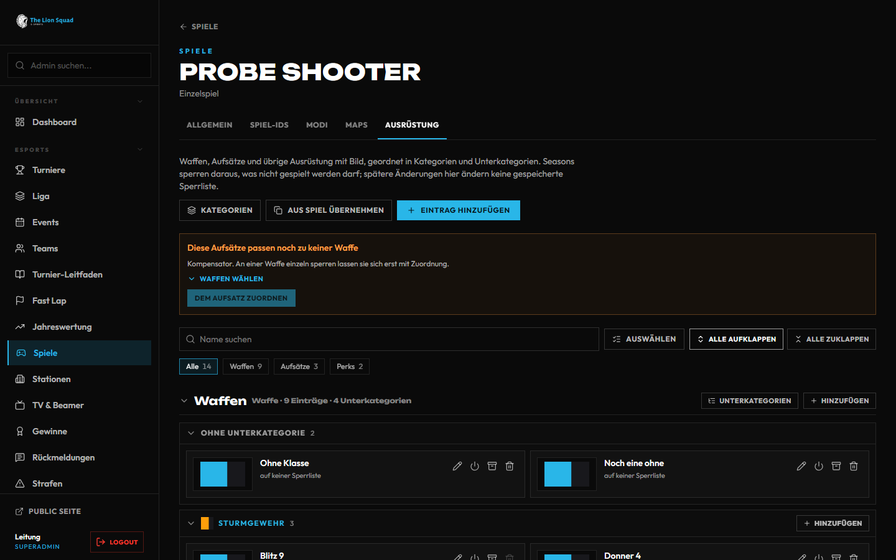</td>
<td>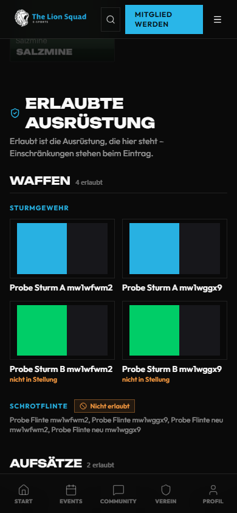</td>
</tr>
<tr>
<td>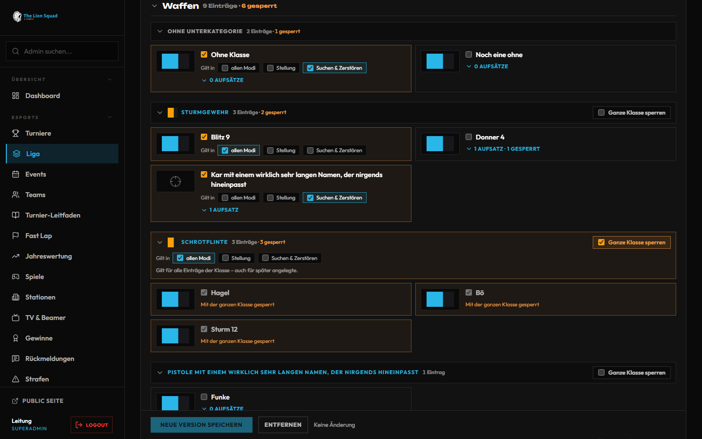</td>
<td>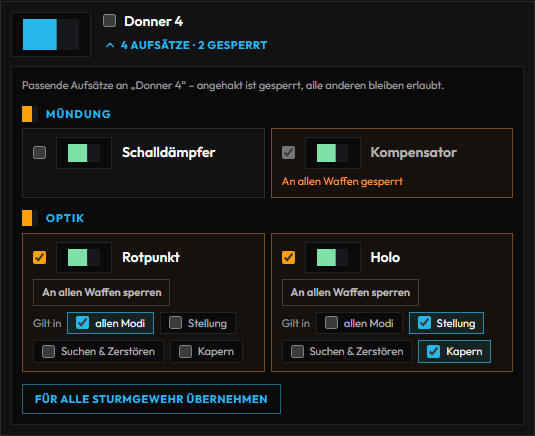</td>
</tr>
<tr>
<td>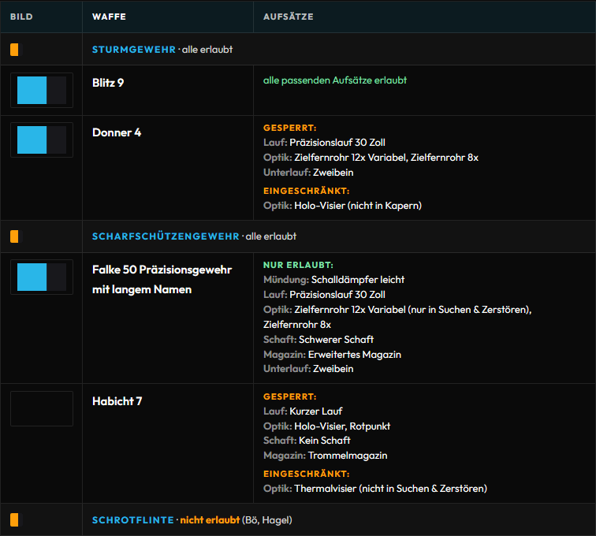</td>
<td>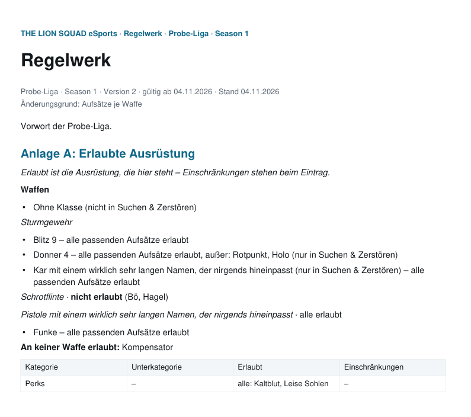</td>
</tr>
<tr>
<td>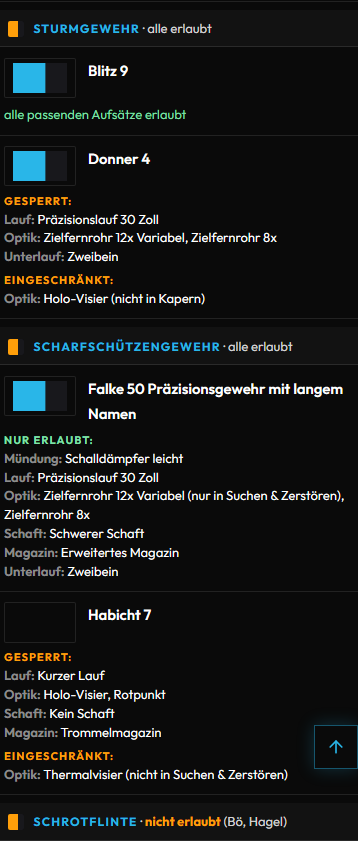</td>
<td></td>
</tr>
</table>

### 2.2 Liga und Season anlegen

1. **Admin → eSports → Liga → Liga anlegen**: Name (etwa „CoD-Liga“) und Spiel.
2. In der Liga **Season anlegen**: nur der **Beginn der ersten Spielwoche** (00:00 Uhr Wiener Zeit, Season 1:
   10.11.2026). Die übrigen Vorgaben kommen als Startwerte mit.
3. Die Season öffnen. Die Season-Seite hat sieben **Reiter**; jede Angabe steht an genau einer Stelle. Am Handy wischst du die
   Reiterleiste seitlich. Jeder Reiter speichert für sich (**Termine speichern**, **Tabelle speichern** …) und schickt nur seine
   eigenen Felder. Was noch nicht gespeichert ist, trägt am Reiter einen **Punkt** und bleibt beim Wechsel erhalten; die Seite fragt
   dann einmal, ob du **jetzt speichern** willst. Verlässt du die Seite mit Ungespeichertem, fragt sie nach.

| Reiter | Was dort steht | Adresse |
| --- | --- | --- |
| **Überblick** | Ablauf der Season, **Was fehlt noch?**, Name, Sichtbarkeit, Stand, Gestaltung und Gewinne | `…/seasons/<id>` |
| **Spielbetrieb** | Modi der Season mit Maps, Mindestgröße, Ergebnisregeln, Serie (Best of, Teamgröße, Modus je Map, Map-Wiederholung), Fristen nach dem Spiel | `#spielbetrieb` |
| **Termine** | Kalender, Standardtermin, Sperrzeiten, Antwortfrist, Terminregeln (2.7a) | `#termine` |
| **Anmeldung und Kader** | Selbstanmeldung (2.5a), Kader und Spielberechtigung (3.9), Plattform und Eingabegerät (2.7c), Eingang der Anmeldungen, Kaderübersicht (3.7) | `#anmeldung`, `#anmeldungen`, `#kader` |
| **Tabelle** | Punkte, Gleichstand, Ausscheiden, Gleichstände der Staffeln (3.5) | `#tabelle` |
| **Regelwerk und Sperrliste** | Stand des Regelwerks mit Weg dorthin (2.11), Sperrliste (2.1a) | `#regelwerk`, `#sperrliste` |
| **Ligen und Staffeln** | Liga 1, 2 …, Staffeln, Staffelgröße, Vorgaben übertragen (2.3, 2.7) | `#ligen` |

<table>
<tr>
<td>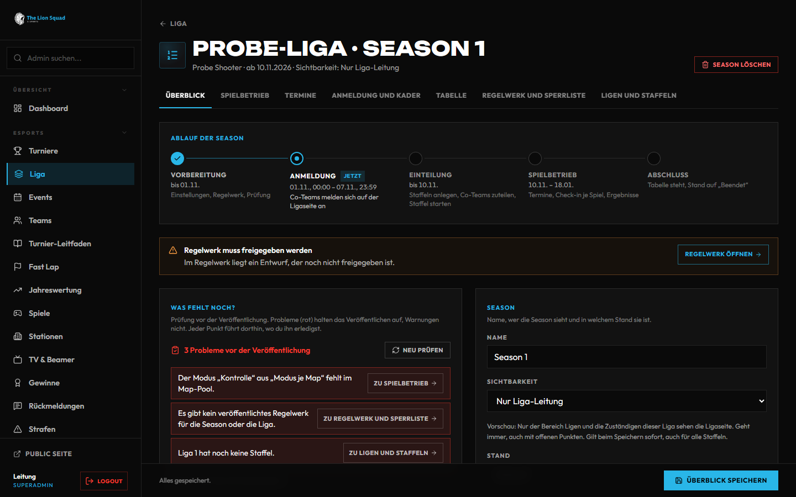</td>
<td>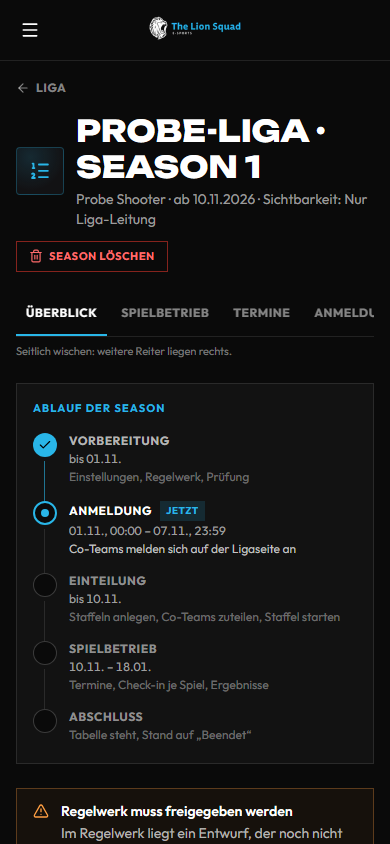</td>
</tr>
</table>

**Überblick.** Oben die **Ablaufleiste**: Vorbereitung → Anmeldung (das Anmeldefenster; ohne Fenster „ohne Selbstanmeldung“) →
Einteilung → Spielbetrieb (mit der laufenden Spielwoche) → Abschluss. Sie folgt aus den Einstellungen und Staffeln, nichts davon
stellst du von Hand. Darunter **Was fehlt noch?** – die Prüfung vor der Veröffentlichung (2.8). Jeder Punkt hat einen Knopf
**Zu …**, der in den richtigen Reiter springt. Daneben **Name**, **Sichtbarkeit** und **Stand**, je mit einem Satz, was sie bewirken.
Der *Stand* ist deine bewusste Schaltung (Entwurf, Läuft, Beendet, Archiviert); mit dem Start der ersten Staffel springt er von selbst
auf *Läuft*. Muss das Regelwerk freigegeben werden (Entwurf liegt bereit oder Daten haben sich geändert), steht oben
**Regelwerk muss freigegeben werden** mit Weg dorthin. **Gestaltung und Gewinne** (2.10) klappt unten auf. Speichern: **Überblick
speichern**.

**Spielbetrieb – die Modi an einer Stelle.**

<table>
<tr>
<td>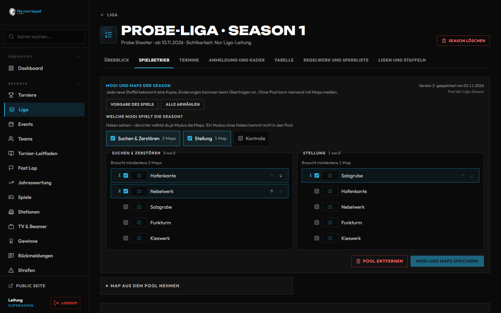</td>
<td>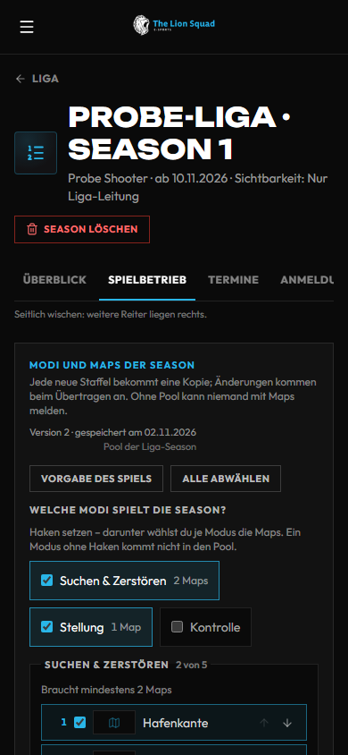</td>
</tr>
</table>

1. **Welche Modi spielt die Season?** Haken bei jedem Modus setzen. Darunter erscheint je angehaktem Modus die Liste seiner Maps:
   anhaken und mit den Pfeilen sortieren. Unter dem Namen steht, wie viele Maps der Modus **mindestens braucht** (aus Modus je Map,
   längster Serie und Map-Wiederholung). **Vorgabe des Spiels** lädt den Standard-Pool des Spiels (ohne ihn alle aktiven Maps) und hakt
   die Modi gleich an. Ein Modus ohne Haken kommt nicht in den Pool. **Modi und Maps speichern** legt eine neue Version an; ohne Pool
   kann niemand mit Maps melden, jede neue Staffel bekommt eine Kopie.
2. Darunter: **Map aus dem Pool nehmen** (Map, „aus allen Modi“ oder einer, **Grund** mit mindestens 5 Zeichen → **Sperren und
   übertragen**: neue Version ohne die Map, sofort an alle Staffeln; Spiele mit festgehaltenem Pool und fertige Spiele bleiben) und
   **Versionen vergleichen**.
3. **Mindestgröße anpassen** (zugeklappt): eine eigene Zahl je Modus überschreibt die Ableitung, leer heißt abgeleitet →
   **Mindestgröße speichern**.
4. **Ergebnisregeln** – nur für die angehakten Modi. Eine neue Season übernimmt beim Anlegen die Regel jedes Modus aus dem Spiel (2.1)
   als eigene Kopie, **Punkte je Map Pflicht** ist an. Je Modus stehen die Regel der Season und darunter „Spiel: …“. Abweichen geht je
   Modus: **Art** (Punkte bis zum Ziel, Runden gewinnen, Höherer Endstand gewinnt, Keine Regel), **Zielpunkte** bzw. **Rundensiege zum
   Sieg**, **Höchstens Runden**, **Zeitlimit**, **Remis möglich**, **Verlängerung** → **Ergebnisregeln speichern**. Ändert jemand später
   die Regel am Spiel, bleibt die Season, wie sie ist: Dann steht **weicht vom Spiel ab** am Modus, und **Vom Spiel übernehmen** holt die
   neue Regel – erst mit dem Speichern gilt sie.
5. **Serie:** **Best of**, **Teamgröße (je Map)**, **Map-Wiederholung in einer Serie** und **Modus je Map** (Map 1, 2, 3 – „frei“ heißt:
   die Teams wählen; so viele Felder wie die längste Serie, entweder alle frei oder jedes belegt). Steht in Modus je Map ein Modus ohne
   Maps im Pool, oder hat ein Modus Maps, kommt aber nie dran, sagt das ein Hinweis direkt darunter. Dazu **Nach dem Spiel**:
   **Ergebnis gilt nach** und **Teilnehmerliste nachtragen bis** (Stunden). Speichern: **Spielbetrieb speichern**.

| Art | Beispiel | Was die Meldung prüft |
| --- | --- | --- |
| Punkte bis zum Ziel | Ziel 250, Zeitlimit 10 Min. | Sieger hat mehr Punkte, höchstens 250; ohne Zeitlimit genau 250 |
| Runden gewinnen | 6 Rundensiege, höchstens 11 Runden | 6:5 geht, 7:5 nicht („höchstens 11 Runden – 7:5 sind 12“) |
| Höherer Endstand gewinnt | – | nur: der Sieger hat mehr |

Mit **Verlängerung** dürfen Ziel und Rundenlimit überschritten werden. Ein Gleichstand geht nur mit **Remis möglich**; die
Map braucht trotzdem einen Sieger. Ohne Regel prüft die Meldung den Endstand nicht. Seasons von vor dieser Funktion haben
keine Kopie und keine Punktepflicht – sie prüfen nichts Neues, bis du hier speicherst.

**Die Werte für Season 1** in den übrigen Reitern:

| Reiter | Feld | Season 1 |
| --- | --- | --- |
| Spielbetrieb | **Best of** · **Teamgröße (je Map)** | Best of 3 · 4 |
| | **Modus je Map** | nach Regelwerk |
| | **Map-Wiederholung in einer Serie** | Gleiche Map nur in anderem Modus (Vorgabe); auch „Aus – jede Map nur einmal“ oder „Immer erlaubt“ |
| | **Ergebnis gilt nach** · **Teilnehmerliste nachtragen bis** (Stunden) | 48 · 48 |
| Termine | **Wochen gesamt** (mit Sperrwochen) | 10 |
| | **Spielwoche (Tage)**, **Standardtag**, **Standardzeit** | 7 · Sonntag · 20:00 |
| | **Runden** | Nur Hinrunde |
| | **Sperrzeiten** (Von, Bis, Bezeichnung) | 21.12.2026–3.1.2027 „Weihnachtspause“ |
| | **Antwort auf Terminvorschlag (Stunden)** – leer heißt bei älteren Seasons „je Staffel wie bisher“ | 72 |
| Anmeldung und Kader | **Anmeldung ab / bis**, **Startplätze** … (2.5a) | nach Plan |
| | **Meldeschluss** (nur Anzeige) – nur ohne Anmeldefenster, sonst gilt „Anmeldung bis“ | – |
| | **Mindestkader** · **Höchstkader** · **Mindestalter (Jahre)** · **Wartezeit neuer Spieler (Tage)** | 3 · 50 · 18 · 7 |
| | **Wer gespielt hat**, **Mindestens auf der Liste** | Teilnehmerliste einmal je Spiel, 3 |
| | **Ein Team je Season**, **Jede Spiel-ID nur einmal** | an, an |
| | **Transferfenster** (Von, Bis, Name) | keines: ohne Fenster keine Transfers |
| | **Plattform und Eingabegerät**: Feld, erlaubte Plattformen, Crossplay, Eingabegerät (2.7c) | nach Regelwerk |
| Tabelle | **Punkteart**: *Sieg, Remis, Niederlage* oder *Punkte nach gewonnenen Maps* (3:2 ergibt 3 und 2) | Sieg, Remis, Niederlage |
| | **Punkte Sieg / Remis / Niederlage** – nur bei *Sieg, Remis, Niederlage* | 3 / 0 / 0 (neue Seasons; ältere: 3 / 1 / 0) |
| | **Bei Punktgleichheit** (in der Reihenfolge des Anklickens) | Direkter Vergleich, Map-Differenz, Mehr gewonnene Maps, Entscheid der Leitung |
| | **Direkter Vergleich (Mini-Tabelle)** – erscheint mit dem direkten Vergleich | Punkte, Map-Differenz, Gewonnene Maps |
| | **Kampflos (Default-Win)** | Maps des Best of (BO3 2:0, BO5 3:0) |
| | **Austritt, Auflösung, Disqualifikation** | Alle Spiele zählen für die Gegner, Team ans Tabellenende |
| | **Remis erlaubt** | aus |
| Ligen und Staffeln | **Teams je Staffel höchstens** | 8 |
| Überblick | **Sichtbarkeit** | bis zum Start *Nur Liga-Leitung* (siehe 2.8) |

**Punkte nach gewonnenen Maps:** Im Reiter **Tabelle** unter **Punkteart** *Punkte nach gewonnenen Maps* wählen. Jede Seite
bekommt so viele Punkte, wie sie Maps gewonnen hat – bei 3:2 der Sieger 3, der Verlierer 2. Kampflos zählt immer wie 3:0 (das Feld
**Kampflos** ist dann gesperrt), „beide nicht erschienen“ gibt beiden 0. Beim Wechsel setzt die Seite die Reihenfolge bei
Punktgleichheit auf **Mehr Siege → Direkter Vergleich → Map-Differenz → Entscheid der Leitung**; das ist ein Vorschlag, du kannst sie
danach ändern. Der direkte Vergleich rechnet dann auch mit den Maps der Spiele untereinander. Gespeichert wird die Umstellung im
Protokoll („Punkteart“ mit vorher und nachher). Eine **laufende** Season bekommt die neue Punkteart über **Vorgaben übertragen**
auch nach dem ersten Ergebnis (siehe Tabelle unten); beendete Staffeln sowie abgeschlossene oder archivierte Seasons bleiben, wie
sie sind. Danach schlägt das Regelwerk eine neue Freigabe vor, weil sich der Baustein „Tabelle und Wertung“ geändert hat.
Eine **Liga N** übernimmt die Punkteart immer von der Season. Mit Map-Punkten gibt es im Blatt der Liga N keine eigenen Punkte für
Sieg, Remis und Niederlage. Sonst legt sie nur ihre eigenen Punkte über die Season; direkter Vergleich, Remis-Regel, kampflos und
Ausscheiden gelten wie in der Season.

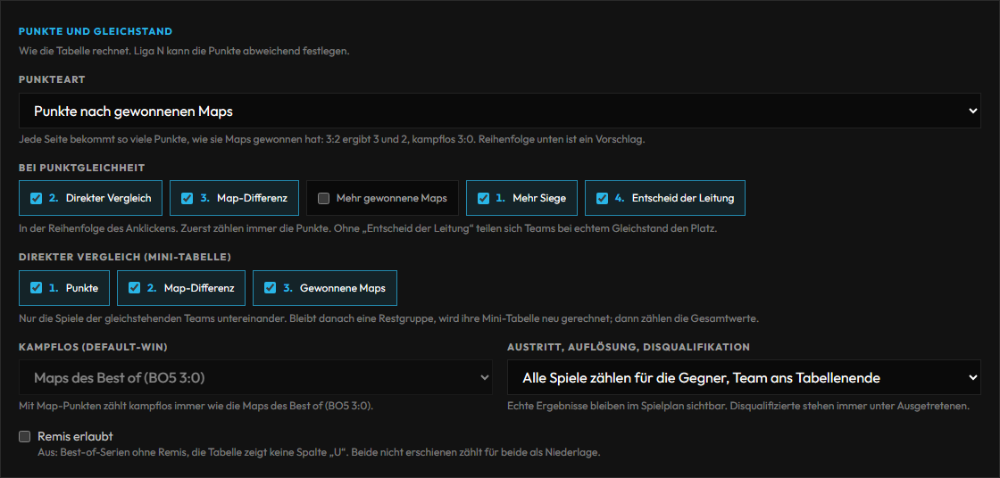

Im Reiter **Termine** steht unter den Sperrzeiten nach dem Speichern, welche Wochen gesperrt sind und **wie viele Teams eine Staffel
höchstens fassen kann** (Season 1: 8 Spielwochen – höchstens 8 Teams mit nur Hinrunde).

<table>
<tr>
<td>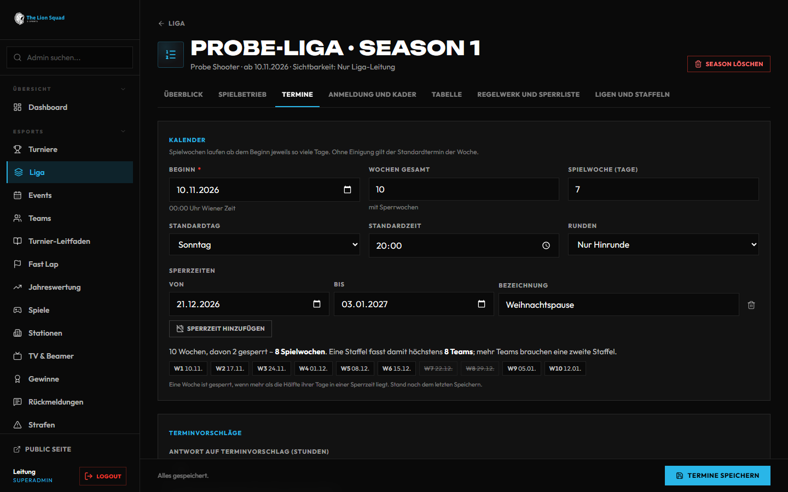</td>
<td>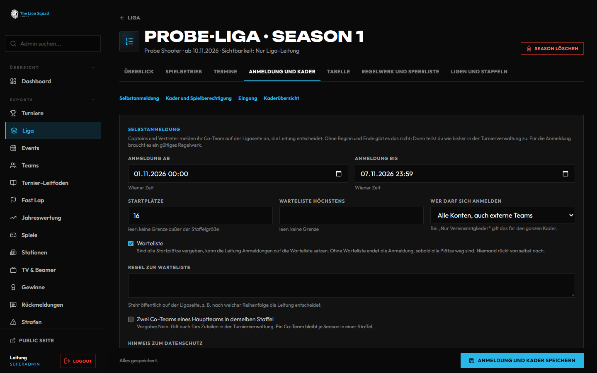</td>
</tr>
<tr>
<td>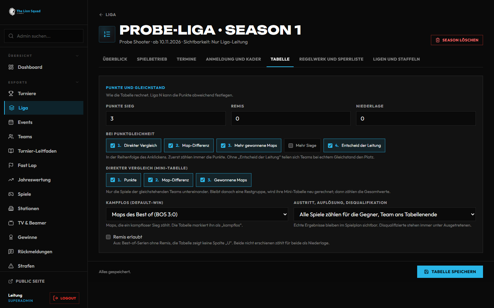</td>
<td>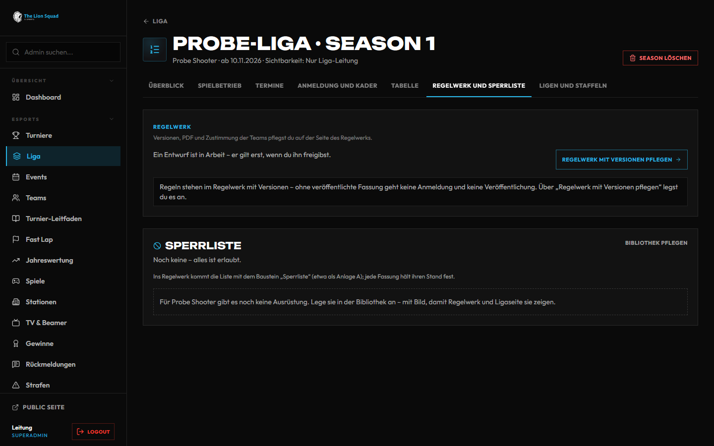</td>
</tr>
</table>

**Regeltext:** Das alte Freitextfeld gibt es auf der Season-Seite nicht mehr. Regeln stehen im Regelwerk mit Versionen (2.11). Hat
eine ältere Season noch einen Regeltext und kein Regelwerk, steht er im Reiter **Regelwerk und Sperrliste** zum Nachlesen und gilt auf
der Ligaseite weiter, bis die erste Fassung veröffentlicht ist. Gelöscht wird nichts.

### 2.3 Liga 1 und Staffel anlegen

1. Auf der Season-Seite im Reiter **Ligen und Staffeln** → **Liga 1 anlegen**. Leere Felder heißen „wie die Season“.
   Der **Beiname** ist freiwillig: „Liga 1“ zählt die Seite von selbst, trag dort nur einen Zusatz wie „Elite“ ein (Anzeige
   „Liga 1 · Elite“). Wiederholt der Beiname die Stufe – etwa „Liga 1“, dann hieße es „Liga 1 · Liga 1“ –, sagt das ein Hinweis
   im Blatt und in der Liste. Liga 2, 3 … entstehen genauso und dürfen eigene Werte haben.
2. In der Zeile von Liga 1 → **Staffel anlegen** → bestätigen. Es entsteht das Turnier „CoD-Liga Season 1 · Liga 1 ·
   Staffel A“ als **Entwurf** – ohne offene Anmeldung, ohne Discord, ohne Jahreswertung. Mehr als acht Teams? Eine
   zweite Staffel (B) anlegen und die Teams verteilen; zwei Co-Teams desselben Hauptteams spielen nie in derselben
   Staffel.

<table>
<tr>
<td>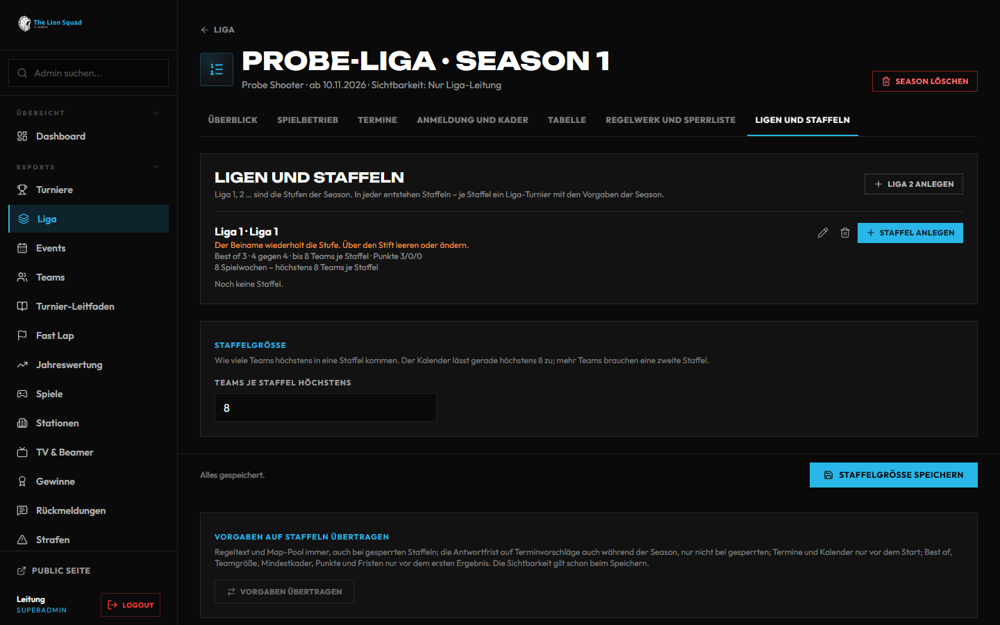</td>
<td>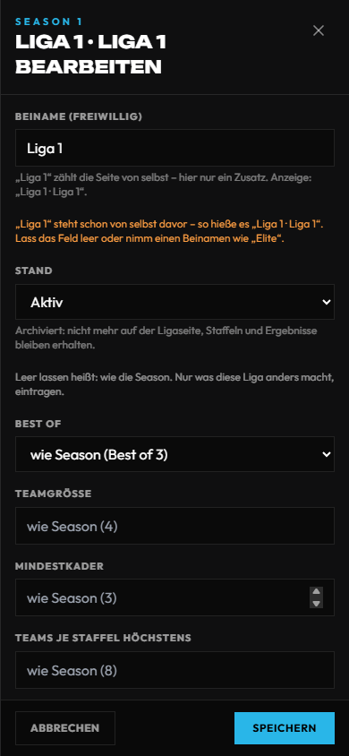</td>
</tr>
</table>

### 2.4 Co-Teams vorbereiten (Teamleitung)

Das macht die Leitung des Hauptteams, nicht die Turnierleitung: **Teams → Deine Teams** → Team wählen → **Co-Team** →
Name, **Spiel** aus der Liste (eines mit anderem Spiel lässt sich nicht zuteilen; Hauptspiel und Versionen zählen zusammen, ohne Spiel passt es überall), **Kader**
(mindestens so viele wie der Mindestkader, höchstens der Höchstkader, Vorgabe 3 bis 50), **Captain** und **Vertreter**
(beide aus dem Kader, verschieden) → speichern. Captain und Vertreter vereinbaren Termine, melden und bestätigen
Ergebnisse. Alle im Kader brauchen ein Konto und müssen Mitglied des Hauptteams sein.

Jeder im Kader braucht außerdem die **Spiel-ID** des Spiels im Profil (**Einstellungen → Gaming → Spiel-IDs**, bei CoD
die **Activision-ID** inklusive `#`). Die ID des Hauptspiels gilt für alle Versionen. Ohne ID kann jemand zugeteilt,
aber nicht aufgestellt werden (3.7). Verlangt die Season ein Mindestalter, braucht jeder im Kader ein **Geburtsdatum im Profil**; sichtbar ist davon nur „erfüllt“ oder „Geburtsdatum fehlt“.
Unter jedem Co-Team, das in einer Staffel spielt, zeigt **Spielberechtigung** die Regeln der Season, wer spielen darf und was fehlt.

### 2.5 Co-Teams zuteilen

1. Season-Seite, Reiter **Ligen und Staffeln** → bei der Staffel **Turnierverwaltung · Co-Teams zuteilen** → Reiter **Teilnehmer**.
2. **Co-Team zuteilen** → Schritt 1: das **Hauptteam** wählen → Schritt 2: das **Co-Team** → **Zuteilen**.
3. Co-Teams, die nicht passen, stehen grau mit dem Grund da (Kader zu klein oder zu groß, Team schon in der Staffel, Staffel voll, jemand steht schon in einem anderen Co-Team der Season …). Fehlende Geburtsdaten, ein zu junges Mitglied, eine andere Plattform oder zu wenige Spielberechtigte stehen nur als Hinweis da: Zuteilen geht, gesperrt wird beim Check-in (3.9).
4. Bei jedem Co-Team steht je Spieler die **Spiel-ID** (Haken) bzw. **keine ID** (gelb), darunter „Ohne gültige
   Activision-ID: …“ mit den Namen. Zuteilen geht trotzdem; diese Spieler können erst aufgestellt werden, wenn die ID
   im Profil steht. Sie und die Verantwortlichen des Co-Teams bekommen eine Nachricht.

Beim Zuteilen wird die ID jedes Spielers für die Season **festgehalten** (3.7). Die Captains und Vertreter bekommen
eine Benachrichtigung. **Entfernen** in der Teilnehmerliste geht nur bis zum
Start. Bis dahin ist der Spielplan eine Vorschau und wird bei jeder Änderung neu gemischt.

### 2.5a Selbstanmeldung

Captains und Vertreter melden ihr Co-Team selbst auf der Ligaseite an, du entscheidest. Ohne Anmeldefenster gibt es das nicht, dann bleibt es beim Zuteilen aus 2.5. Das Zuteilen bleibt auch danach als Sonderweg.

**Einrichten** (Season-Seite, Reiter **Anmeldung und Kader** → **Selbstanmeldung**, Zuständigkeit „Season konfigurieren“):

1. **Anmeldung ab** und **Anmeldung bis** in Wiener Zeit eintragen. Beides oder nichts.
2. **Startplätze** eintragen. Leer heißt: keine Grenze außer der Staffelgröße.
3. **Warteliste** an- oder abschalten, auf Wunsch eine Höchstzahl und eine **Regel zur Warteliste**. Die Regel steht öffentlich auf der Ligaseite.
4. **Wer darf sich anmelden:** alle Konten (Vorgabe) oder nur Vereinsmitglieder. Bei Mitgliedern gilt das für den ganzen Kader.
5. **Zwei Co-Teams eines Hauptteams in derselben Staffel:** Vorgabe Nein.
5a. **Anmeldungen automatisch annehmen:** Vorgabe aus, dann prüfst du jede Anmeldung. Mehr dazu unten unter „Automatisch annehmen“.
6. **Hinweis zum Datenschutz:** Der Text steht bei der Anmeldung über dem Link zur Datenschutzerklärung und wird mit der Zustimmung gespeichert. Leer steht dort ein vorläufiger Platzhalter-Satz. Den Wortlaut gibt der Obmann frei.
7. **Regelwerk veröffentlichen** (2.11): Ohne gültige Version geht keine Anmeldung. Der alte Regeltext reicht dafür nicht, weil er keine Version hat und sich eine Zustimmung darauf nicht belegen lässt.

**Entscheiden** (Season-Seite, Reiter **Anmeldung und Kader** → **Anmeldungen**, Zuständigkeit „Teams freigeben“). Bei jeder neuen Anmeldung bekommst du eine Nachricht mit Link; er öffnet den Reiter gleich an dieser Stelle. Je Anmeldung steht da, wer eingereicht hat, welcher Regelversion und wann zugestimmt wurde und was der Kader gerade nicht erfüllt.

**Offene Punkte** (#2313): Fehlen im Kader Angaben (Geburtsdatum, Spiel-ID, Plattform, Alter) oder sind zu wenige spielberechtigt, steht das im Kasten **Offene Punkte** – mit Zahl und Namen. Das hält nichts auf, du darfst trotzdem annehmen und zuteilen. Gesperrt wird erst beim Check-in und bei der Aufstellung (3.9), das Team wird erinnert.

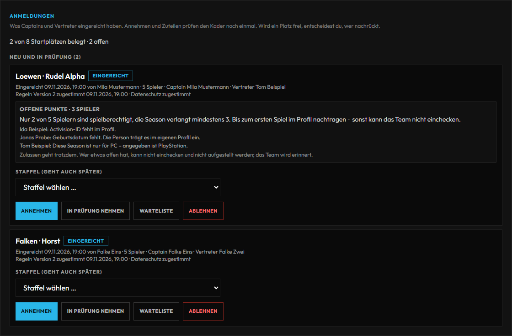

| Knopf | Was passiert |
| --- | --- |
| **In Prüfung nehmen** | Das Team sieht „In Prüfung“. Freiwillig |
| **Annehmen** | Belegt einen Startplatz. Mit gewählter Staffel ist das Co-Team gleich zugeteilt, sonst teilst du später zu |
| **Zuteilen** | Für Angenommene ohne Staffel. Erst jetzt steht das Team in der Staffel, und der Kader wird noch einmal geprüft |
| **Warteliste** | Kein Startplatz. Rückt nicht von selbst nach: Wird ein Platz frei, nimmst du von Hand an. Eine schon angenommene Anmeldung setzt du nur mit Grund zurück, das Team liest ihn |
| **Ablehnen** | Nur mit Grund (mindestens fünf Zeichen). Captain und Vertreter lesen ihn. Das Team darf im offenen Fenster neu einreichen |

Hat sich der Kader seit dem Einreichen geändert, sagt das die Anmeldung, und Annehmen oder Zuteilen lehnen mit demselben Satz ab. Sind alle Plätze belegt, geht **Annehmen** nicht mehr. Mit Warteliste nimmt die Season weiter Anmeldungen an, ohne Warteliste endet die Anmeldung.

**Automatisch annehmen** (Schalter unter **Selbstanmeldung**): Ist er an, ist eine gültige Anmeldung beim Einreichen sofort angenommen und belegt einen Startplatz. Anmeldungen, die noch auf deine Prüfung warten, halten dabei ihren Platz: Eine neue wird nur angenommen, wenn nach ihnen noch ein Platz frei ist. Es gelten dieselben Regeln wie sonst (Fenster, Regelwerk, wer sich anmelden darf, ein Co-Team je Season); fehlende Angaben halten auch hier nicht auf. Sind alle Plätze vergeben oder wartet schon jemand auf der Warteliste, kommt die Anmeldung auf die Warteliste – einen frei gewordenen Platz vergibst du wie bisher. Gibt es nur eine Staffel, steht das Co-Team gleich darin; bei mehreren teilst du zu, das Team sieht so lange „Angemeldet – Zuteilung folgt“. Geht die einzige Staffel nicht (voll, gesperrt, schon begonnen), ist das Co-Team ohne Staffel angenommen, und im Eingang steht „Nicht automatisch zugeteilt: …“ mit dem Grund. Steht schon ein anderes Co-Team desselben Hauptteams in der einzigen Staffel, nimmt die Season nicht an: Die Anmeldung bleibt bei dir, mit „Nicht automatisch angenommen: …“. Den Grund liest du auch in deiner Nachricht. Du bekommst zu jeder automatischen Annahme eine Nachricht, im Eingang steht „Automatisch angenommen“ und im Verlauf „Angenommen, automatisch“. Das gilt auch für dein eigenes Team, weil niemand entschieden hat; die anderen Zuständigen sehen dann im Eingang „Team der Leitung – automatisch angenommen“. Das Umschalten steht mit dem Wert vorher und nachher im Protokoll.

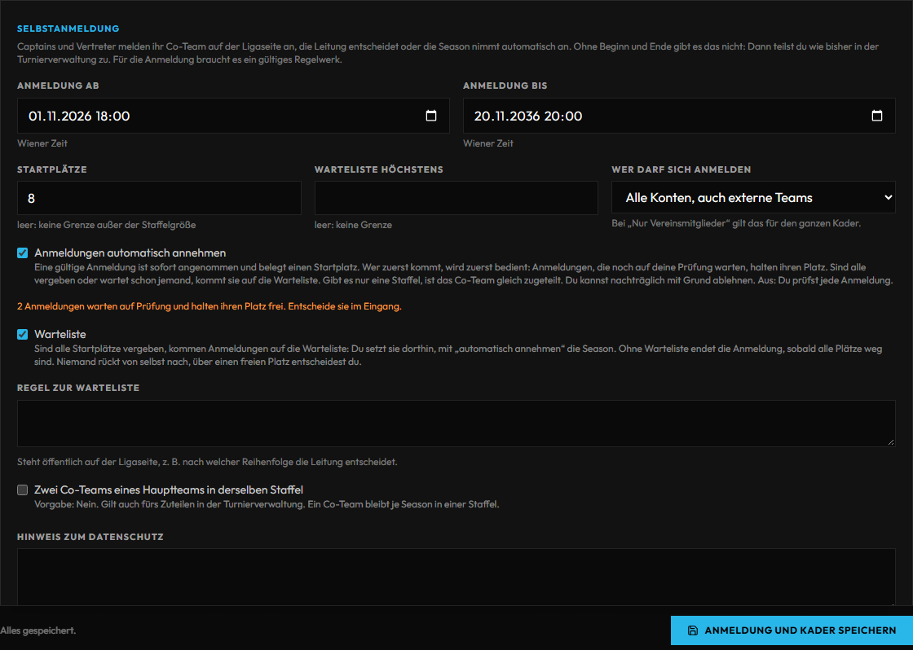

Passt eine automatisch angenommene Anmeldung nicht, **lehnst du sie ab** oder setzt sie auf die **Warteliste** – beides nur mit Grund, das Team liest ihn. Hat die Season das Co-Team automatisch in die einzige Staffel gesetzt, nimmt Ablehnen oder Warteliste es dort wieder heraus, solange der Spielplan noch nicht steht; danach geht es nur über **Austritt eintragen** in der Teilnehmerliste. Über das eigene Team entscheidet auch hier eine andere Person. Schaltest du die Einstellung später ein, bleiben offene Anmeldungen von vorher bei dir: Sie halten ihren Platz – wer zuerst kommt, wird zuerst bedient. Die Ligaseite zählt sie darum bei den freien Startplätzen schon mit, und wartet jemand auf der Warteliste, steht dort kein freier Platz. Unter dem Schalter steht dann „X Anmeldungen warten auf Prüfung und halten ihren Platz frei. Entscheide sie im Eingang.“

Teilst du ein Co-Team mit offener Anmeldung über 2.5 direkt zu, gilt die Anmeldung als angenommen. Nimmst du die Zuteilung zurück, bleibt sie angenommen und hält ihren Platz, bis du neu zuteilst oder ablehnst. Zugeteilte zieht niemand per Klick zurück: Den Austritt trägst du in der Teilnehmerliste ein. Ausnahme: Hat die Season das Co-Team automatisch zugeteilt, zieht das Team selbst zurück, solange der Spielplan nicht steht und der Check-in noch nicht begonnen hat. Die Warteliste bleibt dabei, wie sie ist; über den freien Platz entscheidest du.

**Eigenes Team:** Über die Anmeldung deines eigenen Teams entscheidet eine andere Person. Eigenes Team heißt: Du stehst im Kader des Co-Teams, bist Captain oder Vertreter, leitest das Hauptteam mit oder hast den Antrag eingereicht. Dann stehen bei dieser Anmeldung keine Knöpfe, sondern der Satz „Über dein eigenes Team entscheidet eine andere Person.“ Die Anmeldungen der anderen Teams entscheidest du wie gewohnt. Dasselbe gilt für **Co-Team zuteilen** (2.5), wenn das Co-Team eine offene Anmeldung hat. Nur der **Superadmin** darf als Notausnahme: Er trägt bei der Anmeldung einen **Grund für die Notausnahme** ein (mindestens fünf Zeichen), erst dann gehen die Knöpfe. Der Grund steht im Verlauf der Anmeldung und im Protokoll.

### 2.6 Spielplan und Start

Oben in der Turnierverwaltung der Staffel: **Liga starten**. Damit wird der Spielplan fest (Season 1 mit acht Teams:
sieben Spieltage zu je vier Spielen, Heimrecht ausgeglichen, Spieltag 7 nach der Weihnachtspause in Woche 9) und die
Staffel steht auf **Live**. Ab jetzt können die Captains Termine vorschlagen und melden. Mit der ersten Staffel springt
die Season von *Entwurf* auf *Läuft*, ein von Hand gesetzter Stand bleibt.

- Kein **Check-in** und keine Anmeldung – die Co-Teams sind zugeteilt, niemand checkt ein. Die Status-Auswahl oben
  bietet für eine Staffel nur Entwurf, Live, Pausiert, Beendet, Ergebnisse veröffentlicht, Archiviert und Abgesagt.
- Den Spielplan vor dem Start ansehen: Reiter **Matchplan** (Vorschau mit Spielwochen) bzw. **Spiele**. Der Reiter
  **Tabelle** führt zur Tabelle und zum Spielplan auf der öffentlichen Seite. Neu mischen: **Werkzeuge → Vorschau neu
  mischen** – nur vor dem Start; danach steht der Spielplan.

Die Turnierverwaltung einer Staffel zeigt nur, was die Liga braucht. Oben steht, wohin sie gehört („Liga 1 · Staffel
A“) mit **Season öffnen** und **Ligaseite**. Im Reiter **Bearbeiten** stehen die Werte der Season (Spiel, Start und
Ende, Spielwoche, Standardtermin, Teamgröße, Staffelgröße, Best of, Bestätigungsfrist, Antwortfrist auf
Terminvorschläge, Sichtbarkeit, Regeltext) nur zum Lesen unter **Aus der Season** – ändern in der Season, dann
**Vorgaben übertragen** (2.7). Auch den Map-Pool pflegt die Season. Anmeldung, Check-in, Discord, Preise, Jahreswertung,
Setzliste und Weiterkommen gibt es in der Staffel nicht. Änderbar bleiben Titel, Beschreibung, Banner, Partner und
Streaming. Die Antwortfrist ändert sich nur noch über die Season (oder Liga N) und **Vorgaben übertragen** – auch bei
älteren Seasons: dort ist das Feld leer und jede Staffel behält ihre bisherige Frist, bis du in der Season einen Wert
einträgst und überträgst.

Eine Staffel lässt sich nur **vor dem Start** löschen – in der Turnierliste oder auf der Season-Seite (2.9). Danach
bleibt sie: Status **Abgesagt** oder **Archiviert**. In der Turnierliste tragen Staffeln das Kennzeichen „Liga ·
Staffel A“; der Filter **Nur Liga-Staffeln** zeigt nur sie.

### 2.7 Vorgaben später ändern und übertragen

Eine Staffel trägt die Werte, die beim Anlegen galten. Ändert ihr danach etwas an der Season, steht oben „Die
bestehende Staffel trägt noch die alten Werte“ – **Jetzt übertragen** bzw. im Reiter **Ligen und Staffeln** **Vorgaben übertragen**. Was nicht
mehr geht, steht je Staffel mit Grund da:

| Was | Wird übertragen |
| --- | --- |
| Regeltext, Map-Pool | immer (ein entfernter Pool verschwindet nur vor dem ersten Ergebnis; Spiele mit festgehaltenem Pool behalten ihn) |
| Antwortfrist auf Terminvorschläge | auch während der Season – gilt für neue Vorschläge; nicht bei gesperrten Staffeln. Ist das Feld der Season leer (ältere Seasons), behält jede Staffel ihre Frist |
| Ergebnisregeln und Punktepflicht | auch während der Season – gilt für neue Meldungen, fertige Ergebnisse bleiben; nicht bei gesperrten Staffeln |
| Termine und Kalender (Beginn, Wochen, Sperrzeiten, Standardtermin, Runden, Staffelgröße) | nur vor dem Start |
| Best of, Teamgröße, Mindestkader, Punkte, Modus je Map, Map-Wiederholung, Fristen | nur vor dem ersten Ergebnis |
| Punkteart (Sieg/Remis/Niederlage oder gewonnene Maps) mit Reihenfolge bei Punktgleichheit und Kampflos | auch während der Season, wenn sich die Punkteart ändert; nicht bei gesperrten oder beendeten Staffeln |
| Sichtbarkeit | sofort beim Speichern, ohne Übertragen |
| Terminregeln (Kasten „Termine und Verschiebungen“) | sofort beim Speichern des Kastens; gesperrte Staffeln beim Übertragen |
| Check-in (Kasten „Check-in vor dem Spiel“) | sofort beim Speichern des Kastens; gesperrte Staffeln beim Übertragen |
| Veto (Kasten „Veto“, 2.7d) | sofort beim Speichern des Kastens; gesperrte Staffeln beim Übertragen; ein laufendes Veto behält seinen Stand |
| Vorgabe der Woche (im Kasten „Veto“, 2.7d) | sofort mit **Vorgaben speichern**, für alle Staffeln und ohne Übertragen; gilt für Spiele, deren Veto noch nicht begonnen hat |
| Vorfälle und Pausen (Abschnitt im Reiter Spielbetrieb, 2.7e) | beim Übertragen, auch während der Season; nicht bei gesperrten Staffeln. Ein schon gemeldeter Vorfall behält seine Antwortzeit |

### 2.7a Termine und Verschiebungen (Regelwerk § 7)

Im Reiter **Termine** der Season-Seite steht der Kasten **Termine und Verschiebungen** (Zuständigkeit „Season konfigurieren“). Er hat ein eigenes
**Terminregeln speichern** und gilt sofort für alle Staffeln der Season. Neue Seasons bekommen die Vorgaben; eine ältere Season
sagt „Diese Season ist älter als die Terminregeln“ – dort gilt ein Vorschlag der Heimseite sofort und es gibt keine
Verschiebung, bis ihr einmal speichert.

| Feld | Vorgabe | Wirkung |
| --- | --- | --- |
| **72-h-Regel** (an/aus) und **Frist (Stunden)** | an, 72 | Antwortet die Gastseite nicht auf einen Vorschlag der Heimseite, gilt er nach der Frist – nur in der Spielwoche, nicht in einer Sperrzeit, nur in der Zukunft. Sonst gilt der Standardtermin. Sperrzeiten zählen nicht mit |
| **Verschieben bis (Stunden vor dem Termin)** | 24 | später beantragen geht nicht mehr |
| **Verschiebungen je Spiel** | 2 | 0 heißt: nur die Leitung verschiebt |
| **Verschieben nur innerhalb der Spielwoche** | an | wochenübergreifend entscheidet die Leitung |
| **Erinnerung ohne Ergebnis** | 24 h nach dem Termin | Nachricht an Captain und Vertreter beider Seiten |
| **Überfällig nach** | 48 h nach dem Termin | das Spiel steht bei euch unter **Mein Dienst → Braucht deine Entscheidung** |

Alles, was über diese Grenzen geht (später, öfter, in eine andere Woche), legt die Liga-Leitung fest – siehe 3.1.

### 2.7b Check-in vor dem Spiel (Regelwerk § 8)

Auf der Season-Seite im Reiter **Termine** steht unter den Terminregeln der Kasten **Check-in vor dem Spiel** (Zuständigkeit „Season
konfigurieren“), mit eigenem **Check-in speichern**; er gilt sofort für alle Staffeln der Season. Neue Seasons bekommen die Vorgaben; eine ältere Season sagt
„Diese Season ist älter als der Check-in“ – dort gibt es keinen Check-in und keinen Vorschlag „nicht erschienen“, bis ihr einmal
speichert.

| Feld | Vorgabe | Wirkung |
| --- | --- | --- |
| **Öffnet (Minuten vor dem Termin)** | 15 | Nr. 19: ab dann checken Captain oder Vertreter ihre Seite ein |
| **Schließt (Minuten nach dem Termin)** | 15 | danach kein Check-in mehr durch die Seiten – ihr könnt nachtragen oder verlängern |
| **Mindestens Anwesende je Seite** | 3 (aus Teilnehmerliste oder Teamgröße − 1) | Nr. 46: nur Spieler aus dem Kader, nur wer spielen darf (3.9); bis zum Schluss lässt sich ergänzen |
| **Erinnerung vor Schluss (Minuten)** | 5 | zweite Nachricht an Seiten ohne Check-in; 0 = keine |
| **Erinnerung an fehlende Angaben (Stunden vor dem ersten Spiel)** | 48 | einmal je Team vor dem ersten Spiel: an jeden, dem Geburtsdatum, Spiel-ID oder Plattform fehlt, und an Captain und Vertreter (3.9); 0 = keine. Steht nicht im Regelwerk |

Wie es dann läuft, steht in 3.1b. Im Regelwerk nennt der Baustein `[[baustein:checkin]]` diese Werte (2.11).

### 2.7d Veto: Maps vor dem Spiel sperren und wählen (Regelwerk § 6, Anlage B)

Auf der Season-Seite im Reiter **Spielbetrieb** steht direkt unter **Serie** der Kasten **Veto** (Zuständigkeit „Season konfigurieren“),
mit eigenem **Veto speichern**; er gilt sofort für alle Staffeln der Season, ein gerade laufendes Veto behält seinen Stand. Neue Seasons
beginnen mit **Veto an**: Die Vorlage folgt dem Map-Pool automatisch (wie **Vorschlag aus Modusfolge und Pools**) – bei jedem Speichern
des Pools und bei „Map aus dem Pool nehmen“ –, bis ihr den Kasten das erste Mal speichert; der Kasten sagt das, solange es gilt. Danach
bleibt die Vorlage, wie ihr sie gespeichert habt, und **Was fehlt noch?** im Überblick nennt, was mit dem Pool nicht mehr aufgeht. Ältere
Seasons ohne Kasten bleiben aus – dort tragen die Teams die Maps wie bisher beim Ergebnis ein. Das Veto braucht den **Check-in** (2.7b):
Es beginnt, sobald beide Seiten eingecheckt sind, Map 1 folgt direkt danach.

| Feld | Vorgabe | Wirkung |
| --- | --- | --- |
| **Veto in dieser Season** | an (neue Seasons) | an: nach dem Check-in sperren und wählen die Teams nach der Schrittfolge; aus: Maps beim Ergebnis |
| **Team A** | Heimteam laut Spielplan | Nr. 22: Team A beginnt laut Vorlage, Team B ist die andere Seite. „Los je Spiel“: der Server lost je Spiel einmal, nie neu beim Neuladen |
| **Zeit je Schritt (Sekunden)** | 60 | Nr. 23: läuft die Zeit ab, wählt das System zufällig aus den noch zulässigen Maps – das Veto bleibt nie stehen |
| **Schrittfolge** | leer | je Schritt: **Sperren** oder **Wählen** durch Team A oder B in einem Modus, **Decider** (die übrige Map des Modus, setzt das System) oder **Vorgabe** (die Map legt ihr je Spielwoche fest, siehe unten); Wahl, Decider und Vorgabe bekommen ihre **Position** in der Serie (Map 1 bis Best of). Die Reihenfolge der Schritte ist die des Vetos, nicht die Spielreihenfolge |

So geht es am schnellsten: **Vorschlag aus Modusfolge und Pools** baut eine Folge nach Anlage B aus „Modus je Map“, den Poolgrößen und
dem Best of – je Modus beginnt abwechselnd Team A und B; ein Modus mit einer Position sperrt bis eine Map bleibt und endet mit dem Decider,
ein Modus mit mehreren sperrt bis so viele Maps bleiben wie Positionen und wählt dann abwechselnd. Danach anpassen (Schritte ordnen,
löschen, hinzufügen) und speichern. Die Prüfung läuft live und sagt in Sätzen, was nicht aufgeht: jede Position genau einmal, der Modus
der Position wie in „Modus je Map“, genug Maps je Modus für Sperren und Wahlen, vor einem Decider genau eine übrige Map. Mit Veto an
lässt sich nur eine Vorlage speichern, die aufgeht; mit Veto aus bleibt ein Entwurf speicherbar. **Was fehlt noch?** im Überblick nennt
eine Vorlage, die nach einer Pool-Änderung nicht mehr passt, und eine Season ohne Check-in. Spielt eine Liga N ein anderes Best of als
die Season, läuft dort kein Veto (Warnung) – die Maps kommen dann beim Ergebnis. Wie es dann läuft, steht in 3.1c. Im Regelwerk nennt
der Baustein `[[baustein:veto]]` die Vorlage, `{{veto.step_seconds}}` die Zeit je Schritt (2.11).

**Vorgabe der Woche** (Entscheidung Nr. 122): Soll in einem Modus nicht gesperrt und gewählt werden, sondern die Leitung die Map
festlegen, nehmt in der Schrittfolge die Art **Vorgabe** – mit Modus und Position, ohne Team, höchstens eine je Modus. Die Prüfung
rechnet sie ein: Die vorgegebene Map braucht einen Platz im Pool des Modus und fehlt den Teams beim Sperren und Wählen. Nach **Veto
speichern** steht im selben Kasten der Block **Vorgabe der Woche**:

1. Je **Spielwoche** eine Zeile mit den Tagen der Woche. Wählt je Modus die Map aus dem Pool. Oben steht, welche Wochen noch fehlen;
   diese Zeilen sind markiert.
2. **Rotiert automatisch durch den Pool** füllt die **leeren** Wochen als Vorschlag: Woche für Woche die nächste Map in der
   Reihenfolge des Pools, danach wieder die erste. Was ihr schon gewählt habt, bleibt. Jede Woche lässt sich danach einzeln ändern.
3. **Alle neu verteilen** ersetzt auch gewählte Wochen. Vorher fragt die Seite nach und nennt, wie viele gewählte Wochen das
   überschreibt.
4. **Vergangene Wochen und Wochen, in denen schon ein Veto begonnen hat**, fasst keiner der beiden Knöpfe an. An der Zeile steht
   „vorbei“ bzw. „Veto begonnen“. Von Hand könnt ihr sie weiter ändern.
5. Was ihr geändert habt, bleibt bis zum Speichern als **geändert** markiert. **Vorgaben speichern**. Lücken dürfen bleiben, ihr
   könnt also Woche für Woche eintragen. Darunter zeigt **Verlauf**, wer wann welche Woche geändert hat.

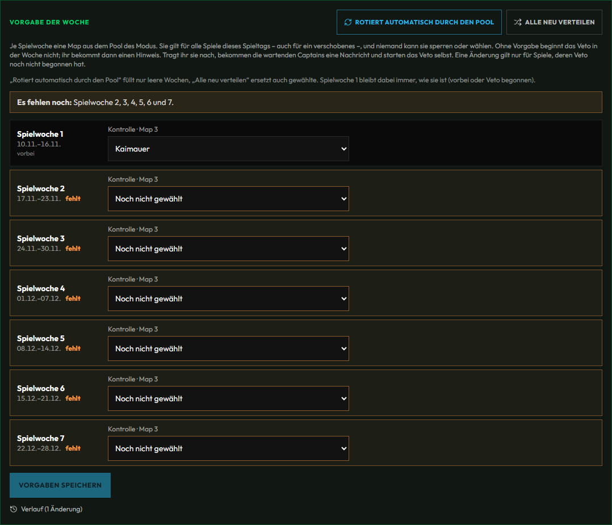

Was gilt:

- **Spielwoche heißt Spieltag.** Der Block schreibt „Spielwoche 3“ mit den Tagen dieser Woche. Gemeint ist der dritte Spieltag, also
  die dritte Woche, in der gespielt wird (Sperrwochen zählen nicht mit). Die Vorgabe gilt für alle Spiele dieses Spieltags.
- **Ein verschobenes Spiel bleibt in seiner Spielwoche.** Es spielt die Vorgabe seines Spieltags, auch wenn es erst in einer späteren
  Woche stattfindet – nicht die Vorgabe der Woche, in die der neue Termin fällt.
- **Ohne Vorgabe beginnt das Veto nicht.** Sind beide Seiten eingecheckt und für die Woche fehlt die Map, sagt die Matchseite das, und
  ihr bekommt einen Hinweis (einmal je Spielwoche, mit Link zum Kasten). Gewertet wird nichts von selbst.
- **Nachtragen startet das Veto nicht.** Speichert ihr die fehlende Vorgabe, bekommen die Captains (bzw. Vertreter) beider Seiten die
  Nachricht „Vorgabe da – Veto kann starten“. Das Veto beginnt erst, wenn **beide Seiten** auf der Matchseite **Bereit zum Veto**
  getippt haben – so läuft keine Zeit ab, während jemand fehlt. Bis dahin gibt es keine Frist. Die Meldung nach dem Speichern sagt, wie
  viele Spiele gewartet haben. Das gilt auch, wenn ihr den Schritt **Vorgabe** aus der Schrittfolge nehmt, während ein Spiel wartet.
- **Ändern wirkt nur nach vorn.** Eine geänderte Vorgabe gilt für Spiele, deren Veto noch nicht begonnen hat. Ein laufendes oder
  fertiges Veto behält seine Map, auch nach **Neu starten**. Jede Änderung steht im Protokoll und im Verlauf.
- **Pool geändert?** Steht eine vorgegebene Map nicht mehr im Pool des Modus, beginnt das Veto in dieser Woche nicht. Die Zeile sagt
  **nicht mehr im Pool**, in der Auswahl steht „Map nicht mehr im Pool – bitte neu wählen“, und oben steht, welche Wochen es betrifft
  (auch **Was fehlt noch?** im Überblick nennt sie). Die alte Auswahl bleibt gespeichert, bis ihr sie ändert – speichert ihr eine andere
  Woche, geht dabei nichts verloren. „Rotiert automatisch durch den Pool“ fasst solche Wochen nicht an, „Alle neu verteilen“ schon.
- Im Regelwerk beschreibt der Baustein `[[baustein:veto]]` die Regel; `{{veto.presets}}` nennt die Maps je Woche (2.11).

### 2.7e Vorfälle und Pausen (Regelwerk § 9, Anlage C)

Auf der Season-Seite im Reiter **Spielbetrieb** steht zwischen „Veto“ und „Nach dem Spiel“ der Abschnitt **Vorfälle und Pausen**
(Zuständigkeit „Season konfigurieren“). Er gehört zum Formular des Reiters: **Spielbetrieb speichern**, danach **Vorgaben
übertragen** (2.7) – die Werte gehen auch in eine laufende Staffel, nur nicht in eine gesperrte. Eine Season, die die Felder noch
nicht trägt, zeigt die Vorgaben und spielt mit ihnen.

| Feld | Vorgabe | Wirkung |
| --- | --- | --- |
| **Antwortzeit der Gegenseite (Minuten)** | 10 | So lange hat die Gegenseite, um einem gemeldeten Vorfall zuzustimmen oder abzulehnen. Danach ist die Map **in Klärung** und ihr entscheidet. Jeder Vorfall behält die Zeit, mit der er gemeldet wurde |
| **Rehosts und Pausen je Team und Map** | 1 | § 9.6: Die Seite zählt Rehosts und technische Pausen je Team und Map und zeigt „1 von 1 genutzt“. **Nichts wird verweigert:** Ein weiterer Vorfall bleibt meldbar, braucht aber die Zustimmung der Gegenseite, sonst entscheidet ihr. Ein MOSS-Absturz zählt nie, die Pause zwischen den Maps auch nicht |
| **Serie bei einer Map in Klärung** | Weiterspielen unter Vorbehalt | „Weiterspielen unter Vorbehalt“: Die Teams spielen und melden die übrigen Maps, die Map in Klärung zählt erst nach eurer Entscheidung. „Serie pausiert, bis entschieden ist“: Eine Meldung mit einer späteren Map lehnt die Seite ab, bis ihr entschieden habt |
| **Standardpause nach Map** und **Länge der Standardpause (Minuten)** | nach Map 2, 5 Minuten | Steht so im Regelwerk (`{{match.break_after_map}}`, `{{match.break_minutes}}`). Eine andere Pause halten die Teams am Spiel fest – nur dokumentiert, ohne Antwort |

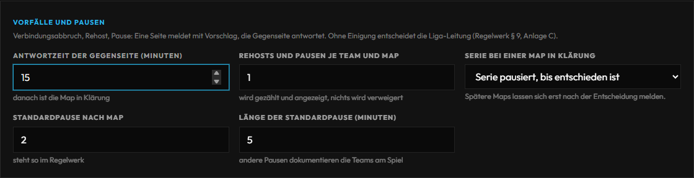

In beiden Fällen gilt: Solange ein Vorfall offen ist, wird **kein Ergebnis des Spiels gültig** – weder durch Bestätigen noch nach
der 48-Stunden-Regel, und das Spiel steht nicht in der Tabelle. Wie ihr entscheidet, steht in 3.1d. Im Regeltext nennt
`{{incident.answer_minutes}}` die Antwortzeit (2.11).

### 2.7c Plattform und Eingabegerät

Eine Season kann nur für PC, nur für PlayStation, für mehrere oder alle Plattformen sein. Im Reiter **Anmeldung und Kader** steht dafür
der Kasten **Plattform und Eingabegerät** (Zuständigkeit „Season konfigurieren“, Adresse `#plattform`) mit eigenem **Plattform
speichern**. Er gilt sofort, ohne Übertragen, auch in laufenden Staffeln.

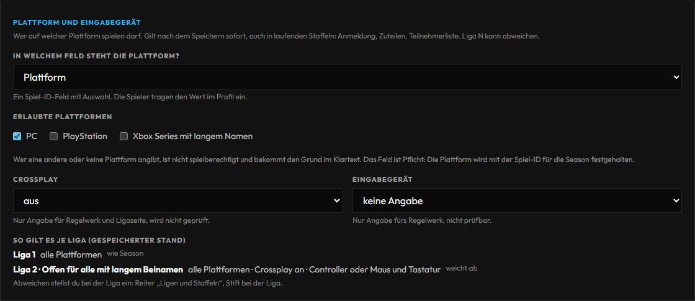

1. **In welchem Feld steht die Plattform?** Wählt das Spiel-ID-Feld mit Auswahl, etwa „Plattform“. Fehlt es, legt es zuerst unter
   **Admin → Spiele → Spiel → Spiel-IDs** an: Feld mit den Auswahlwerten (PC, PlayStation …). **Damit die Plattform je Season
   festgehalten wird, das Plattform-Feld am Spiel als Pflicht führen.** Dann gilt sie wie die Spiel-ID die ganze Season; ein
   freiwilliges Feld liest immer den aktuellen Wert im Profil.
2. **Erlaubte Plattformen** anhaken. Nichts angehakt: alle erlaubt, keine Prüfung. Alle angehakt: jede erlaubt, die Angabe ist aber Pflicht.
3. **Crossplay** (an, aus) und **Eingabegerät** (Controller, Maus und Tastatur, beides) sind nur Angaben für Regelwerk und
   Ligaseite. Geprüft werden sie nicht.

Darunter steht **So gilt es je Liga**. Eine Liga N weicht im Liga-N-Blatt ab (Reiter **Ligen und Staffeln**, Stift bei der Liga, Abschnitt
**Plattform**): **Eigene Plattformen für diese Liga** anhaken und wählen. Mit Haken und ohne Auswahl sind in dieser Liga alle Plattformen
erlaubt. Crossplay und Eingabegerät stehen dort auf „wie Season“, bis ihr etwas anderes wählt.

Wer auf einer anderen Plattform spielt, ist nicht spielberechtigt und sieht den Grund, etwa „Diese Season ist nur für PC – angegeben
ist PlayStation.“ Wer keine Plattform angibt, bekommt „Plattform fehlt im Profil“. Wo das wirkt, steht in 3.9.

### 2.8 Sichtbarkeit

| Einstellung | Ligaseite und Menüpunkt „Liga“ | Staffel-Turnier |
| --- | --- | --- |
| **Aus** | niemand („Liga nicht gefunden“) | intern |
| **Nur Liga-Leitung** | Bereich Ligen und Zuständige dieser Liga – zum Prüfen vor dem Start | intern |
| **Nur Mitglieder** | angemeldete Mitglieder | Nur Mitglieder |
| **Öffentlich** | alle | öffentlich |

Die Sichtbarkeit steht im Reiter **Überblick** und gilt beim **Überblick speichern** sofort für alle Staffeln. Wer in einer Staffel spielt, sieht seine
Spiele, Termine und den Matchchat immer – auch bei *Aus*.

**Prüfung vor der Veröffentlichung:** **Was fehlt noch?** im Reiter **Überblick** listet **Probleme** (rot) und **Warnungen**; jeder Punkt führt mit **Zu …** in den Reiter, wo du ihn erledigst. Probleme
sind: kein oder ein fremder Map-Pool, zu wenige Maps für einen Modus, ein Modus aus **Modus je Map** fehlt im Pool, **Modus je Map**
passt nicht zur längsten Serie, kein veröffentlichtes **Regelwerk** (ein Regeltext allein reicht nicht), keine Liga N oder eine Liga
N ohne Staffel, ein Anmeldefenster, das erst nach dem Beginn der Season endet. Warnungen sind etwa ein abgelaufenes oder fehlendes
Anmeldefenster oder inaktive Modi und Maps im Pool. *Nur Liga-Leitung* ist eine **Vorschau** und geht immer, auch mit Problemen.
Solange es Probleme gibt, lässt sich die Sichtbarkeit aber nicht auf **Nur Mitglieder** oder **Öffentlich** stellen – weder von *Aus*
noch von der Vorschau aus; das Speichern sagt dann, was fehlt. **Neu prüfen** liest den Stand nach Änderungen neu. Nur der Superadmin
kann im Notfall trotzdem veröffentlichen: Er trägt im Abschnitt einen **Grund für die Notausnahme** ein (mindestens 5 Zeichen) und
tippt **Überblick speichern**; der Grund steht im Protokoll. Von *Nur Mitglieder* weiter auf *Öffentlich* prüft nichts mehr.

### 2.8a Startseite und Teilen-Vorschau

Eine sichtbare Season steht auf der Startseite, ohne dass du etwas tun musst (#2324). Wer sie dort sieht, richtet sich nach der
**Sichtbarkeit** (2.8), nicht nach dem Stand: Eine *öffentliche* Season im Stand *Entwurf* steht drin, *Aus* und *Nur Liga-Leitung*
nie, *Nur Mitglieder* nur für angemeldete Mitglieder.

- **Hinweis unter dem Kopf**, solange das Anmeldefenster offen ist: Emblem, Banner, Anmeldeschluss, freie Startplätze und die
  Knöpfe **Mit Co-Team anmelden** und **Zur Ligaseite**. Nach dem Anmeldeschluss verschwindet er von selbst. Mehrere offene Seasons
  stehen kompakt nebeneinander. Sind alle Plätze weg und gibt es keine Warteliste, bleibt nur **Zur Ligaseite**.
- **Nächste Termine:** die Season wie ein Event mit Zeitraum, freien Plätzen und Plakette – „Anmeldung öffnet“, „Anmeldung offen ·
  endet am …“, „Anmeldung geschlossen“ bzw. „Angekündigt · startet …“, während der Season „Spielwoche 3 von 10“ oder „Spielpause“.
  Einsortiert nach dem nächsten Datum, das zählt. Nach dem Ende der Season fällt sie heraus.
- **Abschalten:** Reiter **Überblick** → **Auf der Startseite bewerben** (Vorgabe an) → **Überblick speichern**. Die Ligaseite
  bleibt davon unberührt.
- **Teilen-Vorschau** (Discord, WhatsApp): Bei offenem Fenster heißt die Karte „… · Anmeldung offen“ und nennt Anmeldeschluss und
  freie Plätze. Als Bild nimmt sie das Banner der Season bzw. Liga, sonst das Emblem.

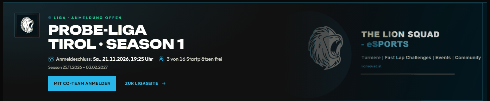

### 2.9 Korrigieren, archivieren, löschen

Falsch angelegt? So kommst du zurück – Löschen geht nur, solange nichts gespielt oder zugeteilt ist; danach
**archivierst** du (ausgeblendet, aber alles bleibt erhalten).

**Liga bearbeiten:** **Admin → eSports → Liga** → Stift in der Zeile der Liga. Name, Beschreibung und **Stand**
(*Aktiv*/*Archiviert*) gehen immer. Das **Spiel** nur, solange keine Season eine Staffel hat (die Modus-Reihenfolge
der Seasons wird dabei geleert, den Map-Pool neu wählen). Die **Adresse** (`/liga/…`) nur, bis eine Season zum ersten
Mal sichtbar war – danach bleibt sie, damit geteilte Links weiter gehen.

**Season bearbeiten:** auf der Season-Seite wie in 2.2; archivieren im Reiter **Überblick** über **Stand → Archiviert**.
**Liga N bearbeiten:** Stift bei der Liga → Beiname, Abweichungen und **Stand** (*Aktiv*/*Archiviert*). Eine
archivierte Liga N verschwindet von der Ligaseite, ihre Staffeln bleiben.

**Löschen:** Papierkorb bei der Liga (Übersicht), **Season löschen** (oben auf der Season-Seite) oder Papierkorb bei
der Liga N. Es öffnet sich ein Blatt:

| Was du siehst | Bedeutung |
| --- | --- |
| „Das wird endgültig gelöscht“ mit Liste (Seasons, Ligen, leere Staffeln) | Geht: darunter ist jede Staffel ein **Entwurf ohne Co-Teams und Spiele** – sie wird mitgelöscht. **Grund** eintragen (mindestens 5 Zeichen, steht im Protokoll) → **Endgültig löschen** |
| „Archivieren statt löschen“ mit Gründen | Geht nicht: eine Staffel hat schon Co-Teams, einen festen Spielplan oder Ergebnisse, oder die Season ist kein **Entwurf** mehr. **Archivieren** blendet aus, alles bleibt; zurück über **Stand → Aktiv** |

Eine Season lässt sich nur als **Entwurf** löschen. Eine Liga löschen heißt: mit allen Seasons, Ligen N und leeren
Staffeln darunter.

**Staffel löschen:** auf der Season-Seite im Reiter **Ligen und Staffeln** der Papierkorb in der Zeile der Staffel – nur im **Entwurf** und vor dem
festen Spielplan, wie in der Turnierverwaltung. Zugeteilte Co-Teams werden dabei aus der Staffel genommen (das Blatt
sagt, wie viele); Grund eintragen → **Endgültig löschen**. Nach dem Start: Status **Abgesagt** oder **Archiviert** in
der Turnierverwaltung.

### 2.10 Gestaltung: Emblem, Banner, Farbe und Gewinne

Alles freiwillig – ohne Gestaltung sieht die Ligaseite aus wie bisher (Liga-Zeichen, kein Banner, Vereinsfarbe).
Gestaltung wirkt beim **Speichern sofort**, ohne „Vorgaben übertragen“.

| Was | Wo | Hinweise |
| --- | --- | --- |
| **Akzentfarbe** | Stift bei der Liga → *Gestaltung* | Farbe für Kopf, Zeichen und Abzeichen der Ligaseite. Zu dunkle Farben lehnt die Seite ab (sie wären auf dem dunklen Grund nicht lesbar, nötig ist ein Kontrast von 4,5 : 1). **Vereinsfarbe** setzt sie zurück |
| **Emblem** | Stift bei der Liga, auf der Season-Seite überschreibbar | Quadratisch, am besten SVG oder PNG mit durchsichtigem Hintergrund. Zuständige ohne Admin-Medien laden PNG, JPG oder WebP hoch, kein SVG. Über **Hochladen** oder die **Mediathek** – eine fremde Adresse geht nicht. Zu sehen auf Ligaseite, Ligaübersicht, Teamseite (Abschnitt *Liga*) und Spielseite einer Staffel |
| **Banner** | Stift bei der Liga, auf der Season-Seite überschreibbar | Breitformat (16 : 9 reicht). Am Desktop zeigt die Ligaseite einen breiten Streifen (3 : 1), am Handy einen höheren Ausschnitt (4 : 3). Unter dem Bild **Fokuspunkt für Desktop** bzw. **Handy** wählen und ins Bild klicken – dieser Punkt bleibt beim Zuschneiden sichtbar; die Vorschau zeigt beide Zuschnitte |
| **Gewinne** | Season-Seite, Reiter **Überblick** → *Gestaltung und Gewinne*; je Liga N über den Stift | Platz → Preis, optional mit Bild (etwa der Pokal). Die Ligaseite zeigt sie als **„Um was gespielt wird“**. Eine Liga N ohne eigene Gewinne spielt um die der Season |

**Rückfälle:** Season → Liga → Standard. Leert die Season ihr Emblem oder Banner, gilt wieder das der Liga; die
Season-Seite zeigt das geerbte zur Vorschau.

**Wo das Banner noch auftaucht:** in der **Link-Vorschau** (Teilen in WhatsApp, Discord …) einer öffentlichen Season
und bei den **Staffeln** – die App zeigt eine Staffel als Turnier mit ihrem Banner. Hat eine Staffel in der
Turnierverwaltung ein eigenes Banner bekommen, bleibt das stehen.

**Gewinne sind reine Anzeige:** Staffeln zählen weiter nicht für XP, Pokale oder die Jahreswertung.

### 2.11 Bereich Ligen und Zuständige

**Einmal nach dem Update (nur der Superadmin):** Die Rolle Turnierleitung und die Freigabe „Turnierleitung“ öffnen die Liga nicht
mehr. Superadmin und Club-Admin haben den Bereich **Ligen** von selbst, alle anderen bekommen ihn einzeln. Nichts geschieht
automatisch. Bis zu dieser Vergabe sehen bisherige Turnierleiter von der Liga nur noch, was alle sehen.

1. **Admin → Alle Benutzer** öffnen und die Person suchen.
2. **Bearbeiten** tippen.
3. Unter **Freigaben** den Haken bei **Ligen** setzen.
4. **Speichern** und die Rückfrage bestätigen. Die Person bekommt eine Meldung, die Vergabe steht im Protokoll.
5. Die Person braucht die Zwei-Faktor-Anmeldung. Hat sie noch keine, steht das in ihrer Meldung.

**Zuständige je Liga:** Wer nur einen Teil machen soll, bekommt den Bereich nicht, sondern eine Zuständigkeit in einer Liga.

1. **Admin → eSports → Liga** öffnen und bei der Liga **Zuständige** tippen.
2. Unter **Person hinzufügen** den Namen tippen und die Person wählen.
3. Anhaken, wofür sie zuständig ist, dann **Zuständig machen**.

| Zuständigkeit | Was die Person darf |
| --- | --- |
| **Liga verwalten** | Liga bearbeiten, Seasons anlegen und löschen, Staffel starten, pausieren, beenden und sperren, Helfer der Staffel. Sieht auch, wer zuständig ist |
| **Season konfigurieren** | Vorgaben, Map-Pool, Liga 1, 2 …, Staffeln anlegen und löschen, Übertragen, Spielplan |
| **Teams freigeben** | Co-Teams zuteilen und herausnehmen, Austritt |
| **Kader prüfen** | Kaderübersicht mit Spiel-IDs, neue ID freigeben, Stichtag |
| **Spiele betreuen** | Termine festlegen, Terminvorschläge entscheiden, Spielplan freigeben, Check-in im Notfall für eine Seite eintragen und das Spiel starten (3.1b), ins Veto eingreifen (3.1c) |
| **Ergebnisse korrigieren** | Ergebnis eintragen und korrigieren, Rückgängig, kampflos und „nicht erschienen“ werten, Aufstellung nachtragen |
| **Proteste** | Streitfälle entscheiden. Für „Ergebnis ändern“ im Streitfall braucht es zusätzlich **Ergebnisse korrigieren** |
| **Strafen** | Vorgesehen, kommt später |
| **Regeln veröffentlichen** | Regelwerk der Liga und der Season (2.11) |

- Zuständige brauchen keinen Bereich, aber die Zwei-Faktor-Anmeldung. Ohne sie gilt die Zuständigkeit nicht, das Blatt sagt es an der Zeile.
- Zuständige finden ihre Ligen unter **Admin → Mein Dienst → Meine Ligen** und im Menü unter **Liga**. Sie sehen nur ihre Ligen und nur die Knöpfe ihrer Zuständigkeiten. Das gilt auch für Turnierleitung und Helfer, die zugleich zuständig sind.
- **Bilder:** Zuständige ohne Admin-Medien laden Emblem, Banner und Gewinnbilder als eigene Bilder hoch (kein SVG), die Mediathek zeigt ihnen nur diese.
- Vergeben und entfernen darf nur der Bereich **Ligen**. Liga anlegen und löschen auch.
- **Co-Teams in einer laufenden Staffel:** Kader, Captain, Vertreter und Status ändern nur noch die eigene Teamleitung und die Liga-Leitung mit **Kader prüfen** (Season → Reiter **Anmeldung und Kader** → **Kader und Spiel-IDs** → **Kader bearbeiten**). Die Turnierleitung nicht mehr. Nach dem Ende der Staffel gilt wieder alles wie vorher.
- **Helfer** am Turnier (Organisation, Schiedsrichter, Ergebnisdienst, Station) lesen in einer Staffel nur noch. Ergebnisse tragen dort nur Zuständige und der Bereich Ligen ein.

**Befangenheit:** Wer in einem Spiel selbst beteiligt ist (Kader einer Seite, Captain, Vertreter, Hauptteam-Leitung), korrigiert dort
keine Ergebnisse, entscheidet keine Proteste, verhängt keine Strafen und setzt keinen Termin direkt. Die Matchseite und der Matchplan sagen es, der
Knopf fehlt, und die Person meldet als eigene Seite wie alle anderen, den Termin über Vorschlag und Zustimmung. Es entscheidet eine zweite berechtigte Person. Nur der **Superadmin** darf als Notausnahme: Das Ergebnis-Fenster
oder der Matchplan fragt dann nach dem Grund, er steht im Protokoll (`league.conflict.override`).

**Ergebnis mit „Rückgängig“:** Verliert jemand in den 10 Sekunden die Zuständigkeit oder wird befangen, geht das Ergebnis nicht hinaus. Die Person bekommt eine
Nachricht, der Vorgang steht im Protokoll.

**Bekannte Grenze – Strafen-Eingang:** Admin → eSports → Strafen hängt bis #2208 am Bereich Turnierleitung. Kampflos-Wertungen einer Staffel siehst du dort nur mit
beiden Bereichen, Turnierleitung und Ligen. Mit nur einem von beiden fehlen sie. Am Spiel selbst bleibt die Wertung sichtbar.

---

### 2.11 Regelwerk: Versionen, PDF und Zustimmung

Das Regelwerk hat eine eigene Seite mit Inhaltsverzeichnis, Suche und festen Links auf jeden Paragrafen, dazu ein PDF je Version. Gepflegt
wird es an einer Stelle: **Season → Reiter Regelwerk und Sperrliste → Regelwerk mit Versionen pflegen** (nur diese Season; **zurück** führt wieder in den Reiter) oder **Liga → Regelwerk**
(für alle Seasons ohne eigenes). Fertige Dateien hochladen geht bewusst nicht, das PDF entsteht aus dem Text.
Das dürfen der Bereich **Ligen** und Zuständige mit **Regeln veröffentlichen** in dieser Liga, mit Zwei-Faktor-Anmeldung. Die Turnierleitung allein darf es nicht.

1. **Neuen Entwurf beginnen.** Titel und Text in Markdown. Jede Überschrift wird ein Abschnitt mit eigenem Link. Bleibt sie gleich, bleibt auch
   der Link über alle Versionen gleich.
2. **Anlagen** bekommen ihren Buchstaben aus der Reihenfolge (Anlage A, B, C …) und stehen eigens im Inhaltsverzeichnis.
3. **Bausteine:** Die Knöpfe setzen eine Marke in den Text, etwa `[[baustein:map_pool]]`, und werden in den **zuletzt benutzten Editor**
   eingefügt (Haupttext oder Anlage). Der Inhalt kommt aus den Einstellungen der Season - tippe Listen, Ziele oder Zeiten also nie ab.
   Im Web stehen sie schön mit Symbolen und Bildern, im PDF als schlichte Liste oder Tabelle. Alle Bausteine:

   | Baustein | Marke | Zeigt | Quelle in der Verwaltung |
   | --- | --- | --- | --- |
   | Map-Pool | `[[baustein:map_pool]]` | Tabelle Modus · Maps | Season → Spielbetrieb → Map-Pool |
   | Modusfolge | `[[baustein:mode_order]]` | Modus je Map | Season → Spielbetrieb → Serie |
   | Check-in | `[[baustein:checkin]]` | Fenster (öffnet und schließt, Minuten um den Termin), Mindestens Anwesende je Seite, Start sobald beide eingecheckt, Entscheidung der Leitung bei Fehlen (2.7b); ohne Check-in ein Satz | Season → Termine → Check-in vor dem Spiel |
   | Veto | `[[baustein:veto]]` | Team A (Heim oder Los), Zeit je Schritt, Start nach dem Check-in und die Schrittfolge nummeriert („1. Team A sperrt eine Map (Stellung)“, 2.7d); mit einer Vorgabe der Woche dazu die Regel (gilt für alle Spiele des Spieltags, nicht sperrbar, nicht wählbar) und der Schritt „Die Liga-Leitung gibt Map 3 je Spielwoche vor“; ohne Veto ein Satz | Season → Spielbetrieb → Veto |
   | Erlaubte Ausrüstung | `[[baustein:loadout_bans]]` | was erlaubt ist: aktive Bibliothek ohne die Sperrliste, je Kategorie und Unterkategorie mit Bild, Hinweise „nicht in …“ bzw. „nur in …“, Waffen als Tabelle je Kategorie mit Bild und den Ausnahmen nach Slot („gesperrt: …“, „nur erlaubt: …“, wenn das kürzer ist), ganz gesperrte Klasse als Zeile „nicht erlaubt“ (im PDF genauso, übrige Ausrüstung als Tabelle; gedacht für Anlage A, 2.1a) | Spiel → Ausrüstung, Season → Regelwerk und Sperrliste |
   | Einstellungen je Modus | `[[baustein:mode_settings]]` | je Modus Zeitlimit, Zeit je Runde, Einstellungen (Tabelle), Regeltext | Spiel → Modi, Season → Ergebnisregeln |
   | Modi der Season | `[[baustein:modes]]` | Tabelle Modus (mit Symbol) · Ergebnisregel in Klartext (Ziel, Runden, Verlängerung, Remis) · Zeit · Spieler je Seite | Season → Spielbetrieb → Modi, Ergebnisregeln |
   | Spielformat | `[[baustein:format]]` | Best of, Teamgröße, Mindest- und Höchstkader, Map-Wiederholung, Teilnehmerliste; Abweichungen je Liga N | Season → Spielbetrieb → Serie, Anmeldung und Kader, Ligen |
   | Tabelle und Wertung | `[[baustein:table]]` | Punkte, Remis, Reihenfolge bei Punktgleichheit, kampflos, beide nicht erschienen, Ausscheiden | Season → Tabelle |
   | Termine | `[[baustein:schedule]]` | Spielwochen, Standardtermin, Sperrzeiten, Antwortfrist, 72-h-Regel, Verschiebungen, Erinnerung und überfällig | Season → Termine |
   | Spielberechtigung | `[[baustein:eligibility]]` | Zulassung, Annahme der Anmeldung („automatisch angenommen“ oder „die Liga-Leitung prüft“, nur mit Anmeldefenster, 2.5a), Mindestalter, Spiel-IDs, Plattform (erlaubte Plattformen, Crossplay, Eingabegerät, Abweichungen je Liga N, 2.7c), ein Co-Team je Season, Wartezeit, Stichtag, Transferfenster | Season → Anmeldung und Kader, Spiel → Spiel-IDs |

4. **Variablen** stehen mitten im Satz, etwa „Gespielt wird Best of `{{best_of}}`“, und werden beim Lesen durch den Wert der Season
   ersetzt. **Variable einfügen** zeigt die Liste mit dem Wert von heute (mit Suche); die **Hilfe** darunter nennt alle Bausteine und
   Variablen. Eine Variable **ohne Wert** in dieser Season (etwa ohne Höchstkader) steht als „(nicht festgelegt)“ im Text - nie still leer.
   Bei einem Regelwerk der Liga zählt jede Season, für die es eingefroren wird - auch wenn die Seite der Liga „(je Season)“ zeigt.
   Vorschau und Vorschlag nennen solche Variablen; veröffentlichen (auch über die Freigabe) geht erst mit dem Haken **Trotzdem
   veröffentlichen - im Text steht dann „(nicht festgelegt)“**, der nur dann erscheint. Eine **unbekannte** Variable (Tippfehler) nennt die Vorschau, und das
   Veröffentlichen lehnt sie mit der ganzen Liste ab.

   | Variable | Wert |
   | --- | --- |
   | `{{league.name}}`, `{{game.name}}` | Name der Liga, des Spiels |
   | `{{season.name}}`, `{{season.number}}`, `{{season.start}}`, `{{season.end}}`, `{{season.weeks}}` | Season, Nummer, erster und letzter Tag, Spielwochen |
   | `{{best_of}}`, `{{maps_to_win}}`, `{{team_size}}`, `{{min_squad_size}}`, `{{max_squad_size}}`, `{{map_repeat}}` | Serie, Maps zum Sieg, Teamgröße, Kader, Map-Wiederholung in Worten |
   | `{{lineup_mode}}`, `{{lineup_min_players}}`, `{{result_confirm_hours}}`, `{{lineup_amend_hours}}` | Aufstellung, Mindestzahl, Bestätigungs- und Nachtragsfrist |
   | `{{veto.step_seconds}}`, `{{veto.team_a}}` | Veto (2.7d): „60 Sekunden“ je Schritt, „das Heimteam laut Spielplan“ oder „per Los je Spiel“; ohne Veto „(nicht festgelegt)“ |
   | `{{veto.presets}}` | Vorgabe der Woche (2.7d): „Spielwoche 1: Hafen (Kontrolle); Spielwoche 2: Kai (Kontrolle)“; ohne Einträge „noch keine eingetragen“. Steht die Variable im Regelwerk, schlägt jede neue Vorgabe eine Freigabe vor – wer das nicht will, lässt sie weg (die Matchseite nennt die Map ohnehin) |
   | `{{schedule.matchday_days}}`, `{{schedule.default_weekday}}`, `{{schedule.default_time}}`, `{{schedule.default_slot}}`, `{{schedule.response_hours}}`, `{{schedule.blocked_periods}}` | Spielwoche, Standardtermin („Sonntag, 20:00 Uhr“), Antwortfrist, Sperrzeiten |
   | `{{schedule.home_rule_hours}}`, `{{schedule.reschedule_max}}`, `{{schedule.reschedule_notice_hours}}`, `{{schedule.result_reminder_hours}}`, `{{schedule.result_overdue_hours}}` | Terminregeln (2.7a) |
   | `{{table.points}}` | Punktevergabe in Worten: „Sieg 3, Niederlage 0 Punkte“ oder „je gewonnene Map ein Punkt (3:2 ergibt 3 und 2 Punkte, 3:0 ergibt 3 und 0)“ |
   | `{{table.points_win}}`, `{{table.points_draw}}`, `{{table.points_loss}}`, `{{table.draws}}`, `{{table.tiebreakers}}`, `{{table.head_to_head}}`, `{{table.forfeit_score}}`, `{{table.exit_rule}}` | Punkte, Remis, Reihenfolge bei Punktgleichheit, direkter Vergleich, kampflos, Ausscheiden |
   | `{{eligibility.min_age}}`, `{{eligibility.wait_days}}`, `{{eligibility.roster_deadline}}`, `{{eligibility.transfer_windows}}`, `{{eligibility.entry_policy}}`, `{{eligibility.id_fields}}` | Spielberechtigung (3.9) |
   | `{{eligibility.platform}}`, `{{eligibility.crossplay}}`, `{{eligibility.input_device}}` | Plattform je Season (2.7c): „PC und PlayStation“ oder „alle Plattformen“, Crossplay „an“/„aus“, Eingabegerät; ohne Plattform-Feld „(nicht festgelegt)“ |
   | `{{application.opens}}`, `{{application.closes}}`, `{{application.slots}}` | Anmeldefenster und Startplätze (2.5a) |
   | `{{application.acceptance}}` | Ein ganzer Satz ohne Punkt (2.5a): „Anmeldungen werden automatisch angenommen, solange ein Startplatz frei ist; sind alle vergeben oder wartet schon jemand, kommen sie auf die Warteliste; die Liga-Leitung kann nachträglich mit Grund ablehnen oder auf die Warteliste zurückstufen“ oder „Die Liga-Leitung prüft jede Anmeldung“; ohne Anmeldefenster „(nicht festgelegt)“ |
   | `{{protest.hours}}`, `{{appeal.hours}}`, `{{evidence.keep_days}}` | Protestfrist, Einspruchsfrist, Aufbewahrung der Beweise. Heute gelten die Vorgaben 48 Stunden, 48 Stunden, 30 Tage; einstellbar werden sie mit den Paketen Proteste und Strafen |
   | `{{match.break_after_map}}`, `{{match.break_minutes}}` | Standardpause zwischen den Maps (Vorgabe nach Map 2, 5 Min.); einstellbar im Abschnitt „Vorfälle und Pausen“ (2.7e) |
   | `{{incident.answer_minutes}}` | Antwortzeit der Gegenseite auf einen gemeldeten Vorfall (Vorgabe 10 Min., 2.7e) |
   | `{{mode:<kennung>.name}}`, `.rule`, `.target`, `.round_limit`, `.time_limit`, `.round_time`, `.players`, `.overtime`, `.draw` | je Modus: Name, Regel in Klartext, Ziel, Rundenlimit, Zeitlimit, Zeit je Runde, Spieler je Seite, Verlängerung und Remis („ja“/„nein“). Die Kennung steht in der Liste. |

5. **Vorschau** zeigt die Seite mit den Werten von heute und den Änderungen zur letzten Version.
6. **Veröffentlichen:** **Gültig ab**, **Änderungsgrund** (steht öffentlich dabei) und die Wahl, ob **Captains neu zustimmen** müssen. Danach lässt sich
   die Version nicht mehr ändern. Bausteine und Variablen werden eingefroren: alte Versionen zeigen ihre Werte von damals, im Web und im PDF.

**Was die Seite selbst macht:** Sie vergleicht jede Version mit der vorigen. Geänderte Paragrafen tragen einen Strich am Rand und das Wort
„Geändert“, oben steht „Neu in Version X“ mit Links zu den Stellen. Leser können die Markierung ausblenden und Wort für Wort mit jeder alten Version
vergleichen, auch entfernter Text ist dann zu sehen.

**Regelwerk muss freigegeben werden.** Änderst du eine Einstellung, die im Regelwerk steht (Modus umbenannt, Ziel geändert, Best of, Map-Pool,
Sperrliste …), ändert sich die veröffentlichte Version **nie von selbst**. Die Verwaltung zeigt an drei Stellen **Regelwerk muss freigegeben
werden**: im Season-Überblick, in **Mein Dienst** (für wer „Regeln veröffentlichen“ darf) und auf der Regelwerk-Seite. Dort steht, welche
Bausteine und Variablen sich geändert haben (alt durchgestrichen, neu unterstrichen), und darunter der **Vorschlag**: die neue Fassung mit
den Werten von heute, geänderte Paragrafen markiert. Du prüfst, setzt **Gültig ab** und **Änderungsgrund** (vorbelegt mit den geänderten
Stellen), wählst, ob **die Teams neu zustimmen** müssen, und klickst **Freigeben und veröffentlichen**. Willst du den Text vorher anpassen:
**Text vorher anpassen** legt den Entwurf an. Bis zur Freigabe gilt und zeigt die alte Version. Auch eine neue **Darstellung** eines
Bausteins kommt so: Seit die erlaubte Ausrüstung die Waffen als Tabelle je Kategorie zeigt, mit den Ausnahmen nach Slot und „nur erlaubt“
(2.1a), schlägt die Verwaltung für jede Season mit diesem Baustein einmal eine neue Fassung vor; die veröffentlichte bleibt bis dahin Wort
für Wort, wie sie war.

**Zustimmung:** Verlangt eine Version Zustimmung, sehen Captain und Vertreter (ohne beide die Leitung des Hauptteams) **Neue Fassung, bitte
zustimmen** - als Aufgabe auf der Startseite, auf der Regelseite, auf der Ligaseite, auf der Team-Seite (Spielberechtigung des Co-Teams) und auf
jeder Matchseite der Staffel. Der Stand je Co-Team steht unter **Zustimmungen**. **Fehlt sie, läuft das Spiel trotzdem**, nichts wird blockiert.

**Auffindbar:** Das Regelwerk steht auf der Liga-Übersicht (`/liga`, Link **Regeln** je Season), auf der Ligaseite, auf der Team-Seite und auf
der Matchseite, je mit Version, Stand und PDF.

**Gut zu wissen:**

- Ohne Regelwerk zeigt die Ligaseite weiter den **Regeltext** der Season. Mit Regelwerk steht dort ein Link mit Version und Stand plus PDF.
- Die Staffel zeigt mit Regelwerk nur noch den Hinweis auf die Regelseite, auch in der App.
- Jedes festgeschriebene Ergebnis merkt sich die Version, die gerade galt. Eine spätere Korrektur ändert das nicht.
- Die Seite folgt der Sichtbarkeit der Season (2.8), alte Versionen auch.
- **Bilder** nur über **Hochladen** oder die Mediathek. Eine fremde Adresse lehnt das Speichern ab, sie geht nur als Link. Zuständige ohne Admin-Medien nehmen ihre eigenen Bilder; was eine andere Person schon in den Entwurf gestellt hat, darf stehen bleiben.
- **Im PDF** steht ein Bild auf eigener Zeile als Bild, sonst als `[Bild: …]`. Die PDF-Schrift kann nur Westeuropäisches: Zeichen wie → werden umschrieben, Emoji fallen weg.
- Eine **veröffentlichte Version** bleibt, wie sie ist: Ihre Bilder lassen sich in der Mediathek weder drehen noch löschen. Für ein neues Bild eine neue Version veröffentlichen.
- Eine Season oder Liga mit veröffentlichtem Regelwerk oder mit Zustimmungen lässt sich nicht mehr löschen, nur archivieren. Entwürfe gehen mit.
- Ein Regelwerk darf mit allen Anlagen höchstens 400 000 Zeichen und 400 Überschriften haben.

## 3. Während der Season

### 3.1 Termine

Captain oder Vertreter schlagen auf der Matchseite unter **Terminabstimmung** einen Termin vor, die Gegenseite nimmt
an (Haken), lehnt ab (X) oder macht einen **Gegenvorschlag**. Ohne Einigung gilt der Standardtermin der Spielwoche.
Im Web gehen **bis zu 3 Termine auf einmal** (**+ weiteren Termin**, eine Notiz, ein Knopf): Jeder wird einzeln geprüft,
gespeichert werden alle oder keiner, die Gegenseite bekommt **eine** Nachricht und nimmt einen davon an – die übrigen
schließen als „erledigt – anderer Termin steht“, in jeder Staffel und in jedem Turnier. **Alle ablehnen**, **Zurückziehen**
und ein **Gegenvorschlag** (bis zu 3 Termine) gelten für alle Termine zusammen. Die 72-h-Regel nimmt wie bisher den
frühesten gültigen Vorschlag der Heimseite.
Ein Vorschlag in einer Sperrzeit wird abgelehnt („In dieser Zeit wird nicht gespielt (Weihnachtspause, …)“). Termin-,
Bestätigungs- und Nachtragsfristen ruhen in der Sperrzeit, das Einspruchsfenster nicht (siehe 1.).

- **Nachrichten:** Jeder Vorschlag, Gegenvorschlag, jedes Annehmen, Ablehnen und Zurückziehen geht sofort an Captain
  und Vertreter der anderen Seite (ohne beide an deren Teamleitung) – ins Postfach und per Push, Thema
  „Match-Erinnerungen“. Trägt die Turnierleitung selbst einen Termin vor, erfahren es beide Seiten. Erinnerungen vor
  Fristen kommen später (#1647).
- **Termin oder Best of direkt am Spiel ändern:** steht mit altem und neuem Wert im Protokoll, und Captain und Vertreter
  beider Seiten bekommen eine Nachricht – je Änderung eine.
- **Eigener Vorschlag:** steht bei der eigenen Seite als „wartet auf die Gegenseite“ mit **Zurückziehen**; annehmen
  kann ihn nur die Gegenseite. Zurückgezogen ist kein Vorschlag mehr offen – keine Antwortfrist, keine Eskalation.
- **Antwortfrist:** Jeder neue Vorschlag und Gegenvorschlag bekommt eine neue Frist, Annehmen beendet sie. Läuft sie ab,
  steht das Spiel auf „Turnierleitung nötig“ und ihr bekommt eine Nachricht.
- **Ablehnen:** Gilt danach ein Termin (der vereinbarte oder der Standardtermin), bleibt es dabei: kein „abgelehnt“ am
  Spiel, keine Frist, keine Nachricht an euch. Nur wenn wirklich kein Termin gilt, läuft die Frist weiter.
- **Standardtermin in einer Sperrzeit:** Fällt der Standardtag hinein, gilt zur selben Uhrzeit der nächste freie Tag der
  Woche, sonst der letzte davor. Hat die Woche keinen freien Tag, steht im Matchplan unter **Spielwochen** ein Hinweis
  statt eines Termins – dann legt ihr ihn fest.
- **Startseite:** Offene Vorschläge der Gegenseite stehen bei Captain und Vertreter unter **Offene Aktionen** als
  „Terminvorschlag beantworten“ – auf der Website und in der App.

**Mit Terminregeln (2.7a):**

- **Fester Termin:** Haben sich beide Seiten geeinigt (oder galt die 72-h-Regel, oder habt ihr ihn gesetzt), steht der
  Termin fest. Neue Vorschläge gehen dann nicht mehr – nur noch die **Verschiebung**. Der Standardtermin allein ist kein
  fester Termin: Bis zu einer Einigung bleibt die Terminabstimmung offen.
- **72-h-Regel:** Läuft die Frist für einen Vorschlag der Heimseite ohne Antwort ab, gilt er; beide Seiten bekommen eine
  Nachricht, im Verlauf steht „72-h-Regel“. Die Matchseite sagt vorher, ab wann er gilt.
- **Verschiebung:** Auf der Matchseite unter **Termin und Verschiebung**: Eine Seite beantragt mit neuem Termin und
  **Grund**, die andere stimmt zu oder lehnt ab. Die Seite zeigt die Grenze im Klartext („Noch 1 Verschiebung möglich,
  beantragen bis Sa 14.11. 20:00“). Später, öfter oder in eine andere Woche geht nur über euch – die Captains sehen dann
  den Hinweis auf @leitung im Matchchat.
- **Termin festlegen:** Mit „Spiele betreuen“ steht auf der Matchseite **Termin festlegen (Liga-Leitung)** mit Pflichtgrund.
  Er gilt sofort, offene Anträge sind damit erledigt, beide Seiten bekommen eine Nachricht. Im eigenen Spiel legt ihn eine
  zweite Person fest (Befangenheit, 2.11); der Superadmin nur als Notausnahme mit Grund im Matchplan.
- **Verlauf:** Jede Änderung steht unter **Verlauf** – Einigung, 72-h-Regel, Standardtermin, Verschiebung, Liga-Leitung,
  mit Person und Grund. Sehen können ihn nur die beiden Seiten und die Leitung.
- **Überfällig:** Ist ein Spiel nach dem Termin nie gemeldet, erinnert die Seite beide Seiten (Vorgabe nach 24 Stunden);
  nach der zweiten Frist steht es unter **Mein Dienst → Braucht deine Entscheidung**, und ihr bekommt eine Nachricht.
  Entscheiden heißt: Ergebnis eintragen, kampflos werten oder einen neuen Termin festlegen. Ohne Entscheidung schließt
  die Season später nicht ab.

### 3.1b Check-in und Start (Regelwerk § 8)

Mit dem Kasten aus 2.7b läuft jedes Spiel so, alles auf der **Matchseite** im Block **Check-in**:

- **Fenster:** öffnet 15 Minuten vor dem Termin, schließt 15 Minuten danach (Vorgaben). Die Seite zählt herunter und sagt in einem
  Satz, was zu tun ist. Beide Seiten bekommen bei der Öffnung eine Nachricht („Check-in offen“, Push wie „Du bist dran“), Seiten
  ohne Check-in kurz vor Schluss noch eine.
- **Einchecken:** Captain oder Vertreter haken an, wer da ist – mindestens die Mindestzahl, nur Spieler aus dem Kader, nur wer
  spielen darf (gesperrt, Wartezeit, fehlende ID stehen grau mit Grund). Bis zum Schluss lassen sich Anwesende ergänzen. Die
  Gegenseite sieht, dass und mit wie vielen eingecheckt wurde.
- **Fehlende Angaben** (3.9): Hier greift die Sperre. Wer selbst nicht spielen darf, sieht oben im Block „Du kannst so nicht
  einchecken“ mit dem Grund und dem Knopf **Im Profil nachtragen**. Reichen die Spielberechtigten nicht für die Mindestzahl, sagt
  die Seite das schon vor dem Fenster, und Einchecken geht nicht. Ist die Angabe nachgetragen, geht der Check-in sofort, ohne euch.

  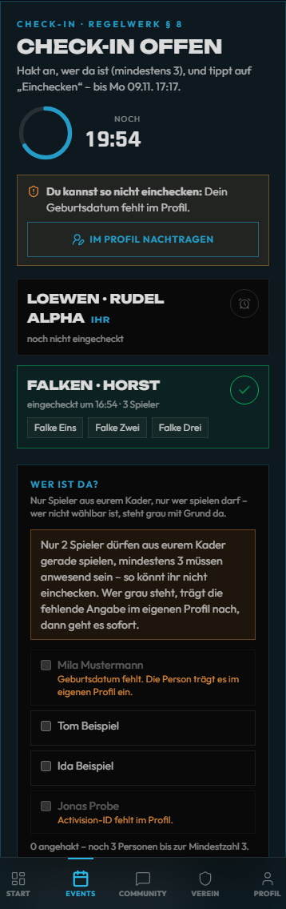
- **Regelwerks-Sperre:** Hat das Co-Team einer neuen Regelversion mit Zustimmungspflicht nicht zugestimmt, geht für dieses Team kein
  Check-in und kein Start – die Seite sagt „Das Regelwerk hat sich geändert – bitte erst zustimmen“ mit Weg zur Fassung. Das gilt
  auch, wenn ihr für die Seite eintragen wollt, und auch, wenn die neue Fassung erst zwischen Check-in und Start kommt.
- **Start:** Sind beide Seiten eingecheckt, steht **Spiel starten – Map 1 läuft**; eine Seite tippt, auch vor dem Termin. Ab dann
  gilt das Spiel als begonnen (Spielzeit, kein Verschieben, kein „nicht erschienen“ mehr). Ihr könnt mit „Spiele betreuen“ ebenfalls
  starten. Mit Veto (2.7d) läuft zwischen Check-in und Start erst das Veto (3.1c); der Start-Knopf kommt danach.
- **Erst einchecken, dann melden:** Die Captains können das Ergebnis erst melden, wenn beide Seiten eingecheckt sind – die Matchseite
  sagt sonst, wer fehlt (in der App kommt der Satz als Antwort auf die Meldung). Hat niemand auf **Spiel starten** getippt, gilt das Spiel
  mit der ersten Meldung als begonnen. Ihr selbst tragt über **Ergebnis eintragen** weiter ohne Check-in ein.
- **Fehlt eine Seite nach dem Fenster:** Der Server wertet **nie** von selbst. Es entsteht ein Vorschlag „Nicht erschienen?“ – als
  Nachricht an euch, unter **Mein Dienst → Braucht deine Entscheidung** („Check-in abgelaufen“) und als Karte in der
  Leitungsansicht der Staffel. Dort entscheidet ihr: **<Team> nicht erschienen** (kampflos über den bekannten Weg, Teamstrafe wie in
  3.2), **+5 Min. verlängern** (das Fenster geht wieder auf) – oder ihr tragt die Seite auf der Matchseite unter **Für eine Seite
  eintragen (Liga-Leitung)** mit Grund nach, etwa wenn der Captain ohne Netz anruft; dann ist der Vorschlag erledigt. Im eigenen
  Spiel macht das eine zweite Person (Befangenheit, 2.11).
- **Ohne Check-in** (ältere Season oder Kasten nie gespeichert) bleibt alles wie vorher: kein Vorschlag, „Ergebnis fehlt“ meldet
  sich, ihr wertet von Hand.

### 3.1c Veto durchführen (Regelwerk § 6)

Mit dem Kasten aus 2.7d läuft nach dem Check-in das Map-Veto – auf der **Matchseite** im Block **Check-in**, Abschnitt **Map-Veto**:

- **Start:** Sobald beide Seiten eingecheckt sind, beginnt das Veto von selbst; beide Seiten bekommen eine Nachricht („Veto läuft“),
  Team A (Heimteam, oder gelost) ist zuerst dran. Die Seite zeigt den laufenden Schritt („Schritt 3 von 11 · Stellung · Loewen wählt
  Map 1“), einen Countdown, den **Ablauf** als Leiste (jeder Schritt mit Sperre/Wahl/Decider, Team A oder B und Modus; fertige Schritte
  mit der Map, der laufende markiert) und je Modus alle Maps als **Karten mit Bild** (offen, gesperrt mit Bann-Zeichen und wer, gewählt
  mit „Map 1“ in der Farbe der Seite, Decider, Vorgabe der Woche). Team A ist blau, Team B orange.
- **Ziehen:** Captain oder Vertreter der Seite am Zug tippen im markierten Modus eine Karte an – **Sperren** oder **Wählen**, je nach
  Schritt. Ausgegraute Maps sind gesperrt, schon gewählt oder würden die Serie nicht mehr aufgehen lassen (die Seite sagt es beim
  Antippen). Die übrige Map eines Decider-Schritts setzt das System sofort. Ein Doppelklick oder ein zweites Gerät zählt nicht doppelt;
  war die Gegenseite schneller oder die Zeit um, sagt die Seite „bitte neu laden“ und zeigt den neuen Stand.
- **Live:** Die Seite aktualisiert sich von selbst – alle 2 Sekunden, solange das Veto läuft (im Hintergrund-Tab nicht, beim Zurückkommen
  sofort). Ein Zug der Gegenseite leuchtet auf ihrer Karte kurz auf, der Ablauf rückt weiter. Der Countdown richtet sich nach der Uhr des
  Servers, nicht nach der des Handys; die letzten 10 Sekunden sind rot und mit Sanduhr und „gleich vorbei“ markiert. Mit „Bewegung
  reduzieren“ im Gerät steht alles sofort da.
- **Erinnerung:** Ist eine Seite am Zug, hat 20 Sekunden lang nicht gezogen und die Matchseite nicht offen, bekommen Captain und Vertreter
  einmal die Nachricht **„Map-Veto wartet – ihr seid am Zug“** (je Schritt höchstens einmal).
- **Zuschauer und TV:** Wer nicht beteiligt ist, sieht das laufende Veto auf der Matchseite nur lesend (wenn die Staffel sichtbar ist).
  Über **TV-Ansicht** im Veto-Block öffnet sich die Ansicht für den Bildschirm (`/display/veto/<Spiel>`): großer Countdown, wer am Zug
  ist, Karten und Ablauf, danach die Spielreihenfolge. Für Staffeln „Nur Mitglieder“ hängt ihr den Anzeige-Schlüssel des Turniers an
  (`?key=…`, aus eSports → TV & Beamer). Für eine Season „aus“ oder „nur Verwaltung“ und im Entwurf zeigt der TV auch mit Schlüssel
  nichts.
- **Zeit:** Läuft die Zeit je Schritt ab, wählt das System zufällig aus den zulässigen Maps und schreibt es in den Verlauf („Zeit
  abgelaufen, das System hat gewählt“). Die nächste Seite hat wieder ihre volle Zeit.
- **Ende:** Nach dem letzten Schritt steht die **Spielreihenfolge** (Map 1 bis Best of mit Modus und Map) – beide Seiten bekommen eine
  Nachricht, dann erscheint **Spiel starten – Map 1 läuft**. Das Meldeformular zeigt je Map die festgelegte Map und den Modus fest; die
  Captains tragen nur Sieger, Punkte und Aufstellung ein. Meldet jemand eine andere Map, lehnt der Server ab („Map 2: laut Veto wird
  hier … gespielt“). Ihr selbst tragt über **Ergebnis eintragen** frei ein, etwa nach einem Map-Fehler.
- **Eingriff der Leitung** (Zuständigkeit „Spiele betreuen“, nur mit Grund, alles im Protokoll und für beide Seiten sichtbar):
  **Pausieren** (die Restzeit bleibt stehen), **Fortsetzen**, **Letzten Schritt zurück** (ein automatischer Decider geht mit dem Zug davor),
  **Neu starten** (Team A bleibt, ein Los wird nicht neu gezogen). Nach dem Start von Map 1 ändert sich am Veto nichts mehr. Im eigenen
  Spiel macht das eine zweite Person (Befangenheit, 2.11).
- **Neuer Termin:** Jeder neue Termin (auch zurück auf den alten, auch „Neu ansetzen“) setzt Check-in und Veto zurück – nach erneutem
  Check-in beider Seiten beginnt das Veto von vorn.
- **Gesperrte Staffel:** Solange die Staffel gesperrt ist, läuft nichts weiter – kein Start, keine Zufallswahl, kein Zug; nach dem
  Entsperren geht es beim nächsten Aufruf weiter.
- **Ohne Veto** (Kasten aus, ältere Season, Liga N mit anderem Best of): Die Seite sagt es, nach dem Check-in kommt gleich der Start, die
  Maps werden beim Ergebnis eingetragen.
- **Vorgabe der Woche** (2.7d): Der Veto-Block nennt sie schon vor dem Check-in („Vorgabe der Woche · Spielwoche 2“). Im Veto steht
  die Map im Brett als **Vorgabe der Woche** fest, bei der Auswahl ist sie ausgegraut („… ist die Vorgabe der Woche – weder sperrbar
  noch wählbar“). Ist ihr Schritt an der Reihe, setzt ihn das System sofort; in der Spielreihenfolge steht sie an ihrer Position
  („Map 3 · Vorgabe der Woche“). **Letzten Schritt zurück** nimmt nur Züge der Seiten zurück, die Vorgabe bleibt.
- **Vorgabe fehlt:** Statt „Veto läuft“ steht **Veto wartet auf die Vorgabe der Woche** mit der Woche und dem Modus. Niemand kann
  ziehen oder starten, gewertet wird nichts. Tragt die Map in der Season nach (2.7d).
- **Vorgabe steht – bereit zum Veto?** Nach dem Nachtragen bekommen beide Seiten die Nachricht „Vorgabe da – Veto kann starten“. Auf
  der Matchseite tippt je Seite Captain oder Vertreter **Bereit zum Veto**:
  1. Die Seite zeigt beiden, wer schon bereit ist („Ihr seid bereit – wartet auf die Gegenseite“). Die Gegenseite bekommt einmal eine
     Nachricht.
  2. Wer als Erster bereit war, kann mit **Doch nicht bereit** zurücknehmen, solange die Gegenseite noch fehlt.
  3. Sind beide bereit, beginnt das Veto sofort. Erst ab da läuft die Zeit je Schritt, vorher gibt es keine Frist. Tippen beide
     gleichzeitig oder doppelt, beginnt trotzdem nur ein Veto.
  4. Ein neuer Termin setzt „Bereit“ zurück – nach dem neuen Check-in beginnt das Veto wieder von selbst, wenn die Vorgabe steht.
  5. Nehmt ihr die Vorgabe der Woche wieder heraus, während die Seiten schon „Bereit“ tippen, wartet das Veto wieder auf die Vorgabe.
     Die Seiten können **Doch nicht bereit** tippen. Sind beide bereit und ihr tragt die Vorgabe wieder ein, beginnt das Veto mit
     eurem Speichern von selbst.
- **Notfall: Veto starten (Liga-Leitung).** Kann eine Seite nicht selbst tippen (etwa Captain ohne Netz), startet ihr das wartende
  Veto im Kasten darunter: **Grund** eintragen (Pflicht), **Veto jetzt starten**. Das braucht „Spiele betreuen“, steht mit Grund im
  Protokoll, und im eigenen Spiel macht es eine zweite Person (Befangenheit, 2.11).

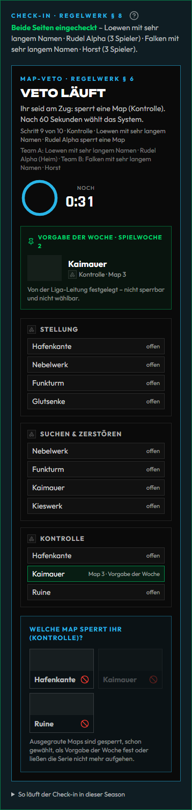 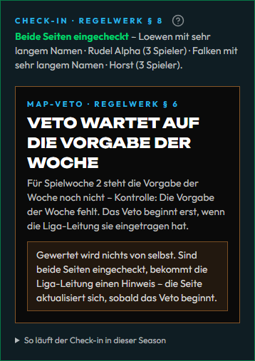 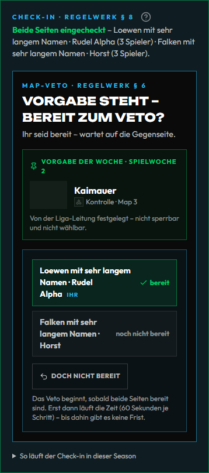

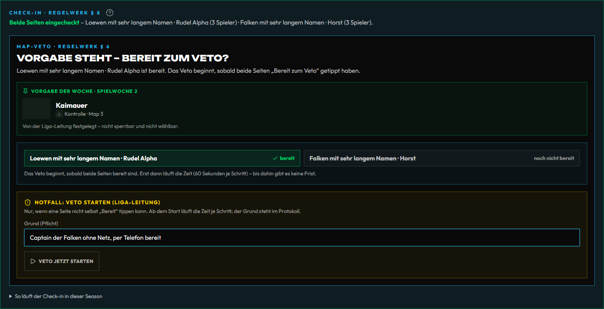

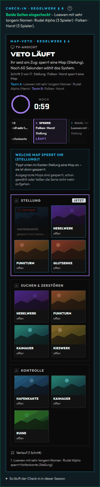 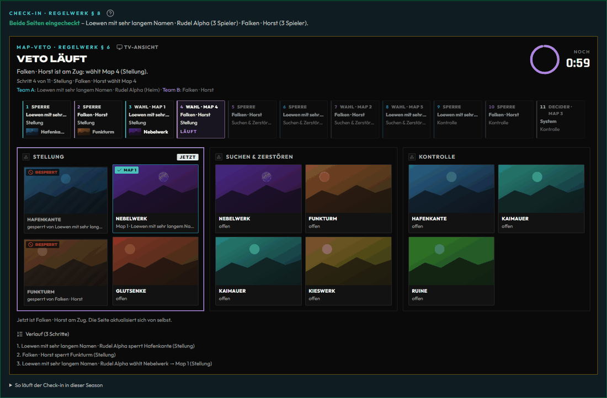

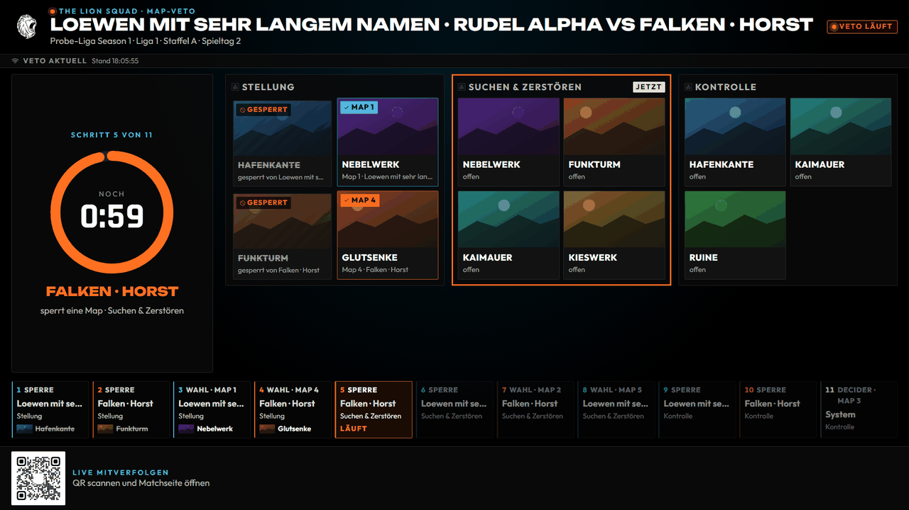

### 3.1d Vorfälle im Spiel (Regelwerk § 9, Anlage C)

Fliegt jemand aus der Lobby, braucht es einen Rehost oder eine Pause, melden die Teams das auf der **Matchseite** in der Fläche
**Vorfälle im Spiel** (was sie dort tun, steht im [Spickzettel](liga-captains.md)). Für euch heißt das:

- **Einigen sich die Seiten**, habt ihr nichts zu tun. Der Vorfall steht mit Stand, Vorschlag und Nachweisen am Spiel. Wird eine Map
  neu gestartet oder wiederholt, zählt sie trotzdem nur einmal: Beim gültigen Ergebnis trägt die Map „Wiederholt“, die erste
  Austragung steht nur im Vorfall. **Meldungen von vor dem Neustart oder der Wiederholung zählen nicht mehr** – sie beschreiben die
  ungültige Austragung. Beide Seiten und ihr lest über den Vorfällen „Map 2 wird wiederholt – danach meldet ihr die Serie neu“,
  bis neu gemeldet ist. Das gilt genauso, wenn ihr selbst auf Neustart oder Wiederholung entscheidet.
- **Lehnt die Gegenseite ab oder antwortet sie nicht in der Antwortzeit** (2.7e), ist die Map **in Klärung**. Ihr bekommt eine
  Nachricht, der Fall steht unter **Mein Dienst → Braucht deine Entscheidung** („Map in Klärung“). Bis ihr entscheidet, gilt
  kein Ergebnis: Melden bleibt möglich, Bestätigen und die 48-Stunden-Regel ruhen, das Spiel steht nicht in der Tabelle.
  Öffentlich steht am Spiel nur „in Klärung“, nie der Vorfall selbst.
- **Entscheiden** (Zuständigkeit „Ergebnisse“ oder „Proteste“): auf der Matchseite am Vorfall unter **Entscheidung der
  Liga-Leitung**. Seht euch zuerst die **Nachweise** beider Seiten an (aufklappen; ihr könnt selbst welche anhängen). Dann wählt ihr:
  *Beim Stand fortsetzen*, *Rehost beim Stand*, *Neustart (frühe Phase)*, *Map wiederholen*, *Map zugesprochen* (mit der Seite)
  oder *Keine Maßnahme*. Die **Begründung** ist Pflicht, beide Seiten lesen sie.
- **Serie feststellen** – der zweite Schritt, erst danach kann ein Ergebnis gültig werden:
  - Ist nichts mehr zu spielen (etwa bei „Keine Maßnahme“ oder „Map zugesprochen“), hakt ihr gleich bei der Entscheidung
    **Serie gleich feststellen** an.
  - Nach „Neustart“ oder „Map wiederholen“ wird die Map erst gespielt und die Serie **neu gemeldet**. Vorher gibt es „Serie
    feststellen“ nicht, und „Mein Dienst“ nennt das Spiel solange nicht. Sobald eine Seite neu gemeldet hat, steht am Vorfall das
    Formular **Serie feststellen**: **Fehlt noch eine Map?** (dann setzt ihr sie an und stellt später noch einmal fest) und **Welche Maps
    zählen nicht?** – Maps, die unter Vorbehalt gespielt wurden, obwohl die Serie mit eurer Entscheidung schon entschieden war. Sie
    stehen in keiner Wertung, die Matchseite zeigt „zählt nicht (Entscheidung der Liga-Leitung)“.
  - Haben beide Seiten schon dasselbe gemeldet, gilt das Ergebnis mit der Feststellung sofort. Hat nur eine Seite gemeldet, läuft
    die Bestätigungsfrist ab der Feststellung neu. Passen die Meldungen nicht zu eurer Entscheidung, tragt ihr das Ergebnis über
    **Ergebnis eintragen** ein (3.2).
- **Selbst einen Vorfall aufnehmen:** **Vorfall aufnehmen** in derselben Fläche. Die Map ist dann sofort in Klärung, ohne Antwort der
  Seiten – so setzt ihr eine Serie aus (Anlage C.2.6).
- **Ohne Entscheidung schließen:** Gibt es über die Map nichts mehr zu entscheiden (etwa weil ein Team gar nicht mehr antritt),
  schließt ihr den offenen Vorfall am Vorfall mit **Ohne Entscheidung schließen** und einer Begründung. Beide Seiten bekommen
  „Vorfall geschlossen“, die Begründung steht am Vorfall. Haben beide Seiten schon dasselbe Ergebnis gemeldet, gilt es mit dem
  Schließen – das Formular sagt das.
- **Kampflos und „nicht erschienen“ erst nach dem Vorfall:** Solange ein Vorfall offen ist, lehnt die Seite „Kampflos“, „Nicht
  erschienen“ und „Beide nicht erschienen“ ab und sagt, zu welcher Map der Vorfall offen ist. Entscheidet zuerst oder schließt
  ihn. Endet ein Spiel auf anderem Weg (abgesagt, archiviert), schließt die Seite offene Vorfälle von selbst und ohne Nachricht;
  „in Klärung“ verschwindet dann überall.
- **Im eigenen Spiel** entscheidet eine zweite berechtigte Person (Befangenheit, 2.11); die Seite sagt das. Der Superadmin kann nur
  als Notausnahme mit Grund.
- **Ergebnis eintragen** geht, sobald kein Vorfall mehr offen ist (weder „wartet auf Antwort“ noch „in Klärung“) – die Seite nennt
  sonst den Grund. Ist entschieden, aber die Serie noch nicht festgestellt, stellt euer eingetragenes Ergebnis sie fest: Am
  Vorfall steht dann „Serie festgestellt: Die Liga-Leitung hat das Ergebnis eingetragen.“ Nehmt ihr das Ergebnis mit
  **Rückgängig** zurück, ist auch die Serie wieder offen.
- **Zurückziehen** kann die meldende Seite nur, solange die Antwortzeit läuft. Danach liegt der Vorfall bei euch.

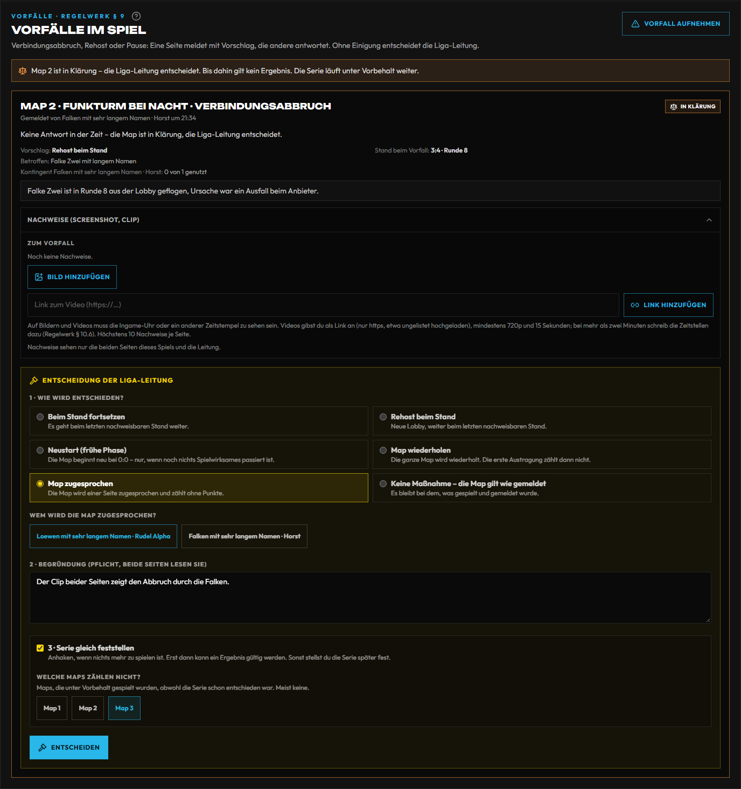

### 3.1a Turnier nach dem Ende noch „Live“

Gilt für alle Turniere: Steht ein Turnier nach seinem eingetragenen Ende noch auf **Live**, sagt es euch **Mein Dienst**
(und die Startseite der Verwaltung) unter **Braucht deine Entscheidung**: „Läuft laut Stand noch, Ende war am … – beenden?“.
Sind noch Spiele offen, zeigt die öffentliche Seite weiter **Läuft**; sind alle fertig, zeigt sie **Beendet**, und ihr stellt
auf „Beendet“ bzw. „Ergebnisse veröffentlichen“ – erst dann gelten Gewinne und Saisonpunkte. Umgestellt wird nie von
selbst. Die Turnierliste zeigt denselben Hinweis neben dem Stand.

### 3.2 Ergebnisse

Melden mit Maps und Teilnehmerliste (nur im Web), Bestätigen im Web oder in der App, die 48-Stunden-Regel und
was dabei geprüft wird, steht für die Captains in
[Turniere, 3.16](turniere.md#316-liga-ergebnis-je-map-melden-für-captains) – zum Weitergeben gibt es den
[Spickzettel](liga-captains.md). Für die Turnierleitung dazu:

- **Selbst eintragen**: Reiter **Spiele** → **Ergebnis eintragen** – Stand, auf Wunsch Maps und die Teilnehmerlisten
  beider Seiten; eine fehlende Seite trägt ihre Liste danach selbst nach. Je Map wählen die Punkte den Sieger vor; die
  Sieger-Knöpfe bleiben für euch trotzdem da (etwa beim Übergehen einer Regel mit Grund). Passen Sieger und Punkte nicht
  zusammen, steht das an der Map, mit **Sieger aus den Punkten übernehmen**. Siehe
  [Turniere, 3.6](turniere.md#36-ergebnisse-melden-eintragen-korrigieren).
- **Kampflos**: im Ergebnis-Fenster **Nicht erschienen** auf der fehlenden Seite. Schon eingetragene Maps fallen dabei
  weg, der alte Stand bleibt im Verlauf des Spiels. Die Wertung ist eine Teamstrafe: Captain, Vertreter und die Leitung
  des Hauptteams sehen sie unter **Meine Strafen**, in **Admin → Strafen** steht sie einmal unter dem Co-Team.
- **Beide nicht erschienen**: am Spiel **Beide nicht erschienen** (nur in einer Staffel, nur ohne Ergebnis, mit
  Begründung). Beide verlieren, keine Punkte, keine Maps, je Seite ein Eintrag „nicht erschienen“; im Spielplan steht
  „beide nicht erschienen“. Wollt ihr das Spiel doch nachholen: am selben Spiel **Neu ansetzen** mit Grund – das Spiel ist
  wieder offen, den Termin setzt ihr wie gewohnt. Recht: **Ergebnisse korrigieren**, nicht im eigenen Spiel.
- **„Nicht erschienen?“ nur als Vorschlag**: Mit Check-in (2.7b, 3.1b) schlägt der Server nach dem Fenster vor, wenn eine Seite
  fehlt – gewertet wird nie von selbst, ihr entscheidet (kampflos, nachtragen, verlängern; fehlen beide: **Beide nicht
  erschienen**). Ohne Check-in sagt ein Termin nichts darüber, ob jemand da war: Dann gibt es keinen Vorschlag, **Ergebnis
  fehlt** meldet sich, klärt es mit beiden Seiten und wertet selbst.

### 3.3 Teilnehmerliste nachtragen

**Am Schluss hakt jedes Team einmal an, wer gespielt hat**: alle, die mindestens eine Map gespielt haben. Mindestens drei, bei Wechseln auch sechs und mehr. Es gibt keine Eingabe vor oder je Map; Maps, Modi und Endstände bleiben je Map Pflicht. Jedes Team trägt nur seine eigene Seite ein.

Fehlt nach der Bestätigung eine Liste (etwa nach einer Bestätigung in der App oder nach den 48 Stunden), **bleibt das Ergebnis gültig**. Captain oder Vertreter dieser Seite tragen die Liste bis **48 Stunden ab der Bestätigung** im Web nach; bis dahin steht bei ihnen auf der Startseite die Aufgabe. Danach bekommt ihr den Fall als Nachricht **Teilnehmerliste fehlt nach der Frist**: am Spiel **Fehlende Teilnehmerliste nachtragen (Liga-Leitung)** mit einem Grund, oder ihr entscheidet anders. Eine fehlende Liste ist keine Wertung. **Wer nicht auf der Liste steht, zählt nicht als Einsatz.** Für die Tabelle spielt die Liste keine Rolle; sie zählt für den Doppel-Einsatz und für Auszeichnungen.

Staffeln, die noch **je Map** aufstellen (ältere Seasons oder **Wer gespielt hat → Aufstellung je Map**), laufen wie bisher: die eigene Aufstellung bis 48 Stunden nach dem Ergebnis, danach die Leitung mit **Ergebnis korrigieren**. Alte Spiele bleiben lesbar.

### 3.4 Einspruch und Korrektur

- **Beanstandung und Protest** (Regelwerk § 11, § 12): Stimmt etwas nicht, tippt eine Seite **Stimmt nicht** bzw.
  **Problem melden**. Vor der Bestätigung ist das eine **Beanstandung** – das Spiel ruht („In Klärung“), die
  48-Stunden-Automatik auch. Nach der Bestätigung ist es ein **Protest**, möglich innerhalb der **Protestfrist** der
  Season (Vorgabe 48 Stunden ab der Bestätigung, ruht in Sperrzeiten). Das Formular führt: Grund aus eurer Liste,
  Begründung, bei „Falsches Ergebnis“ das abweichende Ergebnis, bei Ausrüstung, Lobby und Spielberechtigung die
  Pflichtfrage „sofort hingewiesen?“, dann Nachweise. Je Seite läuft ein Verfahren; ergänzen geht bis zum Ende der Frist,
  zurückziehen bis zur Entscheidung (danach kein neues mit demselben Grund).
- **Eingang**: Season → Reiter **Proteste** zeigt alle Verfahren der Season, offene zuerst, mit Zuständiger und
  Restzeit. **Zum Spiel** öffnet die Matchseite mit der Karte des Verfahrens. Dafür braucht es die Zuständigkeit
  **Proteste**; wer am Spiel beteiligt ist, sieht im Eingang nur, dass etwas läuft
  ([2.11](#211-bereich-ligen-und-zuständige)).

  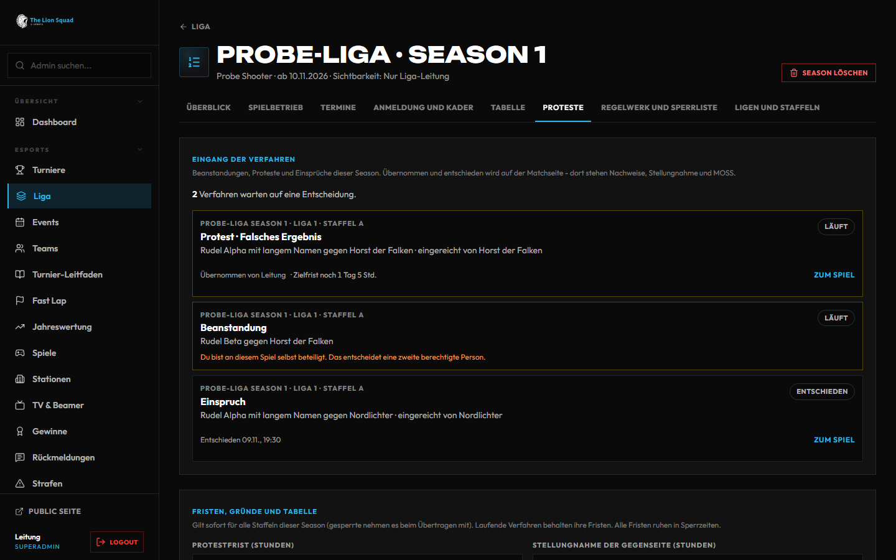

- **Bearbeiten** auf der Karte des Verfahrens: **Übernehmen** (beide Seiten sehen, wer zuständig ist; ab dann läuft die
  Zielfrist, Vorgabe 72 Stunden), **Stellungnahme +24 Std.**, **MOSS-Datei anfordern** (ein Spieler, Frist 24 Stunden;
  fehlt die Datei danach, bekommt ihr einen Hinweis – gewertet wird nichts von selbst, **Entschuldigen** geht mit Grund).
  Läuft die Zielfrist ab, erinnert die Seite die zuständige Person und meldet den Fall einen Tag später an die Leitung mit
  **Liga verwalten**. Entschieden wird nie automatisch.
- **Entscheiden**: immer mit **Begründung** (mindestens zehn Zeichen, geht an beide Seiten). **Ergebnis bleibt** schließt
  das Verfahren; **Ergebnis ändern** öffnet das Ergebnis-Fenster, die Begründung steht dort als Grund der Korrektur.
  Wer am Spiel selbst beteiligt ist, entscheidet nicht.
- **Einspruch**: Gegen die Entscheidung, eine Wertung kampflos oder eine Korrektur kann eine Seite innerhalb der
  Einspruchsfrist (Vorgabe 48 Stunden) einmal Einspruch einlegen. Darüber entscheidet **eine andere Person** als bei der
  ersten Entscheidung – auch der Superadmin nicht über die eigene. Bis dahin gilt die erste Entscheidung weiter.
- **Tabelle und TV**: Mit **Zählt vorläufig** (Vorgabe) bleibt ein Ergebnis mit laufendem Protest in der Tabelle; Spiel
  und Tabellenzeile tragen „in Klärung“. Mit **Zählt bis zur Entscheidung nicht** fällt das Spiel so lange heraus.
- **Einstellen**: Season → **Proteste** → **Fristen, Gründe und Tabelle**. Speichern gilt sofort in allen nicht
  gesperrten Staffeln; laufende Verfahren behalten ihre Fristen. Die vier Grundgründe bleiben in der Liste, damit auch
  die App melden kann.
- **Wer sieht was**: die eigene Seite alles; die Gegenseite Grund, Begründung, Bilder, Links, Stand und Entscheidung,
  aber nicht das abweichende Ergebnis und keine MOSS-Datei; ihr als nicht beteiligte Leitung alles; alle anderen nur
  „In Klärung“. MOSS-Dateien sehen nur die hochladende Person, Captain und Vertreter ihrer Seite und ihr.
- **Korrigieren**: am Spiel **Ergebnis korrigieren** – Stand, auf Wunsch Maps und Aufstellungen, Pflicht ist ein
  **Grund** (mindestens fünf Zeichen). Die Korrektur schließt einen offenen Einspruch, die Tabelle rechnet sofort neu.
  Ohne neue Maps bleiben die alten, solange sie zum Stand passen – sonst fallen sie weg. Ablauf wie in
  [Turniere, 3.7](turniere.md#37-dispute-streit-um-ein-ergebnis).
- **Ergebnisregeln gelten auch für die Leitung** (2.2, Schritt 5): Eintragen und Korrigieren prüfen dieselben Endstände
  wie die Meldung der Captains. Passt ein Endstand wirklich nicht zur Regel (etwa nach einem Absturz), darf die
  **Liga-Leitung mit der Zuständigkeit „Ergebnisse“** sie übergehen: im Ergebnis-Fenster **Ergebnisregel übergehen
  (Liga-Leitung, mit Grund)** einen Grund eintragen (mindestens fünf Zeichen). Best of, Map-Pool und Aufstellung gelten
  trotzdem; der Grund steht im Protokoll. Im eigenen Spiel entscheidet eine zweite Person (2.11), der Superadmin nur als
  Notausnahme mit Grund. Captains können eine Regel nie übergehen.
- **Wiederholte und zugesprochene Maps**: Über die Schnittstelle kann eine Map als **wiederholt** (mit Grund) markiert
  oder von der Leitung **zugesprochen** werden (ohne Punkte, ohne Regel). Die Matchseite zeigt beides an der Map; nach
  dem Serienende steht dort, welche Maps nicht gespielt wurden.

### 3.5 Tabelle und Ligaseite

Die Tabelle steht auf der Ligaseite je Staffel (und in der Turnierverwaltung): Punkte, Spiele, Differenz, Form der
letzten fünf Spiele, Bewegung seit dem letzten Spieltag. Darunter die Spielwochen mit Pause und Reserve, jedes Spiel
mit Termin, Ergebnis, Sieger und den Maps – ohne Aufstellungen. Website, App, TV, Druck und Ergebnis-PDF zeigen dieselbe
Reihenfolge.

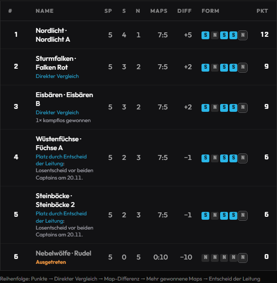

**Punktgleichheit** (Reihenfolge stellt die Season ein, siehe 2.2):

1. **Direkter Vergleich**: nur die Spiele der gleichstehenden Teams untereinander (bei drei und mehr eine
   **Mini-Tabelle**) – Punkte, Map-Differenz, gewonnene Maps. Trennt sie nur einen Teil ab, wird für die übrigen die
   Mini-Tabelle **neu gerechnet**, nur mit ihren Spielen. Der direkte Vergleich zählt nur, wenn **alle Spiele** der
   gleichstehenden Teams untereinander gespielt sind – steht eines noch aus, entscheidet gleich der nächste Punkt.
2. Dann **Map-Differenz** und **gewonnene Maps** über alle Spiele.
3. Stehen Teams danach in allem gleich, **teilen sie sich den Platz** (1, 2, 2, 4) – bis die Leitung entscheidet.

Unter dem Namen steht klein, was den Platz entschied („Direkter Vergleich“, „Map-Differenz“ …), dazu
„kampflos gewonnen/verloren“ und am Ende der Tabelle **Ausgetreten** bzw. **Disqualifiziert**. Unter der Tabelle steht
die Reihenfolge der Kriterien.

**Punkte nach gewonnenen Maps:** Rechnet die Season so (2.2), steht unter der Tabelle „Punkte = gewonnene Maps (3:2 ergibt 3 und 2,
kampflos 3:0)“, und die Spalte **S** (Siege) bleibt auch am Handy sichtbar, weil mehr Siege bei Punktgleichheit zuerst zählen. Die
Spalte **Maps** (gewonnen:verloren) gibt es am PC. App und TV zeigen dieselben Punkte, weil sie vom Server kommen.

<table>
<tr>
<td>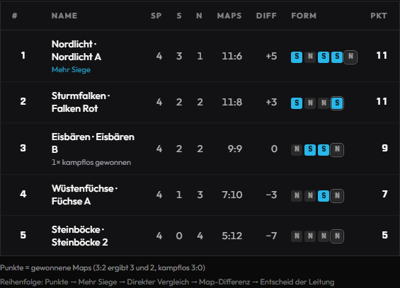</td>
<td>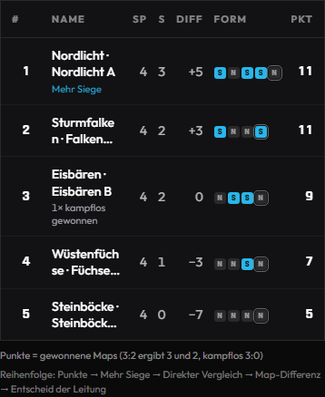</td>
</tr>
</table>

**Entscheid der Leitung:** Admin → Liga → Season → Reiter **Tabelle** → **Tabelle und Gleichstand**. Je gestarteter Staffel stehen dort die
geteilten Plätze. **Reihenfolge festlegen** → mit den Pfeilen sortieren → **Grund** (mindestens fünf Zeichen, steht
öffentlich an der Tabelle: „Platz durch Entscheid der Leitung: …“) → **Festlegen**. Das geht nur bei echtem Gleichstand und
nur für alle Teams auf diesem Platz; über das eigene Team entscheidet eine andere Person. Recht: **Ergebnisse
korrigieren**. Ändert ein späteres Ergebnis den Gleichstand, gilt der Entscheid nicht mehr (Hinweis **Gilt nicht mehr**)
und bleibt zur Nachvollziehbarkeit stehen; **Zurücknehmen** löscht ihn mit Grund.

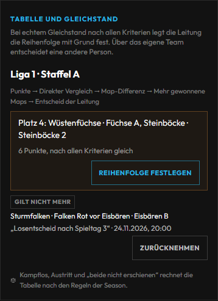

**Austritt, Auflösung, Disqualifikation:** In der Teilnehmerliste der Staffel **Austritt eintragen** bzw.
**Disqualifizieren** (eine Auflösung tragt ihr als Austritt mit Grund „Team aufgelöst“ ein). Mit der Vorgabe neuer
Seasons zählen dann **alle** Spiele des Teams für die Gegner, auch schon gespielte – wie ein kampfloser Sieg (Maps des Best
of). Offene Spiele werden kampflos gewertet. Die echten Ergebnisse bleiben im Spielplan und auf der Matchseite sichtbar.
Das Team steht am Tabellenende: wer später ausschied, weiter oben; Disqualifizierte immer darunter. Ein Spiel zwischen
zwei ausgeschiedenen Teams zählt für keinen. Ältere Seasons rechnen weiter mit der 50-%-Regel, bis ihr die Einstellung
ändert und überträgt (nur vor dem ersten Ergebnis).

Staffel- und Spielseite führen zurück zur Ligaseite: Brotkrumen **Liga · Season · Staffel** und auf der Staffel der
Reiter **Liga** (nur, wenn die Person die Season sehen darf – sonst „Liga · Staffel A“ ohne Link).

### 3.6 Captain und Vertreter während der Season

- **Rolle abgeben:** Captain oder Vertreter geben die eigene Rolle unter **Teams → Deine Teams** mit **Rolle
  abgeben** selbst ab. Leitung und Co-Leitung des Hauptteams bekommen eine Nachricht und vergeben neu (Co-Team
  bearbeiten). Bis dahin handelt die andere Rolle, ohne beide die Teamleitung.
- **Teamseite:** Mitglieder sehen dort die Co-Teams mit Captain und Vertreter; Teamleitung und Rollen-Inhaber kommen
  über **Co-Teams verwalten** zur Verwaltung.
- **App:** Captain und Vertreter lassen sich in der App noch nicht vergeben. Scheitert dort eine Kader-Änderung an
  einer Rolle, nennt die Meldung den Weg auf der Website.
- **Abmelden:** Ein zugeteiltes Co-Team meldet sich nicht selbst ab – auf der Staffel steht „Austritt nur über die
  Turnierleitung“. Herausnehmen kann es nur die Turnierleitung.

### 3.7 Spiel-IDs im Kader

Je Season und Spieler gilt **eine** Spiel-ID: die beim Zuteilen festgehaltene, bei späteren Spielern die bei der
Aufnahme ins Co-Team, und wer die ID erst später eingetragen hat, bekommt sie beim **ersten Aufstellen** festgehalten.
Sie gilt die ganze Season – auf der Matchseite (Aufstellung, **Activision-ID für die Lobby**) und im Ergebnis-Fenster.
Die IDs sehen nur die Beteiligten des Spiels und die Turnierleitung, nie Gäste.

- **Übersicht:** Season-Seite → **Kader und Spiel-IDs**: je Co-Team die Spieler mit Stand – *festgehalten*, *im Profil*
  (wird beim ersten Aufstellen festgehalten), *fehlt*, *wartet auf Freigabe*, *gesperrt*. Oben die Zahl ohne ID, wartend,
  gesperrt und mit neuer ID im Profil.
- **Späterer Spieler:** Kommt jemand ohne ID oder nach dem Stichtag ins Co-Team, bekommen er und die Verantwortlichen des
  Co-Teams eine Nachricht – wie beim Zuteilen, je Person einmal.
- **ID im Profil geändert:** In der Liga gilt weiter die festgehaltene; die Übersicht zeigt „Im Profil steht
  inzwischen …“. Der Spieler sieht im Profil „In der laufenden Liga gilt weiter …“. Passt die neue ID (etwa
  Kontowechsel): **Neue ID freigeben** → **Grund** (mindestens fünf Zeichen) → **Freigeben**. Ab dann gilt sie;
  unter **Protokoll** steht wann, von wem, alt → neu und der Grund.
- **Stichtag für neue Spieler:** in der Übersicht als Datum, Vorgabe **kein Stichtag**. Er gilt **je Co-Team**: Wer
  nach dem Stichtag in ein Co-Team kommt, in dem er in dieser Season noch nicht stand, steht dort als *wartet auf
  Freigabe* da und ist dort nicht aufstellbar, bis ihr ihn mit **ID freigeben** bestätigt. Das gilt auch für einen
  Wechsel aus einem anderen Co-Team – seine festgehaltene ID bleibt dieselbe, im bisherigen Co-Team spielt er weiter.
  Wer nur kurz aus dem Kader war und ins **selbe** Co-Team zurückkommt, ist nicht „spät“.
- **Aufstellung:** Spieler ohne gültige ID stehen beim Melden und Nachtragen grau mit Grund („Nicht aufstellbar: …“);
  der Server lehnt sie ab – auch im Ergebnis-Fenster der Turnierleitung.
- **Korrektur und Nachtrag durch die Leitung:** Wer auf einer Map schon in der gespeicherten Aufstellung steht,
  bleibt drin, auch ohne gültige ID – **Ergebnis korrigieren** und **Aufstellung nachtragen** gehen also mit dem
  Altbestand. Neu auf eine Map setzen lässt sich nur, wer eine gültige ID hat; sonst zuerst die ID eintragen lassen
  bzw. **ID freigeben**, dann korrigieren.
- **Alte Zuteilungen:** Co-Teams, die vor dieser Funktion zugeteilt wurden, bekommt das Update von selbst in den
  Kader (mit der ID aus dem Profil, wo sie steht).
- **Datenschutz:** Die Datenauskunft enthält die festgehaltene ID; löscht jemand sein Konto, verschwindet sie.

### 3.8 Kader, Sperren und Aufstellung

- **Kader zu klein:** Abgänge bleiben möglich – Team verlassen, Mitglied entfernen, aus dem Kader nehmen. Die Rückfrage
  sagt vorher, was das bewirkt. Fällt der Kader einer laufenden Staffel unter den Mindestkader, bekommen Captain, Vertreter,
  Leitung und Co-Leitung des Hauptteams und ihr eine Warnung. Auf deren Startseite steht **Kader auffüllen**, bis er reicht;
  die Season zeigt unter **Kader und Spiel-IDs** oben alle zu kleinen Kader. Spiele und Tabelle ändert das nicht – was ihr
  daraus macht, entscheidet ihr.
- **Gesperrtes Konto:** nicht aufstellbar, auch nicht von euch, auch in Spielen ohne Pflicht-ID. Wer schon in der
  gespeicherten Aufstellung steht, bleibt bei Korrektur und Nachtrag drin (wie bei 3.7). Ein gesperrter Captain oder
  Vertreter zählt nicht: Es handelt der andere, ohne beide die Teamleitung. Die Gegenseite sieht in der Lobby-Liste
  niemanden mit gesperrtem Konto, aber keinen Grund.
- **Beide Seiten:** Dieselbe Person steht nie auf beiden Seiten eines Spiels, über alle Maps – beim Melden, Bestätigen,
  Nachtragen und in eurer Korrektur. Steht sie in einem alten Spiel schon auf beiden Seiten, geht die Korrektur trotzdem
  durch und steht im Protokoll; nehmt sie dabei auf der falschen Seite heraus.

### 3.9 Spielberechtigung: Regeln je Season

Alles sind Vorgaben, jede Season stellt sie selbst ein (2.2). Geprüft wird an einer Stelle: beim Zuteilen, bei der Aufnahme in den Kader, auf der Teilnehmerliste und beim Check-in. Ältere Seasons tragen die Felder nicht und prüfen nichts Neues.

**Fehlende Angaben sperren erst beim Spielen** (#2313): Fehlen Geburtsdatum, Spiel-ID oder Plattform, ist jemand zu jung oder sind zu wenige spielberechtigt, geht die Anmeldung trotzdem, und ihr dürft trotzdem annehmen und zuteilen. Wer etwas offen hat, kann nicht einchecken und nicht aufgestellt werden; ein Team mit zu wenigen Spielberechtigten kann nicht einchecken. Danach gibt es wie immer nur den Vorschlag „nicht erschienen“, gewertet wird nie von selbst. Die Betroffenen sowie Captain und Vertreter bekommen beim Einreichen und vor dem ersten Spiel eine Nachricht (Vorlauf in 2.7b).

| Regel | Was passiert |
| --- | --- |
| **Mindest- und Höchstkader** | Über den Höchstkader lässt sich niemand aufnehmen. Unter den Mindestkader führt nur ein Abgang: Der bleibt möglich, es gibt Warnung und Aufgabe (3.8) |
| **Ein Team je Season** | Wer in der Season in einem anderen Co-Team steht oder stand, kommt nur per Transfer. In anderen Seasons und Ligen ist das frei |
| **Wartezeit** | Bis zum Ende von Spieltag 1 spielen Neue sofort. Danach warten sie ab der Aufnahme so viele Tage, auch wenn der Kader dadurch zu klein ist. Wer ins selbe Co-Team zurückkommt, startet keine neue Wartezeit. Das Zuteilen eines Co-Teams durch euch startet keine. **Ein Transfer wartet immer**, auch vor dem Ende von Spieltag 1 |
| **Stichtag** | Optional in der Kaderübersicht: Neue warten auf eure Freigabe, Abgänge bleiben frei (3.7) |
| **Transferfenster** | Die Teamleitung beantragt im Fenster, ihr entscheidet. Nach der Genehmigung wartet die Person ab der Kaderaufnahme die volle Wartezeit, immer und auch wenn sie das alte Co-Team schon verlassen hatte |
| **Mindestalter** | Prüfung über das Geburtsdatum im Profil als Selbstauskunft. Ohne Datum oder zu jung: Anmeldung, Zuteilen, Aufnahme in den Kader und Transfer gehen, aber kein Check-in und keine Aufstellung. Auf der Team-Seite steht so jemand unter „Aufnehmbar, spielen erst mit der fehlenden Angabe“. Ihr seht nur „Alter erfüllt“, „Geburtsdatum fehlt“ oder „Altersvorgabe nicht erfüllt“, die Liga nennt nie ein Datum oder Alter |
| **Spiel-ID** | Format und Auswahl stehen am Spiel unter **Admin → Spiele → Zahnrad → Spiel-IDs**: Format als regulärer Ausdruck, Beispiel für die Spieler, Auswahlwerte. So wird auch die **Plattform** zum Pflichtfeld, das einmal je Season festgehalten wird. Eine schon festgehaltene ID bleibt gültig. Eine doppelte ID wird abgelehnt, die Meldung nennt nie, wem sie gehört |
| **Plattform** (2.7c) | Bei der Anmeldung zählt nicht als spielberechtigt, wer eine andere oder keine Plattform angibt: Er steht als Hinweis da, auch unter dem Mindestkader geht die Anmeldung. Weil die Liga dort noch nicht feststeht, gilt die weiteste Regel aller Liga N. Beim Zuteilen gilt die Liga N der Staffel; wer nicht passt und ob zu wenige übrig bleiben, steht als Hinweis im Dialog. Auf die Teilnehmerliste kommt niemand mit anderer Plattform. Die Aufnahme in den Kader prüft die Plattform nicht |

**Wartezeit aufheben:** Season → Reiter **Anmeldung und Kader** → **Kader und Spiel-IDs** → beim Spieler **Wartezeit aufheben** → Grund (mindestens fünf Zeichen). Das geht mit der Zuständigkeit **Kader prüfen** und steht im Protokoll.

**Transfer:** Die Teamleitung tippt unter **Spielberechtigung** auf **Transfer beantragen**; die Person muss schon im Hauptteam stehen. Ihr seht den Antrag oben unter **Kader und Spiel-IDs**: **Genehmigen** nimmt die Person aus dem alten Co-Team und setzt sie ins neue, die Wartezeit beginnt, aufheben könnt nur ihr mit Grund; **Ablehnen** braucht einen Grund. Ist die Person im alten Co-Team Captain oder Vertreter, vergibt die Teamleitung die Rolle zuerst neu. Person und beide Teamleitungen bekommen eine Nachricht.

**Eingriff von außen:** Ändert ihr den Kader oder die Rollen eines Co-Teams, bekommen Leitung und Co-Leitung des Hauptteams eine Nachricht: wer, was, wann. Jede Kaderänderung in einer laufenden Staffel steht im Protokoll, auch wenn die Teamleitung sie macht oder jemand das Team verlässt.

---

## 4. Wenn etwas nicht klappt

| Meldung / Fehlerbild | Bedeutung | Was tun |
| --- | --- | --- |
| „Mit bis zu 9 Teams (nur Hinrunde) braucht die Staffel 9 Spielwochen, die Season hat aber nur 8 aktive Wochen …“ | Die Staffel ist zu groß für die Spielwochen | **Teams je Staffel höchstens** senken und eine zweite Staffel anlegen – oder mehr Wochen |
| „Staffel A gibt es in dieser Liga schon.“ | Buchstabe vergeben | **Staffel anlegen** nimmt von selbst den nächsten freien |
| „… hat 3 Spieler im Kader – die Liga verlangt mindestens 4.“ | Kader zu klein | Teamleitung ergänzt den Kader im Profil |
| „… hat schon ein Co-Team in dieser Staffel – zwei Co-Teams desselben Teams spielen nie in derselben Staffel.“ | Gewollt | Zweites Co-Team in eine andere Staffel |
| „… spielt in dieser Season schon in einer anderen Staffel.“ | Ein Co-Team spielt je Season nur eine Staffel | Andere Staffel wählen oder dort entfernen |
| „Die Staffel ist voll (8 von 8 Plätzen).“ | Staffelgröße erreicht | Zweite Staffel |
| „1 Person im Kader von … ist nicht mehr im Team – bitte erst den Kader bereinigen.“ | Jemand hat das Hauptteam verlassen | Teamleitung passt den Kader an |
| „… ist für ein anderes Spiel eingetragen als diese Staffel.“ / „… ist archiviert …“ | Falsches oder altes Co-Team | Co-Team unter **Teams → Deine Teams** prüfen |
| „… hat noch einen alten Spielnamen …“ | Das Spiel wurde früher frei eingetippt und passt zu keinem Spiel der Liste | Die Teamleitung wählt es unter **Teams → Deine Teams** aus der Liste |
| „Captain muss im Kader des Co-Teams stehen.“ / „Captain und Vertreter müssen verschiedene Personen sein.“ | Rollen falsch vergeben | Rollen im Profil neu wählen |
| Co-Team lässt sich nicht entfernen („… Spielplan …“) | Die Staffel ist gestartet | Mit dem Co-Team klären; Spiele notfalls kampflos werten |
| „Eine Liga-Staffel hat keine Anmeldung und keinen Check-in …“ | Status mit Anmeldung oder Check-in gewählt | **Liga starten** (oben) |
| „Turnier kann ohne spielbares Match nicht gestartet werden.“ | Eine ältere Staffel steht noch im Check-in | Status oben auf **Entwurf**, dann **Liga starten** |
| „Best of: Kommt aus der Season – dort ändern und übertragen.“ (ebenso andere Felder, auch die Antwortfrist) | Wert gibt die Season vor | In der Season ändern, dann **Vorgaben übertragen** |
| „In einer Liga-Staffel spielen nur Co-Teams …“ | Teilnehmer ohne Co-Team eingetragen | **Co-Team zuteilen** |
| „Für diese Season ist noch kein gültiges Regelwerk veröffentlicht.“ | Fenster offen, aber keine gültige Version | Regelwerk veröffentlichen (2.11), „Gültig ab“ darf nicht in der Zukunft liegen |
| „Diese Season ist nur für PC – angegeben ist PlayStation.“ (oder „Liga 2 ist nur für …“) | Spieler auf einer nicht erlaubten Plattform | Andere Spieler aufstellen; stimmt die Angabe nicht, ändert sie die Person im Profil (festgehalten: Freigabe wie bei der Spiel-ID, 3.7) |
| „… Nur 2 Spieler sind auf einer erlaubten Plattform …“ beim Zuteilen | Ohne Spieler anderer Plattformen fehlt der Mindestkader | Kader ergänzen oder Co-Team in eine Liga mit passender Plattform |
| „Bitte zuerst das Feld wählen, in dem die Plattform steht …“ / „Eigene Plattformen einer Liga N brauchen bei der Season das Feld …“ | Plattformen ohne Feld eingegrenzt | Im Kasten **Plattform und Eingabegerät** das Feld wählen (2.7c) |
| „Dieses Feld gibt es am Spiel nicht, oder es hat keine Auswahl.“ | Feld ohne Auswahlwerte | Am Spiel unter **Spiel-IDs** Auswahlwerte eintragen |
| „Alle Startplätze sind vergeben.“ beim Annehmen | Plätze voll, auch über 2.5 Zugeteilte zählen | Warteliste, oder **Startplätze** an der Season erhöhen |
| „Eine Liga-Staffel hat keine Anmeldung – Co-Teams teilt die Turnierleitung zu.“ | Zugangslink mit Anmelderecht für eine Staffel | Link nur zum Ansehen anlegen, Co-Team zuteilen |
| „Der Spielplan dieser Staffel steht – zurücksetzen oder neu aufbauen geht nur vor dem Start …“ | Spielplan oder Phase einer gestarteten Staffel neu aufbauen oder löschen | Einzelne Spiele im Reiter **Spiele** korrigieren |
| „Diese Staffel hat schon begonnen oder Spiele – Löschen geht nur vor dem Start …“ | Gestartete Staffel löschen | Status **Abgesagt** oder **Archiviert** |
| „Löschen geht nicht: … hat schon Co-Teams zugeteilt / hat schon begonnen oder Spiele / ist kein Entwurf mehr. Archivieren statt löschen …“ | Liga, Season oder Liga N hängt schon etwas an | Im Blatt **Archivieren** (2.9) |
| „Bitte einen Grund angeben (mindestens 5 Zeichen) …“ | Löschen ohne Grund | Grund eintragen |
| „Das Spiel bleibt, sobald eine Season eine Staffel hat …“ | Spiel einer Liga mit Staffel ändern | Neue Liga anlegen, die alte archivieren |
| „Die Adresse bleibt, seit eine Season der Liga sichtbar war …“ | Adresse nach der Veröffentlichung ändern | Adresse lassen; nur der Name ändert sich || „Ein zugeteiltes Co-Team nimmt nur die Turnierleitung wieder aus der Staffel …“ | Teamleitung will ihr Co-Team abmelden | Bei der Turnierleitung melden |
| Ligaseite zeigt „Liga nicht gefunden“ | Sichtbarkeit *Aus* oder *Nur Liga-Leitung* | Sichtbarkeit der Season ändern und speichern |
| „Dafür fehlt dir das Recht in dieser Liga …“ | Bereich Turnierleitung allein oder falsche Zuständigkeit | Superadmin vergibt den Bereich Ligen, der Bereich Ligen die Zuständigkeit – [2.11](#211-bereich-ligen-und-zuständige) |
| „Du bist an diesem Spiel selbst beteiligt …“ | Eigenes Spiel | Eine zweite berechtigte Person entscheidet; Superadmin nur mit Grund – [2.11](#211-bereich-ligen-und-zuständige) |
| „Bitte im Web mit Maps und Aufstellung melden.“ | Erstmeldung oder abweichende Meldung aus der App | Im Web auf der Matchseite melden |
| „In dieser Zeit wird nicht gespielt (Weihnachtspause, 21.12.2026 bis 3.1.2027) …“ | Termin in einer Sperrzeit | Anderen Termin vorschlagen |
| „Deine Maps, Modi oder Sieger weichen von der Meldung der Gegenseite ab …“ | Bestätigung passt nicht | Einspruch über **Problem melden**; die Turnierleitung entscheidet |
| „Map 2: diese Map ist im Pool für Suchen & Zerstören nicht freigegeben.“ / „Map 2: gespielt wird hier Suchen & Zerstören.“ | Map oder Modus passt nicht zu Pool oder Reihenfolge | Richtige Map bzw. Modus wählen; fehlt eine Map im Pool, Pool der Season ändern und übertragen |
| „Map 3: Hafenkante (Stellung) lief schon als Map 1 – dieselbe Map im selben Modus nur einmal je Serie.“ | Map in derselben Serie schon gespielt | Andere Map wählen; die Regel stellt die Season unter **Map-Wiederholung in einer Serie** ein |
| „Nach Map 2 stand der Sieger schon fest – keine weitere Map.“ / „Best of 3: eine Seite braucht 2 gewonnene Maps …“ | Serie passt nicht zum Best of | Maps korrigieren |
| „… die Aufstellung von … braucht genau 4 Spieler.“ / „… nur Spieler aus dem Kader …“ | Aufstellung falsch | Genau die Teamgröße aus dem eigenen Kader wählen |
| „… steht an diesem Spieltag schon in der Aufstellung eines anderen Teams …“ | Doppel-Einsatz | Andere Person aufstellen |
| „Map 1: … kann nicht aufgestellt werden – Activision-ID fehlt im Profil.“ | Spieler ohne Spiel-ID | Spieler trägt die ID im Profil ein, danach geht es (3.7) |
| „… kann nicht aufgestellt werden – Nach dem Stichtag ins Co-Team gekommen …“ | Neuer Spieler nach dem Stichtag | Season → Reiter **Anmeldung und Kader** → **Kader und Spiel-IDs** → **ID freigeben** mit Grund |
| „… kann nicht aufgestellt werden – Das Konto ist gesperrt.“ | Gesperrtes Konto | Andere Person aufstellen (3.8) |
| „… steht schon in der Aufstellung der anderen Seite – dieselbe Person spielt nie auf beiden Seiten eines Spiels.“ | Person in den Kadern beider Seiten | Für eine Seite eine andere Person aufstellen (3.8) |
| „Kader zu klein: …“ (Nachricht), Aufgabe **Kader auffüllen** | Mindestkader der Staffel unterschritten | Teamleitung ergänzt den Kader; danach ist die Aufgabe weg (3.8) |
| „Im Profil fehlt noch: Activision-ID – erst eintragen, dann freigeben.“ | Freigabe ohne ID im Profil | Spieler trägt die ID zuerst ein |
| „Die Frist zum Nachtragen ist vorbei …“ | 48 Stunden nach dem Ergebnis vorbei | Turnierleitung trägt mit Grund nach |
| „Ein Dispute ist nur bis 30 Minuten nach dem Ergebnis möglich …“ | Einspruchsfrist vorbei | Matchchat mit **@leitung**; die Turnierleitung korrigiert |
| „Bitte kurz den Grund der Korrektur angeben (mindestens 5 Zeichen).“ (Ergebnis-Fenster) bzw. „Bitte einen Grund für die Korrektur angeben (mindestens 5 Zeichen).“ | Korrektur ohne Grund | Grund mit mindestens fünf Zeichen |
| Season gespeichert, die Staffel zeigt noch alte Werte | Noch nicht übertragen | **Vorgaben übertragen** (Grenzen siehe 2.7) |
| „Map 2 ist in Klärung – die Liga-Leitung entscheidet. Bis dahin gilt kein Ergebnis.“ (auch beim Ergebnis eintragen, dort mit „Bitte zuerst über den Vorfall entscheiden.“) | Zu dem Spiel ist ein Vorfall offen | Auf der Matchseite unter **Vorfälle im Spiel** entscheiden und die Serie feststellen (3.1d) |
| „Zu Map 2 ist ein Vorfall offen. Bitte zuerst über den Vorfall entscheiden oder ihn schließen – erst dann lässt sich das Spiel kampflos werten.“ | Kampflos, „Nicht erschienen“ oder „Beide nicht erschienen“ bei offenem Vorfall | Am Vorfall entscheiden oder **Ohne Entscheidung schließen** (3.1d), dann werten |
| „Map 2 wird erst neu gespielt. Die Serie stellst du fest, sobald das Ergebnis danach neu gemeldet ist – oder du trägst es selbst ein.“ | „Serie feststellen“ nach Neustart oder Wiederholung, bevor neu gemeldet ist | Auf die neue Meldung warten oder **Ergebnis eintragen** (3.2) |
| „Map 2 wird wiederholt – danach meldet ihr die Serie neu. Frühere Meldungen zählen nicht mehr.“ | Einigung oder Entscheidung auf Neustart bzw. Wiederholung | Die Teams spielen die Map und melden die ganze Serie neu |
| „Map 1 ist in Klärung und die Serie pausiert – Map 2 lässt sich erst melden, wenn die Liga-Leitung entschieden hat.“ | Die Season spielt mit „Serie pausiert, bis entschieden ist“ (2.7e) | Entscheiden; danach geht die Meldung |
| „Die Meldungen passen nicht zur Entscheidung der Liga-Leitung über den Vorfall – das Ergebnis trägt die Liga-Leitung ein.“ | Nach „Map zugesprochen“ oder nicht zählenden Maps ergibt die Meldung der Teams keine entschiedene Serie | **Ergebnis eintragen** mit den geltenden Maps (3.2) |

---

## 5. Häufige Fragen

**Muss die Staffel voll sein?**
Nein. Mit sechs Teams gibt es fünf Spieltage, die übrigen Wochen sind Reserve. Bei ungerader Zahl hat je Spieltag ein
Team spielfrei.

**Kann ein Spieler in zwei Co-Teams stehen?**
Im Kader ja, aber nicht am selben Spieltag in zwei Aufstellungen derselben Season.

**Was, wenn ein Team nicht antritt?**
Mit Check-in (3.1b) kommt nach dem Fenster der Vorschlag „Nicht erschienen?“ an euch – ihr wertet kampflos, tragt die Seite
nach oder verlängert; von selbst wertet der Server nie. Ohne Check-in wertet ihr im Ergebnis-Fenster (**Nicht erschienen** auf
der fehlenden Seite), ein Vorschlag entsteht dann nicht (3.2).

**Zählt die Aufstellung für die Tabelle?**
Nein, nur das Ergebnis. Die Aufstellung ist für Doppel-Einsatz und spätere Statistik da.

**Ein Spieler hat eine neue Activision-ID – darf er damit spielen?**
Erst nach eurer Freigabe (3.7). Bis dahin spielt er mit der gemeldeten ID; aufstellbar bleibt er.

**Wie sieht ein Captain, was zu tun ist?**
Über die Benachrichtigungen und den [Spickzettel für Captains](liga-captains.md).

---

## 6. Checkliste für den Obmann bis 9.11.

Zum Abhaken in dieser Reihenfolge – jeder Punkt mit dem Klickweg von oben.

- [ ] **Bereich Ligen** an alle vergeben, die die Liga leiten; Zuständige eingetragen – 2.11
- [ ] **Modi** des Spiels angelegt (Stellung, Suchen & Zerstören, Kontrolle) – 2.1
- [ ] **Maps** in der Bibliothek, je mit **Bild** und den richtigen **Modi** – 2.1
- [ ] **Season 1**: Beginn 10.11.2026, 10 Wochen, **Weihnachtspause** 21.12.–3.1., nur Hinrunde, Meldeschluss 6.11. – 2.2
- [ ] **Best of 3**, **Teamgröße 4**, Mindestkader, **Modus je Map** laut Regelwerk, Punkte 3/1/0 – 2.2
- [ ] **Regelwerk** veröffentlicht, Bausteine für Map-Pool und Modusfolge gesetzt – 2.11
- [ ] **Map-Pool der Season** gespeichert – 2.2
- [ ] **Ausrüstung** in der Bibliothek, **Sperrliste der Season** gespeichert und als Baustein im Regelwerk – 2.1a
- [ ] **Prüfung vor der Veröffentlichung** ohne Probleme – 2.8
- [ ] **Liga 1** und **Staffel A** angelegt (bei mehr als acht Teams auch Staffel B) – 2.3
- [ ] Alle **Co-Teams** angelegt, jeder im Kader hat ein **Konto** und ist im Hauptteam – 2.4
- [ ] Jeder im Kader hat die **Activision-ID** im Profil; Season → Reiter **Anmeldung und Kader** → **Kader und Spiel-IDs** zeigt niemanden „ohne ID“,
      Stichtag für neue Spieler entschieden – 3.7
- [ ] Je Co-Team **Captain** und **Vertreter** vergeben – 2.4
- [ ] Alle Co-Teams **zugeteilt** (Teilnehmer: 8 von 8) – 2.5
- [ ] Season gespeichert und, falls nach dem Anlegen der Staffel etwas geändert wurde, **Vorgaben übertragen** – 2.7
- [ ] Ligaseite mit *Nur Liga-Leitung* geprüft: Teams, Wochen mit Weihnachtspause, Pool, Regeln – 2.8
- [ ] **Liga starten** (Spielplan fest, sieben Spieltage) – 2.6
- [ ] **Am 10.11.:** Sichtbarkeit auf **Öffentlich**, **Überblick speichern** – 2.8
- [ ] **Discord-Ankündigung von Hand** (die Liga meldet sich noch nicht selbst): Link zur Ligaseite, Start, Ablauf,
      [Spickzettel für Captains](liga-captains.md)
