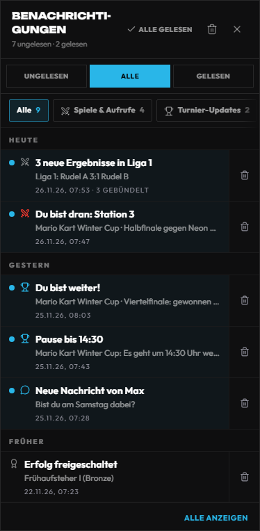
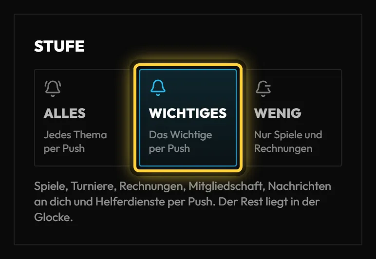
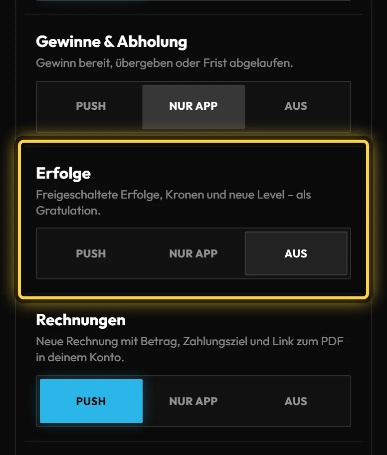
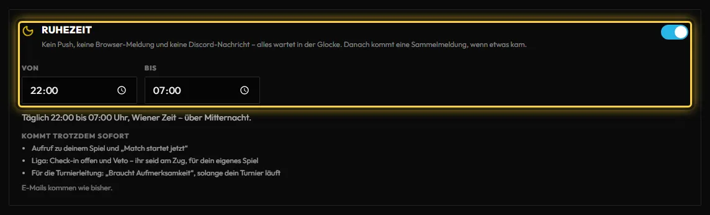
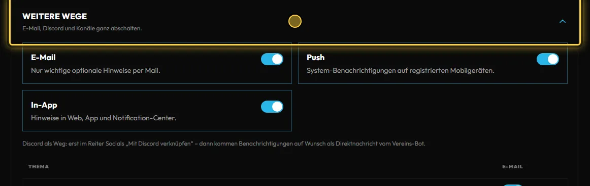
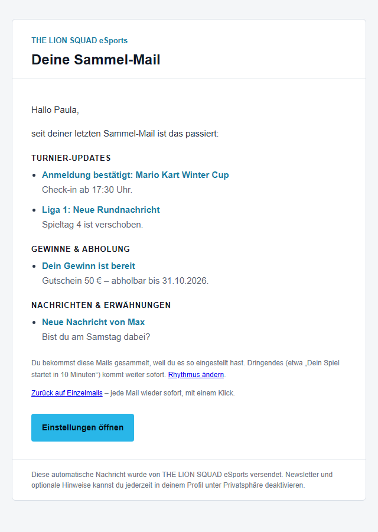

# Mails und Benachrichtigungen – Handbuch

Wie Mitteilungen der Website zu den Leuten kommen: Mail-Versand einrichten, die Texte der Mails ändern, die
Warteschlange im Blick behalten, Push in der App, Discord-Direktnachrichten – und was Mitglieder selbst an- und
abschalten können.

**Wo im Admin:**

- **Admin → Verbindungen → Resend** (`/admin/settings/resend`) – Mail-Versand über Resend: Schlüssel, Absender, Testmail
- **Admin → Verbindungen → SMTP** (`/admin/settings/smtp`) – Mail-Versand über einen eigenen Mailserver, mit Diagnose
- **Admin → E-Mail → E-Mail-Vorlagen** (`/admin/email-templates`) – alle Mails mit Text und Vorschau
- **Admin → E-Mail → Mail-Queue** (`/admin/settings/mail-queue`) – die Warteschlange
- **Admin → E-Mail → Newsletter** (`/admin/settings/newsletter`) – der Verlauf der verschickten Newsletter
- **Admin → E-Mail → Sammel-Mail** (`/admin/settings/sammel-mail`) – Vorgaben der Sammel-Mail mit Vorschau (3.7)
- **Admin → System → Push-Tests** (`/admin/mobile-push`) – Push an ein Konto testen
- **Admin → System → Betrieb & Logs → Ereignisse** – jede Mail und jede Discord-Meldung mit Stand
- **Admin → System → Status** – Ampeln für Mail und Scheduler
- **Benutzermenü → Einstellungen → Benachrichtigungen** (`/profile?tab=notifications`) – was Mitglieder selbst einstellen
- **Glocke** im Kopf und **/notifications** – die Liste der Benachrichtigungen

Wer das darf: Alles unter Verbindungen, E-Mail und System der Bereich **System**. Den Newsletter zu News und Events schickt man im
Kasten **Verteilen** am Beitrag ([Inhalte](inhalte.md)).

---

## Inhalt

1. [Überblick: was alles geht](#1-überblick-was-alles-geht)
2. [Einrichten Schritt für Schritt](#2-einrichten-schritt-für-schritt)
3. [Die Funktionen einzeln](#3-die-funktionen-einzeln)
4. [Wenn etwas nicht klappt](#4-wenn-etwas-nicht-klappt)
5. [Häufige Fragen](#5-häufige-fragen)

---

## 1. Überblick: was alles geht

| Funktion | Was passiert | Einstellen unter |
| --- | --- | --- |
| **Mail-Versand** | Alle Mails der Website gehen über einen Weg: Resend **oder** eigenen SMTP-Server | Verbindungen → Resend / SMTP |
| **Mail-Vorlagen** | Betreff und Text jeder Mail, mit Vorschau und Testmail | E-Mail → E-Mail-Vorlagen |
| **Mail-Queue** | Jede Mail wartet erst, wird dann gesendet; Fehler lassen sich wiederholen | E-Mail → Mail-Queue |
| **Newsletter** | Beim Veröffentlichen von News und Events an alle mit Zustimmung | Kasten „Verteilen“, Verlauf unter E-Mail → Newsletter |
| **Benachrichtigungen** | Eine Meldung, fünf mögliche Kanäle: E-Mail, Push, Browser, In-App, Discord – jede mit Thema und Wichtigkeit | Einstellungen → Benachrichtigungen (Mitglied) |
| **Sammel-Mail** | Optionale Mails gesammelt einmal am Tag oder in der Woche statt einzeln; Dringendes kommt sofort | Mitglied im Reiter **E-Mail**; Vorgaben unter E-Mail → Sammel-Mail |
| **Push in der App** | Mitteilungen aufs Handy, in fünf Kanälen mit eigener Lautstärke | App-Einstellungen am Handy; Test unter Push-Tests |
| **Discord-Direktnachricht** | Dieselbe Meldung als Nachricht vom Vereins-Bot | Mitglied schaltet den Kanal ein |

---

## 2. Einrichten Schritt für Schritt

### 2.1 Mail-Versand über Resend (der einfache Weg)

1. **Admin → Verbindungen → Resend.** Bei Resend (resend.com) ein Konto anlegen, unter „API Keys“ einen Schlüssel mit der
   Berechtigung „Sending access“ erzeugen und im Feld **Resend API** eintragen. Der Schlüssel wird danach nur maskiert angezeigt;
   leer lassen behält den gespeicherten.
2. Bei Resend unter „Domains“ die Vereinsdomain hinzufügen, die DNS-Einträge (SPF, DKIM) beim Domain-Anbieter anlegen und in
   Resend bestätigen. Ohne bestätigte Domain landen Mails im Spam oder werden abgelehnt.
3. Hier **Absendername**, **Absender-E-Mail** (zum Beispiel `noreply@`, gefolgt von eurer Domain) und **Antworten an** (Vereinspostfach) eintragen.
   Diese drei Felder und **Versand aktiv** gelten für beide Wege – unter SMTP steht dieselbe Einstellung, eine Änderung hier gilt auch dort.
4. **Testmail senden**. Kommt sie an, **Versand aktiv** einschalten und speichern.

### 2.2 Oder: eigener Mailserver (SMTP)

1. **Admin → Verbindungen → SMTP.** Bei **Provider** **SMTP (eigener Server)** wählen. Es gilt immer **nur ein Weg**; welcher gerade aktiv ist,
   steht auch unter System → Status.
2. **SMTP Host**, **Port** (587 = STARTTLS, 465 = SSL/TLS, 25 = ohne), **User** und Passwort, **Sicherheit** (Auto nach Port). Empfohlen ist
   **Mit Benutzer/Passwort**.
3. **Absender E-Mail**, **Absendername**, **Antworten an**. Unter den technischen Feldern (Technischer SMTP-Absender, Message-ID Domain, HELO/EHLO)
   reichen meist die Vorgaben.
4. **Diagnose** prüft die Verbindung (auch andere Ports), **Zustellbarkeit** die DNS-Einträge der Domain; **Senden** unter **SMTP Testmail** schickt eine echte Mail. Die **DNS Checkliste gegen Spam**
   erinnert an SPF, DKIM, DMARC und rDNS – ohne sie landen Mails beim Empfänger leicht im Spam.
5. **Versand aktiv** einschalten, speichern.

### 2.3 Prüfen

- **Admin → System → Status** und die Kommandozentrale (Chips „Mail / SMTP“ und „Mail-Queue“) zeigen grün.
- Eine Registrierung mit einer Test-Adresse durchspielen: Die Bestätigungsmail muss ankommen.

---

## 3. Die Funktionen einzeln

### 3.1 Welche Mails es gibt

Account- und Sicherheitsmails (Bestätigung, Passwort zurücksetzen, Anmeldung) sind **immer aktiv** und lassen sich nicht abbestellen.
Alle anderen sind **Themen**, die jede Person selbst an- und abschalten kann (3.6). Die wichtigsten Themen:

| Thema | Wofür |
| --- | --- |
| **Spiel-Erinnerungen** | Startzeiten, Spiel-Hub, Check-in-nahe Hinweise, Aufruf, Ergebnis-Meldungen, Disputes |
| **Turnier-Updates** | Anmeldung (eingegangen, bestätigt, abgelehnt, Warteliste), Check-in, Ergebnisse, „Turnier beendet“, „Turnier abgesagt“, „Event abgesagt“, Stand der eigenen Event-Anmeldung (angemeldet, Warteliste, nachgerückt, von der Leitung storniert), „Wie war …?“ am Tag danach, Fotos vom Event („Die Fotos sind da“), Nachricht der Turnierleitung an alle Angemeldeten eines Events |
| **Gewinne & Abholung** | Gewinn bereit, übergeben, Frist abgelaufen |
| **Erfolge** | Freigeschaltete Erfolge, Kronen und neue Level – nur In-App, Push, Discord, keine Mail |
| **Wochenrückblick** | Montags eine Mail mit XP und neuen Erfolgen, nur bei Aktivität, nur per Mail |
| **Rechnungen** | „Deine Rechnung ist da“ – nur In-App, Push, Mail; Beträge gehen nie über Discord |
| **Vereinsmitgliedschaft** | Einladungen zum Antrag, Nummern, Vorteile. Entscheidungen über die eigene Mitgliedschaft (aufgenommen, abgelehnt, aktiv, ruhend, beendet, gesperrt) kommen immer per Mail und als Meldung, auch wenn das Thema aus ist |
| **Geburtstagsgruß** | Einmal im Jahr eine Mail vom Verein |
| **Nachrichten & Erwähnungen** | Direktnachrichten, Team-Chat-Erwähnungen, Freundschafts- und Team-Einladungen |
| **News & Events** | Neue News, Events, Ankündigungen – nur mit Newsletter-Zustimmung, Standard aus |
| **Vereinsintern** | Interne Events und News, die nur Mitglieder sehen (Mitglieder-Fotoalben melden hier) |
| **Helferdienste** | Nur für Mitglieder: Aufrufe für offene Schichten, Erinnerung am Vortag – keine Mail |

Nachrichtentexte anderer Personen stehen nie in Mails oder Discord-Nachrichten, nur „Du hast eine Nachricht“ mit Link.

### 3.2 Mail-Vorlagen

**Admin → E-Mail → E-Mail-Vorlagen.** Eine Liste aller Mails, die die Website verschickt, nach Thema. Je Vorlage stehen Zweck, Empfänger
und die Variablen, die ihr einsetzen dürft. Unter **Bearbeiten** ändert ihr **Betreff** und **Text (HTML)**; die **Vorschau mit
Beispieldaten** zeigt das Ergebnis, eine **Testmail** geht an euch selbst. Gespeichert gilt der Text sofort („ab jetzt geht dieser Text raus“).
**Auf Standard zurücksetzen** verwirft eure Fassung und stellt den mitgelieferten Text wieder her.

Im Formular steht die Vorlage immer mit **Platzhaltern** wie `{{display_name}}` – beim Versand kommt der echte Wert hinein. Nur die
Vorschau rechts setzt Beispieldaten ein („Paula“, „Mario Kart Winter Cup“). Bei festen Vorlagen ist der Standard mit Platzhaltern der
Ausgangspunkt; Teile, die der Standard nur bei Bedarf zeigt (etwa Grund oder Station), stehen in eurer Fassung immer drin. Wer den
Standard unverändert speichert, speichert nichts – es bleibt beim Standard.

Steht ein Beispielwert aus der Vorschau im Text, fragt **Speichern** nach: So bekäme jede Person „Hallo Paula“. Vorlagen, die schon so
gespeichert sind, tragen in der Liste den Hinweis **Beispielwerte im Text**; im Editor steht, welche Werte es sind. Nichts wird von selbst
überschrieben – Werte durch Variablen ersetzen oder **Auf Standard zurücksetzen**.

### 3.3 Die Mail-Queue

**Admin → E-Mail → Mail-Queue.** Jede Mail wird zuerst eingereiht und dann versendet. Stände: **Wartet**, **Sendet**, **Gesendet**,
**Fehlgeschlagen**, **Übersprungen**. Oben ein Filter **Nach Stand filtern**, darunter die Liste mit Mail, Stand und Zeitpunkt.

- Empfänger stehen **gekürzt** da: erster Buchstabe und Domain, zum Beispiel `m***@gmail.com` – auch in der Meldung des
  Mailservers. **Adresse zeigen** in der Zeile zeigt die ganze Adresse dieser einen Mail, **Verbergen** kürzt wieder. Jedes
  Aufdecken steht im Protokoll (**Betrieb & Logs → Ereignisse**, Adminaktionen: wer, wann, welche Mail – ohne die Adresse).
  Mehr als 30 Adressen in einer Stunde deckt eine Person nicht auf; danach heißt es kurz warten.
- **Adresse suchen** findet Mails an eine bestimmte Adresse (auch nur ein Teil davon); die Treffer stehen ebenfalls gekürzt da.
  **Suche leeren** zeigt wieder alle.
- Bei **Fehlgeschlagen** erscheint **Nochmal versuchen**; eine gesendete Mail geht nie ein zweites Mal hinaus. **Löschen** steht unter „Mehr“.
- Oben: **Jetzt verarbeiten** (Warteschlange sofort abarbeiten), **Hängende Mails neu anstoßen** (stellt Mails zurück, die lange beim Senden
  hängen), **Alle fehlgeschlagenen nochmal versuchen** und **Aufräumen** (löscht Einträge älter als 30 Tage).
- Ein Hinweisfeld nennt, wie viele Mails hängen und das letzte Problem mit Grund.
- **Übersprungen** heißt: Es wurde nicht versendet, zum Beispiel weil kein Versandweg aktiv ist. Der Grund steht
  in der Zeile.
- Für einzelne Mails mit Stand: **Admin → System → Betrieb & Logs → Ereignisse**, Quelle **E-Mail**.

### 3.4 Newsletter

News und Events gehen **beim Veröffentlichen von selbst** an alle mit Newsletter-Zustimmung. Gesendet wird im Kasten **Verteilen** am Beitrag
(Empfängerzahl, **Jetzt senden**, ein zweites Mal nur Redaktion und System). **Mail ansehen** zeigt die Mail, wie sie hinausgeht – Betreff,
Text, Link, mit eurem eigenen Namen als Anrede; verschickt wird dabei nichts. Unter **Admin → E-Mail → Newsletter** steht für System der
**Verlauf**: welche News und Events wann an wie viele Personen gingen – ohne Namen und Adressen. Entwürfe und „Nur intern“ gehen nicht hinaus.
Die Einwilligung gibt jede Person getrennt im Profil (3.6); sie ist jederzeit widerrufbar. Jede Newsletter-Mail hat unten den Link
**Mit einem Klick abbestellen** – er öffnet eine Seite ohne Anmeldung, dort meldet **Newsletter abbestellen** ab. Gmail, Yahoo und andere
zeigen dazu ihren eigenen „Abbestellen“-Knopf (Kopfzeile `List-Unsubscribe`); der meldet sofort ab. Der Widerruf steht wie die Einwilligung
im Protokoll.

### 3.5 Push, In-App und Discord

Eine Benachrichtigung entsteht einmal und geht dann, je nach Einstellung der Person, über die Kanäle:

- **In-App:** die **Glocke** im Kopf und **/notifications** (#1205). Beide gliedern nach **Heute**, **Gestern** und **Früher** und haben
  oben die Themen zum Antippen (etwa nur **Turnier-Updates**). Gleichartiges eines Tages steht in einer Zeile: Nachrichten desselben
  Absenders oder Chats („3 neue Nachrichten von …“), Ergebnisse desselben Turniers („3 neue Ergebnisse in Liga 1“) und Erfolge („2 neue
  Erfolge“). Vor jeder Meldung steht ein Symbol für ihr Thema; **dringende** Meldungen (Aufruf, Match startet jetzt) sind rot. Was bei
  offener Glocke neu ankommt, gleitet sanft in die Liste. Ein Tipp führt zur passenden Seite und markiert das ganze Bündel als gelesen.

  
- **Push:** auf registrierten Handys mit der LionsAPP. Android kennt fünf **Kanäle**, die jede Person in den Handy-Einstellungen einzeln stumm
  schalten kann: **Aufrufe & Spielstart** (wichtig, mit Gong: Du bist dran, Match startet jetzt, Erinnerung vor dem Spiel; für die Turnierleitung
  „Braucht Aufmerksamkeit“), **Turniere & Events**, **Chats**, **Verein** (Vereinsintern, News, Mitgliedschaft, Rechnungen) und **Erfolge**.
  Wer die Chats leise stellt, verpasst den Spielaufruf nicht.
- **Browser** (#1163): dieselben Meldungen wie Push, aber im Browser – am PC und im Handy-Browser, auch bei geschlossener
  Website. Am iPhone geht das nur mit der Website auf dem Home-Bildschirm (Safari → Teilen → „Zum Home-Bildschirm“). Gefragt
  wird nie beim ersten Besuch und nie direkt nach dem Anmelden, sondern nach einer Turnier- oder Event-Anmeldung (#1208): Zuerst
  erscheint unten der Kasten **„Sollen wir dich rufen, wenn du dran bist?“** mit drei Zeilen – Aufruf, Check-in, Ergebnis.
  Erst **Ja, rufen** ruft die Frage des Browsers auf. **Später** schließt ihn; gefragt wird frühestens bei der nächsten
  Anmeldung wieder. Bei einer Event-Anmeldung mit **„Spielst du auch mit?“** kommt der Kasten erst, wenn dieses Blatt zu ist.
  Wurde das eigene Team angemeldet, kommt er beim nächsten Öffnen der Übersicht (Dashboard), dann mit **„Dein Team ist
  angemeldet“** über der Frage. Gemerkt wird das je Konto im Browser, nicht am Server; Abmelden setzt es zurück. Hat der Browser abgelehnt, fragt die Seite nicht mehr; auf Turnier- und
  Event-Seiten steht dann leise **„Aufrufe sind aus – einschalten“**, der Link führt direkt zur Karte **Dieser Browser** unter
  Einstellungen → Benachrichtigungen, die erklärt, wie man es im Browser wieder erlaubt. Ein Tipp auf die Meldung öffnet die passende Seite (ein offener Tab mit dieser Seite wird nach vorn geholt),
  beim Check-in gibt es den Knopf **Jetzt einchecken**. Abmelden vom Konto, Passwort ändern und „Überall abmelden“ melden den
  Browser ab; Meldungen kommen, solange die Anmeldung auf der Website in diesem Browser gilt. Einrichten muss es der
  Betreiber einmal mit zwei Schlüsseln in der Server-Konfiguration ([Betrieb](../BETRIEB.md)); ohne sie gibt es den Kanal nicht.
- **Discord-Direktnachricht:** Nur mit verknüpftem Discord-Konto und nur auf Wunsch (Standard **aus**). Es kommt dieselbe Meldung als
  Nachricht vom Vereins-Bot (Titel, Text, Link). Nie darin: Chat-Texte anderer, Moderation, Zahlungsdaten. Discord stellt Direktnachrichten
  nur zu, wenn die Person mit dem Bot einen Server teilt und „Direktnachrichten von Servermitgliedern“ erlaubt. Lehnt Discord ab, bleibt es
  bei In-App und Push, und die Einstellungen zeigen den Klickweg. Bot aus: keine Nachricht, der Grund steht im Versand-Log.
- **Push testen:** **Admin → System → Push-Tests**: Benutzer suchen, Testnachricht senden. Der Test landet als „Test: …“ im Postfach der Person.
  Die Seite zeigt die angemeldeten Handys, ob der Push-Dienst die Nachricht **angenommen** und ob Apple oder Google sie **zugestellt** haben, dazu
  Fehler in Alltagssprache. „Im Postfach angelegt – aber auf keinem Handy ist die App mit Push angemeldet“ heißt: Die Person hat die App nicht oder
  keine Push-Erlaubnis.
  In der Kommandozentrale steht die Zahl der aktiven Tokens und Fehler unter **Push-Monitoring**.

### 3.6 Was Mitglieder selbst einstellen können

**Benutzermenü → Einstellungen → Benachrichtigungen** (`/profile?tab=notifications`). Die Schritte mit Bildern für Mitglieder
stehen auch in der FAQ unter [Konto und Profil → Benachrichtigungen](../../frontend/src/hilfe/themen/konto-und-profil.json)
(`/faq/konto-und-profil#stufe`).

Die Seite hat vier Reiter (#1662): **Themen** (Stufe und Themen), **E-Mail** (Sammel-Mail, E-Mail je Thema, Newsletter),
**Ruhezeit** und **Mehr** (Discord, Kanäle ganz aus, Zeremonien). Der Reiter steht in der Adresse, etwa
`/profile?tab=notifications&bereich=mail` – dorthin führt auch der Link in jeder Sammel-Mail.

 

- **Stufe** (#1204): oben drei Karten zum Antippen.
  - **Alles:** jedes Thema per Push.
  - **Wichtiges:** Spiele & Aufrufe, Turnier-Updates, Rechnungen, Mitgliedschaft, Nachrichten & Erwähnungen und
    Helferdienste per Push, der Rest nur in der App.
  - **Wenig:** nur Spiele & Aufrufe und Rechnungen per Push, der Rest nur in der App.
  - Eine Stufe stellt alle Themen auf einmal. Stellt jemand ein Thema selbst um, steht dort **Eigene Auswahl**.
  - Neue Konten starten mit **Alles** – nur **News & Events** liegt ohne Newsletter-Haken bei der Registrierung still in der
    Glocke („Nur App“); diese Konten zeigen deshalb „Eigene Auswahl“. Wer von der Verwaltung eingeladen wird, hat keinen
    Haken. Bestehende Konten behalten ihre bisherigen Schalter und sehen meist „Eigene Auswahl“.
- **Themen:** je Thema **Push**, **Nur App** oder **Aus**.
  - **Push** heißt: aufs Handy (LionsAPP) und in angemeldete Browser.
  - **Nur App** legt die Meldung still in die Glocke.
  - **Aus** heißt: auch keine Glocke.
  - Liga-Rundnachrichten und Belohnungen der Liga gehören zu **Turnier-Updates**; Veto, Check-in und Aufrufe des eigenen Spiels zu
    **Spiele & Aufrufe**.
- **Ruhezeit** (#1206): von–bis in Wiener Zeit, Standard **aus**; beim Einschalten 22:00 bis 7:00 Uhr.
  - In der Ruhezeit kommt kein Push, keine Browser-Meldung und keine Discord-Direktnachricht. Alles liegt sofort in der Glocke.
  - Danach kommt genau eine **Sammelmeldung** („In der Nacht: 4 Meldungen“), wenn etwas Ungelesenes kam. Der Server sieht dafür alle fünf
    Minuten nach (Job `quiet_digest`). Auch wer die Ruhezeit mitten in der Nacht verlängert, bekommt nur eine.
  - Ausschalten oder Verkürzen wirkt sofort: Was gewartet hat, kommt beim nächsten Lauf (spätestens nach fünf Minuten).
  - Zwischen Ende und Beginn müssen mindestens 15 Minuten liegen; sonst zeigt das Feld einen Hinweis und speichert nicht.
  - Trotzdem sofort kommen: der **Aufruf zum eigenen Spiel**, **Match startet jetzt**, in der Liga **Check-in offen** und **Veto – ihr seid am
    Zug** fürs eigene Spiel, und für die Turnierleitung **Braucht Aufmerksamkeit**, solange ihr Turnier läuft. Leitungs-Meldungen einer
    Liga-Staffel (Verfahren, Fristen) warten bis zur Sammelmeldung. Der **Push-Test** der Verwaltung kommt ebenfalls sofort.
  - **Absagen** von Turnier und Event und ein **neuer Termin oder Ort** eines Events kommen ebenfalls sofort (Fabians Entscheidung
    26.11.), genauso alles, was die Website ausdrücklich als **dringend** schickt.
  - E-Mails sind davon nicht betroffen.
- **Dieser Browser** (unter den Themen, nur wenn der Betreiber Browser-Benachrichtigungen eingerichtet hat): ob der Browser, in dem die Seite
  gerade offen ist, Meldungen bekommt, mit **Browser anmelden** bzw. **Browser abmelden**. Blockiert der Browser die Benachrichtigungen,
  steht dort, wo man sie wieder erlaubt. Mit **Inhalt verbergen** zeigt dieser Browser nur „Neue Benachrichtigung“. Chat-Texte und Beträge
  (Rechnungen, Kostenbeiträge) stehen nie in einer Browser-Meldung.
- **Reiter E-Mail** (#1662):
  - **Sammel-Mail:** **Sofort**, **Täglich** oder **Wöchentlich**. Sofort heißt: jede Mail einzeln wie bisher. Täglich bzw. wöchentlich
    heißt: eine Mail mit allem, was seit der letzten kam, nach Themen sortiert, mit Link zu jeder Sache. Darunter steht, wann sie kommt
    („Täglich um 07:00 Uhr“), und solange die Person nichts gewählt hat, die **Vorgabe des Vereins**. Wer selbst gewählt hat, kommt
    mit **Vorgabe des Vereins nutzen** wieder zurück. Dringendes (Spiel in 10 Minuten, Check-in schließt, Ergebnis bestätigen,
    Dispute, Absagen, neuer Termin) und Konto-Mails kommen immer sofort. Ist E-Mail ganz aus, sagt die Karte das.
  - In jeder Sammel-Mail steht **Zurück auf Einzelmails**: ein Klick, ohne Anmeldung, dann ein Knopf auf der Seite – danach kommt
    jede Mail wieder einzeln. Der Link gehört zu genau diesem Konto und ändert nur den Rhythmus.
  - der Kanal **E-Mail** ganz an oder aus und je Thema **E-Mail**. Ein Strich heißt: Dieses Thema gibt es per Mail nicht;
  - der **Newsletter**. **News & Events** per E-Mail geht nur mit dieser Einwilligung: „Ich willige separat ein, Newsletter, Event-Hinweise
    und Vereinsnews per E-Mail zu erhalten. Jederzeit widerrufbar.“ Newsletter kommen nie in die Sammel-Mail.
- **Reiter Mehr:** die Kanäle **Push**, **Browser**, **In-App** und **Discord** (nur mit verknüpftem Konto) ganz an oder aus, je Thema
  **Discord**, und die Zeremonien. Ist Push ganz aus, zeigen die Themen einen Hinweis mit **Push einschalten**.
- Account- und Sicherheitsmails bleiben immer aktiv.
- Dieselbe Seite regelt, wie Erfolge gefeiert werden (mit Klang oder dezent).

### 3.7 Sammel-Mail: Vorgaben und Regeln (Verwaltung)

**Admin → E-Mail → Sammel-Mail** (`/admin/settings/sammel-mail`), Bereich **System**.

1. **Vorgabe für alle ohne eigene Wahl:** Sofort, Täglich oder Wöchentlich. Ohne Entscheidung gilt **Sofort** – dann ändert sich für
   niemanden etwas, bis er es selbst umstellt.
2. **Täglich um** und **Wöchentlich am … um**: Wiener Zeit. Vorgabe 07:00 Uhr und Montag 07:00 Uhr.
3. **Speichern.** Rechts steht die **Vorschau** mit Beispielzeilen und deinem Namen; verschickt wird dabei nichts.

So arbeitet sie:

- **Was gesammelt wird:** optionale Mails einer Person mit Rhythmus Täglich oder Wöchentlich – Anmeldungen, Turnier- und Liga-Hinweise,
  Gewinne, Rechnungen, Nachrichten, Vereinsinternes. Nur Themen, die sie per Mail an hat.
- **Was nie gesammelt wird:** Konto- und Sicherheitsmails, Entscheidungen zur Mitgliedschaft, Dringendes (Spiel in 10 Minuten, Erinnerung
  vor dem Spiel, Check-in schließt, Ergebnis bestätigen, Dispute, Absage von Turnier oder Event, neuer Termin oder Ort eines Events),
  Newsletter, Geburtstagsgruß und Wochenrückblick.
- **Wann:** Der Job `mail_digest` sieht alle 10 Minuten nach. Je Person geht **genau eine** Mail je Zeitraum hinaus, mit allem, was vor dem
  Termin kam; was danach kommt, wartet auf den nächsten. Zwei Läufe gleichzeitig schicken trotzdem nur eine.
- **Sichtbarkeit:** Beim Versand wird jede Zeile neu geprüft: Konto aktiv und nicht gesperrt, Thema per Mail noch an, Vereinsinternes
  nur, solange die Person Mitglied ist. Was nicht mehr passt, fällt still heraus.
- **Zurück auf Sofort** (in den Einstellungen oder mit dem Link **Zurück auf Einzelmails** aus der Mail): Was noch wartet, kommt beim
  nächsten Lauf als eine Mail.
- **Viel auf einmal:** Es geht immer alles hinaus. Bis 200 Neuigkeiten stehen einzeln in der Mail, darüber steht „… und N weitere“.
- In der **Mail-Queue** steht jede Sammel-Mail als `notification_digest`; die Vorlage lässt sich unter **E-Mail-Vorlagen** anpassen
  (Platzhalter `{{items}}` ist die fertige Liste).
- Gesammelte Zeilen stehen in der Datenauskunft der Person und werden mit dem Konto gelöscht; Verschicktes räumt der Job nach 90 Tagen weg.

### 3.8 Thema und Wichtigkeit jeder Meldung

Jede Art von Meldung hat ein **Thema** (die Themen der Einstellungen) und eine **Wichtigkeit** (#1662):

| Wichtigkeit | Bedeutung | Beispiele |
| --- | --- | --- |
| **Dringend** | kommt auch in der Ruhezeit sofort, nie in eine Sammlung, in der Glocke rot und als einzige angesagt | Du bist dran, Match startet jetzt, Turnier abgesagt, Event abgesagt oder verschoben, Push-Test |
| **Wichtig** | verlangt meist etwas von dir | Termin, Check-in, Anmeldung, Weiter/Ausgeschieden, Pause, Rechnung, Nachricht an dich |
| **Normal** | zur Kenntnis | Ergebnisse, Erfolge, News, Galerie, Team-Änderungen |

Rechte, Entscheidungen zur Mitgliedschaft, Moderation und der Push-Test stehen unter **Konto & System** – das lässt sich nicht abschalten.
Ein Wächter-Test sorgt dafür, dass jede neue Art ein Thema und eine Wichtigkeit bekommt.

---

## 4. Wenn etwas nicht klappt

| Fehlerbild | Ursache | Lösung |
| --- | --- | --- |
| Mails kommen gar nicht an, Mail-Queue zeigt **Übersprungen** | Kein Versandweg aktiv oder kein Resend-Schlüssel („Kein Resend API Key hinterlegt“) | Resend oder SMTP einrichten, **Versand aktiv** einschalten |
| Testmail kommt nicht an | Falsche Absenderdomain, SPF/DKIM fehlen, Postfach prüft streng | Domain bei Resend bestätigen, SMTP: DNS Checkliste, Spam-Ordner |
| Der Schlüssel „wirkt nicht“, obwohl er eingetragen ist | Der aktive Weg ist SMTP | Auf der Seite SMTP bei **Provider** den gewünschten Weg wählen |
| Mail-Queue: **Fehlgeschlagen** | Server nicht erreichbar, falsche Zugangsdaten, Empfänger abgelehnt | Grund in der Zeile lesen, beheben, **Nochmal versuchen** |
| Hinweis „Mails hängen“ | Der Versand blieb stecken | **Hängende Mails neu anstoßen**, dann **Jetzt verarbeiten** |
| Newsletter ging nicht hinaus | Entwurf, „Nur intern“ oder keine Zustimmungen | Kasten **Verteilen** ansehen ([Inhalte](inhalte.md)) |
| Ein Mitglied bekommt keine Turnier-Mails | Thema oder Kanal E-Mail ist bei ihm aus | In Einstellungen → Benachrichtigungen prüfen |
| Mitglied bekommt keine Push-Meldung | Keine App, keine Erlaubnis, Kanal am Handy stumm, oder Push in den Einstellungen aus | Push-Tests ausführen; Handy-Einstellungen prüfen |
| Keine Meldung im Browser | Browser nicht angemeldet, im Browser blockiert, Kanal „Browser“ oder Thema aus, iPhone ohne Home-Bildschirm | Einstellungen → Benachrichtigungen → **Dieser Browser** ansehen |
| Kanal „Browser“ fehlt in den Einstellungen | Der Server hat keine Web-Push-Schlüssel | Schlüssel erzeugen und setzen ([Betrieb](../BETRIEB.md)) |
| „Im Postfach angelegt – aber auf keinem Handy ist die App mit Push angemeldet“ | Das Konto hat kein registriertes Gerät | App öffnen, Push erlauben |
| Discord-Kanal lässt sich nicht einschalten | Kein Discord-Konto verknüpft | Profil → Socials → Mit Discord verknüpfen |
| Discord-Direktnachricht kommt nicht | Discord lehnt ab (kein gemeinsamer Server oder Nachrichten gesperrt), oder Bot aus | Hinweis in den Einstellungen folgen; Verbindungen → Discord prüfen |
| Rechnung per Discord erwartet | Beträge gehen nie über Discord | Rechnungen kommen In-App, Push, Mail |
| Eine Vorlage zeigt „Vorschau hat nicht geklappt“ | Variable falsch gesetzt | Auf Standard zurücksetzen und neu anfangen |
| Alle bekommen „Hallo Paula“ oder denselben Turniernamen | Beispielwerte der Vorschau wurden gespeichert (Hinweis **Beispielwerte im Text**) | Vorlage öffnen, Werte durch Variablen ersetzen oder **Auf Standard zurücksetzen** |

---

## 5. Häufige Fragen

**Kann ich Mails über Resend und SMTP gleichzeitig laufen lassen?**
Nein, es gilt immer nur ein Weg.

**Kann jemand Sicherheitsmails abbestellen?**
Nein. Account- und Sicherheitsmails sind immer aktiv.

**Wer bekommt den Newsletter?**
Alle, die separat zugestimmt haben. Er geht beim Veröffentlichen von News und Events von selbst hinaus.

**Wie sehe ich, an wie viele ein Newsletter ging?**
Im Kasten **Verteilen** am Beitrag, und im Verlauf unter **E-Mail → Newsletter**.

**Wie kann ich einen Mailtext ändern?**
**E-Mail → E-Mail-Vorlagen**, Vorlage öffnen, **Bearbeiten**.

**Wie sehe ich, ob eine bestimmte Mail rausgegangen ist?**
Mail-Queue, oder Betrieb & Logs → Ereignisse mit Quelle E-Mail.

**Sehen Mitglieder die Chat-Texte in Discord oder Push?**
Nein, nur „Du hast eine Nachricht“.

**Warum gibt es für Erfolge keine Mail?**
Gewollt: Erfolge kommen In-App, per Push und auf Wunsch per Discord. Eine Mail gibt es nur im Wochenrückblick.

**Gibt es Ruhezeiten für Push?**
Eine Einstellung dafür gibt es in den Benachrichtigungen nicht. Jeder Push-Kanal lässt sich aber am Handy stumm schalten.
