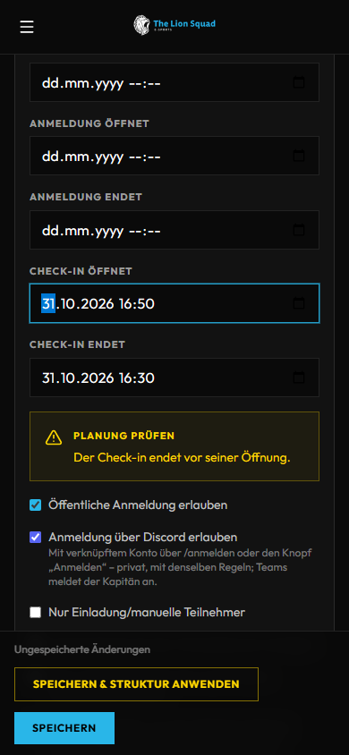
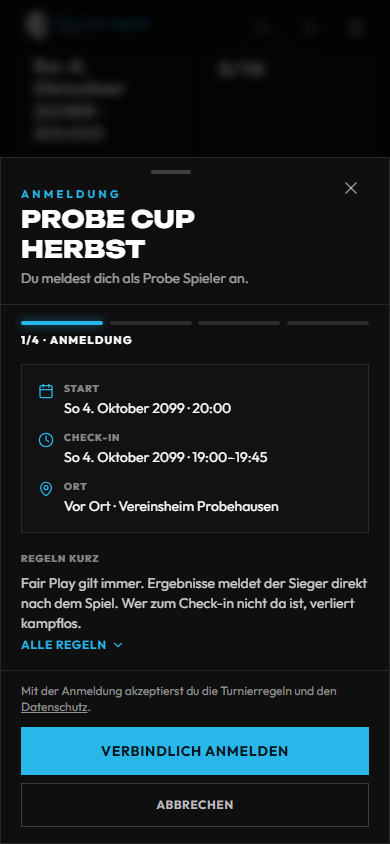
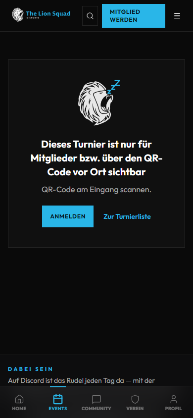
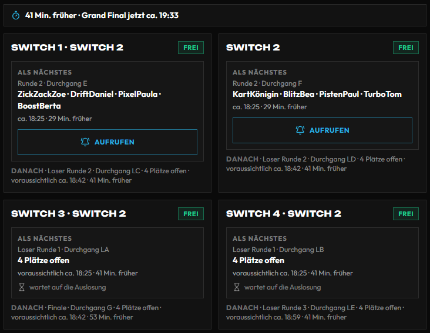
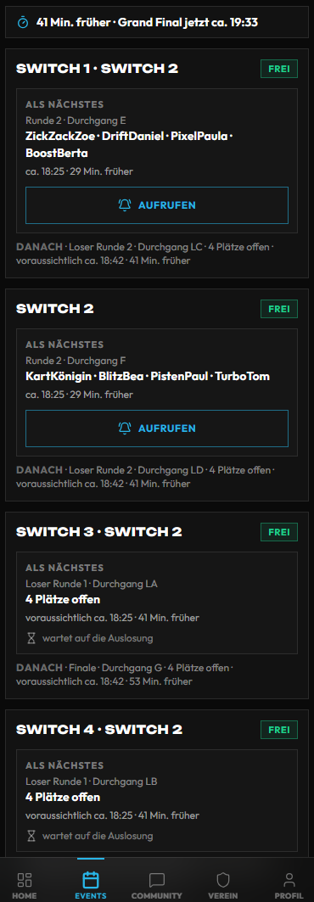
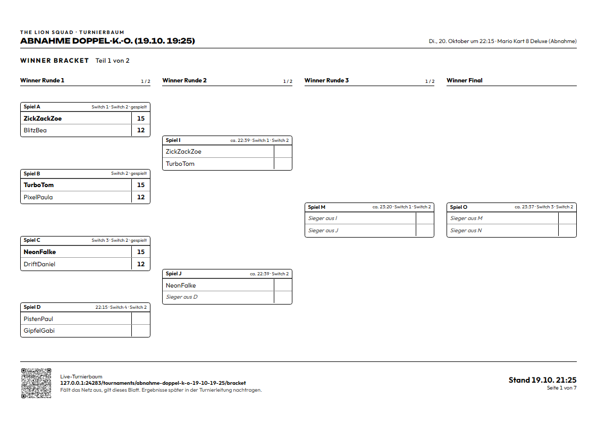
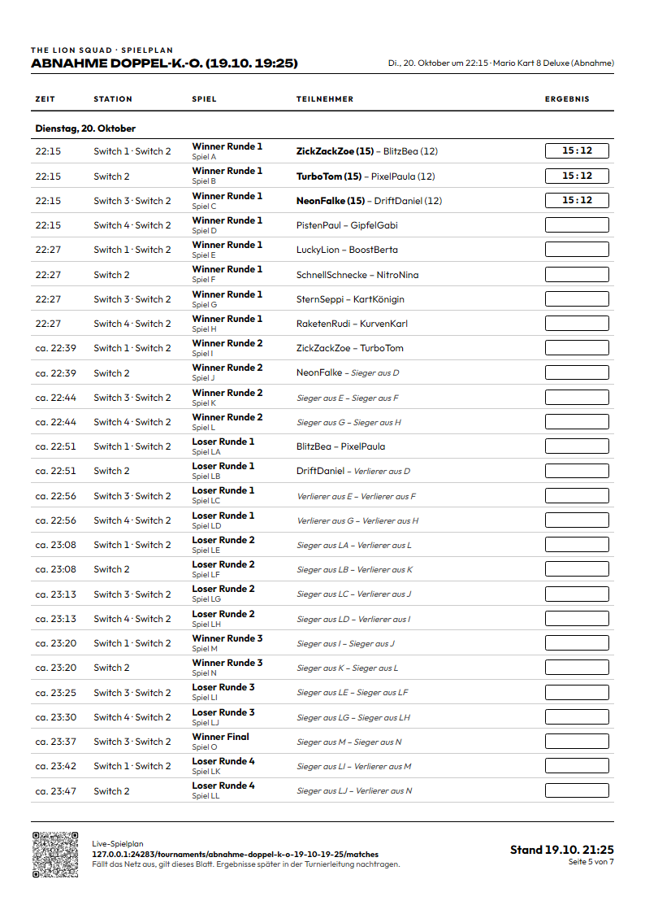
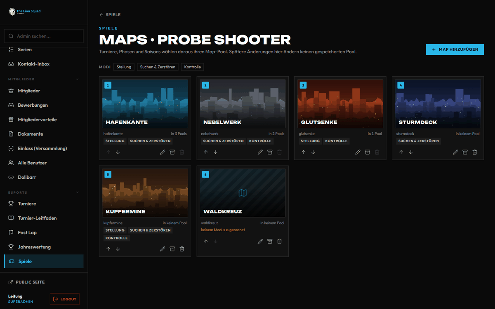
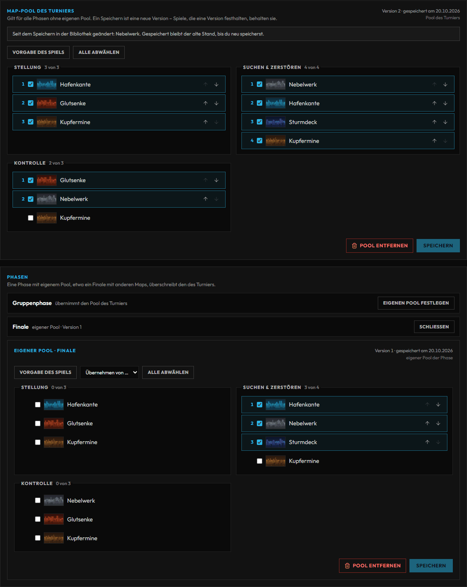

# Turniere – Handbuch

Der Weg eines Turniers aus Sicht der Turnierleitung: anlegen, Anmeldung, Check-in, Turnierbaum und Gruppen, Ergebnisse
(mit dem Ergebnis-Fenster am Handy), Stationen, TV und der Abschluss. Dazu: was ihr tut, wenn nur wenige Helfer da sind.

**Wo im Admin:**

- **Admin → eSports → Turniere** (`/admin/tournaments`) – Liste aller Turniere mit Suche, Status-Filter und CSV-Export
- **Admin → eSports → Turniere → Neues Turnier** (`/admin/tournaments/new`) – anlegen
- **Admin → eSports → Turniere → Turnier öffnen** (`/admin/tournaments/<Turnier>`) – Reiter **Teilnehmer**,
  **Turnierbaum**, **Matchplan** (Zeitleiste je Station, siehe 3.8), **Spiele**, **Gruppen** (nur beim Format Gruppenphase), **Maps** (nur mit Spiel, siehe 3.14), **Team**, **Rückmeldungen** (erst nach
  dem Ende), **Bearbeiten**
- **Admin → eSports → Spiele → Maps** (`/admin/games/<Spiel>/maps`) – Map-Bibliothek eines Spiels mit Bildern und Modi
- **Admin → eSports → Liga** (`/admin/leagues`) – Liga, Season, Liga N und Staffeln (3.15); den ganzen Weg bis zum
  Saisonende erklärt [Liga leiten](liga.md)
- **Admin → eSports → Turnier-Leitfaden** (`/admin/tournament-guide`) – welches Format wofür, mit „Voreinstellung übernehmen“
- **Admin → eSports → Stationen** (`/admin/stations`) – Geräte und Plätze in der Halle, Spiele zuweisen
- **Admin → eSports → Gewinne**, **Strafen**, **Jahreswertung** – was nach dem Turnier daraus wird
- **Turnierleitung am Handy** (`/tournaments/<Name>/leitung`) – Ergebnisse eintragen und Streitfälle entscheiden, ohne die Verwaltung

Wer was darf: Die **Turnierleitung** (Bereich „Turnierleitung“, mit bestätigter Zwei-Faktor-Anmeldung) verwaltet alle
Turniere. **Ohne 2FA** erscheint stattdessen der Hinweis **2FA einrichten**, siehe [Erste Schritte im Admin](admin.md).
**Helfer mit Einsatz** sehen in der Verwaltung nur **ihr** Turnier und dürfen nur das Operative: Status zwischen
**Check-in offen**, **Live**, **Pausiert** und **Beendet**, Check-in, Ergebnisse (je nach Rolle).
**Moderation allein** hat keinen Zugang zu den Turnierseiten.

---

## Inhalt

1. [Überblick: was alles geht](#1-überblick-was-alles-geht)
2. [Einrichten Schritt für Schritt](#2-einrichten-schritt-für-schritt)
3. [Die Funktionen einzeln](#3-die-funktionen-einzeln)
4. [Wenn etwas nicht klappt](#4-wenn-etwas-nicht-klappt)
5. [Häufige Fragen](#5-häufige-fragen)

---

## 1. Überblick: was alles geht

| Funktion | Was passiert | Einstellen unter |
| --- | --- | --- |
| **Turnier anlegen** | Titel und Spiel genügen, das Turnier startet als **Entwurf** und ist nicht öffentlich | Neues Turnier |
| **Formate** | Single und Double Elimination, Jeder gegen jeden, Schweizer System, Gruppenphase, Mehrspieler, Liga, freie Bäume und mehr | Neues Turnier / Reiter Bearbeiten, Abschnitt „Struktur“ |
| **Spielweise** | **Online**, **Vor Ort** oder **Hybrid**: wer Ergebnisse meldet, wer Termine macht, wer eincheckt | „Wie gespielt wird“ |
| **Anmeldung** | Selbstanmeldung, Warteliste, Einladung, Speziallinks, Startgeld | Reiter Bearbeiten, Reiter Teilnehmer |
| **Check-in** | Online selbst, vor Ort durch die Turnierleitung | Reiter Teilnehmer |
| **Aufstellung** | Bei Team-Turnieren wählt der Kapitän, wer spielt | Dein-Stand-Karte der Spieler, Anzeige im Reiter Teilnehmer |
| **Turnierbaum, Gruppen** | Vorschau wächst mit den Anmeldungen, fix wird sie mit dem Ende des Check-ins | Reiter Turnierbaum, Matchplan, Gruppen |
| **Ergebnisse** | Spieler melden, oder die Turnierleitung trägt im **Ergebnis-Fenster** ein, danach 10 Sekunden **Rückgängig** | Matchplan, Stationen, Turnierleitung am Handy |
| **Dispute** | Streitfall entscheiden mit einem Tipp | Turnierleitung am Handy |
| **Stationen** | Spiele Geräten zuweisen, Aufruf auf dem TV | Admin → eSports → Stationen |
| **Maps** | Map-Bibliothek je Spiel mit Bild und Modi; je Turnier und Phase ein eigener Map-Pool | Spiele → Maps, Reiter Maps |
| **TV** | Turnierbaum, Aufrufe, Stationen auf Fernseher und Beamer | [TV und Beamer](tv.md) |
| **Abschluss** | Beendet, Ergebnisse veröffentlicht, Punkte, Erfolge, Gewinne | Statusauswahl im Turnier |

---

## 2. Einrichten Schritt für Schritt

### 2.1 Das Turnier anlegen

1. **Admin → eSports → Turniere → Neues Turnier**. Alternativ **Admin → Kommandozentrale → Schnellzugriff → + Turnier**.
2. **Tipp:** Erst **Admin → eSports → Turnier-Leitfaden** ansehen. In der Tabelle „Nach Turnierform“ setzt der Knopf
   **Voreinstellung übernehmen** Format, Teamgröße, Best of und Spielweise für typische Spiele vor. Alles bleibt änderbar.
3. Kasten **Das Turnier**: **Titel**, **Spiel**, **Format**, **Teilnahme** (Einzelspieler oder Team), bei Teams
   **Spieler pro Team**, dazu **Max Spieler** / **Min Spieler** (bei Teams „Max Teams“ / „Min Teams“).
4. Kasten **Wie gespielt wird**: **Online**, **Vor Ort** oder **Hybrid** wählen (3.2).
5. Rechts im Kasten **Wann**: **Veröffentlichung** (**Entwurf** oder **Angekündigt**), **Start Event/Turnier**,
   **Anmeldung endet**. Unter „Weitere Zeiten und Sonderfälle“: **Ende**, **Anmeldung öffnet**, **Check-in öffnet**,
   **Check-in endet**, **Nur Einladung**, **Anmeldung über Discord erlauben**, **Vereinsmitglieder von der Selbstanmeldung
   ausschließen** und, wenn das Turnier zu einem Event gehört, **Anmeldung nur mit Event-Anmeldung**. Unter dem Kasten warnt
   **Planung prüfen** bei widersprüchlichen Zeiten – beim Bearbeiten genauso, direkt unter **Check-in endet** (etwa „Der
   Check-in endet vor seiner Öffnung.“). Gespeichert wird trotzdem.

   
6. Weiter unten, aufklappbar: **Darstellung und Regeln** (Slug, Plattform, Beschreibung, Banner, **Regeln**,
   Partner), **Spieloptionen** (Best of, Seeding, Gegner der nächsten Runde, Spiel um Platz 3), **Preise**, **Streaming und
   externe Links**. Schreibt die **Regeln** hinein, bevor die Anmeldung aufgeht – was ihr festlegt (Frist bis zum
   Forfeit, Streitfall-Ablauf, Beweise), steht dann für alle fest.
7. **Turnier erstellen**. Du landest im Turnier.

**Turnier für ein Event (seit #1371):** Ein Turnier gehört zu einem Event, wenn du es **im Event** anlegst oder dort
hinzufügst – nicht im Turnier. Event öffnen → Abschnitt **Programm** → **+ Turnier in diesem Event**. Das Formular kommt mit
Ort, Tag, Partnern und den Discord-Einstellungen des Events; der Tag muss im Zeitraum des Events liegen. Ein schon
angelegtes Turnier holst du dort über **Bestehendes hinzufügen**, **Lösen** nimmt es wieder heraus. Im Turnier steht nur
noch die Zeile „Gehört zu … – ändern im Event“, und der Ort kommt vom Event (ein eigener Ort nur ohne Event). Gibt es schon genug Teilnehmer, steht die Meldung „Vorschau mit n
   Spielen angelegt“ da.

### 2.2 Anmeldung öffnen

1. Im Turnier oben im **Status**-Feld **Anmeldung offen** wählen. In der Liste geht es für Entwürfe auch mit dem
   Play-Symbol **Anmeldung öffnen**.
2. Prüfen: **Öffentliche Seite** (Link oben im Turnier) zeigt Anmeldung, Regeln und Preise.

### 2.3 Am Turniertag

1. **Check-in starten** (Knopf oben im Turnier).
2. Teilnehmer einchecken (3.3). Mit dem Ende des Check-ins steht der Baum (3.4).
3. **Turnier starten**.
4. Ergebnisse eintragen oder melden lassen (3.6).
5. Im Status **Beendet**, danach **Ergebnisse veröffentlicht** (3.10).

---

## 3. Die Funktionen einzeln

### 3.1 Formate und Strukturen

Das **Format** steht beim Anlegen und später unter **Turnier öffnen → Bearbeiten → Abschnitt „Struktur“ →
Turnierstruktur**. Zwei Spielarten gibt es: **Duell** (zwei Seiten) und **Mehrspieler** (viele in einer Lobby, gewertet nach
Platzierung).

| Format | Wofür |
| --- | --- |
| **Single Elimination** | Ein Abend, ein Sieger; wer verliert, ist raus. Mit Haken „Spiel um Platz 3“ möglich |
| **Double Elimination** | Eine Niederlage ist nicht das Aus (Loser Bracket) |
| **Jeder gegen jeden** | Kleines Feld, alle spielen gegeneinander, die Tabelle entscheidet |
| **Schweizer System** | Viele Teilnehmer, kein fester Baum; die Runden entstehen einzeln aus den Ergebnissen |
| **Gruppenphase** | Teilnehmer in Gruppen, danach Turnierbaum |
| **Liga** | Eine Saison über Wochen mit Spieltagen |
| **Mehrspieler frei** | Alle gleichzeitig in einer Lobby |
| **Überlebensmodus** | Für Battle-Royale-artige Spiele, gewertet nach Platzierung |
| **Freier Turnierbaum** und **Mehrspieler freier Turnierbaum** | Ihr schreibt den Baum selbst (Schema) |
| **Zeitfahren**, **Rennserie** | Wertung über Rundenzeiten, **kein Turnierbaum**. Für reines Zeitfahren ist die [Fast-Lap-Challenge](fastlap.md) gedacht |

Zu den Besonderheiten:

- **Schweizer System:** Es gibt keine Vorschau. Teilnehmer bestätigen, dann oben im Turnier **Schweizer Runde**
  klicken – jede Runde einzeln. Die Runde startet das Turnier nicht: nach Runde 1 wie gewohnt **Turnier starten** (mit
  Check-in-Ende und Planungsprüfung). Eine falsch erzeugte Runde nimmt **Runde N zurücknehmen** (neben **Schweizer
  Runde**) wieder heraus, solange keines ihrer Spiele aufgerufen, gestartet oder gewertet ist und keines an einer
  Station hängt; ein Freilos zählt nicht.
- **Gruppenphase:** Oben **Gruppen generieren**, die Zahl der Gruppen eintippen (Vorschlag 4). Im Reiter **Gruppen**
  stehen sie. Der Status bleibt dabei, gestartet wird mit **Turnier starten**. Gibt es schon feste Gruppenspiele, fragt
  die Seite vorher nach und nennt die Zahl („12 Spiele, davon 3 begonnen oder gewertet“) – neue Gruppen löschen sie
  samt Ergebnissen. Nach dem Ende und bei gesperrtem Turnier gibt es keine neuen Gruppen.
- **Liga, Jeder gegen jeden und Gruppen:** Unter **Bearbeiten → Spielweise** erscheint der Kasten **Spielwochen**:
  **Spieltag dauert (Tage)**, **Standardtag**, **Standarduhrzeit** (Wiener Zeit) und **Antwortfrist (Stunden)**. Ein
  Spieltag ist ein Zeitraum. Beide Seiten dürfen Termine vorschlagen, was die Gegenseite annimmt, gilt, sonst greift
  die Standardzeit. Ein vereinbarter Termin bleibt, auch außerhalb der Woche. Antwortet die Gegenseite nicht in der
  Frist, bekommt die Turnierleitung eine Meldung. Spielwochen gibt es nur online: eine Gruppenphase **vor Ort** plant
  der Spielplaner auf Stationen (siehe 3.8).
- **Freier Turnierbaum:** Unter **Bearbeiten → Struktur** erscheint das Feld **Schema** (beim Mehrspieler-Baum dazu
  **Spielgröße** und **Qualifizierte**). Ein Beispiel-Schema steht als Vorgabe darin. Anschließend unten
  **Speichern & Struktur anwenden**, dann im Reiter **Turnierbaum** prüfen.
- **Läufe umbauen (Mehrspieler-Baum):** Ist das Turnier nicht voll oder fallen Fahrer aus, werden unterbesetzte Läufe
  zusammengelegt (2 + 2 wird ein Lauf mit 4), ausgeglichen oder das Turnier wird abgekürzt (der Lauf mit allen Verbliebenen
  ist das Finale). Unter **Bearbeiten → Spieloptionen → Läufe umbauen** wählst du **Vorschlag** (Standard: der Vorschlag
  steht als Leiste oben in der Turnierverwaltung, du bestätigst oder lehnst ab) oder **Automatisch**. Auffüllen und
  Freilose laufen immer von selbst; laufende und aufgerufene Läufe werden nie umgebaut.
- **Sehr viele Begegnungen:** Bei Jeder gegen jeden und Liga mit sehr vielen Teilnehmern zeichnet das System keinen
  Entwurf. Dann Teilnehmerzahl senken oder Gruppen nutzen.
- **Seeding** (Zufall, Manuell, Ranking) und der **Setzplatz** pro Teilnehmer stehen unter Spieloptionen bzw. beim
  Hinzufügen eines Teilnehmers.

Ob der Baum Vorschau oder fix ist, siehst du im Reiter **Spiele** (Hinweis „Vorschau / Draft“).

**Format ändern und was ab dem Check-in-Ende feststeht (seit #2120):**

- Bis zum Ende des Check-ins darfst du **Turnierstruktur**, **Teilnahme** und **Spieler pro Team** ändern; beim
  **Speichern** baut sich die Vorschau gleich neu (aus K.-o. wird wirklich Doppel-K.-o.). Eigene Phasen aus „Phase
  anlegen“ bleiben stehen – die baust du mit **Speichern & Struktur anwenden** neu.
- Ab dem Ende des Check-ins (oder sobald es feste Spiele gibt, etwa generierte Gruppen) stehen **Turnierstruktur**,
  **Teilnahme**, **Spieler pro Team** und **Spiel** nur noch lesend da, und **Speichern & Struktur anwenden** fehlt.
  Im Reiter **Spiele** fehlen dann **Vorschau** und **Mit Teilnehmern generieren** (bei einer neuen, leeren Phase bleibt
  Generieren). Eine Vorschau ersetzt nie echte Spiele.
- **Zurücksetzen** (Werkzeuge) löscht alle Spiele, der Status bleibt. Stehen schon feste Spiele, nennt die Rückfrage die
  Zahl („12 Spiele, davon 3 begonnen oder gewertet“); erst **12 Spiele löschen** setzt zurück. Nach dem Ende (Beendet,
  Ergebnisse veröffentlicht, Archiviert) gibt es kein Zurücksetzen mehr – Platzierungen, Punkte, Pokale und Gewinne
  hängen am Baum.

### 3.2 Online, Vor Ort, Hybrid

Im Kasten **Wie gespielt wird** (beim Anlegen) bzw. **Bearbeiten → Spielweise** stehen drei Voreinstellungen. Darunter
lassen sich die drei Werte einzeln ändern (**Austragung**, **Ergebniserfassung**, **Terminplanung**).

| Voreinstellung | Ergebnisse | Termine | Check-in |
| --- | --- | --- | --- |
| **Online** | Spieler melden, die Gegenseite bestätigt | Spieler schlagen vor | Spieler selbst |
| **Vor Ort** | Turnierleitung (und Station-Crew) tragen ein | fix durch die Turnierleitung | Turnierleitung |
| **Hybrid** | Staff kann eingreifen, Spieler können melden | gemischt | Spieler selbst |

Lasst ihr **Ergebniserfassung** und **Terminplanung** auf „Automatisch“, gilt die Regel der Zeile oben. Eine Angabe an
einem Spiel geht vor der einer Phase, die vor der des Turniers. Die Liste der Turniere zeigt die geltende Regel als
Schilder an. Eine Warnung erscheint, wenn die Mischung nicht passt (zum Beispiel „Vor-Ort-Turnier mit
Spieler-Ergebnismeldung“).

**Auto-Start:** Der Haken „Turnier anhand Start-/Endzeit automatisch live/beendet schalten“ ist nur für Online-Turniere
gedacht. Für Vor-Ort-Turniere ausgeschaltet lassen, dort startet ihr selbst.

### 3.3 Anmeldung, Startgeld und Teilnehmer

**So melden sich Spieler an:** Auf der öffentlichen Turnierseite mit **Jetzt anmelden** (in der Vor-Ort-Ansicht
**Mitspielen**). Das öffnet immer zuerst ein kurzes Blatt – am Handy von unten, am PC als Fenster – mit **Start**,
**Check-in**-Fenster, **Ort** (online oder vor Ort mit Adresse), **Startgeld** (falls eingestellt) und den **Regeln in
drei Sätzen**; **Alle Regeln** klappt den ganzen Text auf. Erst **Verbindlich anmelden** meldet an, **Abbrechen**,
das Kreuz oder die Escape-Taste nicht. Bei Team-Turnieren wählt der Kapitän oder Co-Kapitän im selben Blatt das Team;
fehlt dem Spiel eine Pflicht-ID (zum Beispiel Spielername), fragt das Blatt sie ab. Die drei Sätze kommen vom Anfang
eurer **Regeln** – schreibt das Wichtigste also nach oben.

- Die Anmeldung gilt **sofort als Bestätigt**, solange Platz ist. Ist das Turnier voll, kommt die Person auf die
  **Warteliste**. Beides bekommt sie als Nachricht. Bei vollem Turnier sagt es schon das Blatt: „Der Cup ist voll – du
  kommst auf die Warteliste (Platz 3)“, der Knopf heißt dann **Auf die Warteliste**.
- Es geht nur im Status **Anmeldung offen** und im Zeitfenster **Anmeldung öffnet / endet**. Mit dem Haken
  **Nur Einladung** gibt es keine Selbstanmeldung.
- Selbst abmelden können sich Spieler nicht mehr, wenn sie eingecheckt sind oder das Turnier läuft; dann geht es nur
  über die Turnierleitung.

**Startgeld:** Kostet die Teilnahme etwas, steht es im Abschnitt **Startgeld** unter **Turnier öffnen → Bearbeiten**.
Den sieht und ändert nur der Bereich **Finanzen**. Wer anmeldet, übernimmt das Startgeld ausdrücklich (bei Teams der
Kapitän für das ganze Team); ohne diese Bestätigung nimmt die Seite die Anmeldung nicht an. Bezahlt wird mit der
verbindlichen Teilnahme: Warteliste kostet nichts. Alles Weitere steht in [Abrechnung](../ABRECHNUNG.md).

**Reiter Teilnehmer** (Standard beim Öffnen):

- **Teilnehmer hinzufügen** (bei Teams: **Team hinzufügen**): Konto in der Personensuche wählen, oder ohne Konto als
  manueller Gast mit **Anzeigename**; dazu **Status** und **Setzplatz**. Ein Hinweis erscheint, wenn die Person nicht
  beim Event angemeldet ist, obwohl das Turnier es verlangt – eintragen geht trotzdem.
- Suche („Name, Discord, E-Mail oder Team suchen“) und Filter nach Status, mit Zähler und den Zahlen je Status.
- Je Zeile: die **Status-Auswahl** (nur für die Turnierleitung): Ausstehend, Bestätigt, Abgelehnt, Warteliste,
  Eingecheckt, Nicht erschienen. Beim Ablehnen fragt die Seite nach einem freiwilligen Grund; die Person bekommt eine
  Nachricht. Wird bis zum Ende des Check-ins ein Platz frei (Absage, **Nicht erschienen**, Entfernen), rückt die
  älteste Anmeldung der Warteliste von selbst nach und bekommt eine Nachricht. Danach entscheidet ihr (3.4).
- Die Knöpfe **Check-in**, **Auschecken**, **Nicht erschienen**, **Entfernen**. Rückt nach **Nicht erschienen**
  jemand von der Warteliste nach, nennt die Meldung den Namen („Nicht erschienen gesetzt – Nachrücker: …“).
- Wer in einem festen Spiel steht, hat kein **Entfernen**, und **Ausstehend**, **Abgelehnt** und **Warteliste** sind in
  der Status-Auswahl gesperrt – in jedem Status, auch pausiert oder nach dem Ende. Sonst stünden im Baum Spiele mit
  einer Anmeldung, die es nicht mehr gibt. Vor dem Start: **Nicht erschienen** und ersetzen; im laufenden Turnier:
  **Austritt eintragen** oder **Disqualifizieren**.
- **Disqualifizieren** und **Austritt** (nur Strukturrollen, nur im laufenden Turnier): der erste Klick zeigt den
  Umbauplan in Worten („E: Lena kommt kampflos weiter.“), erst **Austritt eintragen** bzw. **Disqualifizieren** macht
  ihn wirksam; ein freiwilliger Grund geht in die Nachricht an die Person. Die Regeln: im K.-o. und Doppel-K.-o. kommt der Gegner kampflos weiter, ein
  Spiel, das schon läuft, wird gewertet – nie ein Eintrag ins Loser Bracket (anders als bei **Nicht erschienen** für
  ein einzelnes Spiel). In Liga und Gruppen gilt die 50-Prozent-Regel: weniger als die Hälfte der eigenen Spiele
  gespielt → alle Spiele annulliert und raus aus der Tabelle, sonst Rest kampflos verloren. Im Schweizer System
  bleiben die Ergebnisse, die Person wird nicht mehr gepaart. In Läufen rückt der Nächstplatzierte nach – mit Loser
  Bracket auf beiden Wegen: wer auf den Sieger-Weg nachrückt, verlässt dafür das Loser Bracket, dort rückt der Nächste
  auf, der letzte Platz wird ein Freilos. Wer im nächsten Lauf schon aufgerufen oder gefahren ist, bleibt dort. Wird
  die nächste Runde ausgelost (auch **Jetzt auslosen** je Weg und **Neu auslosen**), gilt dieselbe Reihe: wer
  ausgetreten ist, kommt in keinen Topf, die Nächsten rücken auf. Danach steht
  die Anmeldung auf **Ausgetreten** bzw. **Disqualifiziert**; die Statusauswahl kennt diese Werte nicht.
- Bei Team-Turnieren steht unter jedem Team die Aufstellung (3.5).
- Oben im Turnier: Downloads **PDF Teilnehmer**, **PDF Check-in**, **PDF Anmeldung QR** (zum Aufhängen), **PDF Spiele**
  und **CSV Matchplan**.
- Mit **Speziallinks** (Kasten oben, nur Turnierleitung) schickt ihr einzelnen Personen einen Link, der anmelden darf.
- Anmeldungen über den Vor-Ort-Zugang tragen in der Liste das Zeichen **Vor Ort**.

**Vor-Ort-Anmeldung über QR (auch für Nicht-Mitglieder):** Bei Turnieren mit **Nur Mitglieder**, **Community** oder
**Intern** können vor Ort trotzdem Begleitpersonen oder Gäste mitspielen – über den QR-Code am TV oder am Aushang.

- Der Kasten **Vor-Ort-Anmeldung über QR** oben im Turnier (nur Turnierleitung) zeigt, ob der Zugang an ist und für
  welches Zeitfenster er gilt. Vorgabe: **an** bei Turnieren **Vor Ort** und **Hybrid**, **aus** bei **Online**.
  **Abschalten** bzw. **Einschalten** ändert das.
- Gültig ist der Zugang ab **Anmeldung öffnet** bzw. **Check-in ab** (das Frühere) bis zum Turnierende, nur solange
  das Turnier zwischen **Anmeldung offen** und **Pausiert** steht. Davor und danach gilt wieder die normale
  Sichtbarkeit – auch für einen weitergeleiteten Link.
- **Aushang drucken** öffnet ein A4-Blatt mit Turnier, Termin, Spiel und großem QR-Code. Der TV zeigt im
  Anmelde-Bildschirm denselben QR-Code, solange der Zugang gilt.
- **Neuer Code** macht den alten QR-Code und alle damit schon geöffneten Zugänge sofort ungültig – etwa, wenn ein Foto
  des Aushangs herumgeht. Danach den Aushang neu drucken; der TV zeigt den neuen Code von selbst.
- Wer scannt, sieht eine schlanke Turnierseite (Titel, Termin, Spiel, freie Plätze, **Mitspielen**). Ohne Konto geht es
  über Anmelden oder Registrieren und danach zurück zum Turnier. Regeln, Datenschutz, Fristen, Plätze und Warteliste
  gelten wie immer.
- Nach der Anmeldung sieht die Person das ganze Turnier – Baum, Spielplan, eigene Spiele, Ergebnis melden –, aber
  nichts anderes aus dem Mitgliederbereich. Meldet sie sich ab, ist das Turnier wieder verborgen.
- Wer den Link ohne Zugang öffnet (weitergeleitet, nicht Mitglied, nicht angemeldet), sieht „Dieses Turnier ist nur für
  Mitglieder bzw. über den QR-Code vor Ort sichtbar“ mit dem Hinweis, den QR-Code am Eingang zu scannen, und – ohne
  Konto – **Anmelden**. Ein Tippfehler im Link (oder ein verborgenes Turnier) zeigt „Turnier nicht gefunden“, ohne
  Netz kommt **Nochmal versuchen**.

  

### 3.4 Check-in und der Wechsel zum festen Baum

- **Online/Hybrid:** Spieler checken auf der Turnierseite selbst ein (Knopf **Check-in**) – nur wenn ihre Anmeldung
  **Bestätigt** ist.
- **Vor Ort:** Der Knopf heißt für Spieler „Check-in vor Ort“ und ist gesperrt. Die Turnierleitung setzt den Haken:
  im Reiter **Teilnehmer** **Check-in** (das Gegenstück ist **Auschecken**). Wer nicht kommt: **Nicht erschienen**.
- **Check-in starten** (Hauptknopf oben im Turnier, solange noch kein Check-in läuft) setzt den Status **Check-in
  offen**. Der Baum bleibt bis zum Ende des Check-ins eine Vorschau; bis dahin rücken Wartende nach. Vor der
  eingestellten Zeit gestartet, steht **Check-in öffnet** danach auf dem wirklichen Beginn.
- **Ende des Check-ins** (die Zeit **Check-in endet**, oder **Turnier starten**, wenn keine Zeit gesetzt ist): Der
  Turnierbaum entsteht **nur aus den Eingecheckten**. Der Status bleibt **Check-in offen**, bis das Turnier startet;
  öffentlich steht „Anmeldung geschlossen“, und Spieler können nicht mehr selbst einchecken. Endet der Check-in früher
  als eingestellt (**Turnier starten**), steht **Check-in endet** auf diesem Zeitpunkt. Die Zeitleiste der Turnierseite
  folgt dem Stand: Erreichtes ist abgehakt, was läuft, steht als „Check-in läuft“ bzw. „Turnier läuft“, ein Countdown
  nur für Kommendes.
- Ohne Check-in (direkt **Turnier starten**) kommen alle **Bestätigten** in den Baum.
- **Nachrücker** nach dem Ende des Check-ins: Wer jetzt eingecheckt, bestätigt oder über **Teilnehmer hinzufügen**
  eingetragen wird, übernimmt genau einen freien Platz – zuerst den einer Person mit **Nicht erschienen**, sonst einen
  leeren Platz neben einem **Freilos** (das Freilos-Spiel wird dann normal gespielt). Das geht, solange das erste Spiel
  dieses Platzes nicht begonnen hat; in Liga und Gruppen, solange höchstens ein Spieltag gespielt ist. Ist kein Platz
  frei, sagt die Seite es. Gezielt ersetzt **Teilnehmer hinzufügen** mit **Ersetzt Nicht-Erschienen** – auch eine
  Person mit Freilos.
- Teilnehmer im festen Baum lassen sich nicht einfach entfernen. Stattdessen **Nicht erschienen** setzen und ersetzen.
- **Weiterkommen (Gegner der nächsten Runde)** (Spieloptionen, auch je Phase), vier Modi:
  - **Fester Baum** (Standard): Die Zuordnung steht im Turnierbaum, Sieger aus A trifft Sieger aus B.
  - **Auslosung nach der Runde**: Erst wenn **alle** Spiele einer Runde fertig sind, kommen alle Weiterkommer in einen
    Topf und werden gleichmäßig auf die Spiele der nächsten Runde verteilt – echtes Los, auch zwei aus demselben Spiel
    können sich wiedersehen. Bis zur Auslosung steht im Baum, wer kommt: „Weiter aus Runde 1“ bei Läufen, „Sieger aus
    Viertelfinale“ bei Duellen.
  - **Show-Auslosung**: wie die Auslosung nach der Runde, nur lost erst die Turnierleitung. Ist die Runde fertig, steht
    im Baum „Auslosung bereit“; die **Turnierleitung am Handy** (Reiter „Braucht Aufmerksamkeit“) und der Kasten
    „Auslosung“ im Reiter Spiele zeigen „Auslosung bereit · N Namen“ mit dem Topf und dem Knopf **Jetzt auslosen**
    (Aufbau-Recht). Nach der eingestellten Zeit (Vorgabe 10 Minuten, je Turnier und Phase) erinnert der Server die
    Turnierleitung; nach noch einmal so viel Zeit lost er selbst.
  - **Sofort zufällig**: Ist ein Spiel fertig, kommt jeder Weiterkommer **sofort** auf einen zufälligen freien Platz
    der nächsten Runde (gleiche Runde und gleicher Abschnitt; Sieger und Verlierer landen ohnehin in getrennten
    Runden). Ein Spiel kann starten, sobald es voll ist – alles kann passieren. Im Baum fährt jeder Name einzeln über die
    Sammelschiene; freie Plätze zeigen weiter „Weiter aus Runde 1“ bzw. „Sieger aus Viertelfinale“.

  Für alle gemischten Modi gilt: Runde 1 steht ab dem Ende des Check-ins fest. Im Doppel-K.-o. wird im Loser Bracket
  nur innerhalb derselben Loser-Runde gemischt; laufen nur zwei Spiele in eines zusammen (Finale, Grand Final, Spiel um
  Platz 3), ändert sich nichts. Jede Auslosung bzw. Zuweisung steht mit Zeitpunkt, Person und Ergebnis im Protokoll.
  Wird ein Ergebnis korrigiert, bleibt der Platz und die Person wird getauscht; läuft das Zielspiel schon, gelten die
  Sperren wie bei jeder Korrektur. **Neu auslosen** (Reiter Spiele, Kasten „Auslosung“) geht, bis eines der Spiele der
  Runde aufgerufen oder gestartet ist – bei „Sofort zufällig“ nur für die Spiele, die noch nicht begonnen haben. Der
  Matchplan plant eine ausgeloste Runde erst nach **allen** Spielen davor („wartet auf Auslosung“); bei „Sofort
  zufällig“ gilt eine Prognose: Die Spiele der nächsten Runde füllen sich in ihrer Reihenfolge mit den Spielen davor in
  deren Reihenfolge – das echte Los entscheidet. In der **Liga** werden Reihenfolge der Spieltage und Heimrecht
  ausgelost (jeder spielt trotzdem genau einmal je Hin- und Rückrunde gegen jeden); **Spieltage neu auslosen** geht bis
  Spieltag 1 beginnt. Die Einstellung gilt, sobald der Turnierbaum neu gebaut wird (Vorschau oder Ende des Check-ins).
  Ältere Turniere mit dem früheren Haken „Zufällig mischen“ laufen als „Auslosung nach der Runde“ weiter.
- **Turnier starten** (Status **Live**) prüft vorher die Planung. Gibt es Konflikte oder Hinweise, fragt die Seite
  „Mit Hinweisen live schalten?“. Ohne ein spielbares Spiel lässt sich das Turnier nicht starten.

### 3.5 Aufstellung bei Team-Turnieren

Bei Team-Turnieren (Teilnahme „Team“) wählen Kapitän oder Co-Kapitän in **Dein Stand** auf der Turnierseite, wer
spielt: genau so viele wie **Spieler pro Team**, die übrigen sind Ersatz, wenn **Ersatzspieler erlauben** (Spieloptionen)
an ist. Das geht bis zum Ende des Check-ins. Am Turniertag tippt jedes Teammitglied **Ich bin da**.

Die Turnierleitung sieht es im Reiter **Teilnehmer** unter dem Teamnamen: „Spielt: …, Ersatz: …“ und „4 von 5 da“.
Ohne gewählte Aufstellung steht dort „Keine Aufstellung – ganzes Team“.

### 3.6 Ergebnisse: melden, eintragen, korrigieren

**Online/Hybrid – Spieler melden.** Auf der Matchseite öffnen die Spieler **Ergebnis melden**: Stand mit Plus und
Minus, bei Best-of den Sieger je Spiel antippen, bei Mehrspieler-Spielen die Zielreihenfolge, auf Wunsch ein Foto und
eine Notiz. Meldet die Gegenseite dasselbe, steht das Ergebnis fest. Hat eine Seite gemeldet, sieht die andere die
Meldung in Worten (mit Foto) und bestätigt mit **Stimmt** – oder **Stimmt nicht**. Bei Teams bestätigt die Teamleitung.
Widerspricht die Gegenseite nicht, **gilt die Meldung nach der Frist**: online nach 15 Minuten, in Liga und Gruppen nach
48 Stunden, spätestens zum Ende der Spielwoche – die Gegenseite hat aber immer mindestens 24 Stunden. Ein Spiel, das mit
Zustimmung des Gegners außerhalb seiner Spielwoche stattfindet, gilt 48 Stunden nach der Meldung. Vor Ort bestätigt wie
bisher die Turnierleitung. Einspruch (3.7) bleibt
danach möglich, in der Liga bis zum Ende der Spielwoche.

**Die Turnierleitung trägt ein.** Dasselbe **Ergebnis-Fenster** öffnet sich an vier Orten, mit denselben Feldern und
Wörtern:

| Ort | Weg |
| --- | --- |
| **Spiele** | Turnier öffnen → Reiter **Spiele** → am Spiel **Ergebnis eintragen** (nur, wenn das Turnier **Live** oder **Pausiert** ist und beide Seiten feststehen) |
| **Stationen** | Admin → eSports → Stationen → an der Station **Ergebnis eintragen** |
| **Turnierleitung am Handy** | `/tournaments/<Name>/leitung` → Reiter **Ergebnisse** → **Eintragen** |
| **Matchseite** | öffentliche Seite des Spiels |

Am Handy kommt das Fenster von unten, am PC steht es in der Mitte. Je nach Spiel gibt es:

- **Stand** mit großen Plus- und Minus-Knöpfen,
- **Best of**: je Spiel den Sieger antippen (nur, wo der höhere Stand gewinnt; wo der niedrigste gewinnt, gibt es den
  Stand),
- **Sieger** antippen (Spiele auf Zeit),
- bei Mehrspieler-Spielen **Reihenfolge antippen** (wer zuerst im Ziel war, zuerst; ein zweiter Tipp nimmt zurück)
  oder **Punkte eintragen**; die Wahl merkt sich der Browser,
- die Schalter **Nicht erschienen** und **Aufgegeben** je Seite (nur eine Seite kann sie haben).

Unten zeigt ein Satz in Worten, was gespeichert wird („… gewinnt …“). Dann **Ergebnis speichern**. Danach
läuft **10 Sekunden lang** unten die Leiste **Rückgängig**. Erst nach Ablauf rückt der Baum weiter, und die Spieler
bekommen Bescheid.

**Korrigieren:** Am Spiel steht dann **Ergebnis korrigieren**. Pflicht ist ein **Grund der Korrektur** (mindestens fünf
Zeichen), er steht im Protokoll. In der Ansicht der Turnierleitung steht unter **Zuletzt eingetragen** der Knopf
**Korrigieren**. Das gilt auch für ein Spiel in Klärung, das schon ein Ergebnis hat.

**Was der Server annimmt** (gleich für Ergebnis-Fenster, Meldung der Spieler und Wertung):

- Stand, Punkte und Zeit sind Zahlen ab 0 (Stand höchstens 1 000 000 000, Zeit höchstens 24 Stunden).
- Im K.-o. gibt es keinen Gleichstand – eine Seite muss gewinnen. In Gruppe, Liga und Swiss teilt Gleichstand den Platz.
- Best of 3 heißt: der Sieger hat genau 2 gewonnene Spiele, die Gegenseite weniger.
- Kommt ein anderer weiter, als zuerst eingetragen, setzt die Korrektur das Folgespiel zurück – auch wenn es schon
  gespielt ist. Das Protokoll hält fest, welches Spiel zurückgesetzt wurde und welches Ergebnis es hatte. Läuft im
  Folgespiel gerade das **Rückgängig**, wartet die Korrektur kurz.
- Ergebnis, Wertung und Klärung setzt nur das Ergebnis-Fenster bzw. die Entscheidung – nicht die Matchplanung.

**Wer darf eintragen?** Die Turnierleitung, und Helfer mit Ergebnis-Recht in ihrem Einsatz (Organisation,
Schiedsrichter, Ergebnisdienst; die Stationsleitung an ihrer Station). Die Ansicht am Handy zeigt nur Spiele, für die
du eingeteilt bist. Jede Eingabe steht im Protokoll.

### 3.7 Dispute: Streit um ein Ergebnis

Sagt ein Spieler, ein Ergebnis stimmt nicht, meldet er ein Problem (Grund, Text, auf Wunsch Foto). Das Spiel steht dann
auf **In Klärung**.

1. Die Turnierleitung sieht es in der Ansicht am Handy im ersten Reiter **Braucht Aufmerksamkeit (n)**: Meldung mit
   Grund, Foto und dem eingetragenen Ergebnis, dazu die Meldungen beider Seiten. Auf der Matchseite führt
   **Streitfall entscheiden** direkt dorthin. In der Kommandozentrale steht die Zahl unter **Ergebnis-Konflikte**.
2. Entscheiden: **Ergebnis bleibt** (ohne Ergebnis: **Weiter wie bisher**) oder **Ergebnis ändern** (ohne Ergebnis:
   **Ergebnis eintragen**), das öffnet das Ergebnis-Fenster.
3. Die **Begründung** ist freiwillig und geht an beide Seiten. Beide bekommen die Entscheidung als Benachrichtigung.

Der Reiter zeigt auch andere Fälle, zum Beispiel ein fehlendes Ergebnis oder eine **defekte Station**: Dort legt
**Umlegen** die wartenden Spiele auf eine freie Station. Erledigtes verschwindet von selbst.

**Nicht erschienen?** Ist die Frist eines Spiels um – vor Ort 10 Minuten ab Aufruf an die Station (vor der geplanten
Zeit aufgerufen: die geplante Zeit), online 15 Minuten ab Spielbeginn –, schlägt die Seite „kampflos verloren“ vor: eine Benachrichtigung an die Turnierleitung und ein Fall in
**Braucht Aufmerksamkeit** mit den Knöpfen **<Name> nicht erschienen** (die Seite verliert nur dieses Spiel, mit Grund
im Protokoll und unter ihren Strafen) und **+5 Min. verlängern**. Die Fristen stellt ihr im Turnier unter
**Erweiterte Spieloptionen → Fristen** ein (leer heißt Standard); eine Phase kann sie in ihren Einstellungen
überschreiben.

Im **Lauf mit mehr als zwei Spielern** wertet **<Name> nicht erschienen** nicht den ganzen Lauf: Nur diese Person wird
markiert, der Lauf bleibt offen und wird mit den Anwesenden gefahren (Karte und Nachricht sagen „Lauf bleibt offen“).
Im Baum steht sie durchgestrichen, am TV als „nicht angetreten“, im Druck mit „n. e.“; die Warteschlange zeigt
zusätzlich „<Name> nicht erschienen“. Die Frist gilt je Person: Fehlen mehrere, tippt ihr jeden Namen einzeln an – der
Fall bleibt für alle offen, die noch nicht markiert sind. Im Ergebnis-Fenster ist **Nicht erschienen** bei ihr schon
gesetzt – ihr tippt nur die Anwesenden in Zielreihenfolge. Setzt ihr dort jemanden erst beim Eintragen auf **Nicht
erschienen**, wird er genauso markiert (mit Eintrag unter den Strafen). Danach steht sie auf dem letzten Platz. Wer
nicht erschienen ist, bekommt nie einen Sieger-Platz – was die Anwesenden nicht füllen, wird ein Freilos; mit Loser
Bracket gehen alle Nicht-Erschienenen auf den Verlierer-Weg (nach den Anwesenden, die nicht weiterkommen), ohne Loser
Bracket scheiden sie aus. Fehlen mehrere, teilen sie sich den letzten Platz; untereinander entscheidet der Setzplatz,
ohne Setzplatz der Sitzplatz im Lauf, wer einen der Plätze im Loser Bracket bekommt. Ist sie doch noch gekommen und
mitgefahren, nehmt ihr den Schalter im Ergebnis-Fenster zurück – dann fällt auch der Eintrag unter ihren Strafen weg.

### 3.8 Stationen

**Admin → eSports → Stationen** (Seite „Stationen & Spiel-Zuweisung“). Oben das **Aktive Turnier** wählen.

- **Einzelne Station** (Name, Gerätetyp, öffentlicher Hinweis) oder **Schnell-Setup** (Präfix und Anzahl, zum Beispiel
  „Switch“ mal 8) – nur für die Turnierleitung.
- **Spiel zuweisen** an einer Station: **Zuweisen** reserviert, **Direkt starten** startet gleich. **Starten** und
  **Freigeben** stehen an der belegten Station.
- **Zeitplan füllen** plant offene Spiele mit Vorschau, **Freie Stationen starten** startet, was bereit ist. Im
  Turnier öffnet **Werkzeuge → Planen** den Matchplan (unten): Der Spielplaner zeigt je Spiel Zeit und Station,
  dazu Konflikte, und schreibt erst bei **Übernehmen** alles auf einmal. Er plant ab jetzt (Erledigtes und Laufendes
  bleibt), hält die Reihenfolge des Turnierbaums ein (spätere Runden stehen als „voraussichtlich“), setzt keinen
  Spieler zweimal gleichzeitig an und hält die **Mindestpause** (Bearbeiten → Erweiterte Spieloptionen, Vorgabe
  5 Minuten) ein. Von Hand gesetzte Termine bleiben stehen; liegen sie zu früh oder doppelt, meldet die Vorschau das
  rot. Nebenbei (Statuswechsel, An- oder Abmeldung) wird nicht mehr geplant. Online-Turniere bekommen keine Stationen.
  Kennt das Spiel **Geräte für Stationen** (3.12), nimmt der Planer nur Stationen mit passendem Gerätetyp; die Dauer je
  Spiel kommt aus der einen Dauer-Regel (3.12).
- **PDF Hochformat / Querformat** liefert einen Aushang der Stationen.
- Der Status einer Station (frei, belegt, reserviert, defekt) lässt sich ändern.
- **Belegung je Station** zeigt dieselbe Zeitleiste wie der Matchplan (unten), live; **Im Matchplan öffnen** springt
  in den Reiter des Turniers. Ein Lauf zeigt alle seine Spieler.

**Matchplan** (Turnier öffnen → Reiter **Matchplan**) ist das Werkzeug der Turnierleitung am Turniertag:

- **Oben die Planung:** Turnierstart, **Mindestpause** zwischen zwei Spielen, **Puffer je Spiel** (Luft, die auf jede
  Spieldauer kommt – nicht auf eine Dauer, die am Spiel selbst steht), die Spieldauer mit Herkunft („vom Spiel:
  12 Min. (Grand Prix) + 8 Min. Puffer“) und die Stationen des Turniers. Ändern darf das die Turnierleitung über alle
  Turniere; alle anderen sehen die Werte.
- **Automatisch planen** zeigt die Vorschau des Spielplaners: geänderte Spiele hell umrandet, gestrichelt, wo sie
  vorher lagen, Konflikte in Worten. Erst **Übernehmen** schreibt. Hat sich der Plan inzwischen geändert, steht das da,
  und die Seite plant neu – geschrieben wird nie etwas anderes als gezeigt.
- **Wer wartet auf wen:** der Ablauf von links nach rechts; antippen zeigt, was ein Spiel braucht und wer danach
  darauf wartet. Gestrichelter Rahmen = Prognose (die Spieler stehen noch nicht fest).
- **Zeitleiste je Station:** Balken je Spiel, Länge = Dauer. Winner Bracket blau, Loser Bracket violett, Finale gold,
  läuft rot mit Spielzeit, erledigt grau, Konflikt orange, feste Termine mit Nadel. **Ziehen** legt ein Spiel auf eine
  andere Zeit oder Station und macht den Termin fest; ein belegtes Feld wird schon beim Ziehen orange. Mit der
  Tastatur: Spiel wählen, **Enter** nimmt auf, **Pfeiltasten** verschieben (5 Minuten, mit Umschalt 15, hoch und runter
  die Station), **Enter** legt ab, **Escape** bricht ab. **Termin lösen** gibt einen festen Termin an den Planer
  zurück.
- **Ändern** (in der Liste, am Handy am Spiel): Start, Station und eigene Dauer eines Spiels von Hand – eine leere Dauer
  erbt (daneben steht, woher), ein leerer Start gibt das Spiel an den Planer zurück. Das ersetzt die frühere
  „Matchplanung“ an den Spielkarten; im Reiter **Spiele** stehen nur noch Phasen, Spiele und Ergebnisse.
- **Baum noch Vorschau** (vor dem Ende des Check-ins): die Spiele stehen schon da, ohne Zeit; geplant wird, sobald der
  Baum fix ist. Kann der Planer nicht antworten oder fehlt das Recht, steht das als Hinweis da.
- **Live:** Oben steht der Verzug aus der Warteschlange („+11 Min. – Finale jetzt ca. 20:51“), die Zeitleiste
  zeigt, wie der Rest nachrückt. Vor Ort steht darunter die **Warteschlange je Station** (läuft, als Nächstes mit
  **Aufrufen**/**Gestartet**, Aufruf und Frist „nicht erschienen“, danach). Im laufenden Turnier vor Ort schreibt der
  Matchplan keine Zeiten mehr: **Prognose ansehen** zeigt die Vorschau ohne **Übernehmen** – die Warteschlange rückt
  von selbst nach, die geplanten Zeiten bleiben als Vergleich für den Verzug. Von Hand ändern und ziehen geht weiter.
- **Am Handy** steht statt der breiten Zeitleiste je Station eine Liste: was läuft, was als Nächstes kommt.
- **Online** gibt es keine Stationen: der Matchplan zeigt die Runden mit Fristen je Spiel (offen seit, „nicht
  erschienen“ ab, Ergebnis gilt ab). **Liga:** Spielwochen mit Frist und dem geltenden Termin (vereinbart, Heimrecht,
  Standardzeit).

Ein Spiel gilt auf dem Aufruf-TV als aufgerufen, sobald es einer Station zugewiesen und noch nicht gestartet ist. Mehr
in [TV und Beamer](tv.md).

Auf der öffentlichen Seite **Spielplan** sehen Zuschauer und Spieler denselben Plan: **Nach Runden** als Karten wie im
Turnierbaum oder, sobald Stationen vergeben sind, **Nach Stationen** als Liste je Station nach Zeit. Ein laufendes Spiel
steht in Rot mit Spielzeit, spätere Runden mit „voraussichtlich“. Angemeldete filtern mit **Nur meine Spiele**. Die
Seite rechnet nichts selbst – Zeit und Station kommen aus dem Spielplaner.

**Live vor Ort: die Warteschlange je Station.** Vor Ort ist der Plan eine Prognose – während des Turniers zählt die
Warteschlange. In der Turnierleitung am Handy (`/tournaments/<slug>/leitung`) steht dafür der Reiter **Stationen**
(nur bei Turnieren vor Ort mit Stationen):

- Je Station: was **läuft** (mit Spielzeit-Uhr „12:34 / 30 Min.“, gelb ab 80 %, rot ab der vollen Dauer), was **als
  Nächstes** kommt und was **danach**. Oben steht der Verzug, zum Beispiel „+11 Min. · Finale jetzt ca. 20:51“.
- Wird eine Station frei, rückt das nächste bereite Spiel nach – an die Station, die zuerst frei ist. Ein Spiel wartet
  nur auf seine eigenen Vorspiele (die Linien im Baum), nicht auf die ganze Runde. Steht ein Platz noch nicht fest,
  heißt es „wartet auf die Vorspiele“, bei der Show-Auslosung „wartet auf die Auslosung“, und die Zeit „voraussichtlich“.
- Bereite Spiele (alle Plätze besetzt) stehen an jeder Station vor denen, die noch warten: Ein Lauf, der auf die
  Auslosung oder auf Vorspiele wartet, nimmt keiner Station das **Aufrufen**. Gibt es mehrere bereite Spiele, bekommt
  jede freie Station eines – vier bereite Läufe laufen auf vier Stationen, nicht nacheinander auf zweien.
- Ein bereites Spiel an einer freien Station hat die Prognose **jetzt**. Spielt jemand am selben Event in einem
  zweiten Turnier, verschiebt das die Prognose nur, wenn sein Spiel dort schon **läuft** oder **aufgerufen** ist – ein
  dort bloß geplantes Spiel nicht. Spätere Spiele plant der Planer weiter um diese Termine herum.
- **Aufrufen** reserviert die Station und schickt den Spielern „Du bist dran“ (Postfach und Push, bei Teams an die
  Aufgestellten). Danach steht dort „Aufgerufen · antreten bis … · nicht erschienen ab …“; die Frist „nicht erschienen“
  (3.7) zählt ab dem Aufruf. Wer vor der geplanten Zeit aufgerufen wird, hat bis zur geplanten Zeit – dann nennen
  „antreten bis“ und „nicht erschienen ab“ dieselbe Uhrzeit.
- **Gestartet** setzt die echte Startzeit. Ab da läuft die Uhr, und **Ergebnis fehlt** zählt erst ab diesem Start
  (Dauer plus 5 Minuten) – ein Spiel, das an seiner Station noch wartet, hat Verzug, aber kein fehlendes Ergebnis.
- Rufen zwei Helfer gleichzeitig auf, gilt genau ein Aufruf; der andere bekommt „Die Station hält inzwischen ein anderes
  Spiel“ und sieht den neuen Stand. Ein schon aufgerufenes Spiel lässt sich nicht still an eine andere Station rufen.
  Knöpfe sieht, wer Stationen bedienen darf (Organisation, Schiedsrichter, Stationsleitung; Helfer mit einer Station nur
  dort).
- **Planen/Übernehmen** verschiebt ein aufgerufenes Spiel nicht; im laufenden Turnier vor Ort zeigt der Matchplan nur
  noch die Prognose. Die geplanten Zeiten bleiben stehen; der Verzug ist der Abstand der Prognose zu ihnen.

<table><tr><th>PC</th><th>Handy</th></tr><tr>
<td></td>
<td></td>
</tr></table>

Spieler sehen auf der Turnierseite unter **Dein Stand** und oben im **Spielplan** „Du bist als Nächstes an Station 2 ·
ca. 18:40“ (oder „Läuft“, „Du bist dran“), auf der Matchseite steht dasselbe für das Spiel. Im Spielplan **Nach
Stationen** steht je Station „Jetzt“ mit Spielzeit und „Als Nächstes“, darüber der Verzug. Online-Turniere haben keine Stationen und keine
Warteschlange – dort gelten die Fristen.

### 3.9 TV

Den Turnierbaum für Fernseher oder Beamer erstellt ihr im Turnier mit dem Link **TV-Link** (oben neben „Öffentliche
Seite“), Einrichtung und Grundwerte stehen in [TV und Beamer](tv.md). Beim Status **Pausiert** gibt es **Pause bis**,
der TV zählt dann herunter. Im Reiter **Turnierbaum** setzt ihr „Runde präsentiert von“.

### 3.10 Abschluss

1. **Beendet** (Status-Auswahl im Turnier, mit Rückfrage): Die Spiele sind durch. Alle Beteiligten bekommen einmal die
   Nachricht „Turnier beendet“; die Erfolge der Teilnehmer werden neu ausgewertet.
2. **Ergebnisse veröffentlicht** (nur Turnierleitung, nicht Helfer; die Rückfrage nennt die Folgen): Jetzt vergibt das
   System die **Punkte für die Jahreswertung** (Gewicht unter Spieloptionen: Major, Normal, Mini, Fun-Wertung … oder
   „Keine Jahreswertung“), die Auszeichnungen und legt die **Gewinn-Einträge** an (zu sehen unter **Admin → eSports →
   Gewinne**). Im Bearbeiten-Formular erzeugt **Gewinne erzeugen** (Abschnitt Preise) die Einträge bei Bedarf noch
   einmal.
3. **Archiviert** oder **Abgesagt**: ebenfalls nur Turnierleitung. **Abgesagt** fragt nach einem freiwilligen Grund;
   alle, die angemeldet sind oder auf der Warteliste stehen (bei Teams jedes Mitglied), bekommen einmal „Turnier
   abgesagt“ ins Postfach und per Push, mit dem Grund. Eine Mail dazu gibt es noch nicht. **Entwurf** fragt ebenfalls
   nach: die öffentliche Seite verschwindet, Angemeldete bekommen keine Nachricht.
4. **Sperren** (Werkzeuge, ab dem Status Beendet): Danach sind Ergebnisse, Teilnehmer, Spielzeiten und Stationen nur
   noch lesbar. Mit **Entsperren** geht es wieder. Löschen bleibt möglich.
5. Der Reiter **Rückmeldungen** erscheint nach dem Ende und zeigt die Rückmeldungen ohne Namen.
6. Nach dem Ende zeigt die Turnierseite das **Podest** (Platz 1 in der Mitte, 2 links, 3 rechts) – bei **Beendet**
   mit dem Hinweis „Stand vorläufig“. Erst mit **Ergebnisse veröffentlicht** bekommt, wer Platz 1 bis 3 belegt hat,
   beim nächsten Öffnen der Turnierseite einmal eine Karte „Champion“, „Zweiter Platz“ oder „Dritter Platz“ mit
   **Teilen** und **Turnierbaum** – einmal je Browser, nie zugleich mit einem Erfolg. Gleich stehende Teilnehmer teilen
   sich in der Rangliste den Platz (1, 1, 3) – beide bekommen Jahreswertungs-Punkte, Preis und Auszeichnung dieses
   Platzes, je Person einmal.

Die **Rangliste** zeigt bei Liga, Jeder gegen jeden und Schweizer System Spiele, Siege/Unentschieden/Niederlagen,
Differenz (beim Schweizer System Buchholz), die Form der letzten fünf Spiele und Pfeile, wie sich der Platz seit dem
vorigen Spieltag geändert hat. Bei der Gruppenphase steht je Gruppe eine eigene Tabelle. Die eigene Zeile ist markiert,
bei Team-Turnieren für alle Mitglieder des Teams.

Strafen stehen unter **Admin → eSports → Strafen**, die Jahreswertung unter **Admin → eSports → Jahreswertung**.

### 3.11 Turniertag mit wenig Helfern

- **Vor Ort** als Spielweise wählen: Ihr tragt Ergebnisse und Termine selbst ein, niemand muss Spieler hinterherrufen.
- **Helfer eintragen** unter **Turnier öffnen → Reiter „Team“ → Zuweisung hinzufügen**: Person, **Rolle**
  (Organisation, Schiedsrichter, Ergebnisdienst, Stationsleitung, Stream-Betreuung), **Bereich** (ganzes Turnier oder
  Phase, Gruppe, Station, Spiel) und eine **Notiz**, zum Beispiel „Samstag Vormittag“. Der Helfer sieht nur dieses
  Turnier. Zwei Helfer reichen oft: einer am Check-in, einer mit dem Handy bei den Spielen („Ergebnisdienst“).
- **Werkzeuge → Planen** statt jedes Spiel einzeln zuzuweisen; Vorschau prüfen, dann **Übernehmen**.
- **Das Handy der Turnierleitung** (`/tournaments/<Name>/leitung`) trägt Ergebnisse ein, zeigt „Ergebnis fehlt“ und
  gibt Benachrichtigungen bei Problemen.
- **TV** aufstellen und aufrufen lassen, damit Spieler selbst sehen, wo sie hinmüssen.
- **Check-in** vorher: Online-Spieler checken selbst ein, vor Ort druckt **PDF Check-in** die Liste zum Abhaken.
- **Plan B auf Papier** am Vorabend drucken: Baum, Spielplan und Check-in-Liste ([3.13](#313-plan-b-auf-papier)).
- **Nicht erschienen** früh setzen, Ersatz einsetzen, und die Frist vorher in den Regeln nennen.

### 3.12 Spieldauer und Spiel-Daten

Wie lange ein Spiel geplant wird, steht an **einer** Stelle fest (seit #1554) – Planer, „Ergebnis fehlt“,
Planungsprüfung, Matchplan-Export, Turnierbaum und TV rechnen gleich:

1. **Dauer am Spiel selbst** (Matchplan → Matchplanung → **Dauer Min.**),
2. sonst die **Spieldauer der Phase**,
3. sonst die **Matchdauer des Turniers** (Bearbeiten → Erweiterte Spieloptionen),
4. sonst die **Dauer des Spielmodus** aus der Spiele-Verwaltung,
5. sonst **30 Minuten**.

Leere Felder erben. Neben jedem Dauer-Feld steht, was ohne eigenen Wert gilt, etwa **„vom Spiel: 15 Min. (Grand Prix
4 Rennen)“** oder **„vom Turnier: 45 Min.“**. Erzeugte Spiele und Phasen bekommen keine Dauer mehr hineinkopiert:
Änderst du die Matchdauer des Turniers oder die Dauer im Spiel, gilt das sofort für alle Spiele ohne eigenen Wert –
beim nächsten **Planen** stimmen die Zeiten. Ein neues Turnier lässt die Matchdauer leer und nimmt die des Spiels.

**Spiel-Daten pflegen:** **Admin → eSports → Spiele → Spiel bearbeiten**, Abschnitt **Für Turniere**. Alles ist
freiwillig:

| Feld | Wofür |
| --- | --- |
| **Modi und Dauer** | Name und Minuten je Modus, z. B. „Grand Prix 4 Rennen“ 12 Min. Der erste Modus ist die Vorgabe; im Turnier wählt **Spielmodus** einen anderen. **Minuten je Einzelspiel** heißt: die Minuten gelten pro Spiel, Best-of zählt mit. Die Minuten sind freiwillig: ein Modus nur für Maps (etwa „Stellung“ oder „Suchen & Zerstören“) bleibt ohne Dauer. Umbenennen behält die Zuordnung der Maps (siehe 3.14). |
| **Spieler je Lauf vor Ort / online** | Wie viele gleichzeitig an einer Station bzw. in einer Lobby spielen. Füllt bei Mehrspieler-Bäumen die **Spielgröße** vor. |
| **Best-of-Vorgabe** | Füllt **Best of** vor, wenn im Turnier das Spiel gewählt wird. |
| **Aufbau- und Wechselzeit** | Minuten je Spiel an der Station; kommt zur Dauer aus dem Modus dazu (nicht zu einer Dauer am Turnier). |
| **Geräte für Stationen** | Der Planer nimmt nur Stationen mit einem dieser Geräte (Switch, Switch 2, PC, PS5, Xbox …). Nichts gewählt: jede Station. Eine Station, die fest diesem Spiel zugeordnet ist, passt immer. |
| **Punktetabelle** | Punkte je Platz, z. B. `15, 12, 10, 9, 8, 7, 6, 5, 4, 3, 2, 1` oder `4-3-2-1`. Wird gespeichert; die Wertung rechnet noch nicht damit. |

**Best-of als Erwartungswert:** Ist die Dauer **je Einzelspiel** angegeben, plant der Planer die Mitte aus kürzestem und
längstem Verlauf: Best of 1 = 1 Spiel, **Best of 3 = 2,5**, Best of 5 = 4, Best of 7 = 5,5 Spiele. Minuten = aufgerundet
(Spiele × Minuten je Spiel) + Aufbauzeit. Beispiel: 4 Minuten je Rennen, Best of 3, 3 Minuten Aufbau → 10 + 3 = **13 Min.**
Eine Dauer am Turnier, an der Phase oder am Spiel ist immer die ganze Dauer, ohne Multiplikation.

**Beispiel Mario Kart 8 Deluxe** (Vorschlag, nicht angelegt – so tragt ihr es selbst ein):

| Feld | Wert |
| --- | --- |
| Dauer je Modus | „Grand Prix 4 Rennen“ 12 Min. (Vorgabe) · „Einzelrennen“ 4 Min., Minuten je Einzelspiel |
| Spieler je Lauf vor Ort / online | 4 / 12 |
| Best-of-Vorgabe | keine (Grand Prix ist ein Lauf) |
| Aufbau- und Wechselzeit | 3 Min. |
| Geräte für Stationen | Switch (bei Mario Kart World: Switch 2) |
| Punktetabelle | `15, 12, 10, 9, 8, 7, 6, 5, 4, 3, 2, 1` (12er-Lobby) bzw. `4-3-2-1` (4 an einer Station) |

Im Turnier dann **Matchdauer** leer lassen: dort steht „vom Spiel: 15 Min. (Grand Prix 4 Rennen)“.

### 3.13 Plan B: auf Papier

Fällt am Event Netz oder Server aus, läuft das Turnier auf Papier weiter. Darum am **Vorabend** drucken:

- Auf **Turnierbaum**, **Spielplan**, **Teilnehmer** (nur mit Check-in-Recht) und beim Event (**Was läuft** bzw.
  **Anmeldungen & Einlass**) steht der Knopf **Drucken**. Er öffnet die Druckansicht – hell, ohne Menü – mit dem passenden
  Teil vorgewählt. Oben lassen sich die Teile an- und abhaken (Turnierbaum, Spielplan, Check-in-Liste bzw. Tagesplan),
  Baum und Listen **quer** oder **hoch** stellen und der Spielplan **nach Zeit** oder **nach Station** ordnen. Erst
  **Drucken** dort schickt es an den Drucker; am Handy öffnet es das Druck- bzw. Teilen-Menü (als PDF sichern).
- **Baum:** A4 quer, Runde für Runde nebeneinander. Passt ein großer Baum nicht auf ein Blatt, geht er auf mehreren
  Seiten weiter – jede Spalte trägt ihren Rundennamen (wie im Web-Baum) und „1/2“, „2/2“. Winner Bracket, Loser Bracket,
  Grand Final, Gruppen und Läufe (FFA) haben je ihren Block; leere Kästchen rechts sind für das Ergebnis bzw. den Platz.
- **Spielplan:** Zeit, Station, Spiel, Teilnehmer und ein leeres Feld zum Eintragen des Ergebnisses.
- **Check-in-Liste:** Kästchen zum Abhaken, Setzplatz, beim Event die Begleitpersonen, darunter die Warteliste. Nur mit
  Turnier-Recht – andere sehen den Teil gar nicht, und der Server gibt die Liste nur der Turnierleitung.
- Jede Seite trägt unten die **Druckzeit** („Stand 30.10. 19:12“) und einen **QR-Code** zur Live-Seite. Was auf Papier
  eingetragen wurde, später in der Turnierleitung nachtragen.

<table>
<tr><th>Baum auf A4 quer (Testdaten)</th><th>Spielplan mit Ergebnisfeldern (Testdaten)</th></tr>
<tr>
<td></td>
<td></td>
</tr>
</table>

### 3.14 Maps und Map-Pools

**Map-Bibliothek je Spiel:** **Admin → eSports → Spiele**, in der Zeile des Spiels das Karten-Symbol (**Maps**). Jedes
Spiel und jede Spielversion hat seine eigenen Maps – eine neue Version erbt keine, und gleiche Namen in zwei Spielen
sind zwei verschiedene Maps. Eingebaut ist keine Map; ihr legt alle selbst an. **Map hinzufügen** öffnet das Blatt:

- **Name** und **Slug** (eindeutig im Spiel; bleibt beim Umbenennen gleich), **Bild** im Format 16 : 9 über
  **Hochladen** oder **Medien wählen** (nur eigene Uploads), **Notiz** und **Externe Kennung** (freiwillig).
- **Weitere Schreibweisen**, mit Komma getrennt – etwa wie ein Veranstalter die Map nennt. Darüber ordnet das
  Ergebnisblatt einer Team-Liga einen getippten oder eingefügten Namen der Map zu (siehe [Inhalte, Serien](inhalte.md)).
- **Modi:** dieselben Modi wie bei der Spieldauer (siehe 3.12) – kein zweites Modussystem. Eine Map kann in mehreren
  Modi freigegeben sein und in anderen nicht; nur dort lässt sie sich in einen Pool wählen. Hat das Spiel keine Modi,
  gilt die Map für jeden Pool.
- Die Pfeile ändern die **Reihenfolge**, das Archiv-Symbol **archiviert** (und holt zurück). **Löschen** geht nur, solange
  die Map in keinem gespeicherten Pool stand – sonst archivieren. Die Karte sagt, in wie vielen Pools sie steht.

**Map-Pool im Turnier:** Reiter **Maps** (nur bei Turnieren mit Spiel, für Turnierleitung und Strukturrollen). Je Modus
die Maps an- und abhaken, mit den Pfeilen sortieren; **Vorgabe des Spiels** übernimmt alle freigegebenen, aktiven Maps,
**Alle abwählen** leert die Auswahl, **Speichern** legt den Pool an. Darunter die **Phasen**: eine Phase übernimmt den
Pool des Turniers oder bekommt mit **Eigenen Pool festlegen** einen eigenen (etwa ein Finale mit anderen Maps,
**Übernehmen von … Pool des Turniers** als Startpunkt). **Pool entfernen** an der Phase lässt wieder den des Turniers
gelten. Die Turnierseite zeigt den Pool als Karten mit Bild, je Phase mit eigenem Pool einen weiteren Abschnitt.

**Was gespeichert bleibt:** Jedes Speichern ist eine neue **Version** mit Namen und Bildern von diesem Moment.
Umbenennen, ein neues Bild oder Archivieren in der Bibliothek ändert keinen gespeicherten Pool und keine alten Spiele;
der Editor nennt die geänderten Maps („Seit dem Speichern in der Bibliothek geändert“), erst ein neues Speichern
übernimmt den neuen Stand. Zwei Turniere desselben Spiels haben getrennte Pools. Wechselt das Turnier das Spiel, gilt
der alte Pool nicht mehr und muss neu gewählt werden. Ein Turnier ohne Maps (etwa ein Solo-Cup) braucht nichts davon:
ohne Spiel gibt es keinen Reiter **Maps**, ohne Pool keinen Abschnitt auf der Turnierseite.

### 3.15 Liga anlegen

Eine Liga läuft über Wochen: **Liga** (je Spiel) → **Season** → **Liga 1, Liga 2 …** → **Staffel A, B …**. Jede Staffel
ist ein gewöhnliches Turnier im Format Liga – Spielwochen, Termine, Melden, Bestätigen und Tabelle laufen dort wie
gewohnt. Den Rahmen legst du unter **Admin → eSports → Liga** an (nur Turnierleitung mit Zwei-Faktor):

1. **Liga anlegen:** Name und Spiel, etwa „CoD-Liga“.
2. **Season anlegen:** nur der Beginn der ersten Spielwoche (00:00 Uhr Wien). Danach auf der Seite der Season die
   Vorgaben festlegen: Wochen gesamt (mit Sperrwochen), Spielwoche in Tagen, Standardtag und -zeit, Runden (nur Hinrunde
   oder Hin- und Rückrunde), **Sperrzeiten** wie die Weihnachtspause, Meldeschluss, Best of, Teamgröße, Mindestkader,
   Teams je Staffel, Modus je Map, Punkte und Gleichstand, Fristen, **Regeltext** und **Sichtbarkeit**. Der Kalender
   darunter zeigt nach dem Speichern, welche Wochen gesperrt sind (mehr als die Hälfte ihrer Tage in einer Sperrzeit)
   und wie viele Teams eine Staffel höchstens fassen kann.
3. **Map-Pool der Season** wählen – jede neue Staffel bekommt eine Kopie.
4. **Liga 1 anlegen**, bei Bedarf mit Beiname und eigenen Werten (Best of, Teamgröße, Mindestkader, Teams je Staffel,
   Punkte); leer heißt „wie die Season“.
5. **Staffel anlegen:** legt das Turnier als Entwurf mit allen Vorgaben an – ohne offene Anmeldung, ohne Discord, ohne
   Jahreswertung. Passt die Staffelgröße nicht in die Spielwochen (Season 1: acht Teams mit nur Hinrunde in acht
   Spielwochen), lehnt der Server ab und nennt die größte passende Staffel – die übrigen Teams kommen in eine zweite
   Staffel. Über **Turnierverwaltung · Co-Teams zuteilen** geht es weiter in das Turnier.

**Sichtbarkeit:** *Aus* (Vorgabe) zeigt nichts, *Nur Turnierleitung* nur euch, *Nur Mitglieder* und *Öffentlich* geben
Liga und Staffel-Turniere frei – die Sichtbarkeit gilt schon beim Speichern für alle Staffeln. Ändert ihr später etwas
anderes an der Season, tragen bestehende Staffeln noch die alten Werte, bis ihr **Vorgaben übertragen** drückt:
Regeltext und Map-Pool gehen immer (ein entfernter Pool verschwindet nur vor dem ersten Ergebnis), Termine und
Kalender nur vor dem Start, Best of, Teamgröße, Mindestkader, Punkte und Fristen nur vor dem ersten Ergebnis – was nicht mehr
geht, steht mit Grund da.

Staffeln zählen nicht für Jahreswertung, Turnier-Pokale, Löwen-Rang-XP für Teilnahme und Podest und die Team-Stufe;
gespielte und gewonnene Spiele zählen weiter. Auf Startseite, im öffentlichen Kalender und in der Turnierliste der
Website stehen sie nicht, im Profil und auf der Teamseite gekennzeichnet als „Liga · Staffel A“.

### 3.16 Liga: Ergebnis je Map melden (für Captains)

In der Liga melden **Captain oder Vertreter** des Co-Teams (ohne beide die Teamleitung) – auf der Matchseite im Web:

1. **Melden:** je gespielter Map den Modus (steht fest, wenn die Season eine Reihenfolge vorgibt), die **Map aus dem
   Pool** antippen, den **Sieger** antippen, auf Wunsch die Punkte und die **eigene Aufstellung** (genau so viele
   Spieler, wie die Staffel je Map vorsieht). Die nächste Map erscheint, sobald die letzte einen Sieger hat – bis die
   Serie entschieden ist. Ein Map-Veto gibt es nicht im System; ihr tragt ein, was gespielt wurde.
2. **Bestätigen:** die Gegenseite sieht die Maps in Worten, stellt je Map ihre eigene Aufstellung auf und tippt
   **Stimmt**. Stimmen Maps oder Sieger nicht, bitte **Stimmt nicht** – das ist der Einspruch, die Turnierleitung
   entscheidet. Aus der App geht nur das Bestätigen (ohne Aufstellung); eine erste Meldung lehnt die App mit „Bitte im
   Web mit Maps und Aufstellung melden“ ab.
3. **Ohne Antwort** gilt die Meldung nach 48 Stunden (spätestens am Ende der Spielwoche) mit ihren Maps.
4. **Aufstellung nachtragen:** wer aus der App oder durch die Automatik ohne Aufstellung dasteht, sieht auf der
   Matchseite „Aufstellung fehlt noch“ und trägt sie je Map nach – bis 48 Stunden nach dem Ergebnis, danach nur noch über
   die Turnierleitung (mit Grund).

Geprüft wird: Best of (keine Map nach der Entscheidung), Map im Pool und für den Modus freigegeben, Aufstellung nur
aus dem eigenen Kader, nur mit **Spiel-ID** (etwa Activision-ID; festgehalten für die Season, siehe
[Liga leiten, 3.7](liga.md#37-spiel-ids-im-kader)) und **kein Doppel-Einsatz** – niemand spielt am selben Spieltag für
zwei Teams derselben Season.
Die Turnierleitung trägt Maps im Ergebnis-Fenster mit Aufstellungen beider Seiten ein oder korrigiert sie mit Grund;
„Rückgängig“ nimmt die Maps mit dem Ergebnis zurück.

---

## 4. Wenn etwas nicht klappt

| Fehlerbild | Ursache | Lösung |
| --- | --- | --- |
| Statt der Verwaltung steht „2FA einrichten“, „Neues Turnier“ fehlt | Turnierleitung ohne bestätigte Zwei-Faktor-Anmeldung | Zwei-Faktor einrichten und neu anmelden ([Erste Schritte](admin.md)) |
| Im Admin sind nur dein Turnier und wenige Knöpfe da | Du bist Helfer mit Einsatz | Gewollt. Mehr Rechte gibt der Bereich Turnierleitung |
| „Anmeldung für dieses Turnier geschlossen“ | Der Status ist nicht **Anmeldung offen** | Status ändern |
| „Anmeldung ist noch nicht geöffnet“ / „bereits beendet“ | Außerhalb von **Anmeldung öffnet / endet** | Zeiten im Reiter Bearbeiten ändern |
| „Anmeldung für dieses Turnier ist deaktiviert“ | **Nur Einladung** oder „Öffentliche Anmeldung erlauben“ aus | Haken ändern oder Speziallink nutzen |
| „Bitte bestätige, dass du das Startgeld übernimmst“ | Das Turnier kostet Startgeld | Haken beim Anmelden setzen |
| „Dieses Turnier ist für externe Teilnehmer vorgesehen …“ | Haken „Vereinsmitglieder ausschließen“ | Ausschalten oder Teilnehmer von Hand eintragen |
| Spieler kommt nicht ins Turnier, steht auf Warteliste | Das Turnier ist voll | **Max Spieler** erhöhen oder die Person auf Bestätigt setzen |
| Check-in-Knopf der Spieler ist grau („Check-in vor Ort“) | Das Turnier ist **Vor Ort** | Die Turnierleitung checkt ein |
| „Bei Vor-Ort-Turnieren macht die Turnierleitung den Check-in.“ | Dasselbe | wie oben |
| Teilnehmer lässt sich nach Check-in-Start nicht entfernen | Der Baum ist fix | **Nicht erschienen** setzen und mit „Ersetzt Nicht-Erschienen“ einen Ersatz hinzufügen |
| „Die Anmeldung steht im festen Turnierbaum …“ | Entfernen, Ablehnen oder Warteliste für jemanden mit festen Spielen | Vor dem Start **Nicht erschienen** und ersetzen, im laufenden Turnier **Austritt eintragen** oder **Disqualifizieren** |
| „Turnierstruktur: Der Turnierbaum steht seit dem Ende des Check-ins fest …“ (auch Teilnahme, Spieler pro Team, Spiel) | Der Check-in ist zu Ende oder es gibt feste Spiele | So weiterspielen; neu aufbauen nur über **Zurücksetzen** |
| „Der Turnierbaum steht schon fest (…). Eine Vorschau ersetzt keine echten Spiele …“ | **Vorschau** oder **Struktur anwenden** über festen Spielen | Erst **Zurücksetzen**, dann neu aufbauen |
| „Das Turnier ist vorbei – der Turnierbaum bleibt, wie er gespielt wurde …“ | Zurücksetzen, neu aufbauen, Gruppen oder Schweizer Runde nach dem Ende | Gewollt. Einzelne Ergebnisse mit **Ergebnis korrigieren** |
| „In Runde N hat schon ein Spiel begonnen …“ | **Runde zurücknehmen**, obwohl ein Spiel läuft, gemeldet ist oder an einer Station hängt | Station freigeben bzw. Ergebnis korrigieren; die Runde bleibt |
| „Turnier kann ohne spielbares Match nicht gestartet werden.“ | Es gibt keine Spiele | Struktur prüfen (Bearbeiten → Speichern & Struktur anwenden), Teilnehmer bestätigen |
| „Turnierplanung enthält Konflikte“ beim Starten | Doppelte Stationen, Zeiten, … | Konflikte beheben oder in der Rückfrage „Trotzdem live“ |
| Turnierbaum leer („Turnierbaum noch nicht erzeugt“) | Keine Struktur oder zu wenig Teilnehmer | Teilnehmer bestätigen, Struktur anwenden. Beim Schweizer System **Schweizer Runde** klicken |
| Zeitfahren hat keinen Baum | Gewollt, wertet über Rundenzeiten | [Fast Lap](fastlap.md) nutzen |
| Unter Matchplan fehlt **Ergebnis eintragen** | Das Turnier ist nicht **Live**/**Pausiert**, oder eine Seite steht noch nicht fest | Status prüfen, Vorrunde beenden |
| „Für dieses Spiel kannst du kein Ergebnis eintragen.“ | Dir fehlt das Ergebnis-Recht im Einsatz | Rolle im Reiter **Team** prüfen |
| „Bitte kurz den Grund der Korrektur angeben“ | Ein vorhandenes Ergebnis lässt sich nur mit Grund ändern | Grund eintragen (mindestens fünf Zeichen) |
| Ergebnis gespeichert, der Baum rückt nicht weiter | Noch die 10 Sekunden **Rückgängig** | Kurz warten |
| „Nur eine Seite kann ‚Nicht erschienen‘ oder ‚Aufgegeben‘ haben.“ | Beide Schalter gesetzt | Einen davon aus |
| Turnier ist gesperrt, nichts lässt sich ändern | **Sperren** nach dem Ende | **Entsperren** in den Werkzeugen |
| „Turnierleitung darf nur operative Status setzen“ | Ein Helfer wollte einen anderen Status | Statuswechsel macht die Turnierleitung |
| „Dieser Vor-Ort-Code gilt nicht (mehr)“ nach dem Scannen | Zugang abgeschaltet, erneuert oder außerhalb des Zeitfensters | Kasten **Vor-Ort-Anmeldung über QR** prüfen; nach **Neuer Code** den Aushang neu drucken |
| Gast hat sich registriert, sieht das Turnier aber nicht („nicht sichtbar“) | Die Bestätigungs-Mail wurde in einem anderen Browser geöffnet (etwa in der Mail-App) – dort fehlt der Vor-Ort-Zugang | Im Browser angemeldet bleiben und den QR-Code dort **neu scannen** |
| Dashboard zeigt „Turnier-Anmeldungen: warten auf Freigabe“ | Von Hand eingetragene Anmeldungen mit Status **Ausstehend** | Im Reiter Teilnehmer auf **Bestätigt** setzen |

---

## 5. Häufige Fragen

**Muss ich jede Anmeldung freigeben?**
Nein. Selbstanmeldungen sind sofort **Bestätigt**, solange Platz ist. Nur von Hand eingetragene mit Status **Ausstehend**
warten.

**Wann wird der Turnierbaum fix?**
Mit dem Ende des Check-ins (3.4). Bis dahin ist er eine Vorschau, die bei jeder An- und Abmeldung neu gemischt wird;
danach stehen auch Format, Teilnahme und Spiel fest (3.1).

**Der Leitfaden sagt, ich erzeuge den Baum „mit den Anwesenden“ – stimmt das?**
Nicht ganz: Der Baum entsteht beim Start des Check-ins aus allen Bestätigten und Eingecheckten. Wer nicht erscheint,
setzt ihr danach auf **Nicht erschienen** und ersetzt ihn, oder das Spiel geht mit **Nicht erschienen** im
Ergebnis-Fenster aus.

**Heißt es Walkover oder Nicht erschienen?**
In der Oberfläche „Nicht erschienen“ (im Ergebnis-Fenster). „Walkover“ steht nur noch im Leitfaden.

**Wie trage ich ein Ergebnis am Handy ein?**
Öffentliche Turnierseite → Link **Turnierleitung** (sichtbar, wenn du Ergebnisse eintragen darfst) → **Ergebnisse** →
**Eintragen**.

**Kann ich einen Fehler beim Ergebnis zurücknehmen?**
Sofort: ja, 10 Sekunden lang mit **Rückgängig**. Später: **Ergebnis korrigieren** mit Grund.

**Können Spieler ihr Ergebnis selbst melden, obwohl wir vor Ort spielen?**
Nur wenn ihr **Ergebniserfassung** auf „Beide Parteien melden“ oder „Hybrid“ stellt. Bei „Vor Ort“ trägt die
Turnierleitung ein.

**Wie bekomme ich einen Spieler nach der Anmeldefrist noch hinein?**
Reiter **Teilnehmer → Teilnehmer hinzufügen**, oder ein **Speziallink**.

**Wo stelle ich ein, wie viele Punkte das Turnier für die Jahreswertung gibt?**
Unter **Bearbeiten → Erweiterte Spieloptionen → Jahreswertung**. Gutgeschrieben werden sie bei **Ergebnisse
veröffentlicht**.

**Was passiert beim Löschen eines Turniers?**
In der Liste das Papierkorb-Symbol; die Rückfrage warnt, dass Teilnehmer, Turnierbaum und öffentliche Seite danach
weg sind. Gesperrte Turniere lassen sich trotzdem löschen.
