# Turniere – Handbuch

Der Weg eines Turniers aus Sicht der Turnierleitung: anlegen, Anmeldung, Check-in, Turnierbaum und Gruppen, Ergebnisse
(mit dem Ergebnis-Fenster am Handy), Stationen, TV und der Abschluss. Dazu: was ihr tut, wenn nur wenige Helfer da sind.

**Wo im Admin:**

- **Admin → eSports → Turniere** (`/admin/tournaments`) – Liste aller Turniere mit Suche, Status-Filter und CSV-Export
- **Admin → eSports → Turniere → Neues Turnier** (`/admin/tournaments/new`) – anlegen
- **Admin → eSports → Turniere → Turnier öffnen** (`/admin/tournaments/<Turnier>`) – Reiter **Teilnehmer**,
  **Turnierbaum**, **Matchplan** (Zeitleiste je Station, siehe 3.8), **Spiele**, **Gruppen** (nur beim Format Gruppenphase), **Maps** (nur mit Spiel, siehe 3.14), **Team**, **Rückmeldungen** (erst nach
  dem Ende), **Bearbeiten**
- **Admin → eSports → Spiele → Zahnrad** (`/admin/games/<Spiel>`) – die Spielseite mit den Reitern **Allgemein**,
  **Spiel-IDs**, **Modi** (`#modi`), **Maps** (`#maps`, Map-Bibliothek mit Bildern; die alte Adresse
  `/admin/games/<Spiel>/maps` leitet dorthin weiter) und **Ausrüstung** (`#ausruestung`, Waffen, Aufsätze und übrige Ausrüstung
  in Kategorien und Unterkategorien wie Sturmgewehr oder Optik, für die Sperrlisten der Liga; die alte Adresse `/admin/games/<Spiel>/equipment` leitet dorthin), siehe 3.12, 3.14 und
  [Liga leiten 2.1a](liga.md#21a-ausrüstung-und-sperrliste)
- **Admin → eSports → Liga** (`/admin/leagues`) – Liga, Season, Liga N und Staffeln (3.15); den ganzen Weg bis zum
  Saisonende erklärt [Liga leiten](liga.md)
- **Admin → eSports → Turnier-Leitfaden** (`/admin/tournament-guide`) – welches Format wofür, mit „Voreinstellung übernehmen“
- **Admin → eSports → Stationen** (`/admin/stations`) – Geräte und Plätze in der Halle, Spiele zuweisen
- **Admin → eSports → Gewinne**, **Strafen**, **Jahreswertung** – was nach dem Turnier daraus wird
- **Turnierleitung am Handy** (`/tournaments/<Name>/leitung`) – Ergebnisse eintragen und Streitfälle entscheiden, ohne die Verwaltung
- **Öffentliche Turnierliste** (`/tournaments`) – Filter **Beendet** zeigt auch veröffentlichte und archivierte Turniere,
  **Live** auch pausierte; je Seite 24 Turniere, ältere mit **Mehr laden**. Alle Turnierseiten tragen dieselben
  Brotkrumen „Start · eSports · Turniere · Turnier · Seite“ (Staffeln den Liga-Weg).
- **Terminvorschläge** auf der Matchseite gehen nur in die Zukunft – frühestens 5 Minuten ab jetzt. Bis zu 3 Termine
  gehen auf einmal (**+ weiteren Termin**); die Gegenseite nimmt einen davon an, die übrigen sind damit erledigt.

Wer was darf: Die **Turnierleitung** (Bereich „Turnierleitung“, mit bestätigter Zwei-Faktor-Anmeldung) verwaltet alle
Turniere. **Ohne 2FA** erscheint stattdessen der Hinweis **2FA einrichten**, siehe [Erste Schritte im Admin](admin.md).
**Helfer mit Einsatz** sehen in der Verwaltung nur **ihr** Turnier und dürfen nur das Operative: Status zwischen
**Check-in offen**, **Live**, **Pausiert** und **Beendet**, Check-in, Ergebnisse (je nach Rolle).
**Moderation allein** hat keinen Zugang zu den Turnierseiten.

---

## Inhalt

1. [Überblick: was alles geht](#1-überblick-was-alles-geht)
2. [Einrichten Schritt für Schritt](#2-einrichten-schritt-für-schritt)
3. [Die Funktionen einzeln](#3-die-funktionen-einzeln)
4. [Wenn etwas nicht klappt](#4-wenn-etwas-nicht-klappt)
5. [Häufige Fragen](#5-häufige-fragen)

---

## 1. Überblick: was alles geht

| Funktion | Was passiert | Einstellen unter |
| --- | --- | --- |
| **Turnier anlegen** | Titel und Spiel genügen, das Turnier startet als **Entwurf** und ist nicht öffentlich | Neues Turnier |
| **Formate** | K.-o. und Doppel-K.-o., Jeder gegen jeden (einfach oder mit Hin- und Rückrunde), Schweizer System, Gruppenphase, Mehrspieler, freie Bäume. Die Vereinsliga mit Seasons und Staffeln läuft über **Admin → eSports → Liga** (3.15) | Neues Turnier / Reiter Bearbeiten, Abschnitt „Struktur“ |
| **Spielweise** | **Online**, **Vor Ort** oder **Hybrid**: wer Ergebnisse meldet, wer Termine macht, wer eincheckt | „Wie gespielt wird“ |
| **Anmeldung** | Selbstanmeldung, Warteliste, Einladung, Speziallinks, Startgeld | Reiter Bearbeiten, Reiter Teilnehmer |
| **Check-in** | Online selbst, vor Ort durch die Turnierleitung | Turnierleitung am Handy, Reiter **Check-in** |
| **Aufstellung** | Bei Team-Turnieren wählt die Teamleitung, wer spielt | Dein-Stand-Karte der Spieler, Anzeige im Reiter Teilnehmer |
| **Turnierbaum, Gruppen** | Vorschau wächst mit den Anmeldungen, fix wird sie mit dem Ende des Check-ins | Reiter Turnierbaum, Matchplan, Gruppen |
| **Ergebnisse** | Spieler melden, oder die Turnierleitung trägt im **Ergebnis-Fenster** ein, danach 10 Sekunden **Rückgängig** | Matchplan, Stationen, Turnierleitung am Handy |
| **Dispute** | Streitfall entscheiden mit einem Tipp | Turnierleitung am Handy |
| **Stationen** | Spiele Geräten zuweisen, Aufruf auf dem TV | Admin → eSports → Stationen |
| **Maps** | Map-Bibliothek je Spiel mit Bild und Modi; je Turnier und Phase ein eigener Map-Pool | Spielseite → Maps, im Turnier Reiter Maps |
| **TV** | Turnierbaum, Aufrufe, Stationen auf Fernseher und Beamer | [TV und Beamer](tv.md) |
| **Hinweis an alle** | Ein Satz wie „Pause bis 14:30“ an alle im Turnier oder Event: Benachrichtigung, Banner, auf Wunsch TV | Turnierleitung am Handy, Reiter **Hinweis** (3.17) |
| **Abschluss** | Beendet, Ergebnisse veröffentlicht, Punkte, Erfolge, Gewinne | Statusauswahl im Turnier |

---

## 2. Einrichten Schritt für Schritt

### 2.1 Das Turnier anlegen

1. **Admin → eSports → Turniere → Neues Turnier**. Alternativ **Admin → Kommandozentrale → Schnellzugriff → + Turnier**.
2. **Tipp:** Erst **Admin → eSports → Turnier-Leitfaden** ansehen. In der Tabelle „Nach Turnierform“ setzt der Knopf
   **Voreinstellung übernehmen** Format, Teamgröße, Best of und Spielweise für typische Spiele vor. Alles bleibt änderbar.
3. Kasten **Das Turnier**: **Titel**, **Spiel**, **Format**, **Teilnahme** (Einzelspieler oder Team), bei Teams
   **Spieler pro Team**, dazu **Max Spieler** / **Min Spieler** (bei Teams „Max Teams“ / „Min Teams“).
4. Kasten **Wie gespielt wird**: **Online**, **Vor Ort** oder **Hybrid** wählen (3.2).
5. Rechts im Kasten **Wann**: **Veröffentlichung** (**Entwurf** oder **Angekündigt**), **Sichtbarkeit** (Öffentlich,
   Community, Vereinsmitglieder, Intern), **Start Event/Turnier**, **Anmeldung endet**. Unter „Weitere Zeiten und Sonderfälle“: **Ende**, **Anmeldung öffnet**, **Check-in öffnet**,
   **Check-in endet**, **Nur Einladung**, **Anmeldung über Discord erlauben**, **Vereinsmitglieder von der Selbstanmeldung
   ausschließen** und, wenn das Turnier zu einem Event gehört, **Anmeldung nur mit Event-Anmeldung**. Unter dem Kasten warnt
   **Planung prüfen** bei widersprüchlichen Zeiten – beim Bearbeiten genauso, direkt unter **Check-in endet** (etwa „Der
   Check-in endet vor seiner Öffnung.“). Gespeichert wird trotzdem.

   Beim Bearbeiten (Reiter **Bearbeiten**, Kasten „Zeitplan und Anmeldung“) steht der Haken **Automatisches
   Turnier-Hinweisbanner anzeigen**: Solange Anmeldung oder Check-in offen sind bzw. das Turnier innerhalb eines Tages
   startet, läuft dann oben im Turnierbereich der Website und in der App ein Banner. Ihn sieht, wer das Turnier sehen
   darf (Sichtbarkeit Community: Angemeldete, Vereinsmitglieder: Mitglieder); bei **Intern** läuft keiner.
   Darunter stehen seine **Views**, **Klicks** und wann er **zuletzt angezeigt** wurde, bei mehreren Bannern
   (Anmeldung / Check-in, Startet bald) einzeln aufgeschlüsselt. Die Zahlen bleiben, wenn der Banner nicht mehr läuft.
   Alle laufenden automatischen Banner zeigt auch Admin → Auftritt → Branding (siehe [Auftritt](auftritt.md)).

   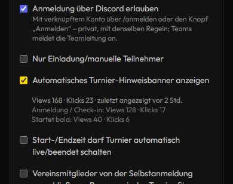

   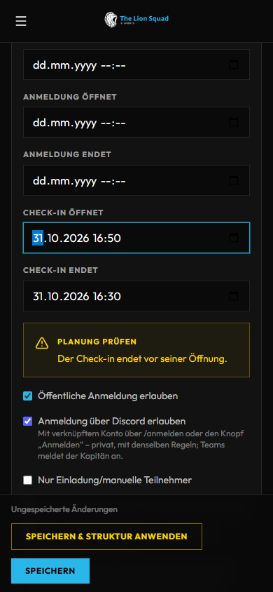
6. Weiter unten, aufklappbar: **Darstellung und Regeln** (**Adresse (URL)** – sie folgt dem Titel, bis du sie selbst
   änderst –, Plattform, Beschreibung, Banner, **Regeln**, Partner), **Spieloptionen** (Best of, **Setzliste**,
   Weiterkommen bzw. Spieltage auslosen, Spiel um Platz 3), **Preise**, **Streaming und externe Links** (Plattform,
   **Kanal oder Adresse**, Haken **Stream auf der Turnierseite zeigen**). Das Formular zeigt nur, was zu Format und
   Austragung passt (3.2). Schreibt die **Regeln** hinein, bevor die Anmeldung aufgeht – was ihr festlegt (Frist bis zum
   Forfeit, Streitfall-Ablauf, Beweise), steht dann für alle fest.
7. **Turnier erstellen**. Du landest im Turnier.

**Turnier für ein Event (seit #1371):** Ein Turnier gehört zu einem Event, wenn du es **im Event** anlegst oder dort
hinzufügst – nicht im Turnier. Event öffnen → Abschnitt **Programm** → **+ Turnier in diesem Event**. Das Formular kommt mit
Ort, Tag, Partnern und den Discord-Einstellungen des Events; der Tag muss im Zeitraum des Events liegen. Ein schon
angelegtes Turnier holst du dort über **Bestehendes hinzufügen**, **Lösen** nimmt es wieder heraus. Im Turnier steht nur
noch die Zeile „Gehört zu … – ändern im Event“, und der Ort kommt vom Event (ein eigener Ort nur ohne Event). Gibt es schon genug Teilnehmer, steht die Meldung „Vorschau mit n
   Spielen angelegt“ da.

### 2.2 Anmeldung öffnen

1. Im Turnier oben im **Status**-Feld **Anmeldung offen** wählen. In der Liste geht es für Entwürfe auch mit dem
   Play-Symbol **Anmeldung öffnen**.
2. Prüfen: **Öffentliche Seite** (Link oben im Turnier) zeigt Anmeldung, Regeln und Preise.

### 2.3 Am Turniertag

1. **Check-in starten** (Knopf oben im Turnier).
2. Teilnehmer einchecken (3.3). Mit dem Ende des Check-ins steht der Baum (3.4).
3. **Turnier starten**.
4. Ergebnisse eintragen oder melden lassen (3.6).
5. Im Status **Beendet**, danach **Ergebnisse veröffentlicht** (3.10).

---

## 3. Die Funktionen einzeln

### 3.1 Formate und Strukturen

Das **Format** steht beim Anlegen und später unter **Turnier öffnen → Bearbeiten → Abschnitt „Struktur“ →
Turnierstruktur**. Zwei Spielarten gibt es: **Duell** (zwei Seiten) und **Mehrspieler** (viele in einer Lobby, gewertet nach
Platzierung).

| Format | Wofür |
| --- | --- |
| **K.-o.** (früher „Single Elimination“) | Ein Abend, ein Sieger; wer verliert, ist raus. Mit Haken „Spiel um Platz 3“ möglich |
| **Doppel-K.-o.** (früher „Double Elimination“) | Eine Niederlage ist nicht das Aus (Loser Bracket) |
| **Jeder gegen jeden – einfach** | Kleines Feld, alle spielen einmal gegeneinander, die Tabelle entscheidet |
| **Jeder gegen jeden – Hin- und Rückrunde** (früher „Liga“) | Über Wochen mit Spieltagen, jeder spielt zweimal gegen jeden. Unter dem Format steht der Weg zur Vereinsliga mit Seasons und Staffeln (**Admin → eSports → Liga**, 3.15) – die ist etwas anderes |
| **Schweizer System** | Viele Teilnehmer, kein fester Baum; die Runden entstehen einzeln aus den Ergebnissen |
| **Gruppenphase** | Teilnehmer in Gruppen, jeder spielt mehrere Partien. Eine K.-o.-Runde danach gibt es im selben Turnier noch nicht – die Besten spielen sie als eigenes Turnier |
| **Mehrspieler frei** | Alle gleichzeitig in einer Lobby, **ein** Spiel mit allen, gewertet nach Platzierung. Turniere im früheren „Überlebensmodus“ (verhielt sich genauso) heißen jetzt auch so |
| **Freier Turnierbaum** und **Mehrspieler freier Turnierbaum** | Ihr schreibt den Baum selbst (Schema); im Mehrspieler-Baum gibt es Läufe über mehrere Ebenen |
| **Zeitfahren**, **Rennserie** | Beim Anlegen **nicht mehr zur Wahl**: es entstehen keine Spiele und es gibt keine Zeiteingabe. Zeitfahren laufen über [Fast Lap](fastlap.md), Rennserien über **Serien**. Bestehende Turniere behalten ihr Format, mit diesem Hinweis darunter |

Auf der Turnierseite gibt es den Reiter **Turnierbaum** nur bei Formaten mit Baum. Bei **Jeder gegen jeden** (beide),
**Zeitfahren** und **Rennserie** fehlt er; im laufenden Turnier ist dort – und bei **Schweizer System** und
**Gruppenphase** – die **Rangliste** der Hauptknopf. Der Hinweis im Baum sagt je Format, wie gespielt wird. Die
Ablauf-Leiste über der Turnierverwaltung nennt den Schritt je Format („Spielplan“, „Runden“, „Gruppen“, „Läufe“).

Zu den Besonderheiten:

- **Schweizer System:** Es gibt keine Vorschau. Teilnehmer bestätigen, dann oben im Turnier **Schweizer Runde**
  klicken – jede Runde einzeln. Die Runde startet das Turnier nicht: nach Runde 1 wie gewohnt **Turnier starten** (mit
  Check-in-Ende und Planungsprüfung). Eine falsch erzeugte Runde nimmt **Runde N zurücknehmen** (neben **Schweizer
  Runde**) wieder heraus, solange keines ihrer Spiele aufgerufen, gestartet oder gewertet ist und keines an einer
  Station hängt; ein Freilos zählt nicht.
- **Gruppenphase:** Oben **Gruppen generieren**, die Zahl der Gruppen eintippen (Vorschlag 4). Im Reiter **Gruppen**
  stehen sie. Der Status bleibt dabei, gestartet wird mit **Turnier starten**. Gibt es schon feste Gruppenspiele, fragt
  die Seite vorher nach und nennt die Zahl („12 Spiele, davon 3 begonnen oder gewertet“) – neue Gruppen löschen sie
  samt Ergebnissen. Nach dem Ende und bei gesperrtem Turnier gibt es keine neuen Gruppen.
- **Jeder gegen jeden und Gruppen (online oder hybrid):** Unter **Bearbeiten → Spielweise** erscheint der Kasten **Spielwochen**:
  **Spieltag dauert (Tage)**, **Standardtag**, **Standarduhrzeit** (Wiener Zeit) und **Antwortfrist (Stunden)**. Ein
  Spieltag ist ein Zeitraum. Beide Seiten dürfen Termine vorschlagen, was die Gegenseite annimmt, gilt, sonst greift
  die Standardzeit. Ein vereinbarter Termin bleibt, auch außerhalb der Woche. Antwortet die Gegenseite nicht in der
  Frist, bekommt die Turnierleitung eine Meldung. Spielwochen gibt es nur online und hybrid: vor Ort fehlt der Kasten,
  eine Gruppenphase **vor Ort** plant der Spielplaner auf Stationen (siehe 3.8).
- **Freier Turnierbaum:** Unter **Bearbeiten → Struktur** erscheint das Feld **Schema** (beim Mehrspieler-Baum dazu
  **Spielgröße** und **Qualifizierte**). Ein Beispiel-Schema steht als Vorgabe darin. Anschließend unten
  **Speichern & Struktur anwenden**, dann im Reiter **Turnierbaum** prüfen.
- **Läufe umbauen (Mehrspieler-Baum):** Ist das Turnier nicht voll oder fallen Fahrer aus, werden unterbesetzte Läufe
  zusammengelegt (2 + 2 wird ein Lauf mit 4), ausgeglichen oder das Turnier wird abgekürzt (der Lauf mit allen Verbliebenen
  ist das Finale). Unter **Bearbeiten → Spieloptionen → Läufe umbauen** wählst du **Vorschlag** (Standard: der Vorschlag
  steht als Leiste oben in der Turnierverwaltung, du bestätigst oder lehnst ab) oder **Automatisch**. Auffüllen und
  Freilose laufen immer von selbst; laufende und aufgerufene Läufe werden nie umgebaut.
- **Sehr viele Begegnungen:** Bei Jeder gegen jeden mit sehr vielen Teilnehmern zeichnet das System keinen
  Entwurf. Dann Teilnehmerzahl senken oder Gruppen nutzen.
- **Setzliste** (Spieloptionen): **Zufall** oder **Manuell** – Manuell ordnet nach dem **Setzplatz**, ohne Setzplatz nach
  der Anmeldereihenfolge. Die frühere Option „Ranking“ verhielt sich genauso; ein gespeichertes „Ranking“ steht als
  Manuell da. Den Setzplatz trägst du beim Hinzufügen ein oder – bei „Manuell“ – bis zum Ende des Check-ins in der
  Spalte **Setzplatz** der Teilnehmerliste (Feld verlassen oder Enter speichert, leer nimmt ihn weg; die Vorschau ordnet
  sich neu). Jeden Setzplatz gibt es nur einmal – ist er vergeben, sagt die Meldung, wer ihn hat. Danach steht der Baum,
  und die Spalte verschwindet.

Ob der Baum Vorschau oder fix ist, siehst du im Reiter **Spiele** (Hinweis „Vorschau“). Phasen entstehen aus dem Format;
anlegen, umbauen oder löschen lassen sie sich nicht von Hand. **Regeln dieser Phase** (Austragung, Ergebniserfassung,
Terminplanung, Spieldauer, Weiterkommen) stellt die Turnierleitung je Phase unter der Phase ein.

**Format ändern und was ab dem Check-in-Ende feststeht (seit #2120):**

- Bis zum Ende des Check-ins darfst du **Turnierstruktur**, **Teilnahme** und **Spieler pro Team** ändern; beim
  **Speichern** baut sich die Vorschau gleich neu (aus K.-o. wird wirklich Doppel-K.-o.). Bei **Teilnahme** und
  **Spieler pro Team** bleibt die Phase, wie sie ist (Name, Best of, Schema), samt geplanter Zeiten und Stationen.
  Eine eigene Phase (anderer Name, eigene Einstellungen oder mehrere Phasen) baut ein Formatwechsel nicht still um –
  die baust du mit **Speichern & Struktur anwenden** neu.
- Ab dem Ende des Check-ins (oder sobald es feste Spiele gibt, etwa generierte Gruppen) stehen **Turnierstruktur**,
  **Teilnahme**, **Spieler pro Team** und **Spiel** nur noch lesend da, und **Speichern & Struktur anwenden** fehlt.
  Beim Schweizer System, bei Zeitfahren und Rennserie gibt es den Knopf nie – dort gibt es keinen Baum zum Vorausbauen.
  Im Reiter **Spiele** fehlen dann **Vorschau** und **Mit Teilnehmern generieren** (bei einer neuen, leeren Phase bleibt
  Generieren). Eine Vorschau ersetzt nie echte Spiele.
- **Zurücksetzen** (Werkzeuge) löscht alle Spiele, der Status bleibt. Stehen schon feste Spiele, nennt die Rückfrage die
  Zahl („12 Spiele, davon 3 begonnen oder gewertet“); erst **12 Spiele löschen** setzt zurück. Nach dem Ende (Beendet,
  Ergebnisse veröffentlicht, Archiviert) gibt es kein Zurücksetzen mehr – Platzierungen, Punkte, Pokale und Gewinne
  hängen am Baum.

### 3.2 Online, Vor Ort, Hybrid

Im Kasten **Wie gespielt wird** (beim Anlegen) bzw. **Bearbeiten → Spielweise** stehen drei Voreinstellungen. Darunter
lassen sich die drei Werte einzeln ändern (**Austragung**, **Ergebniserfassung**, **Terminplanung**).

| Voreinstellung | Ergebnisse | Termine | Check-in |
| --- | --- | --- | --- |
| **Online** | Spieler melden, die Gegenseite bestätigt | Spieler schlagen vor | Spieler selbst |
| **Vor Ort** | Turnierleitung (und Station-Crew) tragen ein | fix durch die Turnierleitung | Turnierleitung |
| **Hybrid** | Staff kann eingreifen, Spieler können melden | gemischt | Spieler selbst |

Lasst ihr **Ergebniserfassung** und **Terminplanung** auf „Automatisch“, gilt die Regel der Zeile oben. Eine Angabe an
einem Spiel geht vor der einer Phase, die vor der des Turniers. Die Liste der Turniere zeigt die geltende Regel als
Schilder an. Eine Warnung erscheint, wenn die Mischung nicht passt (zum Beispiel „Vor-Ort-Turnier mit
Spieler-Ergebnismeldung“).

**Auto-Start:** Der Haken „Turnier anhand Start-/Endzeit automatisch live/beendet schalten“ ist nur für Online-Turniere
gedacht. Beim Anlegen fehlt er vor Ort (und ist aus); beim Bearbeiten steht er vor Ort nur noch, solange er an ist – mit
dem Hinweis, ihn auszuschalten. Vor Ort startet ihr selbst.

**Was das Formular je Format und Austragung zeigt (seit #2111):** Felder, die nichts bewirken, fehlen.

| Feld | Steht da |
| --- | --- |
| **Spielwochen** | Jeder gegen jeden und Gruppen, online oder hybrid |
| **Fristen** | „Nicht erschienen vor Ort“ vor Ort und hybrid; „Nicht erschienen online“ online und hybrid; „Ergebnis gilt online nach“ online/hybrid ohne Spielwochen; „Ergebnis gilt in Spielwochen nach“ in Spielwochen |
| **Weiterkommen** | K.-o., Doppel-K.-o. und freie Bäume; bei Jeder gegen jeden – Hin- und Rückrunde stattdessen **Spieltage auslosen** (Reihenfolge und Heimrecht) |
| **Best of** | nicht bei Zeitfahren und Rennserie; bei Mehrspieler heißt es **Runden je Lauf** und zählt für die geplante Dauer |
| **Mindestpause** | vor Ort und hybrid (nur der Stationsplaner hält sie ein) |
| **Preise Siegerrunde/Verliererrunde** | nur Doppel-K.-o. |
| **Vor-Ort-Anmeldung über QR** | vor Ort und hybrid |

### 3.3 Anmeldung, Startgeld und Teilnehmer

**So melden sich Spieler an:** Auf der öffentlichen Turnierseite mit **Jetzt anmelden** (in der Vor-Ort-Ansicht
**Mitspielen**). Das öffnet immer zuerst ein kurzes Blatt – am Handy von unten, am PC als Fenster – mit **Start**,
**Check-in**-Fenster, **Ort** (online oder vor Ort mit Adresse), **Startgeld** (falls eingestellt) und den **Regeln in
drei Sätzen**; **Alle Regeln** klappt den ganzen Text auf. Erst **Verbindlich anmelden** meldet an, **Abbrechen**,
das Kreuz oder die Escape-Taste nicht. Bei Team-Turnieren wählt die Teamleitung oder Co-Leitung im selben Blatt das Team;
fehlt dem Spiel eine Pflicht-ID (zum Beispiel Spielername), fragt das Blatt sie ab. Die drei Sätze kommen vom Anfang
eurer **Regeln** – schreibt das Wichtigste also nach oben.

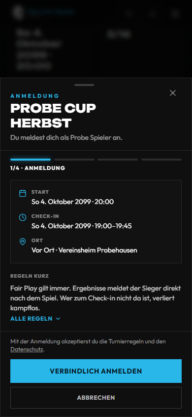

- Die Anmeldung gilt **sofort als Bestätigt**, solange Platz ist. Ist das Turnier voll, kommt die Person auf die
  **Warteliste**. Beides bekommt sie als Nachricht. Bei vollem Turnier sagt es schon das Blatt: „Der Cup ist voll – du
  kommst auf die Warteliste (Platz 3)“, der Knopf heißt dann **Auf die Warteliste**.
- Es geht nur im Status **Anmeldung offen** und im Zeitfenster **Anmeldung öffnet / endet**. Mit dem Haken
  **Nur Einladung** gibt es keine Selbstanmeldung.
- Selbst abmelden können sich Spieler nicht mehr, wenn sie eingecheckt sind, das Turnier läuft oder sie schon in festen
  Spielen stehen (etwa generierte Gruppen oder eine Schweizer Runde); dann geht es nur über die Turnierleitung. **Dein
  Stand** sagt das: „Abmelden und Angaben ändern nur noch über die Turnierleitung“, für Teammitglieder „… kann nur die
  Teamleitung“.
- **Angaben ändern** (in **Dein Stand**): Ingame-Name, Spieler-IDs und Discord lassen sich bis zum eigenen Check-in bzw.
  bis zum Check-in-Ende selbst korrigieren – bei Team-Anmeldungen nur von Teamleitung und Co-Leitung. Das gilt nur für diese
  Anmeldung, das Profil bleibt. In **Liga-Staffeln** sind Name und IDs gesperrt, weil die Spiel-ID je Season im Liga-Kader
  feststeht; nur Discord lässt sich dort ändern.
- **Abgelehnt:** **Dein Stand** sagt, dass die Turnierleitung abgelehnt hat, und bietet **Anmeldung entfernen** (solange
  das Turnier nicht läuft). Das nimmt die Anmeldung nur aus der Ansicht der Person; in der Teilnehmerliste bleibt sie
  **Abgelehnt**. Meldet sich die Person neu an, steht derselbe Eintrag als **Ausstehend** da, und die Turnierleitung bekommt
  eine Nachricht – auch bei vollem Turnier und ohne Warteliste. Dabei ist sie erst, wenn die Leitung bestätigt. Löscht die
  Leitung den Eintrag selbst, ist er weg, und eine neue Anmeldung gilt wieder nach den normalen Regeln.
- **Team-Einladungen:** Im Blatt **Einladen** auf der Teamseite stehen die offenen persönlichen Einladungen mit
  **Zurückziehen**. Lehnt jemand ab, bekommt die einladende Person eine Nachricht. Die Teamleitung kann das Team erst
  verlassen, wenn er die Leitung übergeben hat; das steht auf der Teamseite.

**Startgeld:** Kostet die Teilnahme etwas, steht es im Abschnitt **Startgeld** unter **Turnier öffnen → Bearbeiten**.
Den sieht und ändert nur der Bereich **Finanzen**. Wer anmeldet, übernimmt das Startgeld ausdrücklich (bei Teams der
Teamleitung für das ganze Team); ohne diese Bestätigung nimmt die Seite die Anmeldung nicht an. Bezahlt wird mit der
verbindlichen Teilnahme: Warteliste kostet nichts. Meldet sich jemand nach dem Abmelden wieder an (auch über die
Warteliste) oder bestätigt die Turnierleitung eine abgelehnte oder „nicht erschienene“ Anmeldung wieder (auch beim Check-in),
und es gibt schon eine Rechnung (auch als
Entwurf, auch bezahlt), bleibt diese Rechnung: kein zweiter Rechnungsauftrag, die Anmeldung zeigt wieder diese Rechnung,
und die Finanzübersicht bekommt den Prüffall **Buchung nach dem Beleg geändert** mit altem und neuem Betrag. Die Nachricht
(Glocke, Mail, Discord) nennt dann keinen Betrag, sondern sagt, dass es schon eine Rechnung gibt und der Verein sie prüft.
Das gilt für dieselbe Person mit demselben Team; meldet ein anderes Mitglied das Team neu an (auch nach einer
weggenommenen Ablehnung), bekommt es eine eigene Rechnung. Trägt die Turnierleitung einen **Ersatz** ein, gilt die
ersetzte Person als „nicht erschienen“, und ihr Startgeld-Auftrag schließt wie bei einer Absage. Eine voll gutgeschriebene oder aufgegebene Rechnung zählt nicht mehr: Dann gilt das aktuelle Startgeld mit
neuer Rechnung. Alles Weitere steht in [Abrechnung](../ABRECHNUNG.md).

**Reiter Teilnehmer** (Standard beim Öffnen):

- **Teilnehmer hinzufügen** (bei Teams: **Team hinzufügen**): Konto in der Personensuche wählen, oder ohne Konto als
  manueller Gast mit **Anzeigename**; dazu **Status** und **Setzplatz**. Ein Hinweis erscheint, wenn die Person nicht
  beim Event angemeldet ist, obwohl das Turnier es verlangt – eintragen geht trotzdem.
- Suche („Name, Discord, E-Mail oder Team suchen“) und Filter nach Status, mit Zähler und den Zahlen je Status.
- Je Zeile: die **Status-Auswahl** (nur für die Turnierleitung): Ausstehend, Bestätigt, Abgelehnt, Warteliste,
  Eingecheckt, Nicht erschienen. Beim Ablehnen fragt die Seite nach einem freiwilligen Grund; die Person bekommt eine
  Nachricht. Wird bis zum Ende des Check-ins ein Platz frei (Absage, **Nicht erschienen**, Entfernen), rückt die
  älteste Anmeldung der Warteliste von selbst nach und bekommt eine Nachricht. Danach entscheidet ihr (3.4).
- Der Knopf **Entfernen**. Abgehakt wird hier nicht mehr: Check-in, Rückgängig und **Nicht erschienen** stehen an
  einem Ort, im Reiter **Check-in** der Turnierleitung (3.4). Der Kasten **Zum Check-in** oben im Reiter führt dorthin;
  Freigeben, Ablehnen (Status-Auswahl) und **PDF Check-in** bleiben hier.
- Wer in einem festen Spiel steht, hat kein **Entfernen**, und **Ausstehend**, **Abgelehnt** und **Warteliste** sind in
  der Status-Auswahl gesperrt – in jedem Status, auch pausiert oder nach dem Ende. Sonst stünden im Baum Spiele mit
  einer Anmeldung, die es nicht mehr gibt. Vor dem Start: **Nicht erschienen** und ersetzen; im laufenden Turnier:
  **Austritt eintragen** oder **Disqualifizieren**.
- **Disqualifizieren** und **Austritt** (nur Strukturrollen, nur im laufenden Turnier): der erste Klick zeigt den
  Umbauplan in Worten („E: Lena kommt kampflos weiter.“), erst **Austritt eintragen** bzw. **Disqualifizieren** macht
  ihn wirksam; ein freiwilliger Grund geht in die Nachricht an die Person. Die Regeln: im K.-o. und Doppel-K.-o. kommt der Gegner kampflos weiter, ein
  Spiel, das schon läuft, wird gewertet – nie ein Eintrag ins Loser Bracket (anders als bei **Nicht erschienen** für
  ein einzelnes Spiel). In Liga und Gruppen gilt die 50-Prozent-Regel: weniger als die Hälfte der eigenen Spiele
  gespielt → alle Spiele annulliert und raus aus der Tabelle, sonst Rest kampflos verloren. Im Schweizer System
  bleiben die Ergebnisse, die Person wird nicht mehr gepaart. In Läufen rückt der Nächstplatzierte nach – mit Loser
  Bracket auf beiden Wegen: wer auf den Sieger-Weg nachrückt, verlässt dafür das Loser Bracket, dort rückt der Nächste
  auf, der letzte Platz wird ein Freilos. Wer im nächsten Lauf schon aufgerufen oder gefahren ist, bleibt dort. Wird
  die nächste Runde ausgelost (auch **Jetzt auslosen** je Weg und **Neu auslosen**), gilt dieselbe Reihe: wer
  ausgetreten ist, kommt in keinen Topf, die Nächsten rücken auf. Danach steht
  die Anmeldung auf **Ausgetreten** bzw. **Disqualifiziert**; setzen lassen sich diese Werte nur über den Umbauplan.
  Zurücknehmen geht über die Statusauswahl, mit demselben Recht wie das Eintragen und nur, wenn die Person in keinem festen Spiel
  mehr steht und im Baum ein Platz frei ist – sonst sagt die Meldung, warum nicht, und nichts ändert sich. Der Check-in
  bietet dafür nichts an, und wer disqualifiziert ist, kann sich nicht selbst abmelden.
- Bei Team-Turnieren steht unter jedem Team die Aufstellung (3.5).
- Oben im Turnier: Downloads **PDF Teilnehmer**, **PDF Check-in**, **PDF Anmeldung QR** (zum Aufhängen), **PDF Spiele**
  und **CSV Matchplan**.
- Mit **Speziallinks** (Kasten oben, nur Turnierleitung) schickt ihr einzelnen Personen einen Link, der anmelden darf.
- Anmeldungen über den Vor-Ort-Zugang tragen in der Liste das Zeichen **Vor Ort**.

**Vor-Ort-Anmeldung über QR (auch für Nicht-Mitglieder):** Bei Turnieren mit **Nur Mitglieder**, **Community** oder
**Intern** können vor Ort trotzdem Begleitpersonen oder Gäste mitspielen – über den QR-Code am TV oder am Aushang.

- Der Kasten **Vor-Ort-Anmeldung über QR** oben im Turnier (nur Turnierleitung) zeigt, ob der Zugang an ist und für
  welches Zeitfenster er gilt. Vorgabe: **an** bei Turnieren **Vor Ort** und **Hybrid**, **aus** bei **Online**.
  **Abschalten** bzw. **Einschalten** ändert das.
- Gültig ist der Zugang ab **Anmeldung öffnet** bzw. **Check-in ab** (das Frühere) bis zum Turnierende, nur solange
  das Turnier zwischen **Anmeldung offen** und **Pausiert** steht. Davor und danach gilt wieder die normale
  Sichtbarkeit – auch für einen weitergeleiteten Link.
- **Aushang drucken** öffnet ein A4-Blatt mit Turnier, Termin, Spiel und großem QR-Code. Der TV zeigt im
  Anmelde-Bildschirm denselben QR-Code, solange der Zugang gilt.
- **Neuer Code** macht den alten QR-Code und alle damit schon geöffneten Zugänge sofort ungültig – etwa, wenn ein Foto
  des Aushangs herumgeht. Danach den Aushang neu drucken; der TV zeigt den neuen Code von selbst.
- Wer scannt, sieht eine schlanke Turnierseite (Titel, Termin, Spiel, freie Plätze, **Mitspielen**). Ohne Konto geht es
  über Anmelden oder Registrieren und danach zurück zum Turnier. Regeln, Datenschutz, Fristen, Plätze und Warteliste
  gelten wie immer.
- Nach der Anmeldung sieht die Person das ganze Turnier – Baum, Spielplan, eigene Spiele, Ergebnis melden –, aber
  nichts anderes aus dem Mitgliederbereich. Meldet sie sich ab, ist das Turnier wieder verborgen.
- Wer den Link ohne Zugang öffnet (weitergeleitet, nicht Mitglied, nicht angemeldet), sieht „Dieses Turnier ist nur für
  Mitglieder bzw. über den QR-Code vor Ort sichtbar“ mit dem Hinweis, den QR-Code am Eingang zu scannen, und – ohne
  Konto – **Anmelden**. Ein Tippfehler im Link (oder ein verborgenes Turnier) zeigt „Turnier nicht gefunden“, ohne
  Netz kommt **Nochmal versuchen**.

  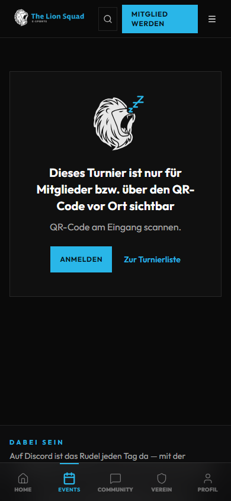

### 3.4 Check-in und der Wechsel zum festen Baum

- **Online/Hybrid:** Spieler checken auf der Turnierseite selbst ein (Knopf **Check-in**) – nur wenn ihre Anmeldung
  **Bestätigt** ist.
- **Vor Ort:** Der Knopf heißt für Spieler „Check-in vor Ort“ und ist gesperrt. Die Turnierleitung setzt den Haken –
  am Handy in der **Turnierleitung** (`/tournaments/<Name>/leitung`), Reiter **Check-in** (siehe unten).

**Reiter „Check-in“ der Turnierleitung (#1161).** Der eine Ort zum Abhaken – vor Ort, hybrid und online, Einzel und
Team, jedes Format. Ihn sehen nur Turnierleitung und Helfer mit **Organisation**, **Schiedsrichter**, **Ergebnisdienst**
oder **Stationsleitung** in diesem Turnier; im Status **Check-in offen** öffnet die Seite gleich dort.

- Oben steht **„13 von 16 da“** mit Balken, darunter, wer noch fehlt, wer nicht erschienen ist und wie viele
  Startgelder offen sind. Der Zähler stimmt sofort nach dem Tipp; klappt das Speichern nicht, springt die Zeile zurück
  und eine Meldung sagt warum.
- **Suche** nach Name, Spielname, Team-Kürzel oder – bei Teams – einem Mitglied. Filter **Fehlen noch**, **Da**, **Alle**.
- Je Zeile ein Tipp: **Da**, danach **Rückgängig**; darunter **Nicht erschienen**. Würde dabei jemand von der
  Warteliste nachrücken, fragt die Seite vorher („Dann rückt jemand von der Warteliste nach – das lässt sich nicht
  einfach rückgängig machen“); die Meldung danach nennt, wer nachgerückt ist. Ist danach alles voll, geht
  **Rückgängig** nicht mehr: „Inzwischen ist … nachgerückt – kein freier Platz mehr“. Das klärt ihr in der Verwaltung.
- Etiketten: **Startgeld offen** (nur, wenn wirklich etwas offen ist – bezahlt, gutgeschrieben oder aufgegeben trägt
  keines; den Betrag sehen nur Finanzen), **Freigabe offen**, **Vor Ort angemeldet**. Bei **Freigabe offen** steht statt
  **Da** der Weg **Erst freigeben** in die Verwaltung: Die Freigabe prüft Platz und Startgeld, danach wird abgehakt.
- **Teams** stehen als eine Zeile: mit Aufstellung („Spielt“, „Ersatz“) oder allen Mitgliedern, grün, wer schon
  **Ich bin da** getippt hat (3.5). Abgehakt wird das ganze Team.
- Zwei Helfer am Einlass sehen gegenseitig, was der andere abhakt. Jeder Tipp steht im Protokoll (wer, wann, von welchem
  Stand zu welchem). Die App nutzt denselben Weg.

  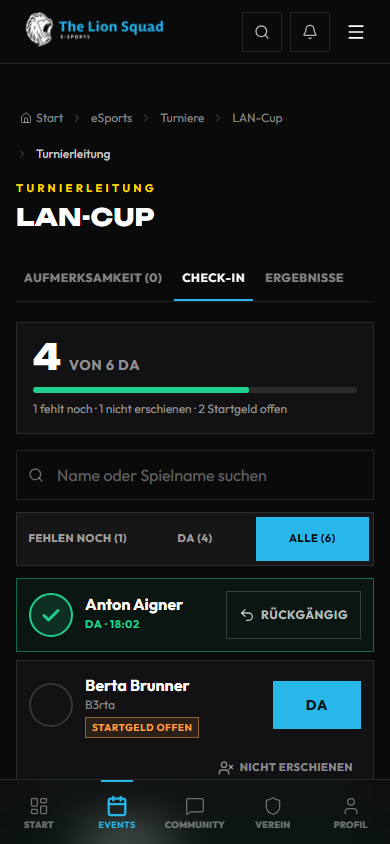

- **Check-in starten** (Hauptknopf oben im Turnier, solange noch kein Check-in läuft) setzt den Status **Check-in
  offen**. Der Baum bleibt bis zum Ende des Check-ins eine Vorschau; bis dahin rücken Wartende nach. Vor der
  eingestellten Zeit gestartet, steht **Check-in öffnet** danach auf dem wirklichen Beginn.
- **Ende des Check-ins** (die Zeit **Check-in endet**, oder **Turnier starten**, wenn keine Zeit gesetzt ist): Der
  Turnierbaum entsteht **nur aus den Eingecheckten**. Der Status bleibt **Check-in offen**, bis das Turnier startet;
  öffentlich steht „Anmeldung geschlossen“, und Spieler können nicht mehr selbst einchecken – statt des Knopfs steht
  **Check-in vorbei**, sobald „Check-in endet“ um ist (auch bevor der Baum gebaut ist). Endet der Check-in früher
  als eingestellt (**Turnier starten**), steht **Check-in endet** auf diesem Zeitpunkt. Die Zeitleiste der Turnierseite
  folgt dem Stand: Erreichtes ist abgehakt, was läuft, steht als „Check-in läuft“ bzw. „Turnier läuft“, ein Countdown
  nur für Kommendes.
- Ohne Check-in (direkt **Turnier starten**) kommen alle **Bestätigten** in den Baum.
- **Nachrücker** nach dem Ende des Check-ins: Wer jetzt eingecheckt, bestätigt oder über **Teilnehmer hinzufügen**
  eingetragen wird, übernimmt genau einen freien Platz – zuerst den einer Person mit **Nicht erschienen**, sonst einen
  leeren Platz neben einem **Freilos** (das Freilos-Spiel wird dann normal gespielt). Das geht, solange das erste Spiel
  dieses Platzes nicht begonnen hat; in Liga und Gruppen, solange höchstens ein Spieltag gespielt ist. Ist kein Platz
  frei, sagt die Seite es. Gezielt ersetzt **Teilnehmer hinzufügen** mit **Ersetzt Nicht-Erschienen** – auch eine
  Person mit Freilos.
- Teilnehmer im festen Baum lassen sich nicht einfach entfernen. Stattdessen **Nicht erschienen** setzen und ersetzen.
- **Weiterkommen (Gegner der nächsten Runde)** (Spieloptionen, auch je Phase; nur bei K.-o., Doppel-K.-o. und freien
  Bäumen – bei Jeder gegen jeden – Hin- und Rückrunde steht dafür der Schalter **Spieltage auslosen**), vier Modi:
  - **Fester Baum** (Standard): Die Zuordnung steht im Turnierbaum, Sieger aus A trifft Sieger aus B.
  - **Auslosung nach der Runde**: Erst wenn **alle** Spiele einer Runde fertig sind, kommen alle Weiterkommer in einen
    Topf und werden gleichmäßig auf die Spiele der nächsten Runde verteilt – echtes Los, auch zwei aus demselben Spiel
    können sich wiedersehen. Bis zur Auslosung steht im Baum, wer kommt: „Weiter aus Runde 1“ bei Läufen, „Sieger aus
    Viertelfinale“ bei Duellen.
  - **Show-Auslosung**: wie die Auslosung nach der Runde, nur lost erst die Turnierleitung. Ist die Runde fertig, steht
    im Baum „Auslosung bereit“; die **Turnierleitung am Handy** (Reiter „Braucht Aufmerksamkeit“) und der Kasten
    „Auslosung“ im Reiter Spiele zeigen „Auslosung bereit · N Namen“ mit dem Topf und dem Knopf **Jetzt auslosen**
    (Aufbau-Recht). Nach der eingestellten Zeit (Vorgabe 10 Minuten, je Turnier und Phase) erinnert der Server die
    Turnierleitung; nach noch einmal so viel Zeit lost er selbst.
  - **Sofort zufällig**: Ist ein Spiel fertig, kommt jeder Weiterkommer **sofort** auf einen zufälligen freien Platz
    der nächsten Runde (gleiche Runde und gleicher Abschnitt; Sieger und Verlierer landen ohnehin in getrennten
    Runden). Ein Spiel kann starten, sobald es voll ist – alles kann passieren. Im Baum fährt jeder Name einzeln über die
    Sammelschiene; freie Plätze zeigen weiter „Weiter aus Runde 1“ bzw. „Sieger aus Viertelfinale“.

  Für alle gemischten Modi gilt: Runde 1 steht ab dem Ende des Check-ins fest. Im Doppel-K.-o. wird im Loser Bracket
  nur innerhalb derselben Loser-Runde gemischt; laufen nur zwei Spiele in eines zusammen (Finale, Grand Final, Spiel um
  Platz 3), ändert sich nichts. Jede Auslosung bzw. Zuweisung steht mit Zeitpunkt, Person und Ergebnis im Protokoll.
  Wird ein Ergebnis korrigiert, bleibt der Platz und die Person wird getauscht; läuft das Zielspiel schon, gelten die
  Sperren wie bei jeder Korrektur. **Neu auslosen** (Reiter Spiele, Kasten „Auslosung“) geht, bis eines der Spiele der
  Runde aufgerufen oder gestartet ist – bei „Sofort zufällig“ nur für die Spiele, die noch nicht begonnen haben. Der
  Matchplan plant eine ausgeloste Runde erst nach **allen** Spielen davor („wartet auf Auslosung“); bei „Sofort
  zufällig“ gilt eine Prognose: Die Spiele der nächsten Runde füllen sich in ihrer Reihenfolge mit den Spielen davor in
  deren Reihenfolge – das echte Los entscheidet. Bei **Jeder gegen jeden – Hin- und Rückrunde** und in der **Liga** werden Reihenfolge der Spieltage und Heimrecht
  ausgelost (jeder spielt trotzdem genau einmal je Hin- und Rückrunde gegen jeden); **Spieltage neu auslosen** geht bis
  Spieltag 1 beginnt. Die Einstellung gilt, sobald der Turnierbaum neu gebaut wird (Vorschau oder Ende des Check-ins).
  Ältere Turniere mit dem früheren Haken „Zufällig mischen“ laufen als „Auslosung nach der Runde“ weiter.
- **Turnier starten** (Status **Live**) prüft vorher die Planung. Gibt es Konflikte oder Hinweise, fragt die Seite
  „Mit Hinweisen live schalten?“. Ohne ein spielbares Spiel lässt sich das Turnier nicht starten.

### 3.5 Aufstellung bei Team-Turnieren

Bei Team-Turnieren (Teilnahme „Team“) wählen Teamleitung oder Co-Leitung in **Dein Stand** auf der Turnierseite, wer
spielt: genau so viele wie **Spieler pro Team**, die übrigen sind Ersatz, wenn **Ersatzspieler erlauben** (Spieloptionen)
an ist. Das geht bis zum Ende des Check-ins. Am Turniertag tippt jedes Teammitglied **Ich bin da**.

Die Turnierleitung sieht es im Reiter **Teilnehmer** unter dem Teamnamen („Spielt: …, Ersatz: …“, „4 von 5 da“) und
beim Abhaken im Reiter **Check-in** der Turnierleitung als Namen je Mitglied. Ohne gewählte Aufstellung steht dort
„Keine Aufstellung – ganzes Team“.

### 3.6 Ergebnisse: melden, eintragen, korrigieren

**Online/Hybrid – Spieler melden.** Auf der Matchseite öffnen die Spieler **Ergebnis melden**: Stand mit Plus und
Minus, bei Best-of den Sieger je Spiel antippen, bei Mehrspieler-Spielen die Zielreihenfolge, auf Wunsch ein Foto und
eine Notiz. Meldet die Gegenseite dasselbe, steht das Ergebnis fest. Hat eine Seite gemeldet, sieht die andere die
Meldung in Worten (mit Foto) und bestätigt mit **Stimmt** – oder **Stimmt nicht**. Bei Teams bestätigt die Teamleitung.
Widerspricht die Gegenseite nicht, **gilt die Meldung nach der Frist**: online nach 15 Minuten, in Liga und Gruppen nach
48 Stunden, spätestens zum Ende der Spielwoche – die Gegenseite hat aber immer mindestens 24 Stunden. Ein Spiel, das mit
Zustimmung des Gegners außerhalb seiner Spielwoche stattfindet, gilt 48 Stunden nach der Meldung. Vor Ort bestätigt wie
bisher die Turnierleitung. Einspruch (3.7) bleibt
danach möglich, in der Liga bis zum Ende der Spielwoche.

Das **Foto** sehen nach der Bildprüfung alle Spieler des Spiels und die Turnierleitung; die eigene Seite sieht ihr Foto
nach dem Senden unter „Deine Meldung“. Wo nur die Turnierleitung einträgt oder das Turnier vor Ort läuft, zeigt die
Matchseite Gästen keinen Knopf „Login zum Ergebnis melden“.

**Was die Matchseite zeigt:** Bei Duellen den Stand, bei Läufen mit mehreren Spielern den **Platz** groß und die
Kacheln in Platzreihenfolge, darunter Punkte oder Zeit und den Startplatz. Jeder Teilnehmer steht dort genau einmal.

**Die Turnierleitung trägt ein.** Dasselbe **Ergebnis-Fenster** öffnet sich an vier Orten, mit denselben Feldern und
Wörtern:

| Ort | Weg |
| --- | --- |
| **Spiele** | Turnier öffnen → Reiter **Spiele** → am Spiel **Ergebnis eintragen** (nur, wenn das Turnier **Live** oder **Pausiert** ist und beide Seiten feststehen) |
| **Stationen** | Admin → eSports → Stationen → an der Station **Ergebnis eintragen** |
| **Turnierleitung am Handy** | `/tournaments/<Name>/leitung` → Reiter **Ergebnisse** → **Eintragen** |
| **Matchseite** | öffentliche Seite des Spiels |

Am Handy kommt das Fenster von unten, am PC steht es in der Mitte. Je nach Spiel gibt es:

- **Stand** mit großen Plus- und Minus-Knöpfen,
- **Best of**: je Spiel den Sieger antippen (nur, wo der höhere Stand gewinnt; wo der niedrigste gewinnt, gibt es den
  Stand),
- **Sieger** antippen (Spiele auf Zeit),
- bei Mehrspieler-Spielen **Reihenfolge antippen** (Platz 1 zuerst; ein zweiter Tipp nimmt zurück)
  oder **Punkte eintragen**; die Wahl merkt sich der Browser,
- die Schalter **Nicht erschienen** und **Aufgegeben** je Seite (nur eine Seite kann sie haben).

Unten zeigt ein Satz in Worten, was gespeichert wird („… gewinnt …“). Dann **Ergebnis speichern**. Danach
läuft **10 Sekunden lang** unten die Leiste **Rückgängig**. Erst nach Ablauf rückt der Baum weiter, und die Spieler
bekommen Bescheid.

**Korrigieren:** Am Spiel steht dann **Ergebnis korrigieren**. Pflicht ist ein **Grund der Korrektur** (mindestens fünf
Zeichen), er steht im Protokoll. In der Ansicht der Turnierleitung steht unter **Zuletzt eingetragen** der Knopf
**Korrigieren**. Das gilt auch für ein Spiel in Klärung, das schon ein Ergebnis hat.

**Inzwischen eingetragen:** Hat jemand anderes das Ergebnis eingetragen, während das Fenster offen war, fragt es
„Inzwischen ist ein Ergebnis eingetragen – als Korrektur speichern?“. **Als Korrektur speichern** zeigt das Feld für
den Grund. Die Meldungen des Servers sind deutsche Sätze ohne Kennungen; Notiz und Grund haben eine feste Länge
(Notiz 1000, Grund 500 Zeichen).

**Was der Server annimmt** (gleich für Ergebnis-Fenster, Meldung der Spieler und Wertung):

- Stand, Punkte und Zeit sind Zahlen ab 0 (Stand höchstens 1 000 000 000, Zeit höchstens 24 Stunden).
- Im K.-o. gibt es keinen Gleichstand – eine Seite muss gewinnen. In Gruppe, Liga und Swiss teilt Gleichstand den Platz.
- Best of 3 heißt: der Sieger hat genau 2 gewonnene Spiele, die Gegenseite weniger.
- Kommt ein anderer weiter, als zuerst eingetragen, setzt die Korrektur das Folgespiel zurück – auch wenn es schon
  gespielt ist. Das Protokoll hält fest, welches Spiel zurückgesetzt wurde und welches Ergebnis es hatte. Läuft im
  Folgespiel gerade das **Rückgängig**, wartet die Korrektur kurz.
- Ergebnis, Wertung und Klärung setzt nur das Ergebnis-Fenster bzw. die Entscheidung – nicht die Matchplanung.

**Wer darf eintragen?** Die Turnierleitung, und Helfer mit Ergebnis-Recht in ihrem Einsatz (Organisation,
Schiedsrichter, Ergebnisdienst; die Stationsleitung an ihrer Station). Die Ansicht am Handy zeigt nur Spiele, für die
du eingeteilt bist. Jede Eingabe steht im Protokoll.

### 3.7 Dispute: Streit um ein Ergebnis

Sagt ein Spieler, ein Ergebnis stimmt nicht, meldet er ein Problem (Grund, Text, auf Wunsch Foto). Das Spiel steht dann
auf **In Klärung**.

1. Die Turnierleitung sieht es in der Ansicht am Handy im ersten Reiter **Braucht Aufmerksamkeit (n)**: Meldung mit
   Grund, Foto und dem eingetragenen Ergebnis, dazu die Meldungen beider Seiten. Auf der Matchseite führt
   **Streitfall entscheiden** direkt dorthin. In der Kommandozentrale steht die Zahl unter **Ergebnis-Konflikte**.
2. Entscheiden: **Ergebnis bleibt** (ohne Ergebnis: **Weiter wie bisher**) oder **Ergebnis ändern** (ohne Ergebnis:
   **Ergebnis eintragen**), das öffnet das Ergebnis-Fenster.
3. Die **Begründung** ist freiwillig und geht an beide Seiten. Beide bekommen die Entscheidung als Benachrichtigung.
4. Wer gemeldet hat, sieht auf der Matchseite den Kasten **Deine Meldung**: Grund, Text und Stand – „Die
   Turnierleitung prüft“, „Das Ergebnis bleibt“ (mit Begründung) oder „Das Ergebnis wurde korrigiert“.

Der Reiter zeigt auch andere Fälle, zum Beispiel ein fehlendes Ergebnis oder eine **defekte Station**: Dort legt
**Umlegen** die wartenden Spiele auf eine freie Station. Erledigtes verschwindet von selbst.

**Nicht erschienen?** Ist die Frist eines Spiels um – vor Ort 10 Minuten ab Aufruf an die Station (vor der geplanten
Zeit aufgerufen: die geplante Zeit), online 15 Minuten ab Spielbeginn –, schlägt die Seite „kampflos verloren“ vor: eine Benachrichtigung an die Turnierleitung und ein Fall in
**Braucht Aufmerksamkeit** mit den Knöpfen **<Name> nicht erschienen** (die Seite verliert nur dieses Spiel, mit Grund
im Protokoll und unter ihren Strafen) und **+5 Min. verlängern**. Die Fristen stellt ihr im Turnier unter
**Erweiterte Spieloptionen → Fristen** ein (leer heißt Standard); eine Phase kann sie in ihren Einstellungen
überschreiben. Sobald eine Seite gemeldet hat, verschwindet der Fall, dann zählt die Meldung. **Liga-Staffeln** haben
diesen Vorschlag nicht, dort meldet sich **Ergebnis fehlt** ([Liga leiten, 3.2](liga.md#32-ergebnisse)).

Im **Lauf mit mehr als zwei Spielern** wertet **<Name> nicht erschienen** nicht den ganzen Lauf: Nur diese Person wird
markiert, der Lauf bleibt offen und wird mit den Anwesenden gefahren (Karte und Nachricht sagen „Lauf bleibt offen“).
Im Baum steht sie durchgestrichen, am TV als „nicht angetreten“, im Druck mit „n. e.“; die Warteschlange zeigt
zusätzlich „<Name> nicht erschienen“. Die Frist gilt je Person: Fehlen mehrere, tippt ihr jeden Namen einzeln an – der
Fall bleibt für alle offen, die noch nicht markiert sind. Im Ergebnis-Fenster ist **Nicht erschienen** bei ihr schon
gesetzt – ihr tippt nur die Anwesenden in Zielreihenfolge. Setzt ihr dort jemanden erst beim Eintragen auf **Nicht
erschienen**, wird er genauso markiert (mit Eintrag unter den Strafen). Danach steht sie auf dem letzten Platz. Wer
nicht erschienen ist, bekommt nie einen Sieger-Platz – was die Anwesenden nicht füllen, wird ein Freilos; mit Loser
Bracket gehen alle Nicht-Erschienenen auf den Verlierer-Weg (nach den Anwesenden, die nicht weiterkommen), ohne Loser
Bracket scheiden sie aus. Fehlen mehrere, teilen sie sich den letzten Platz; untereinander entscheidet der Setzplatz,
ohne Setzplatz der Sitzplatz im Lauf, wer einen der Plätze im Loser Bracket bekommt. Ist sie doch noch gekommen und
mitgefahren, nehmt ihr den Schalter im Ergebnis-Fenster zurück – dann fällt auch der Eintrag unter ihren Strafen weg.

### 3.8 Stationen

**Admin → eSports → Stationen** (Seite „Stationen & Spiel-Zuweisung“). Oben das **Aktive Turnier** wählen.

- **Einzelne Station** (Name, Gerätetyp, öffentlicher Hinweis) oder **Schnell-Setup** (Präfix und Anzahl, zum Beispiel
  „Switch“ mal 8) – nur für die Turnierleitung.
- **Station bearbeiten:** Der Stift an der Station ändert **Name**, **Gerät**, **Spiel** und **Hinweis** – ebenfalls nur für die
  Turnierleitung. Jede Änderung steht im Protokoll.
- **Spiel zuweisen** an einer Station: **Zuweisen** reserviert, **Direkt starten** startet gleich. **Starten** und
  **Freigeben** stehen an der belegten Station.
- **Zeitplan füllen** plant offene Spiele mit Vorschau, **Freie Stationen starten** startet, was bereit ist. Im
  Turnier öffnet **Werkzeuge → Planen** den Matchplan (unten): Der Spielplaner zeigt je Spiel Zeit und Station,
  dazu Konflikte, und schreibt erst bei **Übernehmen** alles auf einmal. Er plant ab jetzt (Erledigtes und Laufendes
  bleibt), hält die Reihenfolge des Turnierbaums ein (spätere Runden stehen als „voraussichtlich“), setzt keinen
  Spieler zweimal gleichzeitig an und hält die **Mindestpause** (Bearbeiten → Erweiterte Spieloptionen, Vorgabe
  5 Minuten) ein. Von Hand gesetzte Termine bleiben stehen; liegen sie zu früh oder doppelt, meldet die Vorschau das
  rot. Nebenbei (Statuswechsel, An- oder Abmeldung) wird nicht mehr geplant. Online-Turniere bekommen keine Stationen.
  Kennt das Spiel **Geräte für Stationen** (3.12), nimmt der Planer nur Stationen mit passendem Gerätetyp; die Dauer je
  Spiel kommt aus der einen Dauer-Regel (3.12).
- **PDF Hochformat / Querformat** liefert einen Aushang der Stationen.
- Der Status einer Station (frei, belegt, reserviert, defekt) lässt sich ändern.
- **Belegung je Station** zeigt dieselbe Zeitleiste wie der Matchplan (unten), live; **Im Matchplan öffnen** springt
  in den Reiter des Turniers. Ein Lauf zeigt alle seine Spieler.

**Matchplan** (Turnier öffnen → Reiter **Matchplan**) ist das Werkzeug der Turnierleitung am Turniertag:

- **Oben die Planung:** Turnierstart, **Mindestpause** zwischen zwei Spielen, **Puffer je Spiel** (Luft, die auf jede
  Spieldauer kommt – nicht auf eine Dauer, die am Spiel selbst steht), die Spieldauer mit Herkunft („vom Spiel:
  12 Min. (Grand Prix) + 8 Min. Puffer“) und die Stationen des Turniers. Ändern darf das die Turnierleitung über alle
  Turniere; alle anderen sehen die Werte.
- **Automatisch planen** zeigt die Vorschau des Spielplaners: geänderte Spiele hell umrandet, gestrichelt, wo sie
  vorher lagen, Konflikte in Worten. Erst **Übernehmen** schreibt. Hat sich der Plan inzwischen geändert, steht das da,
  und die Seite plant neu – geschrieben wird nie etwas anderes als gezeigt.
- **Wer wartet auf wen:** der Ablauf von links nach rechts; antippen zeigt, was ein Spiel braucht und wer danach
  darauf wartet. Gestrichelter Rahmen = Prognose (die Spieler stehen noch nicht fest).
- **Zeitleiste je Station:** Balken je Spiel, Länge = Dauer. Winner Bracket blau, Loser Bracket violett, Finale gold,
  läuft rot mit Spielzeit, erledigt grau, Konflikt orange, feste Termine mit Nadel. **Ziehen** legt ein Spiel auf eine
  andere Zeit oder Station und macht den Termin fest; ein belegtes Feld wird schon beim Ziehen orange. Mit der
  Tastatur: Spiel wählen, **Enter** nimmt auf, **Pfeiltasten** verschieben (5 Minuten, mit Umschalt 15, hoch und runter
  die Station), **Enter** legt ab, **Escape** bricht ab. **Termin lösen** gibt einen festen Termin an den Planer
  zurück.
- **Ändern** (in der Liste, am Handy am Spiel): Start, Station und eigene Dauer eines Spiels von Hand – eine leere Dauer
  erbt (daneben steht, woher), ein leerer Start gibt das Spiel an den Planer zurück. Das ersetzt die frühere
  „Matchplanung“ an den Spielkarten; im Reiter **Spiele** stehen nur noch Phasen, Spiele und Ergebnisse.
- **Baum noch Vorschau** (vor dem Ende des Check-ins): die Spiele stehen schon da, ohne Zeit; geplant wird, sobald der
  Baum fix ist. Kann der Planer nicht antworten oder fehlt das Recht, steht das als Hinweis da.
- **Live:** Oben steht der Verzug aus der Warteschlange („+11 Min. – Finale jetzt ca. 20:51“), die Zeitleiste
  zeigt, wie der Rest nachrückt. Vor Ort steht darunter die **Warteschlange je Station** (läuft, als Nächstes mit
  **Aufrufen**/**Gestartet**, Aufruf und Frist „nicht erschienen“, danach). Im laufenden Turnier vor Ort schreibt der
  Matchplan keine Zeiten mehr: **Prognose ansehen** zeigt die Vorschau ohne **Übernehmen** – die Warteschlange rückt
  von selbst nach, die geplanten Zeiten bleiben als Vergleich für den Verzug. Von Hand ändern und ziehen geht weiter.
- **Am Handy** steht statt der breiten Zeitleiste je Station eine Liste: was läuft, was als Nächstes kommt.
- **Online** gibt es keine Stationen: der Matchplan zeigt die Runden mit Fristen je Spiel (offen seit, „nicht
  erschienen“ ab, Ergebnis gilt ab). **Liga:** Spielwochen mit Frist und dem geltenden Termin (vereinbart, Heimrecht,
  Standardzeit).

Ein Spiel gilt auf dem Aufruf-TV als aufgerufen, sobald es einer Station zugewiesen und noch nicht gestartet ist. Mehr
in [TV und Beamer](tv.md).

Auf der öffentlichen Seite **Spielplan** sehen Zuschauer und Spieler denselben Plan: **Nach Runden** als Karten wie im
Turnierbaum oder, sobald Stationen vergeben sind, **Nach Stationen** als Liste je Station nach Zeit. Ein laufendes Spiel
steht in Rot mit Spielzeit, spätere Runden mit „voraussichtlich“. Angemeldete filtern mit **Nur meine Spiele**. Die
Seite rechnet nichts selbst – Zeit und Station kommen aus dem Spielplaner.

**Live vor Ort: die Warteschlange je Station.** Vor Ort ist der Plan eine Prognose – während des Turniers zählt die
Warteschlange. In der Turnierleitung am Handy (`/tournaments/<slug>/leitung`) steht dafür der Reiter **Stationen**
(nur bei Turnieren vor Ort mit Stationen):

- Je Station: was **läuft** (mit Spielzeit-Uhr „12:34 / 30 Min.“, gelb ab 80 %, rot ab der vollen Dauer), was **als
  Nächstes** kommt und was **danach**. Oben steht der Verzug, zum Beispiel „+11 Min. · Finale jetzt ca. 20:51“.
- Wird eine Station frei, rückt das nächste bereite Spiel nach – an die Station, die zuerst frei ist. Ein Spiel wartet
  nur auf seine eigenen Vorspiele (die Linien im Baum), nicht auf die ganze Runde. Steht ein Platz noch nicht fest,
  heißt es „wartet auf die Vorspiele“, bei der Show-Auslosung „wartet auf die Auslosung“, und die Zeit „voraussichtlich“.
- Bereite Spiele (alle Plätze besetzt) stehen an jeder Station vor denen, die noch warten: Ein Lauf, der auf die
  Auslosung oder auf Vorspiele wartet, nimmt keiner Station das **Aufrufen**. Gibt es mehrere bereite Spiele, bekommt
  jede freie Station eines – vier bereite Läufe laufen auf vier Stationen, nicht nacheinander auf zweien.
- Ein bereites Spiel an einer freien Station hat die Prognose **jetzt**. Spielt jemand am selben Event in einem
  zweiten Turnier, verschiebt das die Prognose nur, wenn sein Spiel dort schon **läuft** oder **aufgerufen** ist – ein
  dort bloß geplantes Spiel nicht. Spätere Spiele plant der Planer weiter um diese Termine herum.
- **Aufrufen** reserviert die Station und schickt den Spielern „Du bist dran“ (Postfach und Push, bei Teams an die
  Aufgestellten). Danach steht dort „Aufgerufen · antreten bis … · nicht erschienen ab …“; die Frist „nicht erschienen“
  (3.7) zählt ab dem Aufruf. Wer vor der geplanten Zeit aufgerufen wird, hat bis zur geplanten Zeit – dann nennen
  „antreten bis“ und „nicht erschienen ab“ dieselbe Uhrzeit.
- **Gestartet** setzt die echte Startzeit. Ab da läuft die Uhr, und **Ergebnis fehlt** zählt erst ab diesem Start
  (Dauer plus 5 Minuten) – ein Spiel, das an seiner Station noch wartet, hat Verzug, aber kein fehlendes Ergebnis.
- Rufen zwei Helfer gleichzeitig auf, gilt genau ein Aufruf; der andere bekommt „Die Station hält inzwischen ein anderes
  Spiel“ und sieht den neuen Stand. Ein schon aufgerufenes Spiel lässt sich nicht still an eine andere Station rufen.
  Knöpfe sieht, wer Stationen bedienen darf (Organisation, Schiedsrichter, Stationsleitung; Helfer mit einer Station nur
  dort).
- **Planen/Übernehmen** verschiebt ein aufgerufenes Spiel nicht; im laufenden Turnier vor Ort zeigt der Matchplan nur
  noch die Prognose. Die geplanten Zeiten bleiben stehen; der Verzug ist der Abstand der Prognose zu ihnen.

<table><tr><th>PC</th><th>Handy</th></tr><tr>
<td>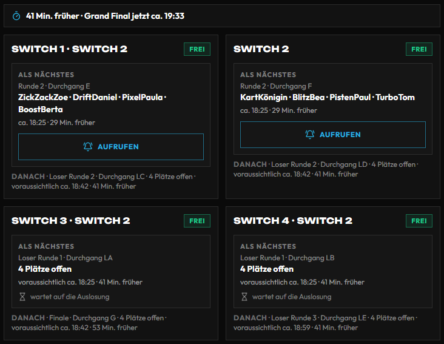</td>
<td>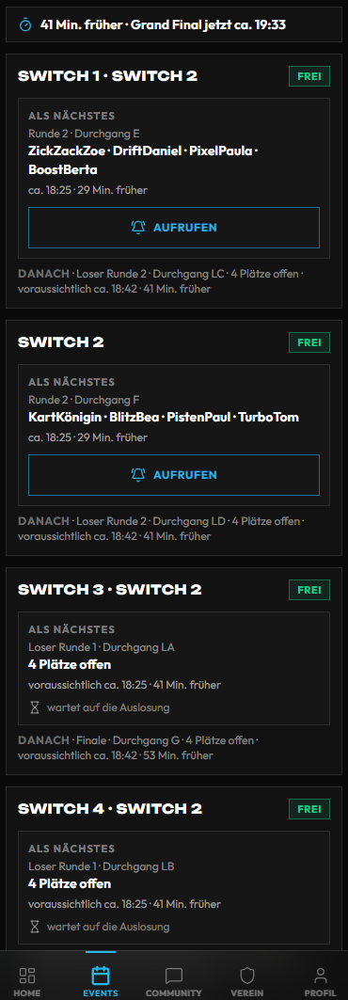</td>
</tr></table>

Spieler sehen auf der Turnierseite unter **Dein Stand** und oben im **Spielplan** „Du bist als Nächstes an Station 2 ·
ca. 18:40“ (oder „Läuft“, „Du bist dran“), auf der Matchseite steht dasselbe für das Spiel. Im Spielplan **Nach
Stationen** steht je Station „Jetzt“ mit Spielzeit und „Als Nächstes“, darüber der Verzug. Online-Turniere haben keine Stationen und keine
Warteschlange – dort gelten die Fristen.

### 3.9 TV

Den Turnierbaum für Fernseher oder Beamer erstellt ihr im Turnier mit dem Link **TV-Link** (oben neben „Öffentliche
Seite“), Einrichtung und Grundwerte stehen in [TV und Beamer](tv.md). Beim Status **Pausiert** gibt es **Pause bis**,
der TV zählt dann herunter. Im Reiter **Turnierbaum** setzt ihr „Runde präsentiert von“.

Bei **Liga, Jeder gegen jeden, Schweizer System und Gruppen** zeigt der TV nach den Spieltagen die Folie **Tabelle**
(gleich lang wie der Spielplan, bei Gruppen je Gruppe eine Tabelle) – ohne dass ihr die Wiedergabeliste ändert. Kopfzeile
und QR-Code sagen dort „Tabelle“ und führen zur Rangliste. Ist das Turnier beendet, kommt der **Sieger aus Platz 1** der
Tabelle mit seiner Siegerkarte (bei Gruppen und bei Gleichstand auf Platz 1 nicht).

### 3.10 Abschluss

1. **Beendet** (Status-Auswahl im Turnier, mit Rückfrage): Die Spiele sind durch. Alle Beteiligten bekommen einmal die
   Nachricht „Turnier beendet“; die Erfolge der Teilnehmer werden neu ausgewertet.
2. **Ergebnisse veröffentlicht** (nur Turnierleitung, nicht Helfer; die Rückfrage nennt die Folgen): Jetzt vergibt das
   System die **Punkte für die Jahreswertung** (Gewicht unter Spieloptionen: Major, Normal, Mini, Fun-Wertung … oder
   „Keine Jahreswertung“), die Auszeichnungen und legt die **Gewinn-Einträge** an (zu sehen unter **Admin → eSports →
   Gewinne**). Im Bearbeiten-Formular erzeugt **Gewinne erzeugen** (Abschnitt Preise) die Einträge bei Bedarf noch
   einmal – erst ab **Beendet**, vorher ist der Knopf gesperrt (sonst gäbe es Gewinne für einen Zwischenstand).
   **Sonderpreise** hängen an keinem Platz; die legt ihr unter **Gewinne** mit **Gewinn hinzufügen** von Hand an:
   Turnier wählen, Gewinner suchen, Platz (bei Sonderpreisen eine freie Zahl), Preis, Wert und auf Wunsch eine
   Abholfrist (gilt bis zum Ende des Tages). **Bearbeiten** in jeder Zeile ändert Preis, Wert und Frist; wer gewonnen
   hat, bleibt. Eine eigene Frist setzt **Frist zurück auf 90 Tage ab „Bereit“** (oder das geleerte Feld) wieder auf
   den Standard: offen ohne Frist, bereit 90 Tage ab dem Bereitstellen. Ein Hand-Gewinn verdrängt den Preis aus der
   Preisstruktur nicht – beide stehen dann in der Liste.

   **Korrektur nach dem Veröffentlichen:** Status zurück auf **Beendet**, Ergebnis korrigieren, wieder **Ergebnisse
   veröffentlicht**. Die Jahreswertungs-Punkte des Turniers werden dabei an die neue Rangfolge angeglichen (in der
   Jahreswertung, in der sie schon stehen; auch nach einem Wechsel Mini/Normal/Major gibt es je Person nur einen
   Eintrag; „Keine Jahreswertung“ nimmt sie zurück), der Abgleich steht im Protokoll. Ist diese Jahreswertung schon
   abgeschlossen oder archiviert, bleiben ihre Punkte unverändert – eine Meldung sagt das beim Veröffentlichen, das
   Protokoll vermerkt „übersprungen“. Fehlende Gewinne kommen dazu;
   ein Gewinn, dessen Platz nicht mehr stimmt, wird nie entzogen, sondern steht unter **Gewinne** mit **Nach Korrektur
   prüfen**.

   **Gewinne übergeben** (Admin → eSports → Gewinne): Ein neuer Gewinn ist **Offen** und hat noch keine Frist. Mit
   **Bereit** liegt er zur Abholung bereit: ab jetzt laufen **90 Tage** Abholfrist (eine von Hand gesetzte Frist
   bleibt), und der Gewinner bekommt Bescheid – in der Glocke, per Push und per Mail; bei Team-Gewinnen die
   Teamleitung. **Abgeholt** vermerkt die Übergabe (mit Nachricht). **Zurück** holt einen versehentlich abgehakten
   Gewinn auf „Bereit“ – ohne neue Nachricht. Nur „Bereit“ verfällt nach Ablauf der Frist (mit Nachricht); **Wieder
   öffnen** gibt einem verfallenen Gewinn eine neue Frist. Jeder Schritt und jedes Löschen steht im Protokoll.
3. **Archiviert** oder **Abgesagt**: ebenfalls nur Turnierleitung. **Abgesagt** fragt nach einem freiwilligen Grund;
   alle, die angemeldet sind oder auf der Warteliste stehen (bei Teams jedes Mitglied), bekommen einmal „Turnier
   abgesagt“ ins Postfach, per Push und – wenn sie Mails zu Turnier-Updates zulassen – per Mail, jeweils mit dem Grund. **Entwurf** fragt ebenfalls
   nach: die öffentliche Seite verschwindet, Angemeldete bekommen keine Nachricht.
4. **Sperren** (Werkzeuge, ab dem Status Beendet): Danach sind Ergebnisse, Teilnehmer, Spielzeiten und Stationen nur
   noch lesbar. Mit **Entsperren** geht es wieder.
5. Der Reiter **Rückmeldungen** erscheint nach dem Ende und zeigt die Rückmeldungen ohne Namen.
6. Nach dem Ende zeigt die Turnierseite das **Podest** (Platz 1 in der Mitte, 2 links, 3 rechts) – bei **Beendet**
   mit dem Hinweis „Stand vorläufig“. Erst mit **Ergebnisse veröffentlicht** bekommt, wer Platz 1 bis 3 belegt hat,
   beim nächsten Öffnen der Turnierseite einmal eine Karte „Champion“, „Zweiter Platz“ oder „Dritter Platz“ mit
   **Teilen** und **Turnierbaum** – einmal je Browser, nie zugleich mit einem Erfolg. Gleich stehende Teilnehmer teilen
   sich in der Rangliste den Platz (1, 1, 3) – beide bekommen Jahreswertungs-Punkte, Preis und Auszeichnung dieses
   Platzes, je Person einmal.

Die **Rangliste** zeigt bei Liga, Jeder gegen jeden und Schweizer System Spiele, Siege/Unentschieden/Niederlagen,
Differenz (beim Schweizer System Buchholz), die Form der letzten fünf Spiele und Pfeile, wie sich der Platz seit dem
vorigen Spieltag geändert hat. Bei der Gruppenphase steht je Gruppe eine eigene Tabelle. Im **K.-o.** stehen Siege,
Niederlagen und unter **Erreicht** die Runde aus dem Baum – etwa „Halbfinale“, „Loser Runde 4“ oder „Grand Final“, bei
mehreren Phasen mit der Phase davor (Punkte gibt es dort nicht). Bei **Läufen (FFA)** stehen Spiele, Siege, der Platz im
Schnitt und die Punkte. Die Namensspalte heißt bei Team-Turnieren „Team“. Die eigene Zeile ist markiert, bei
Team-Turnieren für alle Mitglieder des Teams.

In der Rangliste stehen nur **angenommene und eingecheckte** Anmeldungen – Warteliste, Ausstehend, Abgelehnt und Nicht
erschienen nie; wer mit Spielen ausgeschieden ist (disqualifiziert, abgemeldet), bleibt mit diesen Spielen drin. Im K.-o.
und bei Läufen gibt es Plätze erst mit dem **ersten Ergebnis** (ein Freilos zählt nicht) – vorher steht „Noch keine
Ergebnisse“. Die Turnierseite nennt den **Endplatz** in der Teilnehmerliste erst nach dem Ende.

Nach dem Ende stehen über der Rangliste **Ergebnis-PDF** (heißt „Rangliste“, mit denselben Spalten wie die Seite und bei
Gruppen je Gruppe einer Tabelle) und **Urkunden** (nur, wenn es Platz 1 bis 4 gibt – bei Gruppen nicht, dort fehlt noch
ein Endstand). **Drucken** öffnet die Tabelle in der Druckansicht ([3.13](#313-plan-b-auf-papier)).

Strafen stehen unter **Admin → eSports → Strafen**, die Jahreswertung unter **Admin → eSports → Jahreswertung**.

### 3.11 Turniertag mit wenig Helfern

- **Vor Ort** als Spielweise wählen: Ihr tragt Ergebnisse und Termine selbst ein, niemand muss Spieler hinterherrufen.
- **Helfer eintragen** unter **Turnier öffnen → Reiter „Team“ → Zuweisung hinzufügen**: Person, **Rolle**
  (Organisation, Schiedsrichter, Ergebnisdienst, Stationsleitung, Stream-Betreuung), **Bereich** (ganzes Turnier oder
  Phase, Gruppe, Station, Spiel – unter **Welche** die Auswahl aus diesem Turnier oder „Alle …“) und eine **Notiz**, zum
  Beispiel „Samstag Vormittag“. Der Helfer bekommt eine Nachricht mit dem Weg zu **Mein Dienst** und sieht nur dieses
  Turnier. Zwei Helfer reichen oft: einer am Check-in, einer mit dem Handy bei den Spielen („Ergebnisdienst“).
- **Werkzeuge → Planen** statt jedes Spiel einzeln zuzuweisen; Vorschau prüfen, dann **Übernehmen**.
- **Das Handy der Turnierleitung** (`/tournaments/<Name>/leitung`) trägt Ergebnisse ein, zeigt „Ergebnis fehlt“ und
  gibt Benachrichtigungen bei Problemen.
- **TV** aufstellen und aufrufen lassen, damit Spieler selbst sehen, wo sie hinmüssen.
- **Check-in**: Online-Spieler checken selbst ein, vor Ort hakt ihr am Handy ab (Turnierleitung → Reiter **Check-in**).
  **PDF Check-in** ist die Liste auf Papier, falls Netz oder Server ausfallen.
- **Plan B auf Papier** am Vorabend drucken: Baum bzw. Tabelle, Spielplan und Check-in-Liste ([3.13](#313-plan-b-auf-papier)).
- **Nicht erschienen** früh setzen, Ersatz einsetzen, und die Frist vorher in den Regeln nennen.

### 3.12 Spieldauer und Spiel-Daten

Wie lange ein Spiel geplant wird, steht an **einer** Stelle fest (seit #1554) – Planer, „Ergebnis fehlt“,
Planungsprüfung, Matchplan-Export, Turnierbaum und TV rechnen gleich:

1. **Dauer am Spiel selbst** (Matchplan → Matchplanung → **Dauer Min.**),
2. sonst die **Spieldauer der Phase**,
3. sonst die **Matchdauer des Turniers** (Bearbeiten → Erweiterte Spieloptionen),
4. sonst die **Dauer des Spielmodus** aus der Spiele-Verwaltung,
5. sonst **30 Minuten**.

Leere Felder erben. Neben jedem Dauer-Feld steht, was ohne eigenen Wert gilt, etwa **„vom Spiel: 15 Min. (Grand Prix
4 Rennen)“** oder **„vom Turnier: 45 Min.“**. Erzeugte Spiele und Phasen bekommen keine Dauer mehr hineinkopiert:
Änderst du die Matchdauer des Turniers oder die Dauer im Spiel, gilt das sofort für alle Spiele ohne eigenen Wert –
beim nächsten **Planen** stimmen die Zeiten. Ein neues Turnier lässt die Matchdauer leer und nimmt die des Spiels.

**Spiel archivieren statt löschen:** In der Spieleliste archiviert das Archiv-Symbol ein Spiel: Beim Anlegen (Turnier,
Liga, Serie, Referenz, Co-Team, Game-Server, Station) steht es nicht mehr zur Wahl, alles Bestehende zeigt und nutzt es
weiter, auch die Liste für die App. **Archivierte zeigen** blendet es wieder ein, dasselbe Symbol holt es zurück.
**Löschen** geht nur, wenn nichts mehr daran hängt; sonst nennt der Dialog die Zählung (etwa „2 Turniere, 12 Maps“) und
bietet das Archiv an.

**Die Spielseite:** **Admin → eSports → Spiele**, in der Zeile des Spiels das **Zahnrad** (oder der Name) öffnet
`/admin/games/<Spiel>`. Alles zu einem Spiel steht dort in vier Reitern; jeder Reiter lässt sich auch direkt per Adresse
öffnen (`#allgemein`, `#ids`, `#modi`, `#maps`):

| Reiter | Was dort steht |
| --- | --- |
| **Allgemein** | Name, Kurzname, **Art** (Einzelspiel, Hauptspiel / Serie, Spielversion), **Adresse** (eine geänderte leitet alte Links weiter), bei einer Spielversion das **Hauptspiel**, Logo und Cover, **Discord-Server** und **Discord-Rolle** |
| **Spiel-IDs** | Welche Spieler-ID die Anmeldung fragt: je Feld **Bezeichnung**, **Schlüssel**, **Hinweis für Spieler**, **Format**, **Beispiel**, **Auswahl** und die Haken **Pflichtfeld** und **Je Liga-Season nur einmal**. Der **Schlüssel** entsteht bei einem neuen Feld aus der Bezeichnung und ist nach dem Speichern fest – an ihm hängen die IDs der Spieler. Jedes Feld braucht einen eigenen; ergeben zwei Bezeichnungen denselben (etwa „PSN-ID“ und „PSN ID“), sagt die Seite es vor dem Speichern. Stehen unter einem Feld schon IDs (im Profil oder in einem Liga-Kader), fragt der Papierkorb mit der Zahl der Personen nach; ohne das Feld findet die Seite diese IDs nicht mehr. Legt ihr gleich danach ein Feld mit derselben Bezeichnung an, bekommt es den alten Schlüssel zurück. Dasselbe gilt, wenn ihr bei einer Spielversion die **ID-Quelle**, das **Hauptspiel** oder das Erben ändert: Gehen dadurch gespeicherte IDs verloren, fragt die Seite mit der Zahl der Personen, bevor sie speichert. Ein Spiel, an dem noch IDs hängen (auch unter seiner ID-Quelle oder in einem Liga-Kader), lässt sich nur archivieren, nicht löschen. Bei einer Spielversion dazu **ID-Quelle** und „IDs vom Hauptspiel verwenden“ |
| **Modi** | Die Modi mit Symbol, Dauer, Ergebnisregel und Einstellungen (unten), darunter die **Vorgaben für Turniere** |
| **Maps** | Die Map-Bibliothek als Tabelle Map × Modus (siehe 3.14) |

Jeder Reiter mit Formular hat unten seinen eigenen Knopf (**Allgemein speichern**, **Spiel-IDs speichern**, **Modi
speichern**) und speichert nur seine Felder. Was noch nicht gespeichert ist, steht unten als „Nicht gespeichert“, der
Reiter trägt einen gelben Punkt. Ein Reiterwechsel verliert nichts; **Verwerfen** holt den gespeicherten Stand zurück. Wer
die Seite mit Ungespeichertem verlässt, wird gefragt. Am Handy liegen die Reiter in einer Leiste; passt sie nicht mehr in
die Breite, lässt sie sich seitlich wischen.

**Neues Spiel:** In der Spieleliste **Neues Spiel**, Name und Art eintragen (bei einer Spielversion das Hauptspiel),
**Anlegen und öffnen** – danach öffnet die Spielseite.

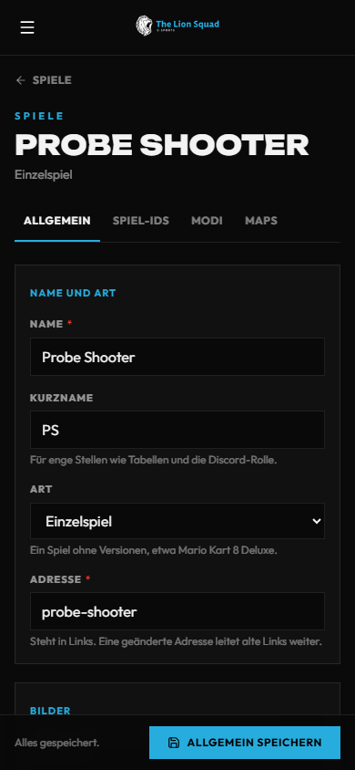

**Spiel-Daten pflegen:** Reiter **Modi**. Alles ist freiwillig:

| Feld | Wofür |
| --- | --- |
| **Modi und Dauer** | Je Modus eine Zeile mit Name, Zustand, Spieler je Seite, Ergebnisregel und Dauer; ein Klick klappt alle Felder auf, **Modus hinzufügen** legt eine neue, schon aufgeklappte Zeile an. **Minuten**, z. B. „Grand Prix 4 Rennen“ 12 Min. Der erste Modus ist die Vorgabe; im Turnier wählt **Spielmodus** einen anderen. **Minuten je Einzelspiel** heißt: die Minuten gelten pro Spiel, Best-of zählt mit. Die Minuten sind freiwillig: ein Modus nur für Maps (etwa „Stellung“ oder „Suchen & Zerstören“) bleibt ohne Dauer. Umbenennen behält die Zuordnung der Maps (siehe 3.14). |
| **Spieler je Lauf vor Ort / online** | Wie viele gleichzeitig an einer Station bzw. in einer Lobby spielen. Füllt bei Mehrspieler-Bäumen die **Spielgröße** vor. |
| **Best-of-Vorgabe** | Füllt **Best of** vor, wenn im Turnier das Spiel gewählt wird. |
| **Aufbau- und Wechselzeit** | Minuten je Spiel an der Station; kommt zur Dauer aus dem Modus dazu (nicht zu einer Dauer am Turnier). |
| **Geräte für Stationen** | Der Planer nimmt nur Stationen mit einem dieser Geräte (Switch, Switch 2, PC, PS5, Xbox …). Nichts gewählt: jede Station. Eine Station, die fest diesem Spiel zugeordnet ist, passt immer. |
| **Punktetabelle** | Punkte je Platz, z. B. `15, 12, 10, 9, 8, 7, 6, 5, 4, 3, 2, 1` oder `4-3-2-1`. Wird gespeichert; die Wertung rechnet noch nicht damit. |

**Je Modus mehr festhalten** (#2206): Die Zeile zeigt Name, **Zustand** (Aktiv, Inaktiv, Archiviert), Spieler je Seite,
die Ergebnisregel in Kurzform (etwa „Runden gewinnen: 6 Siege · Verlängerung“) und die Dauer; am Handy steht das in zwei
Zeilen. Ein Klick klappt die Zeile auf: Name, Zustand, Minuten und dazu:

| Feld | Wofür |
| --- | --- |
| **Zustand** | **Aktiv** (Vorgabe). **Inaktiv**: steht für neue Map-Pools, **Modus je Map** einer Season und den **Spielmodus** eines Turniers nicht mehr zur Wahl. **Archiviert**: dazu in allen Auswahllisten der Verwaltung ausgeblendet und an keiner Map neu wählbar. Was den Modus schon hat, behält ihn: laufende Spiele, gespeicherte Pools, alte Ergebnisse, die Reihenfolge einer Season und die Dauerplanung. |
| **Beschreibung** | Worum es im Modus geht, höchstens 500 Zeichen. Nichts Vertrauliches eintragen: Spiel-Daten sind über die Schnittstelle lesbar. |
| **Spieler je Seite** | 4 heißt 4 gegen 4. Leer: keine Vorgabe. |
| **Format** | Freitext bis 60 Zeichen, etwa die Regel-Variante. |
| **Symbol (quadratisch)** | Ein kleines Bild je Modus (#2266): **Bild hochladen**, **Medien wählen** (Bibliothek) oder **Entfernen**. Es steht vor dem Namen in der Modus-Zeile, an den Maps auf Match- und Ligaseite, im Meldeformular, im Map-Pool, bei **Modus je Map** der Season und im Regelwerk (im PDF nicht). Ohne Bild steht ein neutrales Symbol. Wer keine Medienrolle hat, nimmt eigene Bilder; SVG geht nur mit Medienrolle. Ein gespeicherter Map-Pool behält das Symbol von damals – ein neues Symbol erreicht ihn erst, wenn ihr den Pool neu speichert; bis dahin steht im Pool-Editor am Modus „Symbol geändert – mit dem nächsten Speichern übernommen“. Steht das Symbol in einem gespeicherten Pool oder einem veröffentlichten Regelwerk, lässt es sich in der Mediathek nicht löschen oder drehen. |
| **Ergebnisregel** | **Art**: Punkte bis zum Ziel, Runden gewinnen oder höherer Endstand gewinnt. Dazu **Ziel** (Punkte bzw. Runden zum Sieg), bei Runden ein **Rundenlimit**, ein **Zeitlimit je Map**, die **Zeit je Runde**, **Remis erlaubt** und **Verlängerung bei Gleichstand**. Zeiten gehen als `1:30`, `90 s` oder als Minuten (`10`); gespeichert wird in Sekunden, ältere Angaben in Minuten liest die Seite einfach weiter. Die Zeit je Runde ist nur eine Angabe für Regelwerk und Anzeige. Eine neue Liga-Season übernimmt die Regel als eigene Kopie und prüft damit jeden gemeldeten Endstand ([Liga leiten, 2.2](liga.md#22-liga-und-season-anlegen)); spätere Änderungen hier erreichen laufende Seasons erst, wenn die Leitung sie dort übernimmt. Andere Turniere prüfen damit nichts. |
| **Einstellungen** | Freie Liste je Modus (#2271), etwa Lobby-Einstellungen: je Zeile **Gruppe** (z. B. „Lobby“, „Spieler“), **Bezeichnung**, **Einheit** (Text, Sekunden, Minuten, Punkte, An/aus) und **Wert**; Sekunden gehen auch als `1:30`. Die Pfeile ändern die Reihenfolge, der Papierkorb entfernt eine Zeile; höchstens 40. Die Season übernimmt die Liste als Kopie und darf einzelne Werte ändern. |
| **Eigene Regeln** | Kurzer Regeltext je Modus (bis 1000 Zeichen), etwa „Die Uhr läuft nur, solange keine Seite die Zone hält.“ Steht im Regelwerk unter dem Modus. |

Werte eines bestimmten Titels sind nicht eingebaut; ihr tragt sie je Spiel selbst ein. Passt etwas nicht (Ziel fehlt,
Rundenlimit kleiner als das Ziel, `1:75` als Zeit …), sagt es die Seite vor dem Speichern.

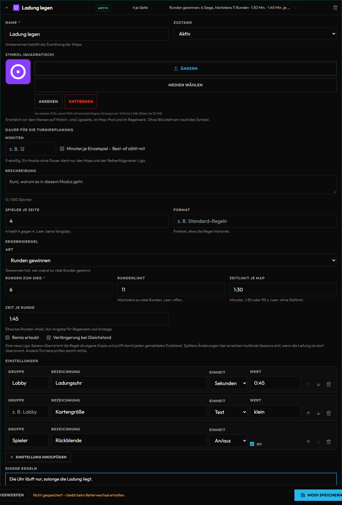

**In der Liga-Season:** Unter **Ergebnisregeln** der Season steht je Modus zusätzlich **Einstellungen und eigene Regeln** –
die Kopie aus dem Spiel. Weicht ein Wert ab, steht an der Zeile **weicht vom Spiel ab**; **Einstellungen vom Spiel
übernehmen** holt die Werte des Spiels. Bestehende Staffeln bekommen Änderungen mit **Vorgaben auf Staffeln übertragen**
(Gruppe „Ergebnisregeln, Einstellungen und Punktepflicht“). Im Regelwerk zeigt der Baustein **Einstellungen je Modus**
(`[[baustein:mode_settings]]`) Zeitlimit, Zeit je Runde, die Einstellungen als Tabelle und den Regeltext – im Web mit Symbol,
im PDF als Tabelle ohne Symbol.

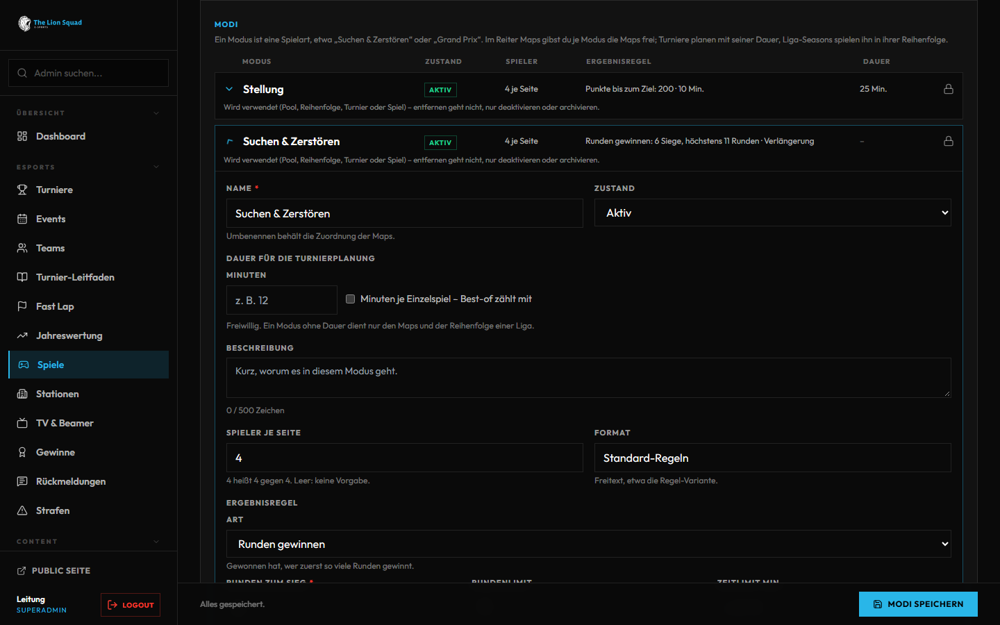

**Best-of als Erwartungswert:** Ist die Dauer **je Einzelspiel** angegeben, plant der Planer die Mitte aus kürzestem und
längstem Verlauf: Best of 1 = 1 Spiel, **Best of 3 = 2,5**, Best of 5 = 4, Best of 7 = 5,5 Spiele. Minuten = aufgerundet
(Spiele × Minuten je Spiel) + Aufbauzeit. Beispiel: 4 Minuten je Rennen, Best of 3, 3 Minuten Aufbau → 10 + 3 = **13 Min.**
Eine Dauer am Turnier, an der Phase oder am Spiel ist immer die ganze Dauer, ohne Multiplikation.

**Beispiel Mario Kart 8 Deluxe** (Vorschlag, nicht angelegt – so tragt ihr es selbst ein):

| Feld | Wert |
| --- | --- |
| Dauer je Modus | „Grand Prix 4 Rennen“ 12 Min. (Vorgabe) · „Einzelrennen“ 4 Min., Minuten je Einzelspiel |
| Spieler je Lauf vor Ort / online | 4 / 12 |
| Best-of-Vorgabe | keine (Grand Prix ist ein Lauf) |
| Aufbau- und Wechselzeit | 3 Min. |
| Geräte für Stationen | Switch (bei Mario Kart World: Switch 2) |
| Punktetabelle | `15, 12, 10, 9, 8, 7, 6, 5, 4, 3, 2, 1` (12er-Lobby) bzw. `4-3-2-1` (4 an einer Station) |

Im Turnier dann **Matchdauer** leer lassen: dort steht „vom Spiel: 15 Min. (Grand Prix 4 Rennen)“.

### 3.13 Plan B: auf Papier

Fällt am Event Netz oder Server aus, läuft das Turnier auf Papier weiter. Darum am **Vorabend** drucken:

- Auf **Turnierbaum**, **Rangliste**, **Spielplan**, **Teilnehmer** (nur mit Check-in-Recht) und beim Event (**Was läuft**
  bzw. **Anmeldungen & Einlass**) steht der Knopf **Drucken**. Er öffnet die Druckansicht – hell, ohne Menü – mit dem
  passenden Teil vorgewählt; **Zurück** führt wieder dorthin (sonst zur Turnierseite). Oben lassen sich die Teile an- und
  abhaken (Turnierbaum, Tabelle bzw. Rangliste, Spielplan, Check-in-Liste bzw. Tagesplan),
  Baum und Listen **quer** oder **hoch** stellen und der Spielplan **nach Zeit** oder **nach Station** ordnen. Erst
  **Drucken** dort schickt es an den Drucker; am Handy öffnet es das Druck- bzw. Teilen-Menü (als PDF sichern).
- **Baum:** A4 quer, Runde für Runde nebeneinander. Passt ein großer Baum nicht auf ein Blatt, geht er auf mehreren
  Seiten weiter – jede Spalte trägt ihren Rundennamen (wie im Web-Baum) und „1/2“, „2/2“. Winner Bracket, Loser Bracket,
  Grand Final und Läufe (FFA) haben je ihren Block; leere Kästchen rechts sind für das Ergebnis bzw. den Platz.
- **Tabelle:** bei Liga, Jeder gegen jeden, Schweizer System und Gruppen statt des Baums (deren Spieltage stehen im
  Spielplan) – Platz, Name und die Spalten der Rangliste, bei Gruppen je Gruppe ein Abschnitt. Diese Formate haben keinen
  Teil „Turnierbaum“; der Druck-Knopf am Baum öffnet die Tabelle. Beim K.-o. heißt der Teil **Rangliste** und ist nur
  auf Wunsch dabei.
- **Spielplan:** Zeit, Station, Spiel, Teilnehmer und ein leeres Feld zum Eintragen des Ergebnisses.
- **Check-in-Liste:** Kästchen zum Abhaken, Setzplatz, beim Event die Begleitpersonen, darunter die Warteliste. Nur mit
  Turnier-Recht – andere sehen den Teil gar nicht, und der Server gibt die Liste nur der Turnierleitung.
- Jede Seite trägt unten die **Druckzeit** („Stand 30.10. 19:12“) und einen **QR-Code** zur Live-Seite. Was auf Papier
  eingetragen wurde, später in der Turnierleitung nachtragen.

<table>
<tr><th>Baum auf A4 quer (Testdaten)</th><th>Spielplan mit Ergebnisfeldern (Testdaten)</th></tr>
<tr>
<td>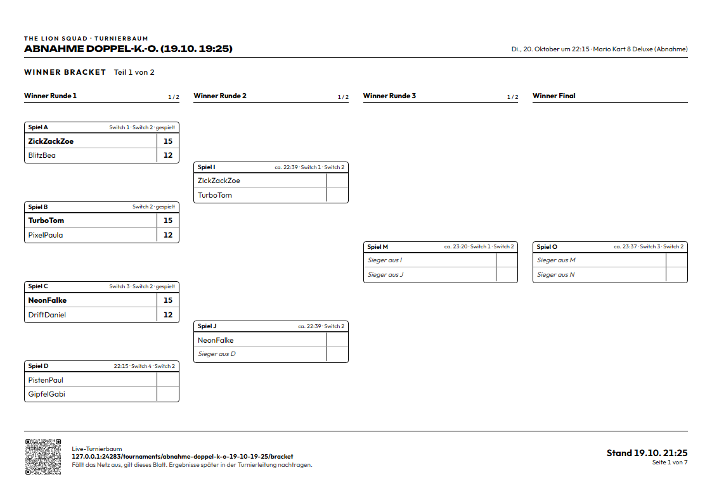</td>
<td>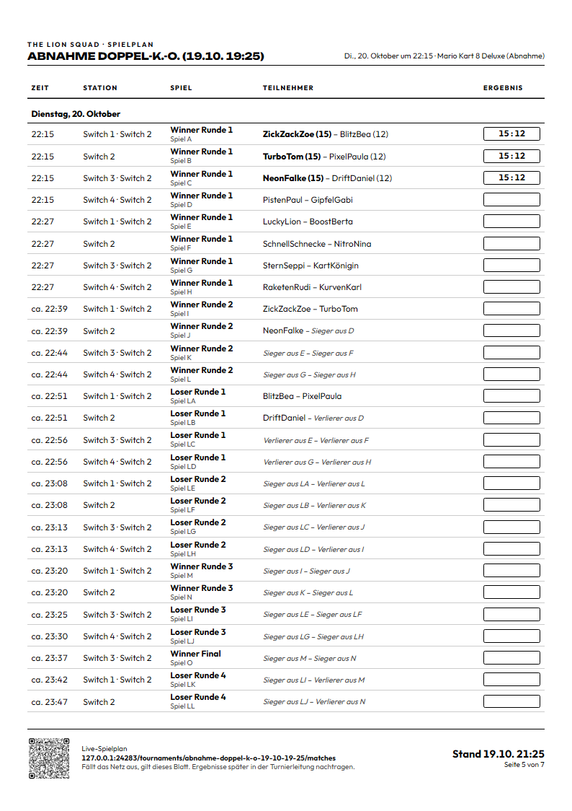</td>
</tr>
</table>

### 3.14 Maps und Map-Pools

**Map-Bibliothek je Spiel:** Spielseite (**Admin → eSports → Spiele → Zahnrad**), Reiter **Maps**. Die alte Adresse
`/admin/games/<Spiel>/maps` leitet dorthin weiter. Jedes Spiel und jede Spielversion hat seine eigenen Maps – eine neue
Version erbt keine, und gleiche Namen in zwei Spielen sind zwei verschiedene Maps. Eingebaut ist keine Map; ihr legt alle
selbst an. **Aus Spiel übernehmen** holt Maps aus einer anderen Version: Spiel wählen, Maps anhaken (schon vorhandene
sind gesperrt), übernehmen. Es entstehen eigene Maps dieses Spiels mit demselben Bild, die Modi nur soweit dieses Spiel
sie kennt.

Die Maps stehen als **Tabelle Map × Modus**: je Map eine Zeile mit Bild, Name und Slug, je Modus eine Spalte (darüber,
wie viele Maps dort freigegeben sind), dann **Zustand** mit „in N Pools“ und die Aktionen. **Häkchen = in diesem Modus
freigegeben**; nur dort lässt sich die Map in einen Pool wählen. Jedes Häkchen speichert sofort. Die Modi sind dieselben
wie im Reiter Modi (siehe 3.12) – kein zweites Modussystem. Hat das Spiel keine Modi, gibt es keine Spalten, und jede Map
gilt für jeden Pool; der Hinweis **Modi anlegen** führt in den Reiter Modi. Ein archivierter Modus hat nur eine Spalte,
solange eine Map ihn noch hat, und lässt sich dort nur abwählen. Am Handy bleibt der Name links stehen, die Spalten
wischt man seitlich.

**Map hinzufügen** öffnet das Blatt:

- **Name** und **Slug** (eindeutig im Spiel; bleibt beim Umbenennen gleich), **Bild** im Format 16 : 9 über
  **Hochladen** oder **Medien wählen** (nur eigene Uploads), **Notiz** und **Externe Kennung** (freiwillig).
- **Weitere Schreibweisen**, mit Komma getrennt – etwa wie ein Veranstalter die Map nennt. Darüber ordnet das
  Ergebnisblatt einer Team-Liga einen getippten oder eingefügten Namen der Map zu (siehe [Inhalte, Serien](inhalte.md)).
- **Freigegeben in:** die Modi für die neue Map. Danach ändert ihr sie in der Tabelle; das Blatt **Bearbeiten** (Stift)
  hat keine Modi mehr.
- In der Zeile ändern die Pfeile die **Reihenfolge**, das Pause-Symbol **deaktiviert** (und aktiviert wieder), das
  Archiv-Symbol **archiviert** (und holt zurück). *Inaktiv*: in keinen neuen Pool wählbar, wo sie schon steht, bleibt sie
  gültig und im Pool-Editor mit „inaktiv“ markiert. Vor dem Deaktivieren und Archivieren nennt eine Rückfrage die
  Liga-Seasons, in deren Pool die Map steht – nur als Hinweis. **Löschen** geht nur, solange die Map in keinem
  gespeicherten Pool und keinem Spiel stand – sonst archivieren.

<table>
<tr><th>Reiter Maps am PC (Testdaten)</th><th>Am Handy (Testdaten)</th></tr>
<tr>
<td>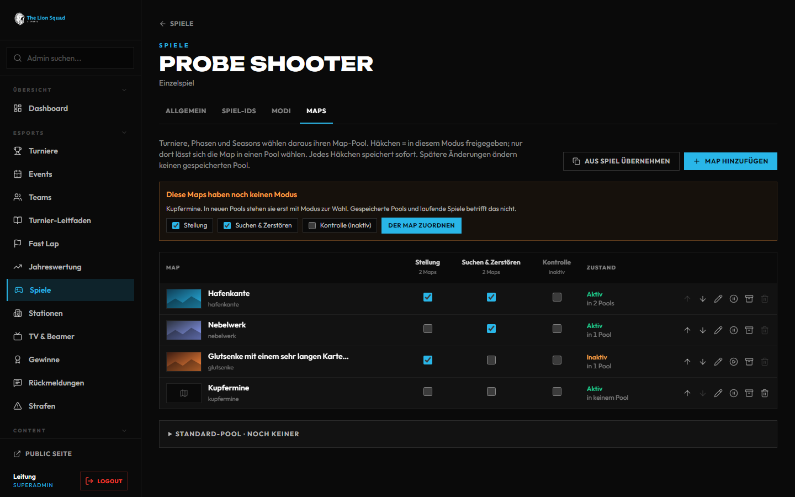</td>
<td>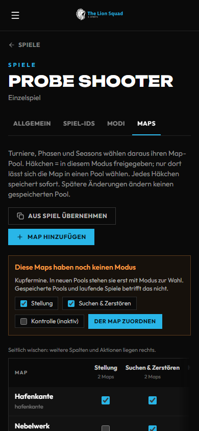</td>
</tr>
</table>

**Modi ändern, ohne etwas zu sperren:**

- **Modus entfernen** (Spielseite → Modi) geht nur bei einem **unbenutzten** Modus. Verwendet ist er, sobald
  er in einem Map-Pool (auch einer alten Version), in **Modus je Map** einer Season oder Staffel, als **Spielmodus** eines
  Turniers oder einer Phase, in einem Spiel oder Ergebnisblatt steht. Dann steht statt des Papierkorbs ein Schloss mit
  dem Hinweis „Wird verwendet – entfernen geht nicht, nur deaktivieren oder archivieren“; stellt den **Zustand** auf
  **Inaktiv** oder **Archiviert**. Auch direkt über die Schnittstelle lehnt der Server das Entfernen ab. Einen unbenutzten
  Modus entfernt der Papierkorb: Beim Speichern fragt die Seite mit der Zahl der betroffenen Maps nach, der Modus
  verschwindet dann auch aus den Maps.
- **Umbenennen** ändert nur den Namen. Die Kennung bleibt, Maps, Pools, Reihenfolgen und Spiele zeigen weiter auf den
  Modus. Gespeicherte Pools und gemeldete Spiele zeigen den Namen von damals.
- **Inaktiv** im laufenden Betrieb: Pools, die den Modus schon haben, gelten weiter, gemeldet wird weiter daraus. Erst ein
  neu gespeicherter Pool ohne ihn nimmt ihn heraus; der Pool-Editor nennt inaktive Modi („Inaktiv und hier nicht zur
  Wahl“). Steht der Modus in **Modus je Map** einer Season, ändert ihr zuerst die Reihenfolge: Einen Pool ohne diesen Modus
  nimmt die Season sonst nicht an.
- **Altbestand:** Ein Modus, der vor dieser Regel trotz Verwendung entfernt wurde, bleibt in gespeicherten Pools lesbar
  („Im gespeicherten Pool steht noch …“), gemeldet wird weiter aus dem gespeicherten Pool.
- **Erster Modus:** Sobald ein Spiel Modi hat, steht eine Map ohne Modus in keinem neuen Pool zur Wahl. Der Reiter Maps
  zeigt dann **Diese Maps haben noch keinen Modus**: Modi anhaken, **Allen … Maps zuordnen**, fertig. Auch der Pool-Editor
  weist darauf hin. Bestehende Pools ohne Modus gelten unverändert weiter.

**Standard-Pool je Spiel:** Im Reiter Maps unten unter **Standard-Pool** speichert ihr je Modus eine Auswahl. Sie ist
nur eine Vorlage: **Vorgabe des Spiels** lädt sie in Turnier, Phase, Season und Saison, gespeichert wird dort wie immer
ein eigener Stand. Gibt es keinen Standard-Pool, lädt der Knopf alle freigegebenen, aktiven Maps. Einen Standard-Pool zu
ändern oder zu entfernen, ändert keinen gespeicherten Pool.

**Map-Pool im Turnier:** Reiter **Maps** (nur bei Turnieren mit Spiel, für Turnierleitung und Strukturrollen). Je Modus
die Maps an- und abhaken, mit den Pfeilen sortieren; **Vorgabe des Spiels** lädt den Standard-Pool (ohne ihn alle
freigegebenen, aktiven Maps), **Übernehmen von …** startet mit dem Pool eines anderen Turniers oder einer Liga-Season
desselben Spiels, **Alle abwählen** leert die Auswahl, **Speichern** legt den Pool an. Darunter die **Phasen**: eine Phase
übernimmt den Pool des Turniers oder bekommt mit **Eigenen Pool festlegen** einen eigenen (etwa ein Finale mit anderen
Maps, **Übernehmen von … Pool des Turniers** als Startpunkt). **Pool entfernen** an der Phase lässt wieder den des
Turniers gelten. Die Turnierseite zeigt den Pool als Karten mit Bild, je Phase mit eigenem Pool einen weiteren Abschnitt.

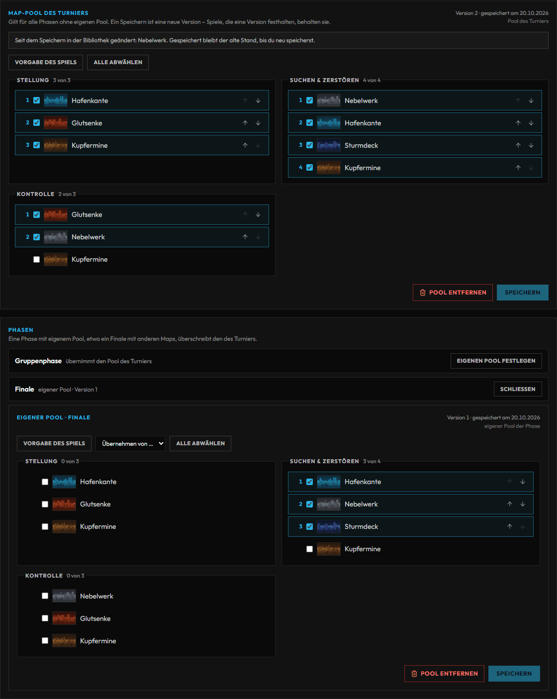

**Was gespeichert bleibt:** Jedes Speichern ist eine neue **Version** mit Namen und Bildern von diesem Moment.
Umbenennen, ein neues Bild oder Archivieren in der Bibliothek ändert keinen gespeicherten Pool und keine alten Spiele;
der Editor nennt die geänderten Maps („Seit dem Speichern in der Bibliothek geändert“), erst ein neues Speichern
übernimmt den neuen Stand. Zwei Turniere desselben Spiels haben getrennte Pools. Wechselt das Turnier das Spiel, gilt
der alte Pool nicht mehr und muss neu gewählt werden. Ein Turnier ohne Maps (etwa ein Solo-Cup) braucht nichts davon:
ohne Spiel gibt es keinen Reiter **Maps**, ohne Pool keinen Abschnitt auf der Turnierseite.

### 3.15 Liga anlegen

Eine Liga läuft über Wochen: **Liga** (je Spiel) → **Season** → **Liga 1, Liga 2 …** → **Staffel A, B …**. Jede Staffel
ist ein gewöhnliches Turnier im Format Liga – Spielwochen, Termine, Melden, Bestätigen und Tabelle laufen dort wie
gewohnt. Den Rahmen legst du unter **Admin → eSports → Liga** an (nur Turnierleitung mit Zwei-Faktor):

1. **Liga anlegen:** Name und Spiel, etwa „CoD-Liga“.
2. **Season anlegen:** nur der Beginn der ersten Spielwoche (00:00 Uhr Wien). Danach auf der Seite der Season die
   Vorgaben in ihren Reitern festlegen (Überblick, Spielbetrieb, Termine, Anmeldung und Kader, Tabelle, Regelwerk und Sperrliste,
   Ligen und Staffeln – Einzelheiten im [Liga-Handbuch, 2.2](liga.md#22-liga-und-season-anlegen)). Der Kalender im Reiter
   Termine zeigt nach dem Speichern, welche Wochen gesperrt sind (mehr als die Hälfte ihrer Tage in einer Sperrzeit)
   und wie viele Teams eine Staffel höchstens fassen kann.
3. **Modi und Maps der Season** im Reiter Spielbetrieb anhaken – jede neue Staffel bekommt eine Kopie des Map-Pools.
4. **Liga 1 anlegen**, bei Bedarf mit Beiname und eigenen Werten (Best of, Teamgröße, Mindestkader, Teams je Staffel,
   Punkte); leer heißt „wie die Season“.
5. **Staffel anlegen:** legt das Turnier als Entwurf mit allen Vorgaben an – ohne offene Anmeldung, ohne Discord, ohne
   Jahreswertung. Passt die Staffelgröße nicht in die Spielwochen (Season 1: acht Teams mit nur Hinrunde in acht
   Spielwochen), lehnt der Server ab und nennt die größte passende Staffel – die übrigen Teams kommen in eine zweite
   Staffel. Über **Turnierverwaltung · Co-Teams zuteilen** geht es weiter in das Turnier.

**Sichtbarkeit:** *Aus* (Vorgabe) zeigt nichts, *Nur Turnierleitung* nur euch, *Nur Mitglieder* und *Öffentlich* geben
Liga und Staffel-Turniere frei – die Sichtbarkeit gilt schon beim Speichern für alle Staffeln. Ändert ihr später etwas
anderes an der Season, tragen bestehende Staffeln noch die alten Werte, bis ihr **Vorgaben übertragen** drückt:
Regeltext und Map-Pool gehen immer (ein entfernter Pool verschwindet nur vor dem ersten Ergebnis), Termine und
Kalender nur vor dem Start, Best of, Teamgröße, Mindestkader, Punkte und Fristen nur vor dem ersten Ergebnis – was nicht mehr
geht, steht mit Grund da.

**Stand der Season:** Mit dem Start der ersten Staffel springt sie von selbst von *Entwurf* auf *Läuft* (steht im
Protokoll). Einen von Hand gesetzten Stand fasst das nicht an.

Staffeln zählen nicht für Jahreswertung, Turnier-Pokale, Löwen-Rang-XP für Teilnahme und Podest und die Team-Stufe;
gespielte und gewonnene Spiele zählen weiter. Auf Startseite, im öffentlichen Kalender und in der Turnierliste der
Website stehen sie nicht, im Profil und auf der Teamseite gekennzeichnet als „Liga · Staffel A“.

### 3.16 Liga: Ergebnis je Map melden (für Captains)

In der Liga melden **Captain oder Vertreter** des Co-Teams (ohne beide die Teamleitung) – auf der Matchseite im Web:

1. **Melden:** je gespielter Map den Modus (steht fest, wenn die Season eine Reihenfolge vorgibt), die **Map aus dem
   Pool** antippen und den **Endstand** der Map eintragen (in neuen Seasons Pflicht, sonst freiwillig). Den **Sieger**
   ergeben die Punkte; antippen muss man ihn nur bei Gleichstand oder wenn keine Punkte eingetragen sind. An jeder Map steht, wie sie gewertet wird, etwa „Gewertet: bis 250 Punkte · 10 Min.“ oder „6 Runden,
   höchstens 11“. Passt ein Endstand nicht dazu oder nicht zum Sieger, steht das gleich unter den Maps, etwa „Map 2: höchstens
   11 Runden – 7:5 sind 12.“ Die nächste Map erscheint, sobald die letzte einen Sieger hat – bis die
   Serie entschieden ist. Am Schluss einmal ankreuzen, **wer bei euch gespielt hat** (mindestens 3, bei Wechseln auch mehr; ältere Staffeln stellen stattdessen je Map auf).
   Ein Map-Veto gibt es nicht im System; ihr tragt ein, was gespielt wurde.
2. **Bestätigen:** die Gegenseite sieht die Maps in Worten, kreuzt ihre Teilnehmer an und tippt
   **Stimmt**. Stimmen Maps oder Sieger nicht, bitte **Stimmt nicht** – das ist der Einspruch, die Leitung
   entscheidet. Aus der App geht nur das Bestätigen (ohne Liste); eine erste Meldung lehnt die App mit „Bitte im
   Web mit Maps und Teilnehmerliste melden“ ab.
3. **Ohne Antwort** gilt die Meldung nach 48 Stunden (spätestens am Ende der Spielwoche) mit ihren Maps und ihrer Liste.
4. **Teilnehmerliste nachtragen:** wer aus der App oder durch die Automatik ohne Liste dasteht, sieht auf der
   Matchseite „Teilnehmerliste fehlt noch“ und trägt sie nach – bis 48 Stunden ab der Bestätigung, danach entscheidet die Liga-Leitung. Das Ergebnis bleibt gültig.

Beim **Bestätigen** gelten die Punkte der ersten Meldung – ihr müsst sie nicht noch einmal eintippen.

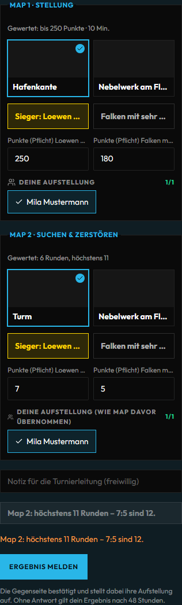

Geprüft wird: Best of (keine Map nach der Entscheidung), der Endstand je Map gegen Sieger und Ergebnisregel der Season
([Liga leiten, 2.2](liga.md#22-liga-und-season-anlegen)), Map im Pool und für den Modus freigegeben, auf der Liste nur
der eigene Kader und nur, wer spielberechtigt ist (**Spiel-ID**, Alter, Wartezeit, siehe
[Liga leiten, 3.7](liga.md#37-spiel-ids-im-kader) und [3.9](liga.md#39-spielberechtigung-regeln-je-season)), nie jemand auf beiden Seiten und **kein Doppel-Einsatz** – niemand spielt am selben Spieltag für
zwei Teams derselben Season.
Die Leitung trägt Maps im Ergebnis-Fenster mit den Listen beider Seiten ein oder korrigiert sie mit Grund;
„Rückgängig“ nimmt die Maps und Listen mit dem Ergebnis zurück.

### 3.17 Hinweis der Turnierleitung an alle

In der Turnierleitung am Handy (`/tournaments/<Name>/leitung`) steht der Reiter **Hinweis**. Dort schreibt ihr einen
kurzen Satz (höchstens 140 Zeichen) an alle im Turnier:

1. Eine **Vorlage** antippen – „Pause bis …“ (mit Uhrzeit in einer Viertelstunde), „Finale an PC 1“ oder „Bitte zum
   Check-in“ – oder selbst schreiben.
2. **An wen**: „Dieses Turnier“ oder „Ganzes Event“ (alle Turniere des Events; nur wer alle diese Turniere leitet). Darunter
   steht, an wie viele Personen er geht.
3. **Steht für**: 30 Minuten bis 8 Stunden, Vorgabe 2 Stunden.
4. Haken **Auch am TV zeigen**, wenn der Hinweis am Turnierbaum-TV und an der Hallen-Tafel stehen soll.
5. Bei „Pause bis 14:30“ gibt es den Haken **Turnier gleich pausieren bis 14:30**: Er setzt den Status „Pausiert“
   mit **Pause bis** (3.9), der TV zeigt dann den Pause-Bildschirm. Nur wer den Turnierstatus wechseln darf, sieht ihn.
6. **Hinweis senden**.

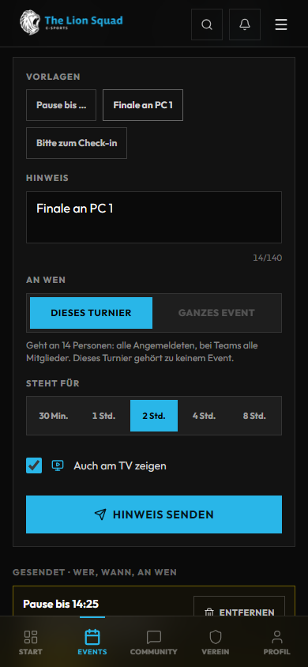

Der Hinweis kommt als Benachrichtigung „Hinweis der Turnierleitung“ zu allen Angemeldeten – bei Teams zu allen
Mitgliedern –, über Glocke, Push und Discord, je nach den Einstellungen der Person (Thema „Turnier-Updates“). Abgemeldete,
Warteliste und gesperrte Konten bekommen nichts. Oben auf der Turnierseite (beim Ziel „Ganzes Event“ auf der Event-Seite
und allen Turnierseiten des Events) steht er als Banner mit Uhrzeit und Restzeit, bis er abläuft oder ihr ihn entfernt.
Banner und TV zeigen nie, wer geschrieben hat.

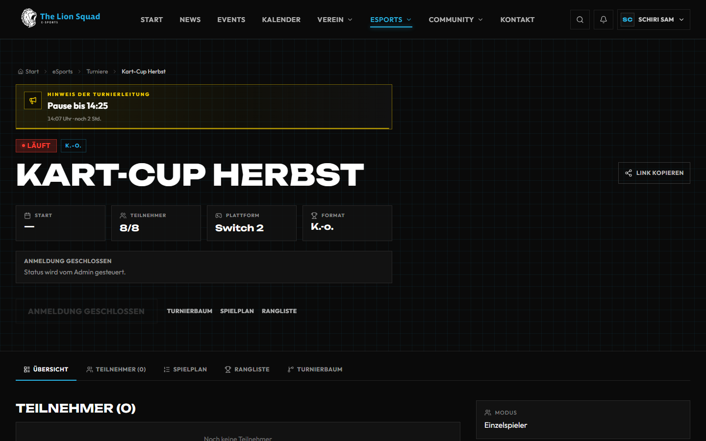

Unter dem Formular steht, was schon hinausging: Text, Uhrzeit, wer, an wen, wie viele benachrichtigt wurden, und ob er
noch steht. **Entfernen** nimmt ihn von Banner und TV; die Benachrichtigungen bleiben. Ein Doppeltipp auf „Senden“ oder
ein zweiter Versuch nach einem Netzfehler schickt nichts doppelt.

---

## 4. Wenn etwas nicht klappt

| Fehlerbild | Ursache | Lösung |
| --- | --- | --- |
| Statt der Verwaltung steht „2FA einrichten“, „Neues Turnier“ fehlt | Turnierleitung ohne bestätigte Zwei-Faktor-Anmeldung | Zwei-Faktor einrichten und neu anmelden ([Erste Schritte](admin.md)) |
| Im Admin sind nur dein Turnier und wenige Knöpfe da | Du bist Helfer mit Einsatz | Gewollt. Mehr Rechte gibt der Bereich Turnierleitung |
| „Anmeldung für dieses Turnier geschlossen“ | Der Status ist nicht **Anmeldung offen** | Status ändern |
| „Anmeldung ist noch nicht geöffnet“ / „bereits beendet“ | Außerhalb von **Anmeldung öffnet / endet** | Zeiten im Reiter Bearbeiten ändern |
| „Anmeldung für dieses Turnier ist deaktiviert“ | **Nur Einladung** oder „Öffentliche Anmeldung erlauben“ aus | Haken ändern oder Speziallink nutzen |
| „Bitte bestätige, dass du das Startgeld übernimmst“ | Das Turnier kostet Startgeld | Haken beim Anmelden setzen |
| „Dieses Turnier ist für externe Teilnehmer vorgesehen …“ | Haken „Vereinsmitglieder ausschließen“ | Ausschalten oder Teilnehmer von Hand eintragen |
| Spieler kommt nicht ins Turnier, steht auf Warteliste | Das Turnier ist voll | **Max Spieler** erhöhen oder die Person auf Bestätigt setzen |
| Check-in-Knopf der Spieler ist grau („Check-in vor Ort“) | Das Turnier ist **Vor Ort** | Die Turnierleitung checkt ein |
| „Bei Vor-Ort-Turnieren macht die Turnierleitung den Check-in.“ | Dasselbe | wie oben |
| „Inzwischen ist … nachgerückt – kein freier Platz mehr“ | Nach **Nicht erschienen** ist jemand von der Warteliste nachgerückt, das Turnier ist voll | In der Verwaltung entscheiden: einen Platz frei machen (etwa die nachgerückte Person zurück auf die Warteliste), dann zurücksetzen |
| „Erst freigeben …“ beim Check-in | Die Anmeldung ist noch **Ausstehend** | In der Verwaltung freigeben, dann im Reiter **Check-in** abhaken |
| Teilnehmer lässt sich nach Check-in-Start nicht entfernen | Der Baum ist fix | **Nicht erschienen** setzen und mit „Ersetzt Nicht-Erschienen“ einen Ersatz hinzufügen |
| „Die Anmeldung steht im festen Turnierbaum …“ | Entfernen, Ablehnen oder Warteliste für jemanden mit festen Spielen | Vor dem Start **Nicht erschienen** und ersetzen, im laufenden Turnier **Austritt eintragen** oder **Disqualifizieren** |
| „Turnierstruktur: Der Turnierbaum steht seit dem Ende des Check-ins fest …“ (auch Teilnahme, Spieler pro Team, Spiel) | Der Check-in ist zu Ende oder es gibt feste Spiele | So weiterspielen; neu aufbauen nur über **Zurücksetzen** |
| „Der Turnierbaum steht schon fest (…). Eine Vorschau ersetzt keine echten Spiele …“ | **Vorschau** oder **Struktur anwenden** über festen Spielen | Erst **Zurücksetzen**, dann neu aufbauen |
| „Das Turnier ist vorbei – der Turnierbaum bleibt, wie er gespielt wurde …“ | Zurücksetzen, neu aufbauen, Gruppen oder Schweizer Runde nach dem Ende | Gewollt. Einzelne Ergebnisse mit **Ergebnis korrigieren** |
| „In Runde N hat schon ein Spiel begonnen …“ | **Runde zurücknehmen**, obwohl ein Spiel läuft, gemeldet ist oder an einer Station hängt | Station freigeben bzw. Ergebnis korrigieren; die Runde bleibt |
| „Turnier kann ohne spielbares Match nicht gestartet werden.“ | Es gibt keine Spiele | Struktur prüfen (Bearbeiten → Speichern & Struktur anwenden), Teilnehmer bestätigen |
| „Turnierplanung enthält Konflikte“ beim Starten | Doppelte Stationen, Zeiten, … | Konflikte beheben oder in der Rückfrage „Trotzdem live“ |
| Turnierbaum leer („Turnierbaum noch nicht erzeugt“) | Keine Struktur oder zu wenig Teilnehmer | Teilnehmer bestätigen, Struktur anwenden. Beim Schweizer System **Schweizer Runde** klicken |
| Zeitfahren oder Rennserie ohne Spiele | Gewollt – diese Formate bekommen im Turnier keine Spiele | Zeitfahren über [Fast Lap](fastlap.md), Rennserien über Serien |
| „Löschen geht nur bei Entwürfen …“ / „Das Turnier hat schon Ergebnisse …“ | Löschen eines angekündigten, laufenden oder beendeten Turniers bzw. eines mit Ergebnissen | Absagen (Status **Abgesagt**) oder archivieren |
| „Min. Teilnehmer darf nicht größer als Max. Teilnehmer sein.“ | Min über Max eingetragen | Werte anpassen |
| Unter Matchplan fehlt **Ergebnis eintragen** | Das Turnier ist nicht **Live**/**Pausiert**, oder eine Seite steht noch nicht fest | Status prüfen, Vorrunde beenden |
| „Für dieses Spiel kannst du kein Ergebnis eintragen.“ | Dir fehlt das Ergebnis-Recht im Einsatz | Rolle im Reiter **Team** prüfen |
| „Bitte kurz den Grund der Korrektur angeben“ | Ein vorhandenes Ergebnis lässt sich nur mit Grund ändern | Grund eintragen (mindestens fünf Zeichen) |
| Ergebnis gespeichert, der Baum rückt nicht weiter | Noch die 10 Sekunden **Rückgängig** | Kurz warten |
| „Nur eine Seite kann ‚Nicht erschienen‘ oder ‚Aufgegeben‘ haben.“ | Beide Schalter gesetzt | Einen davon aus |
| Turnier ist gesperrt, nichts lässt sich ändern | **Sperren** nach dem Ende | **Entsperren** in den Werkzeugen |
| „Turnierleitung darf nur operative Status setzen“ | Ein Helfer wollte einen anderen Status | Statuswechsel macht die Turnierleitung |
| „Dieser Vor-Ort-Code gilt nicht (mehr)“ nach dem Scannen | Zugang abgeschaltet, erneuert oder außerhalb des Zeitfensters | Kasten **Vor-Ort-Anmeldung über QR** prüfen; nach **Neuer Code** den Aushang neu drucken |
| Gast hat sich registriert, sieht das Turnier aber nicht („nicht sichtbar“) | Die Bestätigungs-Mail wurde in einem anderen Browser geöffnet (etwa in der Mail-App) – dort fehlt der Vor-Ort-Zugang | Im Browser angemeldet bleiben und den QR-Code dort **neu scannen** |
| Dashboard zeigt „Turnier-Anmeldungen: warten auf Freigabe“ | Von Hand eingetragene Anmeldungen mit Status **Ausstehend** | Im Reiter Teilnehmer auf **Bestätigt** setzen |

---

## 5. Häufige Fragen

**Muss ich jede Anmeldung freigeben?**
Nein. Selbstanmeldungen sind sofort **Bestätigt**, solange Platz ist. Nur von Hand eingetragene mit Status **Ausstehend**
warten.

**Wann wird der Turnierbaum fix?**
Mit dem Ende des Check-ins (3.4). Bis dahin ist er eine Vorschau, die bei jeder An- und Abmeldung neu gemischt wird;
danach stehen auch Format, Teilnahme und Spiel fest (3.1).

**Der Leitfaden sagt, ich erzeuge den Baum „mit den Anwesenden“ – stimmt das?**
Nicht ganz: Der Baum entsteht beim Start des Check-ins aus allen Bestätigten und Eingecheckten. Wer nicht erscheint,
setzt ihr danach auf **Nicht erschienen** und ersetzt ihn, oder das Spiel geht mit **Nicht erschienen** im
Ergebnis-Fenster aus.

**Heißt es Walkover oder Nicht erschienen?**
In der Oberfläche „Nicht erschienen“ (im Ergebnis-Fenster). „Walkover“ steht nur noch im Leitfaden.

**Wie trage ich ein Ergebnis am Handy ein?**
Öffentliche Turnierseite → Link **Turnierleitung** (sichtbar, wenn du Ergebnisse eintragen darfst) → **Ergebnisse** →
**Eintragen**.

**Kann ich einen Fehler beim Ergebnis zurücknehmen?**
Sofort: ja, 10 Sekunden lang mit **Rückgängig**. Später: **Ergebnis korrigieren** mit Grund.

**Können Spieler ihr Ergebnis selbst melden, obwohl wir vor Ort spielen?**
Nur wenn ihr **Ergebniserfassung** auf „Beide Parteien melden“ oder „Hybrid“ stellt. Bei „Vor Ort“ trägt die
Turnierleitung ein.

**Wie bekomme ich einen Spieler nach der Anmeldefrist noch hinein?**
Reiter **Teilnehmer → Teilnehmer hinzufügen**, oder ein **Speziallink**.

**Wo stelle ich ein, wie viele Punkte das Turnier für die Jahreswertung gibt?**
Unter **Bearbeiten → Erweiterte Spieloptionen → Jahreswertung**. Gutgeschrieben werden sie bei **Ergebnisse
veröffentlicht**.

**Was passiert beim Löschen eines Turniers?**
Löschen geht nur bei **Entwürfen ohne Ergebnisse** (keine gewerteten Spiele, Pokale, Jahrespunkte oder Gewinne) – in
der Liste das rote Papierkorb-Symbol. Mit dem Turnier gehen Anmeldungen, Vorschau, Gruppen, Map-Pool, Chat und
Ergebnisfotos; Stationen bleiben und verlieren nur die Zuordnung. Ein angekündigtes, laufendes oder beendetes Turnier
sagt ihr ab (Status **Abgesagt**) oder archiviert es. Jede Löschung steht im Protokoll (Betrieb & Logs →
Adminaktionen, Schnellfilter **Turniere**) – wie Anlegen, Speichern und jeder Wechsel des Anmeldestatus.
