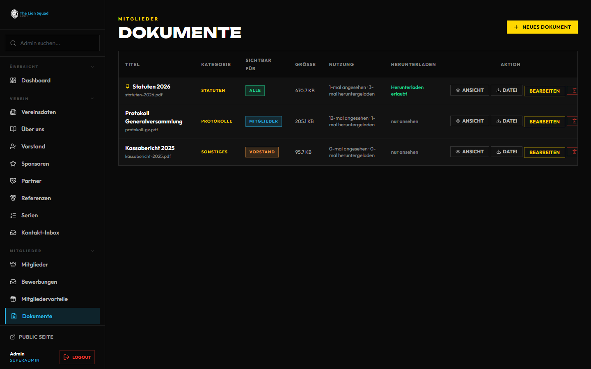
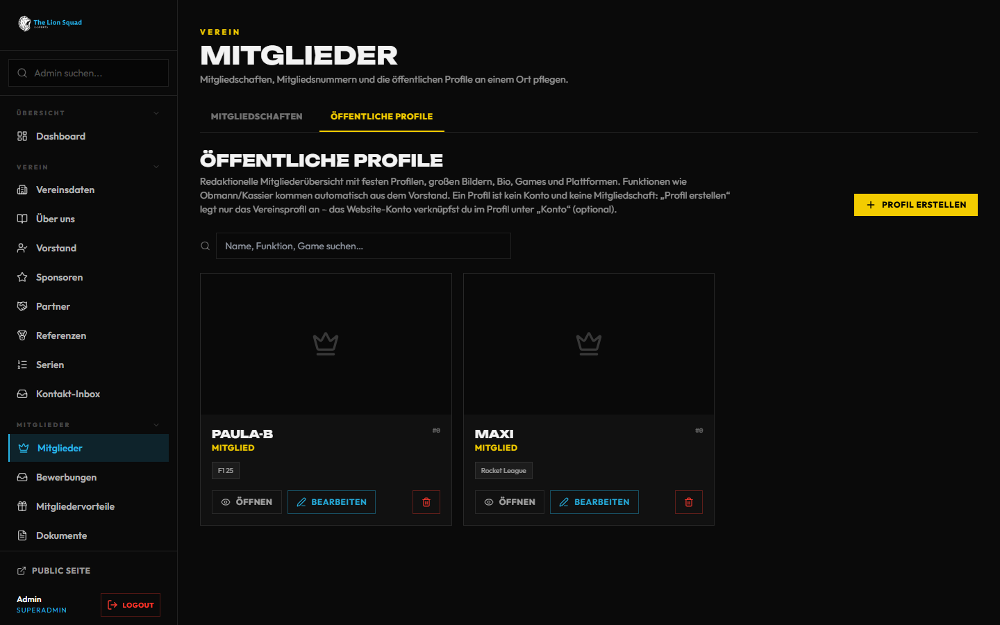

# Verein und Mitglieder – Handbuch

Alles rund um die Mitgliedschaft: wie jemand Mitglied wird, was Mitglieder im Mitgliederbereich finden (Karte, Versammlungen,
Helferdienste, Unterlagen), wie ihr den Vorstand auf der Website zeigt und wer was pflegt. Die Technik dahinter
(Anbindung an die Mitgliederverwaltung Dolibarr) steht im [Dolibarr-Kapitel](../DOLIBARR.md); hier steht, was ihr klickt.

**Wo im Admin:**

- **Admin → Mitglieder → Mitglieder** (`/admin/members`) – Reiter **Mitgliedschaften** und **Öffentliche Profile** (die Profile im öffentlichen Verzeichnis, direkt: `/admin/members?tab=profiles`)
- **Admin → Mitglieder → Bewerbungen** (`/admin/membership-applications`) – Anträge, Einladungen, die Seite „Mitglied werden“
- **Admin → Mitglieder → Mitgliedervorteile** (`/admin/benefits`) – Vorteile für Mitglieder
- **Admin → Mitglieder → Dokumente** (`/admin/documents`) – Vereinsdokumente wie Statuten und Protokolle
- **Admin → Mitglieder → Einlass (Versammlung)** (`/admin/einlass`) – Mitgliedskarte am Eingang scannen
- **Admin → Mitglieder → Alle Benutzer** – Konten, Rollen, Sperren, (siehe Kapitel „Erste Schritte im Admin“)
- **Admin → Mitglieder → Dolibarr** – Verbindung zur Mitgliederverwaltung, siehe [Dolibarr](../DOLIBARR.md)
- **Admin → Verein → Vorstand** (`/admin/board`) – Posten und Stellvertretungen
- **Admin → Verein → Kontakt-Inbox** (`/admin/contact`) – Nachrichten aus dem Kontaktformular

Wer das sieht: der Bereich **Vereinsverwaltung** (auch, wer einen aktiven Vorstandsposten hält). Dolibarr sehen zusätzlich
„System“. **Vereinsdaten** (`/admin/club`): Stammdaten und Kontakt pflegt die Vereinsverwaltung; Rechtstexte, Hosting und Preisturniere ändert nur „System“.

Öffentlich: **/verein** (alles vom Verein an einem Ort), **/about**, **/board** (Vorstand), **/members** (Verzeichnis),
**/membership/join** („Mitglied werden“), **/membership/apply** (Antrag).

---

## Inhalt

1. [Überblick: was alles geht](#1-überblick-was-alles-geht)
2. [Einrichten Schritt für Schritt](#2-einrichten-schritt-für-schritt)
3. [Die Funktionen einzeln](#3-die-funktionen-einzeln)
4. [Wenn etwas nicht klappt](#4-wenn-etwas-nicht-klappt)
5. [Häufige Fragen](#5-häufige-fragen)

---

## 1. Überblick: was alles geht

| Funktion | Was passiert | Einstellen unter |
| --- | --- | --- |
| **Mitglied werden** | Seite mit vier Vorteilen, Beiträgen aus Dolibarr und dem Knopf „Antrag stellen“ | Admin → Mitglieder → Bewerbungen, Kasten „Seite „Mitglied werden““ |
| **Antrag** | Online-Antrag mit Mitgliedsart, Nachricht und Einwilligungen | Bewerbungen |
| **Einladung zum Antrag** | Der Vorstand lädt ein Konto gezielt ein | Bewerbungen, „+ Zum Antrag einladen“ |
| **Mitgliederbereich** | Karte, Versammlungen, Helferdienste, News, Dokumente, Vorteile | `/members/area` (für Mitglieder) |
| **Mitgliedskarte** | Karte mit Prüfcode, auch als Bild und ohne Netz | Meine Mitgliedschaft |
| **Vorstand** | Posten, Stellvertretung, „Wir suchen …“ | Admin → Verein → Vorstand |
| **Statuten** | Geltende Fassung als PDF für alle oder nur für Mitglieder | Dolibarr → Funktionen bzw. Dokumente |
| **Versammlungen** | Einladung, Tagesordnung, Anträge, Abstimmung; Einlass per Karte | Dolibarr (Vereinsakte), Einlass |
| **Helferdienste** | Schichten bei Veranstaltungen, Anfrage und Bestätigung | Dolibarr (Vereinsakte), Mitgliederbereich → Helfen |
| **Persönliche Unterlagen** | Bestätigungen und Schreiben nur für dich | Profil → „Nur für dich“ → Deine Unterlagen |
| **Mitgliederverzeichnis** | Öffentliche Profile mit Foto, Spielen, Plattformen | Mitgliederprofile, oder aus Dolibarr per Einwilligung |
| **Wunschnummer** | Jedes Mitglied sucht sich einmal eine eigene Nummer aus, etwa fürs Trikot | Meine Mitgliedschaft; Admin → Mitglieder → Reiter Nummern |

---

## 2. Einrichten Schritt für Schritt

1. **Dolibarr anbinden**, wenn ihr eine Mitgliederverwaltung habt: [Dolibarr](../DOLIBARR.md). Ohne Anbindung geht alles
   auch von Hand, aber Beiträge, Versammlungen, Helferdienste und persönliche Unterlagen kommen nur mit Dolibarr.
2. **Seite „Mitglied werden“ füllen:** Admin → Mitglieder → Bewerbungen, Kasten **Seite „Mitglied werden“**: vier Vorteile
   (Symbol und ein Satz) und ein Satz, wofür der Beitrag verwendet wird. **Speichern**. Die Beiträge selbst kommen aus Dolibarr
   und werden nur dort gepflegt.
3. **Vorstand besetzen:** Admin → Verein → Vorstand (3.4).
4. **Statuten bereitstellen:** entweder in Dolibarr freigeben, oder Admin → Mitglieder → Dokumente → **Neues Dokument** in der
   Kategorie **Statuten** (3.5).
5. **Öffentliche Profile:** Admin → Mitglieder → Mitglieder → Reiter **Öffentliche Profile** → **Profil erstellen** (3.10). Mit Dolibarr entstehen sie über
   die Einwilligung von selbst.
6. **Testen:** mit einem Test-Konto den Weg „Mitglied werden“ bis zum Antrag durchgehen (3.1).

---

## 3. Die Funktionen einzeln

### 3.1 Mitglied werden: der Weg für Interessierte

1. Wer neu ist, **registriert** sich und ist damit Community-Spieler.
2. Auf **Mitglied werden** (`/membership/join`) stehen eine Mitgliedskarte als Muster, der Knopf **Antrag stellen**, vier
   Vorteile, **Was kostet das?** (die Mitgliedsarten mit Beitrag aus Dolibarr; antwortet Dolibarr nicht, der letzte Stand mit
   Datum, sonst „Die Beiträge nennen wir dir im Antrag“) und **Was wir vom Rudel erwarten**.
3. Im **Antrag** (`/membership/apply`) wählt die Person die **Mitgliedsart**, füllt die Felder aus, die der Verein in Dolibarr
   verlangt (ohne Dolibarr: eine Nachricht mit mindestens 20 Zeichen), und setzt die Haken **Vereinsstatuten** und
   **Datenschutzerklärung**. Freiwillige Einwilligungen sind getrennt und nie Pflicht. Dann **Antrag einreichen**.
4. Danach sieht die Person den Stand: **Antrag in Prüfung**, **Antrag wird übermittelt**, **Du bist Mitglied** oder
   **Antrag abgelehnt**. Mit **Antrag zurückziehen** nimmt sie ihn zurück und kann später einen neuen stellen, auch ohne Dolibarr. Es gibt pro
   Konto einen Antrag.
5. Entscheiden kann der Vorstand in der **Mitgliederverwaltung (Dolibarr)**. Die Person bekommt immer eine Mail und eine Meldung. Nach der Aufnahme
   erscheinen Mitgliedsnummer und Karte.

Ohne Mitgliedschaft schickt eine Seite des Mitgliederbereichs auf **Mitglied werden** und sagt, warum.

### 3.2 Anträge bearbeiten und einladen

**Admin → Mitglieder → Bewerbungen.** Reiter: **Offen**, **Aufgenommen**, **Abgelehnt**, **Zurückgezogen**, **In Übermittlung**, **Fehlgeschlagen** (Dolibarr hat den Antrag nicht angenommen, der Grund steht dabei).

- Jeder Antrag zeigt den Stand und den nächsten Schritt in einem Satz.
- **Annehmen**, **Ablehnen** (mit Begründung) und **Zurückziehen** gibt es nur, wo **die Website entscheidet**. Annehmen vergibt die Mitgliedsnummer (eine bestehende bleibt), nimmt die Art aus dem Antrag und schreibt den Verlauf. Die Person bekommt immer eine Mail und eine Meldung, auch wenn sie Mitgliedschafts-Mails ausgeschaltet hat; was du dazuschreibst, steht darin. Die Rückmeldung nach dem Klick sagt, ob die Mail unterwegs ist. Der Push nennt nur den ersten Satz der Begründung, den vollen Text gibt es in Mail und Glocke. Läuft der
  Antrag über Dolibarr, öffnet **In Dolibarr öffnen** den Eintrag; dort wird entschieden, die Website zeigt den Stand von selbst.
- **In Übermittlung** heißt: gespeichert, aber noch nicht bei Dolibarr. Die Website versucht es weiter.
- **+ Zum Antrag einladen:** Konto suchen (nur Konten **ohne** Mitgliedschaft), optional eine persönliche Zeile, **Einladen**. Die
  Person bekommt einen Hinweis auf der Website und in der App (und eine Mail, wenn sie Mitgliedschafts-Mails zulässt). Eine
  Einladung läuft nach **30 Tagen** ab; offene lassen sich in der Liste der Einladungen **zurückziehen**. Wer schon eingeladen
  ist, steht mit Datum da.
- Einladen darf nur die Vereinsverwaltung.
- Eine neue Bewerbung meldet die Website per Mail an alle mit der Vereinsverwaltung: Vorstand, Freigaben, Club-Admin, Superadmin.

### 3.3 Der Mitgliederbereich

Für aktive Mitglieder und Ehrenmitglieder: Benutzermenü → **Mitgliederbereich** (`/members/area`). Oben die Karte mit
Name, Nummer, „Mitglied seit“ und Beitragsstand, darunter die **Sprungleiste**: **Karte**, **Versammlung**, **Helfen**,
**News**, **Dokumente**, mit der Zahl dessen, was offen oder neu ist („Versammlung · 1 offen“). „Neu“ heißt: in den letzten
zwei Wochen erschienen. Weiter unten stehen nur Abschnitte, in denen etwas ist: Versammlung, offene Abstimmung, freie
Helferdienste, Vereinsdokumente, Mitgliedervorteile, Ansprechpartner, „Gerade in Steam“ (nur Mitglieder mit verknüpftem Konto
und Einwilligung), „Discord jetzt“ (nur Zahlen, nie Namen) und die Discord-Server des Vereins.

Dieselben Zahlen stehen an den Kacheln auf **/verein** und im Tab „Verein“ der App. Interne Events stehen nicht hier, sondern
unter Events (gold markiert) und im Kalender. Eigene Rechnungen und eigene Unterlagen gehören zum Konto (Profil → „Nur für dich“).

**Wer ist Mitglied?** Aktive Mitglieder und Ehrenmitglieder sowie, wer Vereinsverwaltung oder System hat. Ein Konto muss dafür
einem Mitgliedseintrag zugeordnet sein (Dolibarr → Zuordnungen, oder das Mitglied nutzt auf „Meine Mitgliedschaft“ **Zuordnung
anfragen** bzw. den Einladungscode vom Vorstand). Eine Mitgliedsnummer allein reicht nicht.

**Meine Mitgliedschaft** (`/members/membership`): Karte, Mitgliedsart, „Mitglied seit“, Funktion im Verein, mit Dolibarr **Austritt
erklären** (mit Wunschdatum, der letzte Tag wird in der Mitgliederverwaltung gerechnet), ohne Dolibarr eine einfache **Austrittserklärung** (mit Wunschtermin; sie geht an den Vorstand, die Person bleibt Mitglied, bis er den Status auf „Ehemalig“ setzt, und kann sie bis dahin zurücknehmen; der Vorstand bekommt beides per Mail), **Meine Einwilligungen**
(auch in der App; **Ich stimme zu** erst nach dem Lesen der Fassung, **Widerrufen** jederzeit, der Text der zugestimmten Fassung bleibt lesbar), der eigene Eintrag im Mitgliederverzeichnis
(**Im Mitgliederverzeichnis zeigen**, Gamertag, Spiele, Plattformen, Kurztext, **Eintrag speichern**) und der Schalter **Mitgliedsnummer öffentlich zeigen**: Das entscheidet nur das Mitglied, Standard ist aus.

### 3.4 Vorstand und Stellvertretungen

**Admin → Verein → Vorstand.** Eine Liste der Posten mit **Besetzen** bzw. **Ändern**.

- **Besetzen** über die Personensuche – nur **Vereinsmitglieder**. Vorher steht ein Satz, welche Rechte der Posten bringt (wer
  einen aktiven Posten hält oder vertritt, bekommt die **Vereinsverwaltung**), und eine Rückfrage bestätigt. Jede Besetzung steht
  im Protokoll. Besetzen dürfen Vereinsverwaltung und System. Die Person bekommt eine Meldung, auch wenn sie den Posten verliert.
- **Aktivieren und Deaktivieren** entscheidet ebenfalls über die Vereinsverwaltung: erst nach einer Rückfrage, die die Inhaber nennt. Anlegen, Ändern, Aktivieren und Löschen stehen im Protokoll.
- **Stellvertretung:** Bei Posten mit „Vertretung erlaubt“ lässt sich eine Vertretung eintragen und mit **Vertretung entfernen** wieder
  streichen. Offene Stellvertretungen zeigt die Vorstandsseite nicht.
- **Posten bearbeiten:** Bezeichnung (männlich, weiblich optional – „Obmann“ oder „Obfrau“ richtet sich nach dem Geschlecht im
  Profil), Beschreibung, Aktiv/Inaktiv, **Vertretung erlaubt**. Löschen steht unter „Mehr“. Ein Mitgliederprofil, an dem ein Posten hängt, lässt sich nicht löschen und nicht auf ein anderes Konto umhängen: zuerst den Posten neu besetzen. Dasselbe Löschen sperren Referenzen und Serien.
- **Wir suchen …:** Ist ein Posten offen, zeigt die Vorstandsseite „Wir suchen …“ mit dem Satz zum Aufwand, den ihr je Posten
  eintragt (zum Beispiel „Zwei Stunden im Monat, Einschulung inklusive.“).
- **Fotos** kommen aus den Mitgliederprofilen; am schönsten freigestellt, sonst stehen sie einheitlich in Vereinsfarben.
- **Mit Dolibarr:** Führt Dolibarr den Vorstand („Vereinsdaten aus Dolibarr übernehmen“, Schalter unter Admin → Dolibarr →
  Funktionen), ist die Liste nur zum Lesen. Kommen die Rechte aus den Funktionen in Dolibarr, ist ein Posten hier nur für die
  Anzeige. Details: [Dolibarr](../DOLIBARR.md), [Rollen](../ROLLEN.md).

### 3.5 Statuten

- **Mit Dolibarr:** Gibt der Verein die Statuten im Modul für die Öffentlichkeit frei, zeigt die Vorstandsseite die geltende
  Fassung als PDF, dazu frühere und künftige Fassungen. Den Entwurf kennt die Website nie.
- **Ohne Dolibarr:** Ein Dokument der Kategorie **Statuten** unter Admin → Mitglieder → Dokumente (angepinnt oder das neueste,
  nie ein internes).
- Der Schalter **Statuten öffentlich zeigen** steht unter Admin → Dolibarr → Funktionen, ab Werk an. Aus: Die Statuten stehen nur im
  Mitgliederbereich unter Vereinsdokumente.
- Der Link **Vereinsstatuten** im Antrag führt auf genau diese Fassung.

### 3.6 Vereinsdokumente, Vorteile und Persönliches

- **Dokumente:** Admin → Mitglieder → Dokumente → **Neues Dokument**: Datei, Titel, Kategorie (Statuten, Protokolle, Formular,
  Regelwerk, Leitlinie, Download, Media Kit, Präsentation, Vorlage, Sonstiges), **Sichtbarkeit** (**Mitglieder** oder **Vorstand**), Tags und der Haken **Download
  erlauben** (Standard ist nur die Ansicht im Browser). Mitglieder finden sie unter **Vereinsdokumente**.
  Die Liste sagt es in Worten: die Plakette **Alle**, **Mitglieder** oder **Vorstand** zeigt, wer ein Dokument sehen darf;
  darunter steht, wie oft es angesehen und heruntergeladen wurde („1-mal angesehen · 3-mal heruntergeladen“) und ob
  **Herunterladen erlaubt** ist oder es **nur ansehen** gibt. Gesperrte Downloads öffnet, wer die Vereinsverwaltung hat. Am Handy stehen die Dokumente als Karten.
  **Löschen** nimmt die Datei vom Server mit, außer etwas anderes braucht sie noch (auch ein Link in einem Text zählt); dasselbe gilt für die alte Datei, wenn du eine neue hochlädst. Ist sie gerade gesperrt, holt der Aufräum-Job das nach (Betrieb → Checks). Anlegen, Ändern und Löschen stehen im Protokoll.

  
- **Mitgliedervorteile:** Admin → Mitglieder → Mitgliedervorteile: Titel, Text, Link, Gültigkeit, **Sichtbar für Mitgliedsarten**
  (leer = alle), **Aktiv**. Mitglieder sehen sie im Mitgliederbereich und in der App, nur innerhalb von **Gültig von/bis** (beide Tage zählen mit); in der Verwaltung steht dann „abgelaufen“ oder „noch nicht gültig“.
- **Persönliche Unterlagen** (Bestätigungen, Schreiben) legt der Vorstand in der Vereinsakte in Dolibarr ab; das Mitglied
  findet sie im eigenen Profil unter **Nur für dich → Deine Unterlagen** (`/account/documents`). Voraussetzung ist die bestätigte
  Zuordnung des Kontos zum Mitgliedseintrag. Ohne sie steht dort, wie die Verbindung klappt.

### 3.7 Versammlungen, Abstimmungen und Einlass

Alles kommt aus der Vereinsakte in Dolibarr; die Website zeigt und reicht durch, sie hat keine eigene Wahl.

- **Mitglieder:** Mitgliederbereich → **Versammlungen & Abstimmungen**: Einladung, Tagesordnung, **Ich komme** / **Vielleicht** /
  **Ich komme nicht**, Anträge zur Tagesordnung (mit Frist der Statuten), das eigene Stimmrecht, Abstimmung (die Stimme wird vor
  dem Senden bestätigt und lässt sich danach nicht ändern; welche Antwort jemand gab, speichert die Website nirgends) und das
  Ergebnis, sobald die Versammlungsleitung es bestätigt. Zu- oder Absage ist keine Anwesenheit. Ein Knopf trägt die Versammlung
  in den Kalender ein.
- **Einlass:** Admin → Mitglieder → **Einlass (Versammlung)** am Handy öffnen und die Mitgliedskarte scannen, ohne Karte die
  Mitgliedsnummer tippen. Einlassen darf, wer am Tag im Vorstand ist. Mit mehreren Geräten am Eingang stimmen die Zahlen zur
  Beschlussfähigkeit überall: Die Seite lädt alle 10 Sekunden nach. Einrichtung und Grenzen: [Dolibarr](../DOLIBARR.md).

### 3.8 Helferdienste

Mitgliederbereich → **Helfen** (`/members/helfen`): Veranstaltungen mit Schichten aus der Vereinsakte. **Ich helfe** fragt an,
**Anfrage zurückziehen** nimmt sie zurück. „Angefragt“ heißt: Der Vorstand bestätigt; gezählt wird, was als geleistet
bestätigt ist. Absagen nach der Bestätigung gehen an den Vorstand. Die eigene Schicht lässt sich in den Kalender eintragen.
Schichten und Plätze legt der Verein in Dolibarr an. Ein Helfer-Aufruf führt direkt zur Veranstaltung.

### 3.9 Mitgliedskarte

Unter **Meine Mitgliedschaft** (Web) und in der App unter Mehr → Mitgliederbereich → Mitgliedskarte. Ein Partner scannt den
QR-Code; die Prüfseite zeigt ohne Anmeldung nur: gültig oder nicht, Vorname mit Anfangsbuchstabe, Mitgliedsart, gültig bis.
Der Code gilt fünf Minuten und erneuert sich, ein Foto davon nützt nichts. **Als Bild speichern** legt die Karte ohne Prüfcode
ins Album; ohne Netz zeigt die Seite die zuletzt geladene Karte mit „Stand“. Die Karte gilt, solange die Mitgliedschaft aktiv ist.
Apple und Google Wallet gibt es noch nicht. Mehr: [Dolibarr](../DOLIBARR.md).

### 3.10 Mitgliederverzeichnis und Profile

**Admin → Mitglieder → Mitglieder → Reiter Öffentliche Profile** (seit #1365 die einzige Stelle; die alte Adresse
`/admin/member-profiles` öffnet den Reiter, die Menüsuche „Profile“ findet ihn): Redaktionelle Profile mit großem Bild, Bio, Games und
Plattformen. **Profil erstellen** legt nur das Vereinsprofil an; ein Profil ist **kein Konto und keine Mitgliedschaft**. Das
Website-Konto verknüpft ihr im Profil im Kasten **Konto** (optional). Funktionen wie Obmann oder Kassier kommen automatisch aus
dem Vorstand. Mit Dolibarr kommen Mitglieder mit Einwilligung von selbst ins Verzeichnis (`/members`).

**Streamer oder Creator des Vereins:** Im Profil (Abschnitt **Person**, unter dem Kasten **Konto**) setzt ihr das Häkchen für
alle, die der Verein als Streamer oder Creator führt. Hat die Person ihr Twitch-Konto **per Anmeldung** verknüpft
(Einstellungen → Verbindungen, nicht nur den Namen eingetippt), bekommt sie damit den Erfolg **Verifizierter Streamer** –
gleich nach dem Speichern über die Warteschlange. Das Häkchen dürfen alle mit dem Bereich **Vereinsverwaltung** setzen; es steht
wie jede Änderung am Profil im Protokoll. Wegnehmen nimmt den Erfolg nicht zurück; das geht nur unter Erfolge → Vergeben
([Erfolge](erfolge.md), 3.3).

**Admin → Mitglieder → Mitglieder** (Reiter **Mitgliedschaften** und **Öffentliche Profile**): Die Liste zeigt höchstens 500 Konten und sagt es, wenn es mehr sein können. Der **CSV-Export** (aktive Mitglieder oder auch ehemalige) enthält Nummer, Name, Benutzername, E-Mail, Status, Art, Beginn und Aufgabe im Verein, keine Notizen, und steht im Protokoll; führt Dolibarr die Mitglieder, gibt es ihn dort. Daneben führt **Offene Bewerbungen (N)** zu den Anträgen; der Filter **Entwurf (Dolibarr)** erscheint nur, wenn es solche Entwürfe gibt. Ein **Statuswechsel** kommt mit Rückfrage: Sie nennt die Mail, die hinausgeht; nach einem Fehlklick lässt sich der Haken **Person informieren** abwählen. Eine neue Notiz löst keine Mail aus. Hat ein Mitglied den Austritt erklärt, steht das in der Liste und im Blatt. Hält die Person einen Vorstandsposten, geht der Wechsel auf einen nicht aktiven Status erst, wenn der Posten neu besetzt ist; sonst behielte sie die Vereinsverwaltung. Suche
nach Name, E-Mail oder Mitgliedsnummer; **Mitgliedschaft bearbeiten**. Führt Dolibarr die Mitgliedschaft, kommen Status, Art,
Nummer und Beginn von dort und lassen sich hier nicht ändern; **interne Notizen** (sieht das Mitglied nicht) und die interne
Rolle bleiben hier. Ob die Mitgliedsnummer öffentlich ist, entscheidet das Mitglied selbst; das Blatt zeigt nur den Stand.

### 3.11 Kontakt-Inbox

**Admin → Verein → Kontakt-Inbox:** Nachrichten aus dem Kontaktformular. Du siehst zuerst, was **offen** ist (Neu und In Bearbeitung).

- **Suchen und filtern:** Das Suchfeld sucht in Name, Adresse, Betreff und Text. Die Kacheln zeigen je Status die Zahl, ein Klick filtert. „Mir zugewiesen“ und „Ohne Zuständige“ grenzen weiter ein.
- **Zuständig:** In der Nachricht wählst du, wer sich kümmert. Zur Auswahl steht, wer die Vereinsverwaltung hat.
- **Antworten:** Text ins Feld **Antwort** schreiben und **Antwort senden** wählen. Die Mail geht über die Warteschlange an die Adresse der Anfrage, der Wortlaut steht danach im **Verlauf** mit Name und Zeit, der Status ist **Beantwortet**. Spam bekommt keine Antwort – erst **Kein Spam** ordnet die Nachricht ein. Den Text der Mail stellst du unter System → E-Mail-Vorlagen ein („Kontakt: Antwort“). Sie lässt sich nicht abbestellen, weil die Person gefragt hat.
- **Interne Notiz:** Speichert beim Verlassen des Felds, nur wenn sich etwas geändert hat. Sie steht nie in der Mail.
- **Fehlermeldungen:** Über „Fehler melden“ auf einer Fehlerseite kommen Seite, Gerät und Version mit. Die Person sieht das vor dem Absenden.
- **Löschen** ist endgültig, auch für die Kopien der Mails.
- **Aufbewahrung:** Erledigte Anfragen (Beantwortet oder Geschlossen) löscht die Website nach 365 Tagen, Spam nach 30 Tagen, je ab dem letzten Statuswechsel. Einstellen kann das „System“ unter **Betrieb → Alarme**. Offene laufen nicht ab.

Dazu die Benachrichtigung „Kontaktanfragen“ in der Kommandozentrale. Das Thema **Rechnung** ist der Weg aus „Meine Rechnungen“ zum Kassier: Solche Anfragen landen hier, gib sie an den Kassier weiter.

### 3.12 Wunschnummer (#2034)

**Für Mitglieder – Meine Mitgliedschaft → Meine Nummer:** Freie Nummer im Raster antippen oder eintippen; die Seite sagt sofort,
ob sie frei ist (wer eine Nummer hat, steht nirgends). Mit
**Nummer festlegen** und der Bestätigung gehört sie dir. Jede Nummer gibt es im Verein nur einmal. Danach änderst du sie nicht
mehr selbst, sondern stellst mit **Andere Nummer beantragen** einen Antrag – mit kurzer Begründung und, wenn du magst, einer
Wunschnummer. Öffentlich ist die Nummer nicht: Sie sehen nur du und der Vorstand.

**Trikotdruck (#2150):** Druckt ein Artikel im Shop die Vereinsnummer, nimmt die Bestellung deine Wunschnummer – aber nur,
wenn du bei diesem Artikel den Haken zur Einwilligung setzt. Ohne Haken, ohne festgelegte Nummer oder ohne Mitgliedschaft
geht die Bestellung nicht. Die Nummer gibst du dabei nicht ein: Die Website nimmt die hier festgelegte. Auf dem Artikel ist
sie dann für alle sichtbar; in der Bestellung sehen sie nur du und die Finanzen.

**Für den Vorstand – Admin → Mitglieder → Mitglieder → Reiter Nummern** (`/admin/members?tab=numbers`):

- **Liste:** alle Mitglieder mit Nummer, wer sie gewählt hat, und ob sie schon in Dolibarr steht. **Verlauf** zeigt jede Änderung.
- **Offene Anträge:** *‹Nummer› freigeben* trägt die Wunschnummer ein, *Neuwahl erlauben* gibt die alte frei und das Mitglied
  wählt einmal selbst neu, *Ablehnen* lässt alles, wie es ist. Eine Begründung sieht das Mitglied. Neue Anträge melden sich per
  Mail an den Vorstand und – wenn eingeschaltet – im Vorstandskanal auf Discord („Antrag auf eine andere Nummer“).
- **Ändern / Vergeben** trägt direkt eine Nummer ein, **Neuwahl** gibt die Nummer frei.
- **Regeln:** Bereich (Vorgabe 0 bis 99), reservierte Nummern und der Name des Feldes in Dolibarr (Vorgabe `trikotnummer`).

Frei wird eine Nummer **sofort** – beim Austritt, bei der Kontolöschung und bei jedem Wechsel. Eine Sperrfrist gibt es nicht.

**Dolibarr einrichten (einmalig):** In Dolibarr unter *Einrichtung → Module/Anwendungen → Mitglieder* (Zahnrad) den Reiter
*Ergänzende Attribute (Mitglieder)* öffnen und ein neues Attribut anlegen: Bezeichnung „Trikotnummer“, Code `trikotnummer`
(genau wie unter Regeln), Typ *Ganzzahl*. Für das Schreiben braucht die Website unter **Dolibarr → Verbindung** die Erlaubnis zu
schreiben. Fehlt das Feld oder ist Dolibarr nicht erreichbar, bleibt die Nummer auf der Website gesichert; der Abgleich trägt sie
alle zehn Minuten nach, sofort mit **Nach Dolibarr übertragen**. Steht in Dolibarr schon eine Nummer beim Mitglied, übernimmt die
Website sie beim ersten Öffnen. Wird die Zuordnung zu einem Dolibarr-Mitglied gelöst oder gewechselt, behält das Konto seine
Nummer: beim bisherigen Mitglied wird sie in Dolibarr gelöscht, beim neuen eingetragen.

---

## 4. Wenn etwas nicht klappt

| Fehlerbild | Ursache | Lösung |
| --- | --- | --- |
| „Gerade nicht möglich – die Mitgliederverwaltung ist im Moment nicht erreichbar“ beim Antrag | Dolibarr antwortet nicht | Später noch einmal; der Antrag geht nicht verloren |
| Antrag steht auf „In Übermittlung“ | Gespeichert, aber noch nicht bei Dolibarr | Warten, die Website versucht es weiter; Stand unter Bewerbungen → In Übermittlung |
| Bei einem Antrag fehlt **Annehmen** | Der Antrag läuft über Dolibarr | **In Dolibarr öffnen** und dort entscheiden |
| Eine Person findet ihre Unterlagen nicht | Konto ist keinem Mitgliedseintrag zugeordnet | Dolibarr → Zuordnungen bestätigen, oder Einladungscode unter Meine Mitgliedschaft |
| „Die Website darf im Vereinsmodul noch nicht im Namen der Mitglieder handeln“ | Recht beim API-Benutzer fehlt | In Dolibarr einrichten ([Dolibarr](../DOLIBARR.md)) |
| Mitgliederbereich leitet auf „Mitglied werden“ | Das Konto ist kein aktives Mitglied | Mitgliedschaft und Zuordnung prüfen |
| In „Zum Antrag einladen“ findet die Suche niemanden | Gesucht werden nur Konten ohne Mitgliedschaft | Anderen Namen versuchen |
| Einladung ist weg | Sie ist nach 30 Tagen abgelaufen | Neu einladen |
| Eine Person lässt sich nicht als Vorstand eintragen | Es geht nur mit Vereinsmitgliedern | Erst Mitgliedschaft klären |
| Vorstandsliste ist nur lesbar | Dolibarr führt den Vorstand | In Dolibarr ändern |
| Statuten fehlen auf der Vorstandsseite | Nicht freigegeben, oder der Schalter ist aus | Freigabe in Dolibarr oder Dokument „Statuten“ prüfen |
| Karte zeigt „Prüfcode braucht Netz“ | Kein Netz | Gewollt, der Code braucht Verbindung |
| Beim Einlass „nicht eingeladen“ oder „kein Vorstand heute“ | Das Vereinsmodul entscheidet das | Einladung und Funktion in Dolibarr prüfen |
| Nummern: „In Dolibarr fehlt beim Mitglied das ergänzende Attribut …“ | Das Feld ist in Dolibarr nicht angelegt, oder der Code weicht ab | Attribut anlegen (3.12) oder den Feldnamen unter Regeln anpassen, dann **Nach Dolibarr übertragen** |
| Nummern: „Die Website darf nicht nach Dolibarr schreiben“ | Schreiben ist ausgeschaltet | Dolibarr → Verbindung: Schreiben erlauben |
| Nummern: „Konto ist keinem Dolibarr-Mitglied zugeordnet“ | Zuordnung fehlt | Dolibarr → Zuordnungen bestätigen; die Nummer wird dann nachgetragen |
| Nummern: „Nur in Dolibarr“ zeigt Einträge | In Dolibarr steht eine Nummer bei einem Mitglied ohne Website-Konto | Gewollt: die Nummer gilt als vergeben |

---

## 5. Häufige Fragen

**Können Mitglieder ohne Dolibarr verwaltet werden?**
Ja, mit der Mitgliederverwaltung der Website. Beiträge, Versammlungen, Helferdienste und persönliche Unterlagen gibt es aber nur mit Dolibarr.

**Wer entscheidet über Anträge?**
Der Vorstand. Mit Dolibarr in Dolibarr; sonst über Annehmen oder Ablehnen unter Bewerbungen.

**Wo ändere ich die Beiträge?**
In Dolibarr. Die Seite „Mitglied werden“ liest sie nur.

**Sieht die Turnierleitung Mitgliederdaten?**
Nein, das ist die Vereinsverwaltung.

**Kann die Website in Wallets speichern?**
Noch nicht, nur Karte in App und Web.

**Wer sieht „Nur Mitglieder“-Inhalte?**
Aktive Mitglieder, Ehrenmitglieder und Vereinsverwaltung oder System. Die Turnierleitung als Rolle allein reicht nicht.
